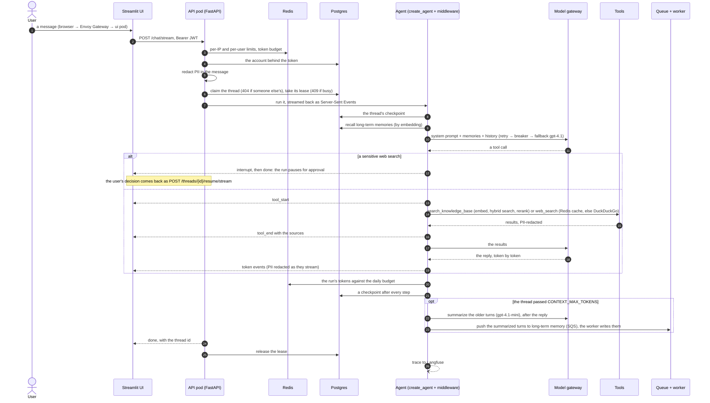

# agentic-ai-chatbot

An agentic chatbot with RAG and web search tools, human-in-the-loop approvals, PII detection and masking, short-term and long-term memory, accounts with rate limits, and traces, metrics and alerts.

The phase plans and as-built docs are in [docs/](docs/); the [Status](#status) table links them, and [Docs](#docs) lists the rest. The agent is LangChain's `create_agent` with middleware, using the built-ins wherever LangChain has one.


## Status

| Phase | What it adds | Status |
| --- | --- | --- |
| [1. Foundation](docs/phase-1-foundation.md) | FastAPI service, streaming chat, Streamlit UI, Langfuse tracing, logging | Built |
| [2. Tools](docs/phase-2-tools-rag-web-search.md) | Knowledge base search (hybrid vector + full-text, reranked) and DuckDuckGo web search | Built |
| [3. Short-term memory](docs/phase-3-short-term-memory-checkpointing.md) | Threads checkpointed to Postgres, resume and time travel, summarization of old turns, retention | Built |
| [4. Approvals](docs/phase-4-human-in-the-loop.md) | `HumanInTheLoopMiddleware`: risky tool calls wait for a person | Built |
| [5. PII redaction](docs/phase-5-pii-detection-masking.md) | Emails, cards, phones and IPs redacted from messages, tool results, replies and the stream | Built |
| [6. Long-term memory](docs/phase-6-long-term-memory.md) | Per-fact memories per user across threads: pushed at the token breach, after 30 idle minutes, or on request; recalled each turn, closest to the message | Built ([PR #7](https://github.com/Anirudh1905/agentic-ai-chatbot/pull/7)) |
| [7. Eval gate](docs/phase-7-eval-gate.md) | Golden sets, a judge model (DeepEval) and a regression gate on every PR | Built ([PR #8](https://github.com/Anirudh1905/agentic-ai-chatbot/pull/8)) |
| [8. Security and observability](docs/phase-8-security-observability.md) | Accounts and login (JWT), your own model key, Redis rate limits and token budgets, deleting a user's data, trace metadata, Prometheus metrics, a Grafana dashboard and alerts | Built ([PR #9](https://github.com/Anirudh1905/agentic-ai-chatbot/pull/9)) |
| [9. Reliability and deployment](docs/phase-9-reliability-deployment.md) | Kubernetes (kind): 2 API replicas behind Envoy Gateway, memory pushes on an SQS queue run by a worker, CloudNativePG, kube-prometheus-stack, a kind smoke test in CI; retries, circuit breakers and a fallback model, a per-thread lock, Postgres backups with a tested point-in-time restore; prompt caching measured, caps on context, a web search cache; a load test, an outage test and a runbook | Built, with the outage test passed and a runbook (on `phase-9-reliability-deployment`); the load test runs with no errors but misses its p95 latency target |

`make check` runs ruff, mypy and the tests (289 at the moment: unit, and integration against the cluster's Postgres, ElasticMQ and Redis). `make eval` runs the eval suites against the real model and writes `tests/evals/report.json`, which CI checks on every PR (see [Evals](docs/development.md#evals)).

## Quickstart

The stack runs on a local Kubernetes cluster ([kind](https://kind.sigs.k8s.io/)); Langfuse runs beside it in Docker Compose. Requires [uv](https://docs.astral.sh/uv/), Docker, kind, kubectl, Helm and [Tilt](https://docs.tilt.dev/install.html).

```bash
cp .env.example .env        # add OPENAI_API_KEY (and OPENAI_BASE_URL for a gateway)
echo "JWT_SECRET=$(openssl rand -hex 32)" >> .env   # signs login tokens; without it every request gets 401
uv sync --all-groups
make cluster                # once: the kind cluster, Envoy Gateway, CloudNativePG (+ its backup plugin and
                            # cert-manager), kube-prometheus-stack
make secrets                # the cluster's Secret and trust store, from .env and this machine
make tilt                   # Langfuse, the image, Postgres (backed up to MinIO), Redis, ElasticMQ, migrations,
                            # the reranker model, sample docs, 2 API pods, the worker and the chat UI
```

Tilt's dashboard is at http://localhost:10350; it only ever deploys to the `kind-chatbot` context. Open the chat UI, create an account and log in. From there:

| Service | URL |
| --- | --- |
| Chat UI (Streamlit) | http://localhost:8088 |
| API (both pods) | http://localhost:8088/api (OpenAPI docs at `/api/docs`) |
| Grafana (the Chatbot dashboard) | http://localhost:8088/grafana/d/chatbot |
| Langfuse (tracing) | http://localhost:3000, login `dev@local.test` / `password` |

The rest (Prometheus, Alertmanager, Postgres, pgweb, Redis, ElasticMQ, MinIO), and running without Kubernetes, are in [Development](docs/development.md#services).

Try asking "Can I return a tent I bought at 40% off?" (answered from the sample docs) or "What's the latest news about REI?" (web search).


The answer cites the refund policy, lists its sources, and uses two long-term memories from an earlier conversation (the sidebar's "What I remember about you"). The bookmark button beside the reply saves it to memory.

## How it works

- **The agent** is LangChain's `create_agent` with middleware: it answers from the knowledge base (hybrid vector and full-text search, reranked) and the web (DuckDuckGo), citing its sources.
- **Conversations** are threads checkpointed in Postgres, summarized once they're long; **long-term memory** keeps small facts about each user across threads.
- **Approvals:** a web search that mentions an internal term waits for a person. **PII** (emails, cards, phones, IPs) is redacted from messages, tool results, replies and the stream.
- **Accounts:** login with a JWT, per-user and per-IP rate limits, a daily token budget, and deleting your data.
- **Reliability:** model calls are retried, then fall back to `gpt-4.1`; circuit breakers skip a provider that's down; one run at a time per thread; Postgres is backed up with point-in-time restore.

A chat, end to end (`POST /chat/stream`; the browser talks to Streamlit through the gateway, and Streamlit calls the API inside the cluster):




Every endpoint's flow is in [API](docs/api.md), and each feature in [How it works](docs/how-it-works.md).

## Observability

Traces go to Langfuse, metrics to Prometheus with 13 alerts, and the "Chatbot" dashboard in Grafana charts them. Here it is under `make load` with 5 users: no errors, p95 time to first token 13.7 to 18.5 s, held back by the CPU reranker ([Load test](docs/phase-9-reliability-deployment.md#load-test)):


## Docs

| Doc | What's in it |
| --- | --- |
| [How it works](docs/how-it-works.md) | Accounts and limits, the knowledge base, web search, conversations, approvals, long-term memory, what the model sees each turn, PII, logs, tracing, metrics, reliability and cost |
| [API](docs/api.md) | Every endpoint, the checks each request passes, and each endpoint's flow as a diagram |
| [Configuration](docs/configuration.md) | Every setting, its default and what it does |
| [Development](docs/development.md) | The repository layout, the local services, evals and the make targets |
| [Runbook](docs/runbook.md) | What to do when the model provider, a backup or the cluster fails, a run is stuck, or PII leaks |
| Phase docs (the [Status](#status) table) | How each phase was designed and built, what changed, and how it was tested |
