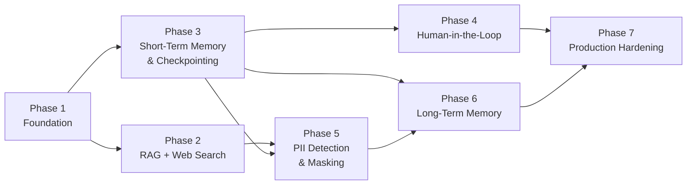
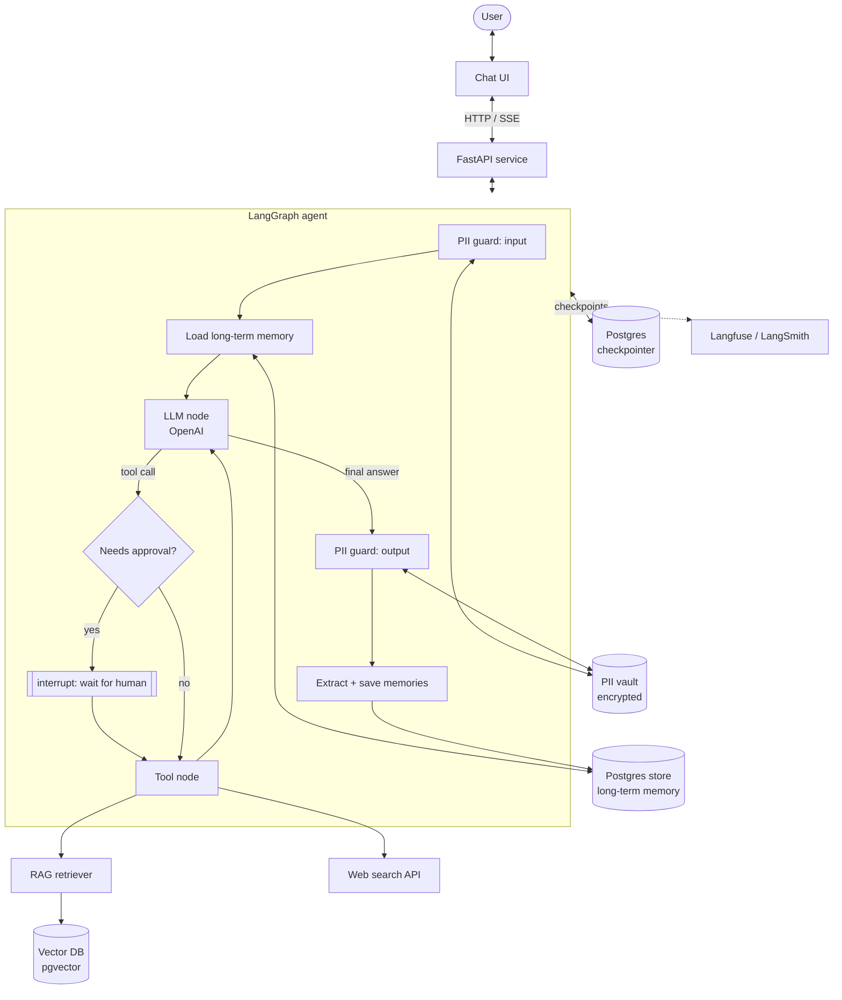

# Agentic AI Chatbot: Build Plan

An agentic chatbot that can answer from private documents (RAG), search the web, pause for human approval, protect personal data, and remember things both within a conversation and across conversations.

The work is split into phases. Each phase ends with something that runs and can be tested, and each one builds on the previous phase.

## Phases

| # | Phase | Delivers | Depends on |
|---|-------|----------|------------|
| 1 | [Foundation](phase-1-foundation.md) | API, agent graph, LLM loop, streaming, config, tracing | None |
| 2 | [Tools: RAG + Web Search](phase-2-tools-rag-web-search.md) | Document ingestion, vector retrieval tool, web search tool, tool routing | 1 |
| 3 | [Short-Term Memory & Checkpointing](phase-3-short-term-memory-checkpointing.md) | Per-thread state saved to Postgres, resume, history trimming and summarization | 1 |
| 4 | [Human-in-the-Loop](phase-4-human-in-the-loop.md) | Approval gates on tool calls, interrupt and resume, edit or reject flows | 3 |
| 5 | [PII Detection & Masking](phase-5-pii-detection-masking.md) | Input/output guardrails, reversible masking, PII-safe tools, logs and checkpoints | 2, 3 |
| 6 | [Long-Term Memory](phase-6-long-term-memory.md) | Cross-thread user memory, extraction, semantic recall | 3, 5 |
| 7 | [Production Hardening](phase-7-production-hardening.md) | Evals, observability, auth, rate limits, deployment | All |

### Why this order

- **Checkpointing comes before HITL.** Pausing a graph for a human means saving its state somewhere and loading it back later. The checkpointer from Phase 3 is what makes Phase 4 possible.
- **PII comes before long-term memory.** Long-term memory saves facts about the user for good. If masking isn't in place first, raw emails, phone numbers and IDs end up in the memory store and are hard to remove.
- **Tools come early.** RAG and web search are the core value of the bot, and the later phases (approval gates, PII-safe tool calls) need real tools to wrap.



## Target architecture (end state)



## Default tech stack

These are defaults, not hard requirements. Each phase doc notes where a swap is easy.

| Concern | Choice | Notes |
|---------|--------|-------|
| Language | Python 3.12 | |
| Agent framework | LangGraph | Built-in checkpointers, `interrupt()` for HITL, and a `Store` for long-term memory cover three of the four features |
| LLM | OpenAI (`gpt-5-mini` for chat; `gpt-5.4` when quality matters more than latency), a small model such as `gpt-5-nano` for cheap side tasks | Model, effort and an optional gateway URL are set in `.env`. Summarization, memory extraction and query rewriting can run on the small model |
| API | FastAPI + Server-Sent Events | |
| Vector DB | Postgres + pgvector | One database for vectors, checkpoints and memory. Qdrant is a straightforward swap |
| Embeddings | Voyage AI or an open-source model (e.g. `bge-m3`) | |
| Web search | DuckDuckGo via `ddgs` (no API key) | Tavily, Brave Search and Exa return richer snippets but need a key |
| PII | Microsoft Presidio + spaCy | Add custom recognizers for domain-specific IDs |
| Tracing | Langfuse (self-hosted) or LangSmith | |
| Packaging | `uv`, Docker Compose for local infra | |

## Repository layout (end state)

```
agentic-ai-chatbot/
├── docs/                      # these documents
├── src/chatbot/
│   ├── api/                   # FastAPI routes, SSE streaming, schemas
│   ├── graph/                 # LangGraph state, nodes, edges, builder
│   ├── tools/                 # rag.py, web_search.py, registry.py
│   ├── ingestion/             # loaders, chunking, embedding, indexing
│   ├── memory/                # short_term.py, long_term.py, extraction.py
│   ├── hitl/                  # approval policies, resume handling
│   ├── pii/                   # detector, masker, vault, recognizers
│   ├── config.py
│   └── observability.py
├── tests/
│   ├── unit/
│   ├── integration/
│   └── evals/
├── docker-compose.yml         # postgres+pgvector, langfuse
├── pyproject.toml
└── .env.example
```
