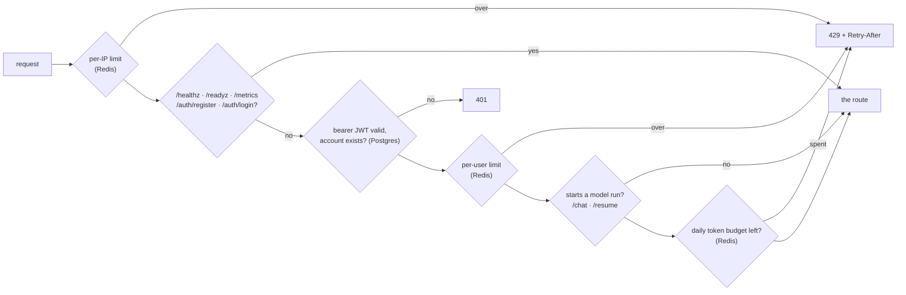
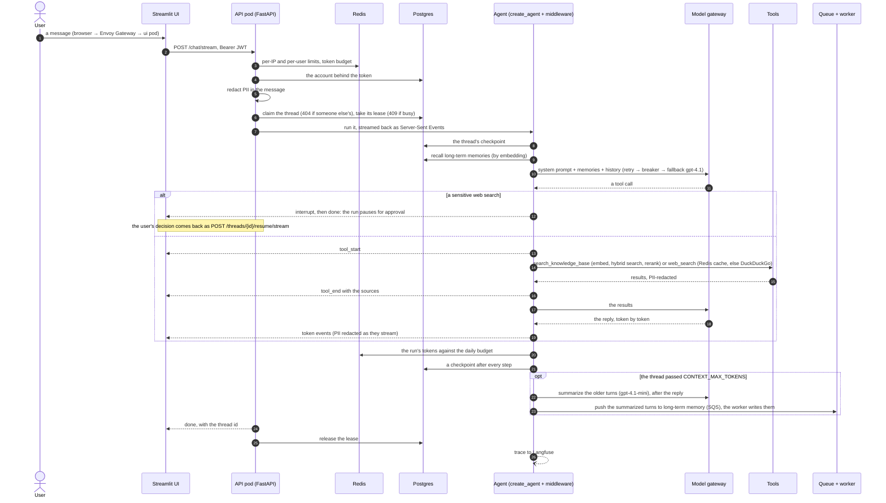
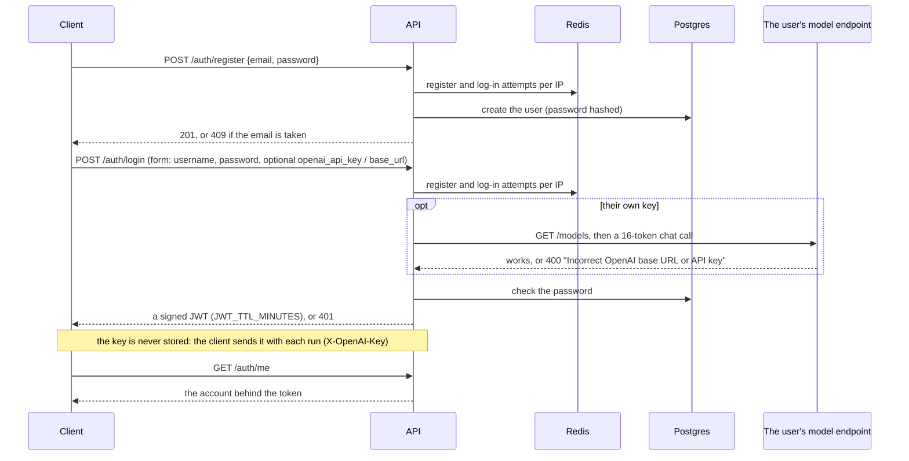
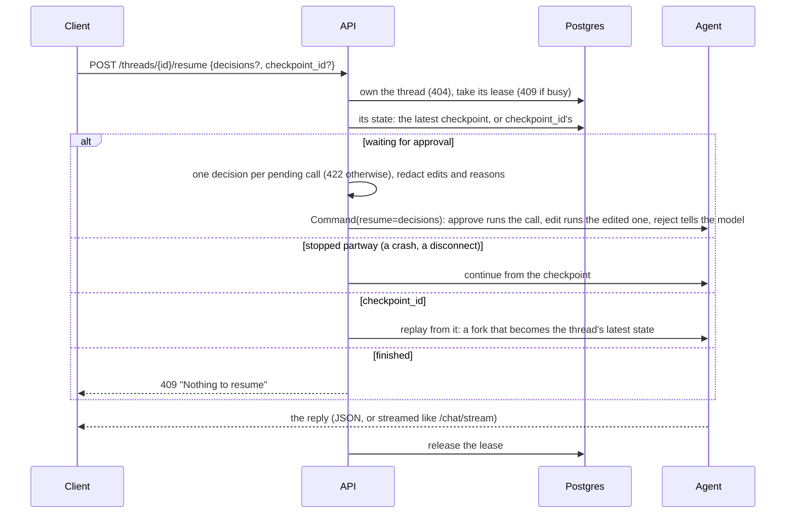
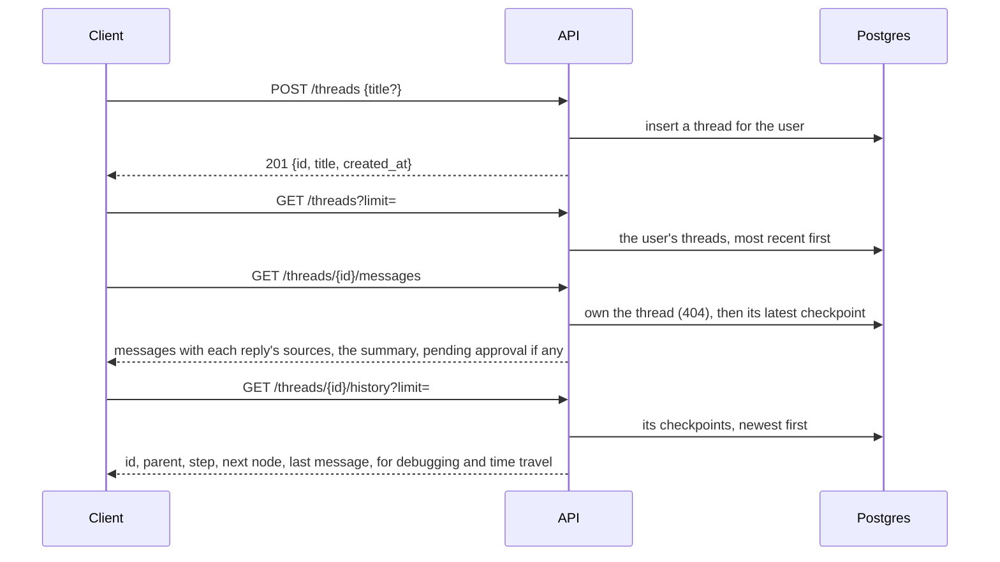
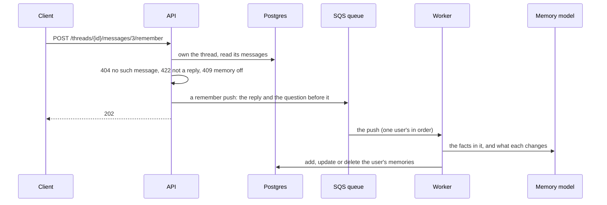
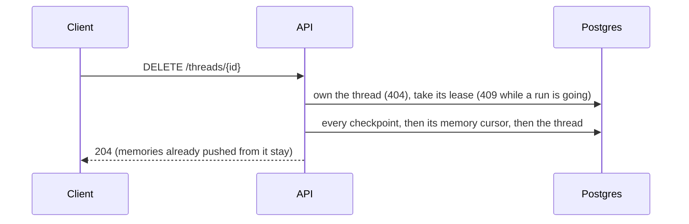
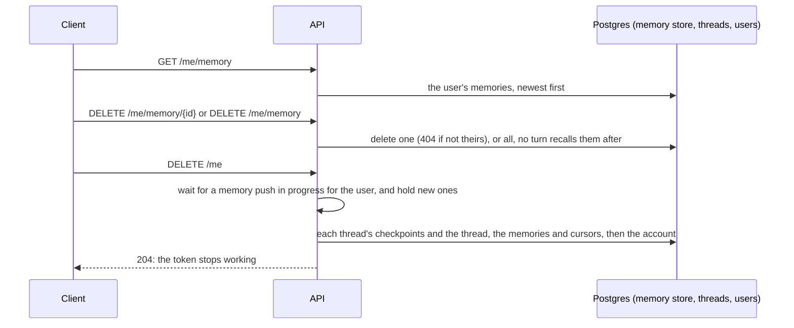
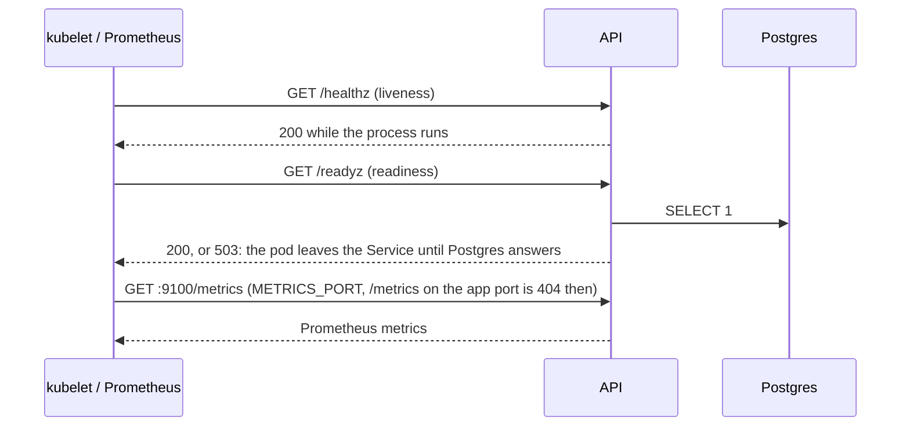

# API

The endpoints, the checks every request passes, and each endpoint's flow. The interactive OpenAPI docs are at http://localhost:8088/api/docs.

[Overview](../README.md) · [How it works](how-it-works.md) · [API](api.md) · [Configuration](configuration.md) · [Development](development.md) · [Runbook](runbook.md)

## Endpoints

| Endpoint | Purpose |
| --- | --- |
| `POST /chat` | Full reply, its sources and the `thread_id` as JSON, or `pending` tool calls if it paused for approval. Omit `thread_id` to start a new thread. 409 while the thread waits for approval |
| `POST /chat/stream` | Server-Sent Events: `tool_start` / `tool_end` (with sources) and `token`, then `done` with the `thread_id` (or `error`). An `interrupt` event before `done` means the run is waiting for approval |
| `POST /threads` | Create an empty thread |
| `GET /threads` | The caller's threads, most recent first |
| `GET /threads/{id}/messages` | The thread's messages (with each reply's sources), the summary, and `pending` if it's waiting for approval |
| `GET /threads/{id}/history` | Checkpoints, newest first, for debugging |
| `POST /threads/{id}/resume` | Send approval `decisions`, finish an interrupted run, or replay from `checkpoint_id` |
| `POST /threads/{id}/resume/stream` | The same, streamed like `/chat/stream` |
| `POST /threads/{id}/messages/{index}/remember` | Push one of the bot's replies, with the question before it, to your long-term memory (the "Remember this" button); 202 |
| `DELETE /threads/{id}` | Delete the thread and all its checkpoints |
| `GET /me/memory` | What the bot remembers about you across threads (your long-term memories), newest first |
| `DELETE /me/memory/{id}` | Forget one memory |
| `DELETE /me/memory` | Forget everything |
| `DELETE /me` | Delete your account and all your data: threads, checkpoints, memories (the "Delete my account" button); 204 |
| `POST /auth/register` | Create an account (`{email, password}`); 409 if the email is taken |
| `POST /auth/login` | Log in (form `username` = email, `password`, optionally `openai_api_key` / `openai_base_url`, checked); returns a bearer token |
| `GET /auth/me` | The signed-in account |
| `GET /healthz` | Liveness |
| `GET /readyz` | Readiness: 503 when the database doesn't answer |
| `GET /metrics` | Prometheus metrics (404 when `METRICS_PORT` moves them to their own port, as in the cluster) |

All endpoints except `/healthz`, `/readyz`, `/metrics`, `/auth/register` and `/auth/login` need a bearer token (401 without a valid one), and answer 429 with `Retry-After` over a rate limit. The ones that start a model run (`/chat`, `/chat/stream`, `.../resume`, `.../resume/stream`) also answer 429 once the user's daily token budget is spent.

## The checks on every request

Every request passes the same checks before its route runs; the routes that start a model run add the token budget:

## A chat, end to end

## Each endpoint's flow

<code>POST /auth/register</code>, <code>POST /auth/login</code>, <code>GET /auth/me</code>

<code>POST /chat</code>, <code>POST /chat/stream</code>

The flow above. `/chat` is the same run, answered as one JSON body (the reply, its sources, the thread id, or `pending` tool calls) instead of a stream. Either answers 409 if the thread is waiting for approval or is already answering.

<code>POST /threads/{id}/resume</code>, <code>POST /threads/{id}/resume/stream</code>

<code>POST /threads</code>, <code>GET /threads</code>, <code>GET /threads/{id}/messages</code>, <code>GET /threads/{id}/history</code>

<code>POST /threads/{id}/messages/{index}/remember</code>

<code>DELETE /threads/{id}</code>

<code>GET /me/memory</code>, <code>DELETE /me/memory/{id}</code>, <code>DELETE /me/memory</code>, <code>DELETE /me</code>

<code>GET /healthz</code>, <code>GET /readyz</code>, <code>GET /metrics</code>

