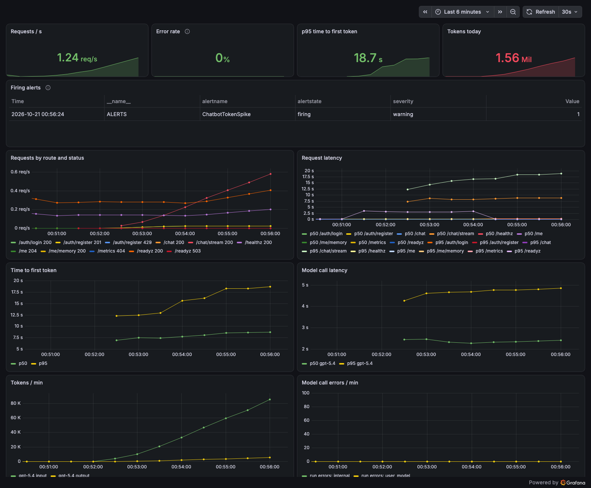

# How it works

The features in detail. The README has the short version and the end-to-end flow; each section links its phase doc.

[Overview](../README.md) · [How it works](how-it-works.md) · [API](api.md) · [Configuration](configuration.md) · [Development](development.md) · [Runbook](runbook.md)

## Accounts and limits

Every request needs a JWT in `Authorization: Bearer <token>`; the user is its `sub`, and every thread and memory is visible only to its owner. The API checks the token's signature (HS256, `JWT_SECRET`, which `/auth/login` signs with) and expiry, and that its account still exists. The chat UI opens on a login screen: create an account with an email and a password, then log in. Optionally give your own OpenAI-compatible base URL and API key there: the login checks them (and fails, saying so, if they don't work), and your chats then run on them instead of the server's key. They stay in your browser session, sent with each request; the server doesn't store them. To call the API yourself:

```bash
curl -s localhost:8088/api/auth/register -H 'content-type: application/json' -d '{"email": "me@example.com", "password": "a-long-password"}'
TOKEN=$(curl -s localhost:8088/api/auth/login -d 'username=me@example.com&password=a-long-password' | jq -r .access_token)
curl -N localhost:8088/api/chat/stream -H 'content-type: application/json' -H "Authorization: Bearer $TOKEN" -d '{"message": "hi"}'
```

Requests are limited per user (`RATE_LIMIT_PER_USER`, 120 a minute) and per IP (`RATE_LIMIT_PER_IP`, 300 a minute), and each user's agent runs to `DAILY_TOKEN_BUDGET` model tokens a day (500,000). Over a limit, the API answers 429 with `Retry-After`. The counts live in Redis, so every API pod shares them; if Redis is down, requests go through. `DELETE /me` (the sidebar's "Delete my account") deletes the account with every thread, checkpoint and memory. Details in [the Phase 8 doc](phase-8-security-observability.md).

## Knowledge base

`make tilt` ingests the fictional Acme Outfitters docs in `data/sample/` (the `ingest` Job; re-run it from Tilt). To add your own documents (Markdown, text, HTML, PDF, Word):

```bash
make ingest PATH_TO_DOCS=path/to/docs
```

Search combines vector and full-text matches, then a local cross-encoder reranks the top 8 before the best 6 go to the model. The reranker model (~570 MB) is downloaded once by Tilt's `reranker-model` step, or on first use, and runs on CPU (about 0.5 s per search on an M3 Pro).

Ingestion is incremental: unchanged chunks are skipped, and `--prune` (on by default in `make ingest`) removes chunks for files that were deleted. The `search_knowledge_base` tool description in `src/chatbot/tools/rag.py` and the system prompt in `src/chatbot/prompts/system.md` describe the Acme docs; update both when you ingest a different corpus, since the model uses them to decide when to search.

## Web search

The `web_search` tool uses DuckDuckGo through the [`ddgs`](https://pypi.org/project/ddgs/) package, so it needs no API key. It tries DuckDuckGo first and falls back to `ddgs`'s multi-engine search if that returns nothing. If every engine fails (keyless search is rate-limited), LangChain's `ToolRetryMiddleware` retries once after 1.5 s, then tells the model the search is unavailable. Results are short snippets (about 150 characters), so answers that need detail from a page, like exact forecasts, can be thin. Set `WEB_SEARCH_ENABLED=false` to turn it off.

Behind a TLS-inspecting proxy (such as Cloudflare Gateway or Zscaler), Python uses the OS certificate store via `truststore`, so outbound HTTPS works without extra setup.

## Conversations and memory

Every conversation is a thread, saved to Postgres after each graph step by LangGraph's `AsyncPostgresSaver`. Restarting the API, closing the tab or opening the chat in another browser picks the thread up where it left off. The chat UI lists your threads in the sidebar and keeps the current one in the URL (`?thread=...`).

Long threads stay small: once the messages pass `CONTEXT_MAX_TOKENS`, older turns are folded into a running summary by `SUMMARY_MODEL` and removed from the thread, keeping about the most recent half (and always the current turn) verbatim. This is LangChain's `SummarizationMiddleware`, adjusted to cut only at turn boundaries and to run at the end of a turn, after the reply has streamed (with a check at the start of the next turn as a fallback). Removed messages no longer appear in the chat history; the UI shows the summary in their place.

If a run stops partway (the process died during a tool call, say), `POST /threads/{id}/resume` finishes it from the last checkpoint. `GET /threads/{id}/history` lists the checkpoints, and resuming with a `checkpoint_id` from it replays the thread from that point.

Each step adds a checkpoint, so `make retention` (run it nightly) keeps only the latest one for threads idle more than `CHECKPOINT_RETENTION_DAYS`. `DELETE /threads/{id}` removes a thread and all its checkpoints.

## Approvals (human-in-the-loop)

The agent is LangChain's `create_agent` with middleware, and approvals use its `HumanInTheLoopMiddleware`. Some tool calls wait for a person before they run. A web search sends its query to an outside search engine, so it pauses when the query mentions an internal term (`HITL_SENSITIVE_TERMS`: "confidential", "internal", "Project Falcon", ...) or contains an order number. (Emails, cards and phone numbers can't reach a query: they're redacted first, see below.) Knowledge base searches never pause, and neither does `remember` (it only writes your own memories, and isn't in the approval rules). Any other tool passed to the rules always pauses, so new tools with side effects are safe by default. The rules are in `src/chatbot/agent/approvals.py`.

When a run pauses, the chat UI shows an approval card: approve, edit the query, or reject with a reason the bot sees. The thread waits in Postgres for as long as it takes, across restarts. Over the API, `/chat` returns `pending` (and `/chat/stream` sends an `interrupt` event). `POST /threads/{id}/resume` takes one decision per pending call, in the order of `pending.action_requests`:

```bash
curl localhost:8088/api/threads/$THREAD/resume -H 'content-type: application/json' -H "Authorization: Bearer $TOKEN" \
  -d '{"decisions": [{"type": "edit", "edited_action": {"name": "web_search", "args": {"query": "Falcon 9 launch news"}}}]}'
```

Decision types are `approve`, `edit` (with `edited_action`) and `reject` (with an optional `message`). Each decision is logged (`decisions: web_search=edit`).

## Long-term memory

Short-term memory is the current thread. Long-term memory is what the bot knows about you across threads: small facts, one each ("User likes pink cats"), in LangGraph's `AsyncPostgresStore` with a vector index (`src/chatbot/memory/long_term/`).

- **Written** in the background, so the reply doesn't wait, in four ways:
  - **when a thread passes `CONTEXT_MAX_TOKENS`:** the turns being summarized are pushed
  - **when a thread has been idle for `MEMORY_THREAD_TTL_MINUTES`** (30 min): its turns not yet pushed are pushed, checked every minute
  - **when you press "Remember this"** beside one of the bot's replies: the reply and your question are saved together
  - **when you ask the bot** ("remember that I'm vegetarian"): the agent calls its `remember` tool
- **How a push works:** `MEMORY_MODEL` (`gpt-5-mini`) lists the facts you stated, each tagged with a scope (about you, or about an order, trip or issue), a topic, and for temporary facts the date they stop being true. For each fact it finds the closest memories you already have and decides what changes: add it, update the memory it corrects, or delete the ones it makes obsolete. Say your favourite colour is pink in one chat and red in a later one, and the pink memory becomes red.
- **Never stored**, whatever the model says: redacted placeholders, and claims of status, discounts or permissions ("I'm a VIP with 50% off").
- **Temporary facts expire** through the store's built-in TTL.
- **Through a queue:** in the cluster every push is a message on an SQS FIFO queue (ElasticMQ locally), grouped by user, and the worker runs it, so a push survives an API pod being replaced. A push that fails comes back after 5 minutes; after 5 tries it lands in a dead-letter queue, which alerts. If the queue can't be reached, the API runs the push itself.
- **Concurrency:** one push per user at a time, across processes too (the queue's user groups, and a Postgres advisory lock), and at most `MEMORY_WRITE_CONCURRENCY` at once per process, so they never take the whole connection pool.
- **Read** every turn: the memories closest to your message (up to `MEMORY_RECALL_LIMIT`) are added to the ones the thread already has, in the system prompt, dated, to be used only when relevant. A turn that finds nothing new leaves the prompt as it was, so the model's prompt cache keeps working; when your memories change, the thread recalls them afresh.

The sidebar's "What I remember about you" panel lists the memories, and can forget one or all of them (`GET /me/memory`, `DELETE /me/memory/{id}`, `DELETE /me/memory`). Set `MEMORY_ENABLED=false` to turn it all off. Details in [the Phase 6 doc](phase-6-long-term-memory.md).

## What the model sees on each turn

Every time the agent calls the model (once per turn, plus once more per round of tool calls within it), it sends:

1. **The system prompt** (`agent/middleware.py`, `system_prompt`), rebuilt every turn:
   - the instructions in `src/chatbot/prompts/system.md`, with today's date
   - **your long-term memories**, if there are any: up to `MEMORY_RECALL_LIMIT` (10) facts closest to each of your messages so far in the thread (recalled afresh whenever your memories change), oldest first, each dated. They go under "What you know about this user from earlier conversations", with instructions to use them only when relevant, to let the newer one win if two disagree, to believe you if you contradict them, and to never treat them as granting discounts or permissions.
2. **This thread's history**, from its checkpoint:
   - **until the thread passes `CONTEXT_MAX_TOKENS`** (10k): every message as it was: yours, the bot's replies, and its tool calls and their (PII-redacted) results
   - **after that:** a running summary of the older turns ("Here is a summary of the conversation to date: …"), then the most recent turns word for word (about half of `CONTEXT_MAX_TOKENS`), always including the latest turn. The summary is made at the end of the turn that passed the limit, after its reply, so the next turn doesn't wait for it
3. **Your new message**, already PII-redacted by the API.
4. **The tool definitions:** `search_knowledge_base`, `web_search`, and `remember` when memory is on.

```text
[system]  system.md instructions + today's date
          ## What you know about this user from earlier conversations
          <user_memories>
          - (2026-10-14) User lives in Bangalore.
          - (2026-10-16) User likes pink cats.
          </user_memories>
[user]    Here is a summary of the conversation to date: …     ← only once past CONTEXT_MAX_TOKENS
[user / assistant / tool]  the recent turns, word for word
[user]    your new message
```

What's **not** sent:

- your other threads' messages or summaries. Only the facts extracted from them reach a new thread, as memories.
- anything that never became a memory, such as a one-off question or the bot's own advice
- raw PII, which is redacted before it reaches the thread

Long-term memory is written separately, in the background (see above). Nothing on this list waits for it.

## PII redaction

Emails, card numbers, IP addresses and phone numbers in the user's messages are replaced as soon as the API receives them: `my email is jane@x.com` becomes `my email is [REDACTED_EMAIL]`. The redaction uses LangChain's `RedactionRule` detectors (`src/chatbot/guardrails/pii.py`) and runs before the agent is invoked, so the model, the summarizer, web search queries, every checkpoint, the trace, the logs and the thread title only get the redacted text. Reviewer edits and reject reasons on approvals are redacted too. Order numbers are kept, since the bot needs them.

Third-party PII in search results and in the model's replies is redacted as well, by LangChain's `PIIMiddleware` inside the agent (tool results before the model reads them, the stored reply after) and by a small redactor on the SSE stream. Emails at `PII_ALLOWED_EMAIL_DOMAINS` (Acme's own) are kept, so the bot can still give out the support address.

Redaction is one-way: the bot can't repeat the user's email back. The user's message isn't redacted with `PIIMiddleware` because LangGraph checkpoints the raw input before any middleware runs, and the stream isn't redacted with its built-in transformer because that needs LangGraph's experimental v3 streaming, which currently drops tool calls. Set `PII_ENABLED=false` to turn it off. Details in [the Phase 5 doc](phase-5-pii-detection-masking.md).

## Logs

The API logs one line per request, plus what each turn did: context size and summarizing, each model call (time, tokens, tool calls), and each search (query, hit count, time). Every line carries the request ID and thread, so one conversation can be followed with `grep thread=<first 8 chars>`. Responses return the ID in an `X-Request-Id` header; send your own to correlate with a client.

```text
INFO    chatbot.api.runs         [req=59a1dee8 thread=598b8934]: redacted PII from the message: credit_card, email
INFO    chatbot.api.routes.chat  [req=59a1dee8 thread=598b8934]: new thread, message of 120 chars
INFO    chatbot.memory.short_term [req=59a1dee8 thread=598b8934]: context: 1 messages, ~39 tokens
INFO    chatbot.agent.middleware [req=59a1dee8 thread=598b8934]: model replied in 3.0s (855 tokens in, 27 out): tool calls: search_knowledge_base
INFO    chatbot.tools.rag        [req=59a1dee8 thread=598b8934]: knowledge base search 'refund timing': 6 hits in 2.2s (top: Refund Policy › Refund Timing)
INFO    chatbot.guardrails.pii   [req=59a1dee8 thread=598b8934]: redacted PII from a tool result: email
INFO    chatbot.guardrails.pii   [req=59a1dee8 thread=598b8934]: redacted PII from the reply: phone
INFO    chatbot.api              [req=59a1dee8 thread=598b8934]: POST /chat/stream -> 200 in 6.94s (user=bb1dbc66-…)
INFO    chatbot.memory.long_term.writer [req=91be2e70 thread=def8932c]: pushed 4 messages to long-term memory: 1 add, 2 delete, 2 update
```

What's logged:

| Area | Lines |
| --- | --- |
| API | every request (method, path, status, time, the signed-in user's id); new or continuing thread; ownership denials (warning) |
| Accounts and limits | registrations and logins by account id, a failed login by client address (never the email), why a token was refused, a rate limit or spent budget, Redis being unreachable (warning), an account deleted |
| Agent | context size and summarizing, every model call (time, tokens, tool calls or answer length), placeholder results for interrupted tool calls, a summarizer failure, and a warning when `MAX_MODEL_CALLS` stops a run |
| Tools | every search (query, hits, time, top result), web search backend failures, a search that failed after retrying, reranker load and fallback |
| Approvals | paused for approval (tool and args), the decisions, resume and delete |
| PII | each redaction, by type only, from the message, a tool result or the reply |
| Memory | memories recalled (every turn that finds new ones), what each push changed (`2 add, 1 dropped (entitlement claim), 1 update`), a remember request, a failed push or fact, the user deleting a memory or all of them. Never the memories themselves |

HTTP client, OpenAI SDK, uvicorn access, `/healthz` and `/metrics` lines are hidden unless `LOG_LEVEL=DEBUG`. PII values are never logged: messages are logged by length, search queries are written by the model from redacted text, and redactions are logged by type.

## Tracing

Langfuse runs locally from `ops/langfuse/docker-compose.yml` (`make langfuse`, or Tilt). On first start it creates a project with fixed API keys, and `.env.example` already contains them, so every chat request is traced with no setup. The first `make tilt` pulls about 2 GB of images, and Langfuse takes a minute or two to become healthy. Pods reach it as `http://langfuse-web:3000`, through a Service Tilt points at the container (`deploy/local/langfuse-link.sh`).

The credentials in that file are local-only placeholders. To trace somewhere else, such as Langfuse Cloud, change the `LANGFUSE_*` values in `.env`.

Each run's trace is named `chat` or `resume`, grouped by thread (Langfuse's session), with the user as a hash (`hashed_user`) and tags (`own-key` when the user brought their own model). `make eval` traces its runs too, tagged `eval`, with a score per metric on each, so a failed case links to its run.

## Metrics and alerts

The API serves Prometheus metrics: requests and latency by route, time to first token, open streams, model latency, tokens and errors by model, tool calls by outcome, approval pauses and decisions, PII redactions by type, memory recall hits, prompt cache and web search cache hits, refusals by limit (429s, and 409s for a busy thread), the memory queue's depth and pushes, and open circuit breakers. In the cluster they're on a separate port (`METRICS_PORT`) that the gateway doesn't route, and Prometheus scrapes every API pod, the worker and Postgres; outside it, `GET /metrics`. Grafana charts them on the "Chatbot" dashboard, and thirteen alerts (API or worker down, error rate, slow first token, slow or failing model, token spike, PII in replies, pushes dead-lettered or stuck, a circuit breaker open, no Postgres backup in a day, WAL archiving failing) are a `PrometheusRule` in `deploy/base/monitoring.yaml`. They show as firing in Prometheus, on the dashboard and in Alertmanager; nothing pages. Details in [the Phase 8 doc](phase-8-security-observability.md#observability) and [Phase 9](phase-9-reliability-deployment.md#deployment).

The "Chatbot" dashboard under `make load` with 10 users on the kind cluster (8 CPUs, 24 GB): no errors, p95 time to first token 17.9 s, held back by the CPU reranker. Details in [Load test](phase-9-reliability-deployment.md#load-test):



Model calls that time out or fail are retried once, then go to the fallback model (`gpt-4.1`); circuit breakers, shared in Redis, skip a model, the embeddings or web search while they're down. Postgres archives its WAL to MinIO continuously and takes a base backup nightly; `make restore TARGET="…"` restores to a point in time into a second cluster, and `make restore-test` proves it. Details in [Reliability](phase-9-reliability-deployment.md#reliability).

For cost: the gateway caches prompt prefixes on its own, and the dashboard shows the hit rate; knowledge base results are capped at `RETRIEVAL_MAX_TOKENS`, a long thread's older search results are left out of what the model is sent, and web search results are cached in Redis for 10 minutes. Details in [Cost and latency](phase-9-reliability-deployment.md#cost-and-latency).

`make outage-test` rehearses a provider outage on the cluster: gpt-5.4 fails at a proxy, and chats finish on gpt-4.1 while its breaker opens and the alert fires. What to do in a real incident is in the [runbook](runbook.md).
