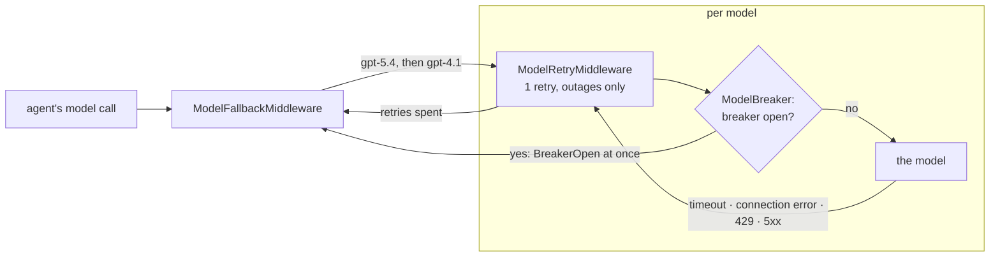
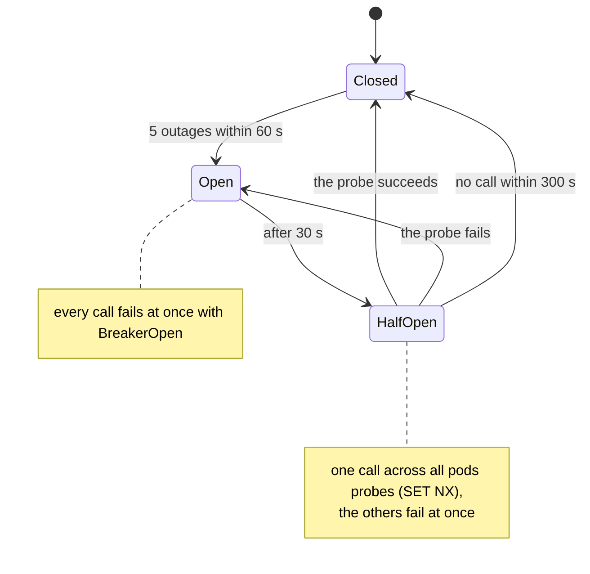
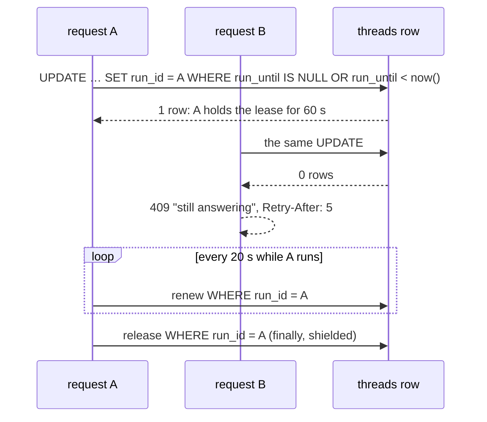
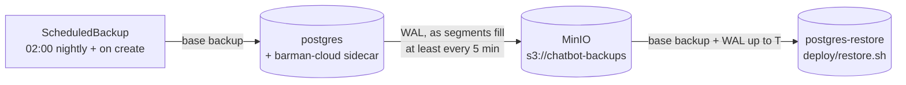
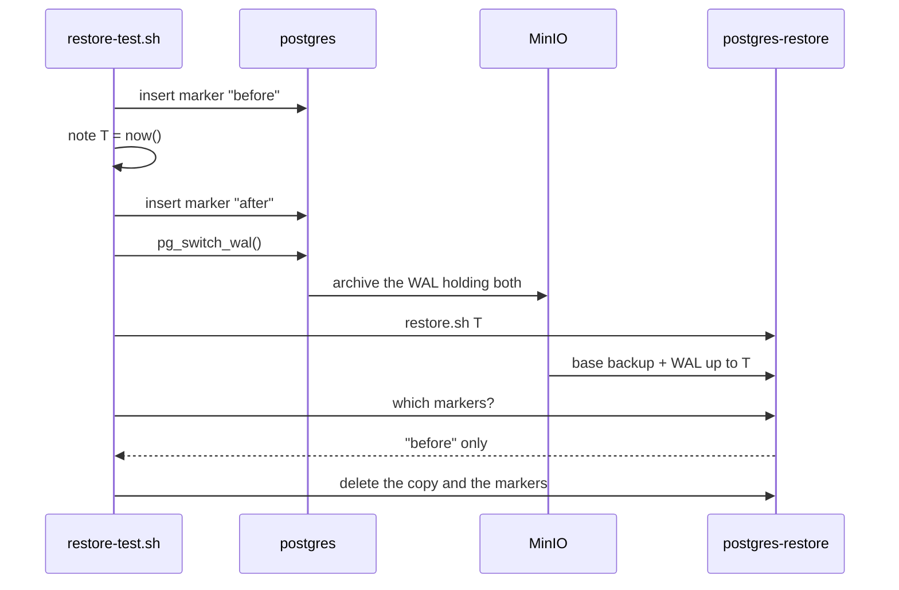

# Phase 10: Reliability

**Goal:** keep answering when a provider fails, and keep the data safe: retries, a fallback model and circuit breakers on the model calls, breakers on the embeddings and web search, one run at a time per thread, and Postgres backups with a tested restore.

[← Phase 9](phase-9-deployment.md) · [Overview](../README.md) · [Next: Phase 11 →](phase-11-cost-latency.md)

**Status: built** (2026-10-20, [PR #10](https://github.com/Anirudh1905/agentic-ai-chatbot/pull/10)); proven on the cluster by the [outage test](phase-12-load-outage-tests.md#outage-test). LangChain's built-ins are used wherever they exist (retries, the fallback); only the circuit breaker and the thread lease are ours.

- [x] Retries with backoff, circuit breakers and a fallback model on the model calls; breakers on the embeddings and web search ([Model calls](#model-calls))
- [x] Graceful degradation: web search down → answer from the knowledge base and say so; embeddings down → keyword search only, and say so
- [x] A per-thread lock: two requests on one thread both read the same checkpoint, and the later write won (Phase 3) ([Per-thread lock](#per-thread-lock))
- [x] Backups and a tested restore for Postgres ([Backups](#backups))

## Decisions

| Decision | Chosen | Why, and what it rules out |
| --- | --- | --- |
| Fallback model | **`gpt-4.1` on the same gateway** (`FALLBACK_MODEL`; empty turns it off) | A stalled gpt-5 call is the failure we've measured (Phases 6, 7). A second provider would need a second key and client |
| Fallback, retries | LangChain's **`ModelFallbackMiddleware`** and **`ModelRetryMiddleware`** | Built-ins. The cost: the fallback catches every error, so a refused request (a 400) goes to the fallback too, though it isn't retried or counted as an outage |
| Circuit breakers | **Our own** (`reliability/breaker.py`), **shared in Redis** | LangChain has none. Shared, so one pod's timeouts spare the others theirs; in memory without Redis |
| Busy thread | **409**, `Retry-After: 5` | Queueing would hold a connection open for a whole reply. LangGraph's multitask strategies are a LangGraph Server feature, not in the library |
| Lock store | **A lease on the `threads` row** | Postgres holds the thread; a Redis lock would be a second source of truth, lost on restart |
| Backups | **CloudNativePG's Barman Cloud plugin to MinIO**, point-in-time recovery | Continuous WAL plus nightly base backups restore to any moment. In production only the ObjectStore's endpoint and keys change |

## Model calls

- **The chain** (`agent/builder.py`), outermost first: `ModelFallbackMiddleware(gpt-4.1)`, `ModelRetryMiddleware`, `ModelBreaker`, then `ModelCallMiddleware` (logs and metrics), so every attempt is measured under its own model's name, and the fallback's calls go through the same retry and breaker.
- **Retries:** `ModelRetryMiddleware(max_retries=MODEL_MAX_RETRIES, retry_on=is_outage, on_failure="error")`, about 1 s of backoff. `is_outage` is a timeout, a connection error, a 429 or a 5xx. The client's own retries are off, so it's one retry, not two: a stalled call costs `REQUEST_TIMEOUT` (30 s) each time, and the fallback answers sooner. `on_failure="error"` matters, since the default turns the last failure into an AI message the fallback never sees.
- **A user on their own key never reaches our fallback:** `UserModel` swaps their client into every call, the fallback's included, and `ModelBreaker` skips their calls, since their endpoint's outages aren't ours to count.
- **A reply that fails partway starts over.** When a model call starts while the previous one never ended and had already streamed tokens, the stream (`api/streaming.py`) sends a **`reset`** event first, and the UI redraws the reply (`write_reply` in `ui/app.py`, since `st.write_stream` can't take text back). It works the same for a retry and the fallback. Tokens the PII redactor still held (the last 128 characters) were never shown, so a short failed reply needs no reset.
- **Memory pushes** fall back with `with_fallbacks`: `model.with_structured_output(schema).with_fallbacks([fallback.with_structured_output(schema)])`. One that fails anyway is retried from the queue.
- **Summaries have no fallback:** `SummarizationMiddleware` needs a chat model, and `with_fallbacks` returns a runnable. A failed summary already lets the turn go on with the full history (Phase 3).
- **Embeddings** (`GuardedEmbeddings`) have a breaker and no fallback, since another model's vectors wouldn't match the stored ones. In an outage, knowledge base search runs on full text only and starts its result with a note the model relays (`KEYWORD_ONLY`); recall goes on with the memories the thread already has; ingest fails at once.
- **Web search** keeps its one retry (Phase 2) and gets a breaker that counts every failure, since by then each backend has failed. While it's open the tool answers "Web search is unavailable right now" at once.

## Circuit breakers

- **Settings:** `BREAKER_FAILURES` (5) outages within `BREAKER_WINDOW_SECONDS` (60) open it for `BREAKER_COOLDOWN_SECONDS` (30). A request the dependency refused (a 400) counts as it answering.
- **In Redis:** four keys per breaker (`breaker/<name>/failures`, `open`, `tripped`, `probe`), each with an expiry, so a pod that dies mid-probe can't leave one stuck (a probe expires after 120 s). The count is `INCR` plus `EXPIRE` in one Lua script. A closed breaker costs one `EXISTS` per call.
- **Without Redis:** while Redis can't be reached, `SharedBreakerStore` keeps state in memory, retries Redis every 30 s, and logs once each way. With no `REDIS_URL`, breakers are per-process in memory (`MemoryBreakerStore`).
- **Watching them:** `chatbot_breaker_open{dependency}` (each process reports what it last saw; the dashboard takes the max), the `ChatbotBreakerOpen` alert after 1 minute, and a dashboard panel. Calls to the fallback model show under `gpt-4.1` in the model metrics.

## Per-thread lock

- **The lease:** migration `0004` adds `threads.run_id` and `threads.run_until`; one conditional `UPDATE`, matching the user and an expired or empty lease, means exactly one of two racing runs gets the row. The helpers are `take_lease` and `ThreadLease` in `api/leases.py`.
- **Who takes it:** the run routes (`/chat`, `/chat/stream`, `/threads/{id}/resume` and its stream) and `DELETE /threads/{id}`, since a run would write checkpoints back after a delete. Reads don't, and neither does the worker's idle scan. It's taken after auth, the rate limit and the ownership check (someone else's thread stays 404), before any tokens are spent.
- **Busy:** 409 with `Retry-After: 5`, counted as `chatbot_limited_total{limit="thread_busy"}`. The UI takes a refused message back out of the chat and shows its text under the error.
- **Renewal** every `THREAD_LEASE_SECONDS / 3`, matched on its own `run_id`. A failed renewal is counted (`chatbot_thread_lease_renewal_failures_total`) and the run carries on: stopping a reply halfway is worse than a small chance of a second run once the lease expires.
- **Release** in a `finally`. A client that disconnects cancels the stream's anyio scope, which would cancel the release too, so it runs shielded (`anyio.CancelScope(shield=True)`).
- **A pod that dies** renews nothing, so its threads free themselves within 60 s. **A run paused for approval holds no lease;** its resume takes a new one.

## Backups

- **Charts:** `make cluster` adds **cert-manager** (v1.21.2, for the plugin's TLS) and the **Barman Cloud plugin** (0.8.1, in `cnpg-system`).
- **`deploy/base/backup.yaml`:** MinIO (a 5 Gi volume, console on 9001 linked from Tilt; Chainguard's image from Docker Hub, pinned, since MinIO stopped publishing images), a `backup-bucket` Job (Barman won't create the bucket), the `backups` ObjectStore (gzip, 7-day retention) and the `postgres-nightly` ScheduledBackup.
- **The cluster** names the plugin as its WAL archiver with `archive_timeout: 5min`, so a restore loses at most the last 5 minutes. The store's keys are made once by `make secrets` (gitignored `backup-store.env`) and kept, since backups are only readable with the keys they were written with.
- **Restore:** `make restore TARGET="2026-10-20 09:30:00+00"` (no `TARGET`: the latest) bootstraps a second Cluster, `postgres-restore`, from the store while the live one keeps running, compares the two (users, threads, threads with checkpoints, the Alembic revision, pgvector's version), and prints how to switch the app over. Switching stays a person's decision: it's an outage either way.
- **`make restore-test`** proves point-in-time recovery, not just that a backup exists:

- **Monitoring:** a `PodMonitor` scrapes Postgres. **PostgresBackupMissing** fires with no base backup in 26 h; **PostgresWALArchiveFailing** when the latest archiving attempt failed for 10 minutes. A dashboard panel shows the time since each.
- **CI** keeps MinIO and the backups, so archiving runs during the smoke test; the restore test doesn't run there.

## Tests and checks

| Part | Unit | Integration | Live, on kind |
| --- | --- | --- | --- |
| Model calls, breakers (`test_reliability.py`; `make outage-test` live) | An outage is retried, then falls back; a refused request isn't retried or counted; an open breaker skips the model; one `reset` for a reply that failed partway, none when nothing was shown; an own-key user never reaches our fallback; the breaker's open, window, probe and expiry rules; memory pushes fall back; web search and embeddings degrade | One pod's failures open the breaker for another; only one pod probes; every key expires (`test_breaker_redis.py`); keyword-only search with the note | `make outage-test`: chats finish on the fallback, the breaker opens and closes, the alert fires |
| Thread lock (`test_thread_lease.py`) | 409 with `Retry-After` on every run route and delete; someone else's thread still 404; released after success, an error and a disconnect (fails without the shield); expiry, renewal, a failed renewal; two concurrent `/chat` give one 200 and one 409 | Ten concurrent takers get exactly one lease; renew, release and expiry | Two concurrent requests: a 200 and a 409 |
| Backups | | | WAL archived and the nightly backup ran on its own; `make restore-test` restored to T in about 3 minutes (2026-10-20) with only the first marker |

## Changes from the design

| Designed | Built | Why |
| --- | --- | --- |
| Our own fallback middleware and a `model_fallback` event | **`ModelFallbackMiddleware`, `ModelRetryMiddleware`, `with_fallbacks`** | Built-ins first. Costs: a 400 goes to the fallback, and replies don't say a backup model answered |
| A `reset` event when the fallback starts | **Sent when a call starts while the previous one never ended** | Needs no marker from the built-ins, and covers retries too |
| Summaries fall back to gpt-4.1 | **No fallback** | The summarizer needs a chat model, not a runnable |
| A fallbacks-by-reason counter | **None** | The built-in doesn't report why; fallback calls show under their model |
| The client's `max_retries=1` | **`ModelRetryMiddleware`, client retries off** | Built-in, with backoff and an outage filter |
| Barman creates the bucket; MinIO's own image | **A `backup-bucket` Job; Chainguard's image, pinned** | Barman doesn't; MinIO stopped publishing, and `cgr.dev` failed through the proxy |
