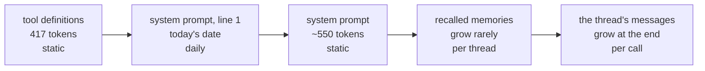
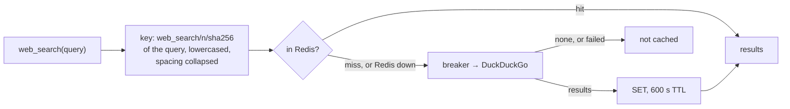

# Phase 11: Cost and latency

**Goal:** keep cost and latency in check: prompt caching measured, caps on the context the model is sent, and a web search cache.

[← Phase 10](phase-10-reliability.md) · [Overview](../README.md) · [Next: Phase 12 →](phase-12-load-outage-tests.md)

**Status: built** (2026-10-20, [PR #10](https://github.com/Anirudh1905/agentic-ai-chatbot/pull/10)).

- [x] Prompt caching on the system prompt and tool definitions: automatic at the gateway; the prefix kept stable and the hits measured ([Prompt caching](#prompt-caching))
- [x] A cap on retrieved context: per search, and old tool results across a thread ([A cap on context](#a-cap-on-context))
- [x] Frequent web searches cached, briefly ([Web search cache](#web-search-cache))
- [x] From earlier phases: a small summary model (`gpt-4.1-mini`, Phase 3), summaries after the reply (Phase 3), a cap on model calls (`MAX_MODEL_CALLS`), rate limits and a daily token budget (Phase 8). Memory extraction stays on `gpt-5-mini` (Phase 6: nano kept outdated and forbidden facts)

## Decisions

| Decision | Chosen | Why, and what it rules out |
| --- | --- | --- |
| Prompt caching | **The gateway's own**, no request parameter | Automatic for prefixes of 1,024 tokens or more. The gateway answers `prompt_cache_key` with a 503, which would count as an outage and send calls to the fallback |
| Old tool results | LangChain's **`ContextEditingMiddleware`** (`ClearToolUsesEdit`) | Built-in, and it edits only what the model is sent: the thread, its sources and the UI keep every result |
| Per-search cap | Our `within_tokens`, at 4 characters a token | Nothing built in caps a tool's output; LangChain's own estimate, no tokenizer download |
| Web search cache | **Redis**, already used by every pod | Shared by the API pods; no in-memory fallback, since a per-pod cache would rarely hit |

## Prompt caching

OpenAI-style caching reuses the longest prompt prefix the endpoint has seen, past 1,024 tokens, in 128-token steps. What the agent sends, in order, from the most stable to the least:

- **Too short alone:** the tools and the system prompt come to 971 tokens (`o200k_base`), just under the minimum, so a thread's first call can't hit. Every later call can: a turn's second call (after a search) repeats the first call's prompt, and the next turn repeats the whole previous one.
- **Memories stay put:** a thread's recalled set only grows when a message brings up one it hasn't seen (Phase 6).
- **On the gateway** (2026-10-20): three identical calls of 1,887 tokens read 0, 0, then 1,664 `cached_tokens`. Hits depend on which backend serves a call, which `prompt_cache_key` would steer, but the gateway refuses it.
- **Measured:** `chatbot_model_cached_tokens_total{model}`, from `usage_metadata.input_token_details.cache_read`; its own counter, so `chatbot_model_tokens_total`'s sums and the token alert stay input plus output. Each model call's log line has it ("2104 tokens in, 1664 cached, 85 out"), and a "Prompt cache hit rate" panel charts it. Under the load tests (2026-10-20 and 21, through the gateway), 20 to 21% of input tokens were cached.
- **Guarded:** a unit test checks that every call of a thread gets the same system prompt, and memories come after the static part. A per-request value in the prompt (a timestamp, a thread ID) would quietly make every call a miss.

## A cap on context

- **Per search:** `RETRIEVAL_MAX_TOKENS` (2,500). After reranking, the knowledge base keeps its best chunks in rank order until the next would pass the cap, and always the first; six chunks of up to 600 tokens could reach 3,600. Web snippets were already capped at 800 characters (Phase 2).
- **Across a thread:** every call resends the thread, earlier search results included, and those are its biggest messages. Past `CONTEXT_CLEAR_TOOL_RESULTS_TOKENS` (6,000), `ContextEditingMiddleware(ClearToolUsesEdit(...))` sends all but the latest `CONTEXT_KEEP_TOOL_RESULTS` (3) results as a placeholder that says to search again if needed.
  - **Only the request changes:** the thread, the UI's sources and the summaries keep every result.
  - **Summarization** still folds old turns away at `CONTEXT_MAX_TOKENS` (10,000), counted on the thread itself, so clearing doesn't delay it.
  - **Its cost to caching:** a cleared result changes the prompt from that message on, so the next call misses past that point.

## Web search cache

- **Shared** by every API pod, for `WEB_SEARCH_CACHE_SECONDS` (600); `n` is `WEB_SEARCH_MAX_RESULTS`, so a different count is a different search.
- **Only searches with results** are cached: keyless search returns nothing when rate-limited, and a failure goes to the retry and the breaker as before. An approval still applies to a cached query, since it runs before the tool.
- **Without Redis** (no `REDIS_URL`, or a TTL of 0) there's no cache; while Redis is down, searches run uncached with one warning per outage, and 0.5 s client timeouts keep a slow Redis from slowing a search.
- **Measured:** `chatbot_web_search_cache_total{result}`, a "Web search cache hit rate" panel, and `(cached)` in each search's log line. Under the load tests (2026-10-20 and 21) it answered a fifth to over a third of searches (12 of 33 in the 10-user run on the larger VM).

## Tests and checks

| Part | Unit | Integration | Live, on kind |
| --- | --- | --- | --- |
| Cost and latency (`test_cost.py`) | One system prompt per thread; memories after the static part; cached tokens counted; the per-search cap; old tool results cleared while the thread keeps them; the search cache's hits, what isn't cached, and Redis down | One pod's cached results are another's hit; a different count misses; every entry has its TTL (`test_search_cache_redis.py`) | Cache hits and cached tokens under the load test |

- **Evals,** after the context caps (2026-10-20), against the committed baseline: nothing dropped. Retrieval, routing, correctness and approval policy at 100%, faithfulness 78%, PII 95% recall and 92% without false positives; citations went from 78% to 90% in that run, within the judge's run-to-run noise; the final run before the PR scored 77% for both faithfulness and citations, and the next (2026-10-21) 75% and 88%, all within the gate. The questions are single turns, so they exercise the per-search cap, not the clearing of old results.

## Changes from the design

| Designed | Built | Why |
| --- | --- | --- |
| A `kind="cached"` on the token counter | **`chatbot_model_cached_tokens_total`** | Sums over `kind`, and the token alert, would have counted cached tokens twice |
