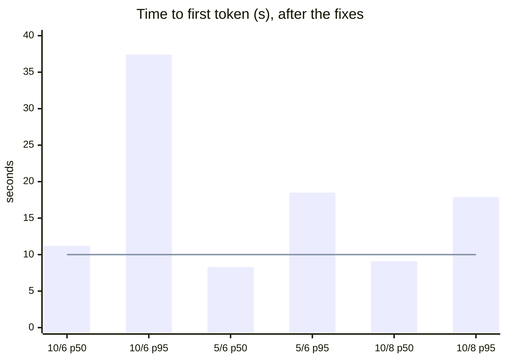
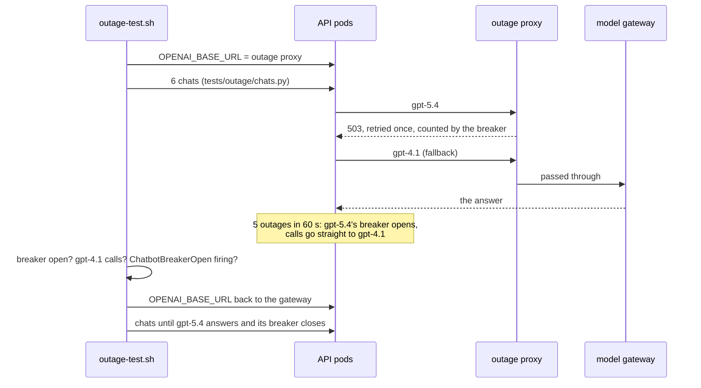

# Phase 12: Load and outage tests

**Goal:** prove the deployed stack: how many users it serves within the latency target, and that a provider outage degrades to the fallback model rather than errors. What to do in a real incident is in the [runbook](runbook.md).

[← Phase 11](phase-11-cost-latency.md) · [Overview](../README.md) · [Runbook](runbook.md)

**Status: run** (2026-10-20 and 21, [PR #10](https://github.com/Anirudh1905/agentic-ai-chatbot/pull/10)). The outage test passes. The load test runs 10 users with no errors, but misses its p95 latency target, which is open.

## Load test

`make load` (`tests/load/run.py`) runs virtual users against the deployed stack, through the gateway, with the reranker on as normally deployed.

- **Each user** has its own account, and they start 13 s apart: registering and logging in are two of the 10 attempts a minute allowed per IP, and they all come from one. Each repeats a conversation for `DURATION` seconds: a knowledge base question from the golden set on a new thread, a follow-up on the same thread, 2 to 5 s of thought. Every fourth conversation asks one of three web questions instead, so the search cache sees repeats.
- **It passes** with no failed turn (a status other than 200, an `error` event, or no `done`) and a p95 time to first token within `P95_TTFT_SECONDS` (10 s). It writes `tests/load/report.json` (gitignored), and each user deletes its account at the end.

| Run | Docker VM | Turns | Failed | First token p50 / p95 | Whole turn p50 / p95 | What it showed |
| --- | --- | --- | --- | --- | --- | --- |
| 10 users, 2026-10-20 | 6 CPUs, 16 GB | 41 | 3 | 10.1 s / 142 s | 10.9 s / 209 s | The VM ran out of memory: the kernel killed an API pod at 2 GB, and Postgres, Redis and every probe stalled |
| 10 users, after the fixes, 2026-10-20 | 6 CPUs, 16 GB | 152 | 0 | 11.2 s / 37.4 s | 11.9 s / 41.2 s | No errors, but searches took 8.2 s at p50 and 25 s at p95, at a load of 33 on 6 cores; Grafana itself timed out |
| 5 users, 2026-10-20 | 6 CPUs, 16 GB | 125 | 0 | 8.3 s / 18.5 s | 8.7 s / 18.8 s | No errors, probe failures or restarts. Follow-ups (no search) 4.0 s at p50, first questions 9.7 s |
| 5 users, 4 minutes, 2026-10-20 | 6 CPUs, 16 GB | 113 | 0 | 8.0 s / 13.7 s | 8.2 s / 14.2 s | The same picture |
| **10 users, 2026-10-21** | **8 CPUs, 24 GB** | **221** | **0** | **9.1 s / 17.9 s** | **9.3 s / 18.4 s** | No errors, probe failures or restarts, at a load of 12 on 8 cores. Searches 4.2 s at p50 and 12.0 s at p95; follow-ups 5.1 s at p50, first questions 10.5 s. The dashboard below is from this run |

Each bar is users/CPUs and a percentile; the line is the 10 s target. The dashboard during the 10-user run on the larger VM; its p95 time to first token (18.7 s) is Prometheus's estimate from histogram buckets, so it differs a little from the load test's 17.9 s:

- **The bottleneck is the CPU reranker, not the model or the app.** Under 10 users model calls stayed at 2.4 to 2.6 s p50 and 4.9 to 7.3 s p95, while knowledge base searches took 8.2 s at p50 on 6 cores and 4.2 s on 8 (reranking adds about 0.5 s on an idle machine, Phase 2). The Docker VM is shared with other projects' containers; with 8 CPUs and 24 GB instead of 6 and 16, searches got twice as fast and the node stayed healthy at 10 users.
- **Fixed along the way:** one rerank at a time per pod (`tools/rerank.py`: concurrent ONNX runs each used every core and allocated their own working memory; with the lock the 10-user run had no out-of-memory kill), API memory requests and limits that match use ([Deployment](phase-9-deployment.md#what-runs-where)), and the load test retrying a dropped login.
- **Capacity on this laptop: 10 users with no errors on 8 CPUs and 24 GB (5 on 6 CPUs and 16 GB), p95 time to first token about 18 s.** The 10 s target holds at p50 (9.1 s), not p95: a turn that searches still waits on the reranker, and first questions take 10.5 s at p50. Meeting it needs a reranker that doesn't compete for the CPU (skipped when busy, fewer candidates, a GPU, or a hosted API); it's kept as is for now, since it raised top-1 retrieval from 96% to 100%.

## Outage test

`make outage-test` (`deploy/outage-test.sh`) rehearses a provider outage on the deployed stack. A proxy (`deploy/outage/proxy.py`, run from the app image) stands in for the model gateway: it answers 503 for every `gpt-5.4` chat call and passes everything else (`gpt-4.1`, embeddings) to the real one. The test points the API at it by setting `OPENAI_BASE_URL` on the Deployment (the environment wins over the secret file), and puts it back when it ends, however it ends.

**Result, 2026-10-21:** passed. All 6 chats finished with no error event (first token in 6 to 12 s). The proxy failed 6 `gpt-5.4` calls. The breaker counts every attempt, retries included, and opens on the fifth; the sixth fits a half-open probe after the 30 s cooldown, which failed and opened it again. Otherwise the proxy passed only `gpt-4.1` calls and embeddings. `ChatbotBreakerOpen` fired for `gpt-5.4`. After the proxy went, `gpt-5.4` answered again and its breaker closed. The [runbook](runbook.md#the-model-provider-is-down) has what to do in a real one.

## Changes from the design

| Designed | Built | Why |
| --- | --- | --- |
| — | **One rerank at a time per pod; 2 Gi requests, 3 Gi limits** | The first run took the node out of memory |
| — | **`DELETE /me` deletes the account inside the user's memory lock, and pushes check the account exists** | Found in the docs review: a push still on the queue ran after the delete and wrote memories back ([Phase 8](phase-8-security-observability.md#deleting-a-users-data)) |

## Tests and checks

- **Across Phases 9 to 12:** `make check` passes 292 tests (2026-10-21) with nothing skipped against the cluster; kubeconform validates the CI overlay, which builds on the local one; CI runs the smoke test.

## Production gaps

A reranker off the API pods' CPU (a GPU or a hosted reranking API), so a search doesn't wait on the CPU under load; the rest are in [Phase 9](phase-9-deployment.md#production-gaps).

## Exit criteria

- [ ] Load test: target concurrent users at the p95 latency target with no errors. Run: 10 users with no errors on 8 CPUs and 24 GB, but p95 time to first token is 17.9 s against 10 s ([Load test](phase-12-load-outage-tests.md#load-test))
- [x] A provider outage degrades to the fallback model, not errors ([Outage test](phase-12-load-outage-tests.md#outage-test))
- [x] Runbook for common incidents: provider outage, stuck interrupts, a PII leak report ([runbook](runbook.md); the stuck-approval query and the reject-on-behalf steps were tried on the cluster)
