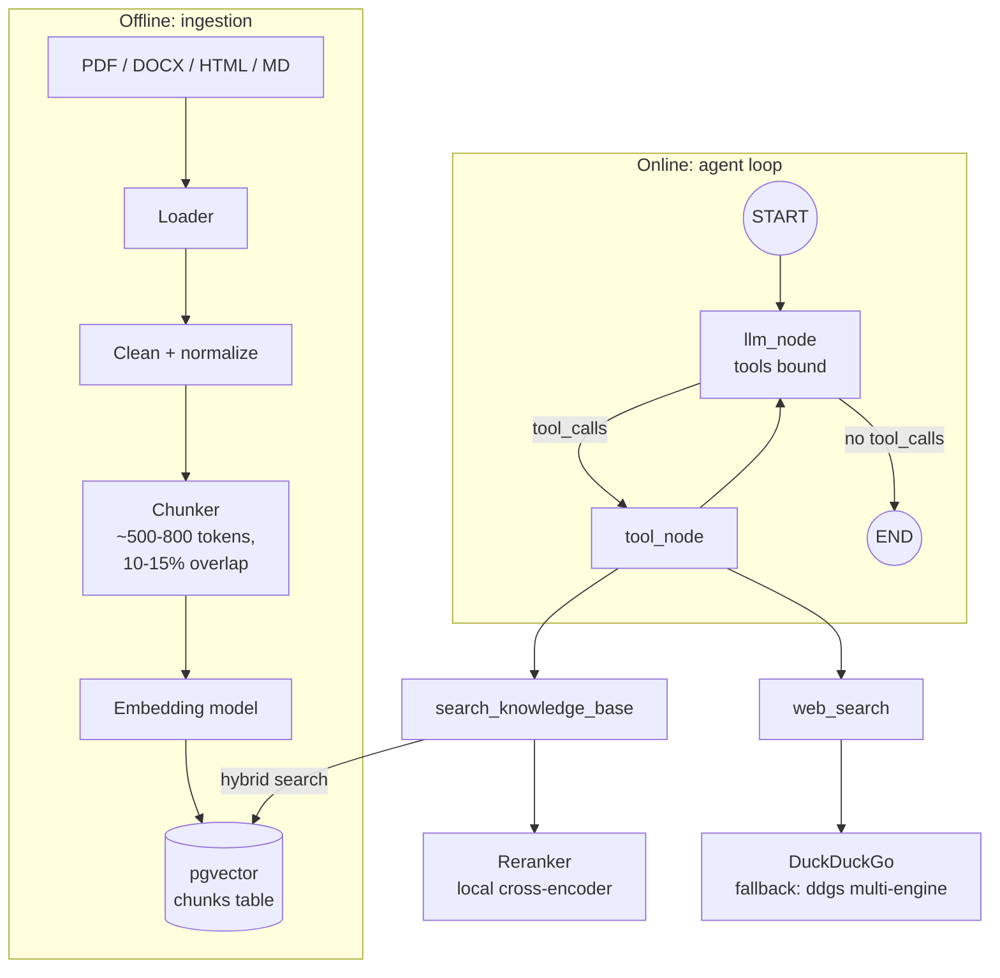
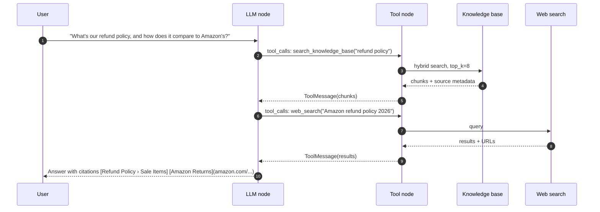

# Phase 2: Tools (RAG + Web Search)

**Goal:** Turn the single LLM call into a ReAct-style agent that decides when to look up internal documents, when to search the web, and when to answer directly.

[← Phase 1](phase-1-foundation.md) · [Overview](README.md) · [Next: Phase 3 →](phase-3-short-term-memory-checkpointing.md)

## Scope

**In scope**
- Ingestion pipeline: load → clean → chunk → embed → index into pgvector
- `search_knowledge_base` tool (RAG retrieval with metadata filters)
- `web_search` tool (DuckDuckGo via `ddgs`, no API key)
- Agent loop: LLM ↔ tool node until the model returns a final answer
- Citations in answers (`[Title › Section]` for documents, markdown links for web pages)

**Out of scope:** approval gates (Phase 4), PII filtering of tool inputs (Phase 5).

## Architecture



## Tool-use sequence



The model can also issue both tool calls in one turn. The tool node runs them in parallel.

## Components

### Ingestion

| Step | Default | Notes |
|------|---------|-------|
| Load | `unstructured` or `pymupdf` for PDFs, `markdownify` for HTML | Keep page numbers and headings as metadata |
| Chunk | Recursive splitter on headings → paragraphs → sentences | Store the heading path in each chunk (`"Policies > Refunds > EU"`) so retrieval results make sense on their own |
| Embed | OpenAI `text-embedding-3-small` (1536 dims), through the same endpoint as the chat model | Pin the model version. Changing it means re-embedding everything |
| Index | pgvector `HNSW` index + Postgres full-text `tsvector` | Both are needed for hybrid search |
| Dedup | Hash of normalized chunk text | Re-ingesting a doc should be a no-op |

Table sketch:

```sql
CREATE TABLE chunks (
  id          uuid PRIMARY KEY,
  doc_id      text NOT NULL,
  source_uri  text NOT NULL,
  heading     text,
  page        int,
  content     text NOT NULL,
  content_tsv tsvector GENERATED ALWAYS AS (to_tsvector('english', content)) STORED,
  embedding   vector(1024) NOT NULL,
  metadata    jsonb DEFAULT '{}',
  content_hash text UNIQUE
);
CREATE INDEX ON chunks USING hnsw (embedding vector_cosine_ops);
CREATE INDEX ON chunks USING gin (content_tsv);
```

### `search_knowledge_base` tool

```python
@tool
async def search_knowledge_base(query: str, filters: dict | None = None, top_k: int = 6) -> list[dict]:
    """Search internal company documents. Use for questions about our
    policies, products, processes or anything not on the public web."""
```

- **Hybrid retrieval:** vector similarity + BM25-style full-text, merged with Reciprocal Rank Fusion.
- **Reranker:** a local cross-encoder (`BAAI/bge-reranker-v2-m3-int8` via fastembed/ONNX) rescores the top 8 fused results and the best 6 go to the model. If it fails, the fused order is used. Measured on the golden set (M3 Pro CPU):

  | Setup | recall@1 | MRR | Added latency (p50) |
  |-------|---:|---:|---:|
  | Hybrid search only | 96% | 0.98 | none |
  | + bge-reranker-v2-m3-int8, 8 candidates | 100% | 1.00 | ~0.5 s |
  | + bge-reranker-v2-m3-int8, 20 candidates | 100% | 1.00 | ~3.8 s |
  | + MiniLM-L-6 / MiniLM-L-12 / jina-tiny | 86–93% | 0.91–0.96 | 0.3–0.7 s |

  The small English rerankers made ranking worse on this corpus. Cross-encoder latency grows quickly with the candidate count, so keep `RERANK_CANDIDATES` small. Re-run `make eval` (it supports `--no-rerank`) when the corpus changes.
- Return `content`, `source_uri`, `heading`, `page` and a stable `chunk_id` so the model can cite.

### `web_search` tool

```python
@tool
async def web_search(query: str, max_results: int = 5) -> list[dict]:
    """Search the public web for current events, third-party info,
    or anything that changes over time."""
```

- Use DuckDuckGo through `ddgs` (no key). It is fast (about 2 s) but sometimes returns nothing, so fall back to `ddgs`'s `auto` backend, which queries several engines. Drop ad links (`/aclick?`). Snippets are short (about 150 characters); Tavily or Brave give richer content if answer quality needs it.
- Apply a timeout and retry with backoff. Return a structured error string on failure rather than raising, so the model can recover.

### Tool descriptions matter

The model picks tools based on the docstrings. Write them as routing rules: what the tool is for, what it's *not* for, and an example query. Most "wrong tool" bugs get fixed here rather than in code.

### Graph changes

```python
llm_with_tools = llm.bind_tools([search_knowledge_base, web_search])
g.add_node("llm", llm_node)
g.add_node("tools", ToolNode([search_knowledge_base, web_search]))
g.add_conditional_edges("llm", tools_condition)   # → "tools" or END
g.add_edge("tools", "llm")
```

Set a `recursion_limit` (e.g. 12) on invocation so a confused model can't loop forever.

## Implementation steps

1. Create `chunks` table migration (Alembic).
2. Build `ingestion/` CLI: `python -m chatbot.ingestion ./data/docs [--prune]`.
3. Implement hybrid search + RRF in `tools/rag.py`; unit-test the fusion logic.
4. Implement `tools/web_search.py` with timeouts and result trimming.
5. Add a `tools/registry.py` so Phase 4 can attach approval policies per tool.
6. Update graph with `ToolNode` and conditional edges.
7. Update the system prompt with citation rules.
8. Emit `tool_start` / `tool_end` SSE events.

## Evaluation

Build a small golden set now (30–50 questions) and keep growing it:

| Metric | How |
|--------|-----|
| Retrieval recall@k | Does the correct chunk appear in the top k? Labelled question → chunk pairs |
| Tool routing accuracy | For each question, the expected tool(s). Did the agent pick them? |
| Answer faithfulness | LLM-as-judge (or Ragas): are claims supported by retrieved context? Planned for Phase 7 |
| Citation correctness | Does every cited source actually contain the claim? Planned for Phase 7 |

The golden set lives in `tests/evals/golden.jsonl` and runs with `make eval` (or the `evals` button in Tilt). It scores retrieval recall@k and tool routing. Routing cases for tools that aren't configured, such as `web_search` without a Tavily key, are skipped and reported.

## Exit criteria

- [ ] Ingesting a folder of docs is idempotent
- [ ] Internal questions route to RAG, current-events questions route to web search, small talk uses neither
- [ ] Answers include citations that resolve to real chunks or URLs
- [ ] Recall@6 ≥ 0.8 on the golden set (tune to your data)
- [ ] Tool failures produce a graceful answer rather than a 500

## Risks and notes

- **Prompt injection through retrieved content.** Web pages and documents can contain instructions. Wrap tool output in clear delimiters, tell the model that tool content is data, and never let tool output trigger tools with side effects without the Phase 4 approval gate.
- **Chunking is the main quality lever.** If answers are poor, look at chunk boundaries before swapping models.
- **Cost.** Each tool round trip resends the whole conversation. Prompt caching on the system prompt and tool definitions helps a lot.
