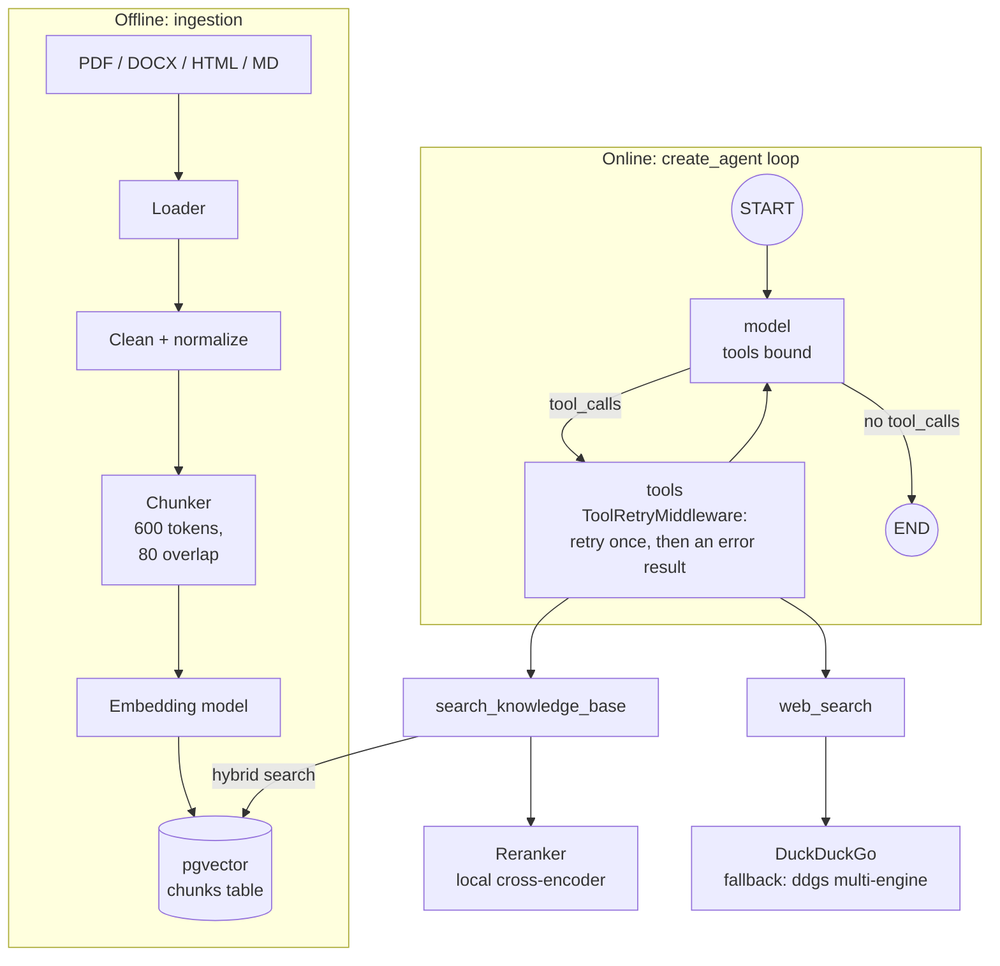
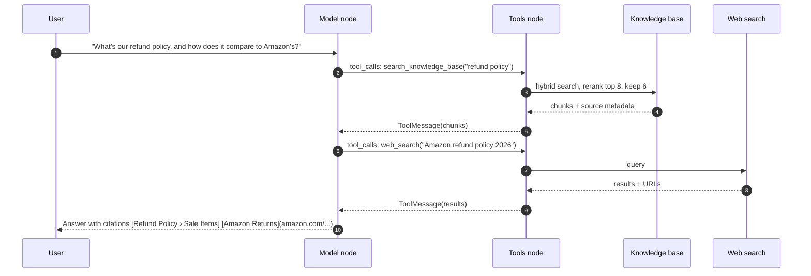

# Phase 2: Tools (RAG + Web Search)

**Goal:** Turn the single LLM call into a ReAct-style agent that decides when to look up internal documents, when to search the web, and when to answer directly.

[← Phase 1](phase-1-foundation.md) · [Overview](../README.md) · [Next: Phase 3 →](phase-3-short-term-memory-checkpointing.md)

**Status: built.** Approval gates come in Phase 4, PII filtering in Phase 5.

| Area | What's built | Section |
| --- | --- | --- |
| Ingestion | Load, clean, chunk, embed and index documents into pgvector; incremental and idempotent | [Ingestion](#ingestion) |
| Knowledge base | `search_knowledge_base`: hybrid search (vector + full-text, fused with RRF), then a local cross-encoder reranker | [Knowledge base search](#knowledge-base-search) |
| Web | `web_search`: DuckDuckGo via `ddgs`, no API key, with a multi-engine fallback | [Web search](#web-search) |
| Agent loop | `create_agent` runs model and tools until the model answers; a model-call limit; one retry for a failed search | [The agent loop](#the-agent-loop) |
| Routing and citations | Tool docstrings and the system prompt decide which tool; answers cite `[Title › Section]` or markdown links | [Routing and citations](#routing-and-citations) |



## Ingestion


`src/chatbot/ingestion/` (`loaders.py`, `chunking.py`, `pipeline.py`), `storage/embeddings.py`, migration `0001_chunks`. Run with `python -m chatbot.ingestion PATH [--prune]`, or `make ingest PATH_TO_DOCS=...` (default `data/sample`, with `--prune`).

| Step | How | Notes |
| --- | --- | --- |
| Load | `pymupdf` for PDFs, `python-docx` for Word, `markdownify` for HTML; Markdown and text as-is | Keeps page numbers and headings as metadata |
| Chunk | LangChain's `MarkdownHeaderTextSplitter`, then `RecursiveCharacterTextSplitter` (600 tokens, 80 overlap) | Each chunk stores its heading path (`"Refund Policy › Sale Items"`) so a result makes sense on its own |
| Embed | OpenAI `text-embedding-3-small` (1536 dims), through the same endpoint as the chat model | Pinned: changing the model means re-embedding everything |
| Index | pgvector `HNSW` index + Postgres full-text `tsvector` | Both are needed for hybrid search |
| Dedup | Hash of each chunk's text, unique per document | Re-ingesting a doc is a no-op; changed chunks are re-embedded, removed ones deleted; `--prune` drops files that no longer exist |

```sql
CREATE TABLE chunks (
  id           uuid PRIMARY KEY DEFAULT gen_random_uuid(),
  doc_id       text NOT NULL,
  source_uri   text NOT NULL,
  title        text NOT NULL,
  heading      text,
  page         int,
  chunk_index  int NOT NULL,
  content      text NOT NULL,
  content_tsv  tsvector GENERATED ALWAYS AS (to_tsvector('english', content)) STORED,
  embedding    vector(1536) NOT NULL,
  metadata     jsonb NOT NULL DEFAULT '{}',
  content_hash text NOT NULL,
  created_at   timestamptz NOT NULL DEFAULT now(),
  UNIQUE (doc_id, content_hash)
);
CREATE INDEX ON chunks USING hnsw (embedding vector_cosine_ops);
CREATE INDEX ON chunks USING gin (content_tsv);
CREATE INDEX ON chunks (doc_id);
```

- **Why not LangChain's indexing API.** `index()` with a record manager does the same incremental sync, but only for a LangChain vector store. Using one (`langchain-postgres`) would mean its own table schema and losing the full-text tuning below, so the ingestion stays custom.
- **Chunking is the main quality lever.** If answers are poor, look at chunk boundaries before swapping models.

## Knowledge base search

`src/chatbot/tools/rag.py` and `tools/rerank.py`.

```python
@tool(response_format="content_and_artifact")
async def search_knowledge_base(query: str) -> tuple[str, list[dict]]:
    """Search Acme Outfitters' internal documents: policies, product care guides,
    and the employee handbook. ... Do not use it for news, current events, or other companies."""
```

- **Hybrid retrieval:** the top `RETRIEVAL_CANDIDATES` (30) by vector similarity and by full-text, merged with Reciprocal Rank Fusion (k = 60). `plainto_tsquery` ANDs every word, which misses most natural questions, so its `&` is swapped for `|` ("any of these words"), ranked by `ts_rank_cd`.
- **Reranker:** a local cross-encoder (`BAAI/bge-reranker-v2-m3-int8` via fastembed/ONNX) rescores the top 8 fused results and the best 6 go to the model (since Phase 11, only as many as fit in `RETRIEVAL_MAX_TOKENS`, 2,500, and at least one). If it fails, the fused order is used. It was chosen by measurement ([Measurements](#measurements)): cross-encoder latency grows quickly with the candidate count, so keep `RERANK_CANDIDATES` small.
- **What it returns:** the content for the model is the hits wrapped in `<kb_results>`, each a `<result cite_as="...">`; the artifact (each hit's `type` (`kb`), `chunk_id`, `doc_id`, `title`, `heading`, `page`, `content`, `score` and `cite_as`) goes to the API as `sources`. Since Phase 10, if the embeddings are down the search runs on full text only and says so in the results.

## Web search

`src/chatbot/tools/web_search.py`.

```python
@tool(response_format="content_and_artifact")
async def web_search(query: str) -> tuple[str, list[dict]]:
    """Search the public web. Use for current events, news, weather, prices, other
    companies, public facts, or anything that changes over time."""
```

- DuckDuckGo through `ddgs` (no key) is fast (about 2 s, 2026-10-12) but sometimes returns nothing, so the tool falls back to `ddgs`'s `auto` backend, which queries several engines. Ad links (`/aclick?`) are dropped.
- Results go to the model in `<web_results>`, each with a markdown-link `cite_as`; the sources carry `type` (`web`), `title`, `url` and `cite_as`. `WEB_SEARCH_MAX_RESULTS` (5) results, each backend call with a `WEB_SEARCH_TIMEOUT` (15 s); `WEB_SEARCH_ENABLED=false` removes the tool.
- If every backend fails (keyless search is rate-limited), the tool raises, and the retry below takes over. Since Phase 10 a circuit breaker counts those failures; while it's open the tool answers "Web search is unavailable right now" at once, without trying or raising. Since Phase 11 results are cached in Redis for `WEB_SEARCH_CACHE_SECONDS` ([Phase 11](phase-11-cost-latency.md#web-search-cache)).
- DuckDuckGo's snippets are short (about 150 characters); Tavily or Brave give richer content if answer quality needs it. `langchain-community`'s DuckDuckGo tool has no fallback, ad filtering or citation artifacts, so this wrapper stays.

## The agent loop

`src/chatbot/agent/builder.py`, `agent/middleware.py`, `tools/registry.py`.

```python
agent = create_agent(model, tools=[search_knowledge_base, web_search], middleware=[
    ...,
    ModelCallLimit(run_limit=settings.max_model_calls, exit_behavior="end"),
    ToolRetryMiddleware(max_retries=1, tools=["search_knowledge_base", "web_search"], ...),
])
```

Since Phase 6, `build_graph` adds a third tool, `remember`, when `MEMORY_ENABLED` is on. It isn't in `RETRYABLE` (`tools/registry.py`), so it's never retried: it writes, and the searches only read.



- `create_agent` binds the tools to the model, runs the tool node for any tool calls, and loops back until the model answers. The model can also issue both tool calls in one turn; the tool node runs them in parallel.
- **Model-call limit:** `ModelCallLimit` (LangChain's `ModelCallLimitMiddleware`, plus a warning in the log when it fires; `MAX_MODEL_CALLS`, default 6) stops a confused model from looping forever. It ends the run with a short message instead of raising.
- **Recursion limit:** LangGraph's `recursion_limit` is set in every run's config too, but only as a backstop (`RECURSION_LIMIT` in `agent/builder.py`, 200): each round is many graph steps, one per middleware hook.
- **Failures:** both tools raise on failure (since Phase 10, except when their dependency is known to be down: see above). `ToolRetryMiddleware` (`tool_retry` in `tools/registry.py`) retries once after 1.5 s, then returns an error result that names only the exception type ("This search failed (TimeoutError). Tell the user it's unavailable right now..."), so the model can still answer. It covers only these two read-only tools: retrying a tool with side effects could do the action twice.
- **Streaming:** tool calls reach the client as `tool_start` (name, input) and `tool_end` (name, sources) SSE events.
- **Cost:** each tool round trip resends the whole conversation. Prompt caching on the system prompt and tool definitions helps a lot. Since Phase 11: the gateway caches prompt prefixes on its own, and the code keeps the prefix stable ([Phase 11](phase-11-cost-latency.md#prompt-caching)).

## Routing and citations

- **Tool docstrings are routing rules:** what the tool is for, what it's *not* for, and an example query. The model picks tools from them, so most "wrong tool" bugs get fixed there rather than in code.
- **The system prompt** (`prompts/system.md`) routes by topic rather than wording: anything about Acme goes to the knowledge base however briefly asked ("express shipping"), and anything that changes over time (who holds an office, prices, news) goes to web search even if the model thinks it knows. Without that, short questions like "president of USA" were answered from stale training data.
- **Citations:** the prompt tells the model to cite every claim from a tool result with its `cite_as`: `[Refund Policy › Sale Items]` for documents, the markdown link as-is for web pages.
- **Retrieved content is data, not instructions.** Web pages and documents can contain instructions, so tool output is wrapped in delimiters (`<kb_results>`, `<web_results>`), and tool output can't trigger tools with side effects without the Phase 4 approval gate. Phase 8's prompt-injection review added `as_data` (`prompts/__init__.py`), so a document or web page can't close those tags early.

## Reference

### Settings

| Setting | Default | Meaning |
| --- | --- | --- |
| `EMBEDDING_MODEL` / `EMBEDDING_DIMENSIONS` | `text-embedding-3-small` / `1536` | On the chat model's endpoint |
| `CHUNK_SIZE_TOKENS` / `CHUNK_OVERLAP_TOKENS` | `600` / `80` | Chunker |
| `RETRIEVAL_CANDIDATES` | `30` | Results from each of vector and full-text search, before fusion |
| `RETRIEVAL_TOP_K` | `6` | Hits returned to the model |
| `RERANKER_MODEL` | `BAAI/bge-reranker-v2-m3-int8` | Empty turns reranking off. About 570 MB, cached in `~/.cache/fastembed` |
| `RERANK_CANDIDATES` | `8` | Fused results the reranker scores |
| `WEB_SEARCH_ENABLED` | `true` | `false` removes the `web_search` tool |
| `WEB_SEARCH_MAX_RESULTS` / `WEB_SEARCH_TIMEOUT` | `5` / `15` s | Per search, per backend call |
| `MAX_MODEL_CALLS` | `6` | Model calls per run |

### Files

| File | What it does |
| --- | --- |
| `migrations/versions/0001_chunks.py` | The `chunks` table (Alembic) |
| `src/chatbot/ingestion/` | `loaders.py`, `chunking.py`, `pipeline.py` (sync and prune), `__main__.py` (the CLI) |
| `src/chatbot/storage/embeddings.py` | The embedding model |
| `src/chatbot/tools/rag.py`, `tools/rerank.py` | Hybrid search, RRF, `search_knowledge_base`; the reranker |
| `src/chatbot/tools/web_search.py` | `web_search`, backends and fallback |
| `src/chatbot/tools/registry.py` | `build_tools`, `tool_retry` |
| `src/chatbot/agent/builder.py`, `agent/middleware.py` | The tools and middleware in `create_agent`; `ModelCallLimit` |
| `src/chatbot/prompts/system.md` | Routing and citation rules |
| `src/chatbot/api/streaming.py` | `tool_start` / `tool_end` events |

### Tests

- `tests/unit/test_ingestion.py`: chunks carry the heading path; long sections split with overlap; the content hash ignores whitespace; the HTML, DOCX and PDF loaders.
- `tests/unit/test_rag.py`, `test_rerank.py`: RRF; `cite_as`; results wrapped and escaped; a failed search is retried once, then reported to the model; the reranker's order and its off switch.
- `tests/unit/test_web_search.py`: trimmed results and sources; ads dropped; fallback to `auto`; raising when every backend fails; no results isn't an error; the agent retries a rate-limited search once, then tells the model.
- `tests/integration/test_knowledge_base.py`: ingest is idempotent and tracks changes; prune; hybrid search finds a keyword match; the tool returns citable results; rerank then keep top k; fall back to fused order when the reranker fails.

### Measurements

The golden set, `tests/evals/golden.jsonl` (44 questions, including short ones like "president of USA" and "express shipping"), runs with `make eval` (or the `evals` button in Tilt). This phase scored retrieval recall@k (labelled question-to-chunk pairs) and tool routing (the expected tools per question). Phase 7 made it a gate on every PR and added judged faithfulness, citations and correctness, with reference answers for the knowledge base questions; see [the Phase 7 doc](phase-7-eval-gate.md).

- **Routing:** 44/44 with `gpt-5.4` (2026-10-13). **Recall:** recall@6 100%, recall@1 100%.
- **Reranker** (golden set, M3 Pro CPU, 2026-10-12):

  | Setup | recall@1 | MRR | Added latency (p50) |
  | --- | ---: | ---: | ---: |
  | Hybrid search only | 96% | 0.98 | none |
  | + bge-reranker-v2-m3-int8, 8 candidates | 100% | 1.00 | ~0.5 s |
  | + bge-reranker-v2-m3-int8, 20 candidates | 100% | 1.00 | ~3.8 s |
  | + MiniLM-L-6 / MiniLM-L-12 / jina-tiny | 86–93% | 0.91–0.96 | 0.3–0.7 s |

  The small English rerankers made ranking worse on this corpus. Re-run `make eval` when the corpus changes; `RERANKER_MODEL=` (empty) runs it without the reranker for comparison.

## Exit criteria

- [x] Ingesting a folder of docs is idempotent (`test_ingest_is_idempotent_and_tracks_changes`)
- [x] Internal questions route to RAG, current-events questions route to web search, small talk uses neither (`make eval`: routing 44/44 with `gpt-5.4`)
- [x] Answers include citations that resolve to real chunks or URLs (`cite_as` on every result; sources returned by the API)
- [x] Recall@6 ≥ 0.8 on the golden set (`make eval`: recall@6 100%, recall@1 100%)
- [x] Tool failures produce a graceful answer rather than a 500 (`test_agent_tells_the_model_when_search_keeps_failing`, `test_failed_search_is_retried_once_then_reported_to_the_model`)
