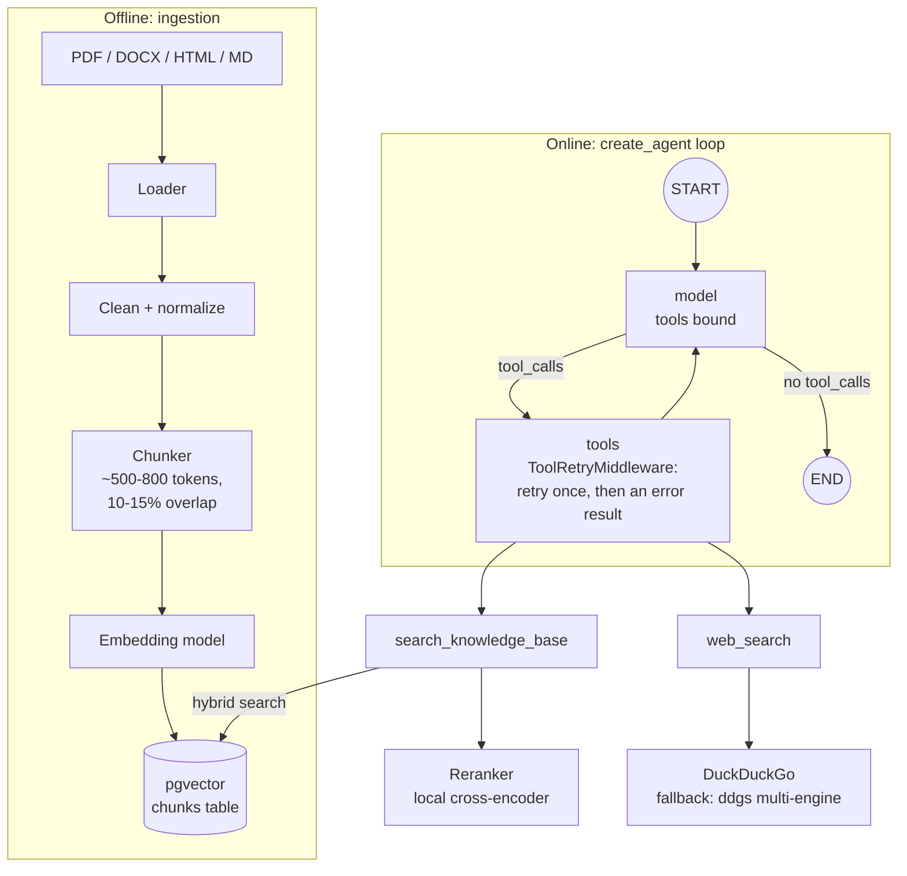
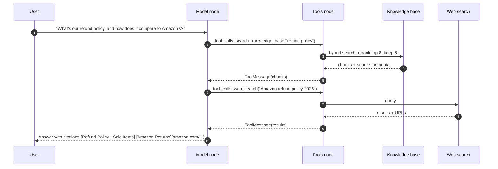

# Phase 2: Tools (RAG + Web Search)

**Goal:** Turn the single LLM call into a ReAct-style agent that decides when to look up internal documents, when to search the web, and when to answer directly.

[← Phase 1](phase-1-foundation.md) · [Overview](README.md) · [Next: Phase 3 →](phase-3-short-term-memory-checkpointing.md)

## Scope

**In scope**
- Ingestion pipeline: load → clean → chunk → embed → index into pgvector
- `search_knowledge_base` tool (RAG retrieval with metadata filters)
- `web_search` tool (DuckDuckGo via `ddgs`, no API key)
- Agent loop: LLM ↔ tool node until the model returns a final answer
- Citations in answers (`[Title › Section]` for documents, markdown links for web pages)

**Out of scope:** approval gates (Phase 4), PII filtering of tool inputs (Phase 5).

## Architecture



## Tool-use sequence



The model can also issue both tool calls in one turn. The tool node runs them in parallel.

## Components

### Ingestion

| Step | Default | Notes |
|------|---------|-------|
| Load | `pymupdf` for PDFs, `python-docx` for Word, `markdownify` for HTML; Markdown and text as-is (`ingestion/loaders.py`) | Keep page numbers and headings as metadata |
| Chunk | LangChain's `MarkdownHeaderTextSplitter`, then `RecursiveCharacterTextSplitter` (600 tokens, 80 overlap) | Store the heading path in each chunk (`"Refund Policy › Sale Items"`) so retrieval results make sense on their own |
| Embed | OpenAI `text-embedding-3-small` (1536 dims), through the same endpoint as the chat model | Pin the model version. Changing it means re-embedding everything |
| Index | pgvector `HNSW` index + Postgres full-text `tsvector` | Both are needed for hybrid search |
| Dedup | Hash of each chunk's text | Re-ingesting a doc is a no-op; changed chunks are re-embedded, removed ones deleted; `--prune` drops files that no longer exist |

The table (`migrations/versions/0001_chunks.py`):

```sql
CREATE TABLE chunks (
  id           uuid PRIMARY KEY DEFAULT gen_random_uuid(),
  doc_id       text NOT NULL,
  source_uri   text NOT NULL,
  title        text NOT NULL,
  heading      text,
  page         int,
  chunk_index  int NOT NULL,
  content      text NOT NULL,
  content_tsv  tsvector GENERATED ALWAYS AS (to_tsvector('english', content)) STORED,
  embedding    vector(1536) NOT NULL,
  metadata     jsonb NOT NULL DEFAULT '{}',
  content_hash text NOT NULL,
  created_at   timestamptz NOT NULL DEFAULT now(),
  UNIQUE (doc_id, content_hash)
);
CREATE INDEX ON chunks USING hnsw (embedding vector_cosine_ops);
CREATE INDEX ON chunks USING gin (content_tsv);
```

LangChain's indexing API (`index()` with a record manager) does the same incremental sync, but only for a LangChain vector store. Using one (`langchain-postgres`) would mean its own table schema and losing the full-text tuning below, so the ingestion stays custom.

### `search_knowledge_base` tool

```python
@tool(response_format="content_and_artifact")
async def search_knowledge_base(query: str) -> tuple[str, list[dict]]:
    """Search Acme Outfitters' internal documents: policies, product care guides,
    and the employee handbook. ... Do not use it for news, current events, or other companies."""
```

The content (results wrapped in `<kb_results>`, each with a `cite_as`) goes to the model; the artifact (the hits as dicts) goes to the API as `sources`.

- **Hybrid retrieval:** vector similarity + full-text, merged with Reciprocal Rank Fusion. `plainto_tsquery` ANDs every word, which misses most natural questions, so its `&` is swapped for `|` ("any of these words"), ranked by `ts_rank_cd`.
- **Reranker:** a local cross-encoder (`BAAI/bge-reranker-v2-m3-int8` via fastembed/ONNX) rescores the top 8 fused results and the best 6 go to the model. If it fails, the fused order is used. Measured on the golden set (M3 Pro CPU):

  | Setup | recall@1 | MRR | Added latency (p50) |
  |-------|---:|---:|---:|
  | Hybrid search only | 96% | 0.98 | none |
  | + bge-reranker-v2-m3-int8, 8 candidates | 100% | 1.00 | ~0.5 s |
  | + bge-reranker-v2-m3-int8, 20 candidates | 100% | 1.00 | ~3.8 s |
  | + MiniLM-L-6 / MiniLM-L-12 / jina-tiny | 86–93% | 0.91–0.96 | 0.3–0.7 s |

  The small English rerankers made ranking worse on this corpus. Cross-encoder latency grows quickly with the candidate count, so keep `RERANK_CANDIDATES` small. Re-run `make eval` (it supports `--no-rerank`) when the corpus changes.
- Return `content`, `source_uri`, `heading`, `page` and a stable `chunk_id` so the model can cite.

### `web_search` tool

```python
@tool(response_format="content_and_artifact")
async def web_search(query: str) -> tuple[str, list[dict]]:
    """Search the public web. Use for current events, news, weather, prices, other
    companies, public facts, or anything that changes over time."""
```

- Use DuckDuckGo through `ddgs` (no key). It is fast (about 2 s) but sometimes returns nothing, so fall back to `ddgs`'s `auto` backend, which queries several engines. Drop ad links (`/aclick?`). Snippets are short (about 150 characters); Tavily or Brave give richer content if answer quality needs it. `langchain-community`'s DuckDuckGo tool has no fallback, ad filtering or citation artifacts, so this wrapper stays.
- Each backend call has a timeout. If every backend fails (keyless search is rate-limited), the tool raises.

### Failures

Both tools raise on failure. LangChain's `ToolRetryMiddleware` (`tool_retry` in `tools/registry.py`) retries once after 1.5 s, then returns an error result that names only the exception type ("This search failed (TimeoutError). Tell the user it's unavailable right now..."), so the model can still answer. It covers only these two read-only tools: retrying a tool with side effects could do the action twice. If the reranker fails, the search falls back to the fused order instead.

### Tool descriptions matter

The model picks tools based on the docstrings. Write them as routing rules: what the tool is for, what it's *not* for, and an example query. Most "wrong tool" bugs get fixed here rather than in code.

The system prompt (`prompts/system.md`) adds routing by topic rather than wording: anything about Acme goes to the knowledge base however briefly asked ("express shipping"), and anything that changes over time (who holds an office, prices, news) goes to web search even if the model thinks it knows. Without that, short questions like "president of USA" were answered from stale training data.

### Agent changes

`create_agent` provides the loop: it binds the tools to the model, runs the tool node for any tool calls, and loops back until the model answers.

```python
agent = create_agent(model, tools=[search_knowledge_base, web_search], middleware=[
    ...,
    ModelCallLimitMiddleware(run_limit=settings.max_model_calls, exit_behavior="end"),
    ToolRetryMiddleware(max_retries=1, tools=["search_knowledge_base", "web_search"], ...),
])
```

`ModelCallLimitMiddleware` (`MAX_MODEL_CALLS`, default 6) stops a confused model from looping forever. It ends the run with a short message instead of raising, unlike a plain `recursion_limit`.

## Implementation steps

1. Create `chunks` table migration (Alembic).
2. Build `ingestion/` CLI: `python -m chatbot.ingestion ./data/docs [--prune]`.
3. Implement hybrid search + RRF in `tools/rag.py`; unit-test the fusion logic.
4. Implement `tools/web_search.py` with timeouts and result trimming.
5. Add a `tools/registry.py` that builds the tools (and, since Phase 4, their retry middleware).
6. Give the agent the tools (`create_agent(..., tools=...)`).
7. Update the system prompt with citation rules.
8. Emit `tool_start` / `tool_end` SSE events.

## Evaluation

Build a small golden set now (30–50 questions) and keep growing it:

| Metric | How |
|--------|-----|
| Retrieval recall@k | Does the correct chunk appear in the top k? Labelled question → chunk pairs |
| Tool routing accuracy | For each question, the expected tool(s). Did the agent pick them? |
| Answer faithfulness | LLM-as-judge (or Ragas): are claims supported by retrieved context? Planned for Phase 7 |
| Citation correctness | Does every cited source actually contain the claim? Planned for Phase 7 |

The golden set lives in `tests/evals/golden.jsonl` and runs with `make eval` (or the `evals` button in Tilt). It scores retrieval recall@k, recall@1 and MRR, and tool routing (44 questions, including short ones like "president of USA" and "express shipping"). Routing cases for a disabled tool, such as `web_search` with `WEB_SEARCH_ENABLED=false`, are skipped and reported.

## Exit criteria

- [x] Ingesting a folder of docs is idempotent (`test_ingest_is_idempotent_and_tracks_changes`)
- [x] Internal questions route to RAG, current-events questions route to web search, small talk uses neither (`make eval`: routing 44/44 with `gpt-5.4`)
- [x] Answers include citations that resolve to real chunks or URLs (`cite_as` on every result; sources returned by the API)
- [x] Recall@6 ≥ 0.8 on the golden set (`make eval`: recall@6 100%, recall@1 100%)
- [x] Tool failures produce a graceful answer rather than a 500 (`test_agent_tells_the_model_when_search_keeps_failing`, `test_failed_search_is_retried_once_then_reported_to_the_model`)

## Risks and notes

- **Prompt injection through retrieved content.** Web pages and documents can contain instructions. Wrap tool output in clear delimiters, tell the model that tool content is data, and never let tool output trigger tools with side effects without the Phase 4 approval gate.
- **Chunking is the main quality lever.** If answers are poor, look at chunk boundaries before swapping models.
- **Cost.** Each tool round trip resends the whole conversation. Prompt caching on the system prompt and tool definitions helps a lot.
