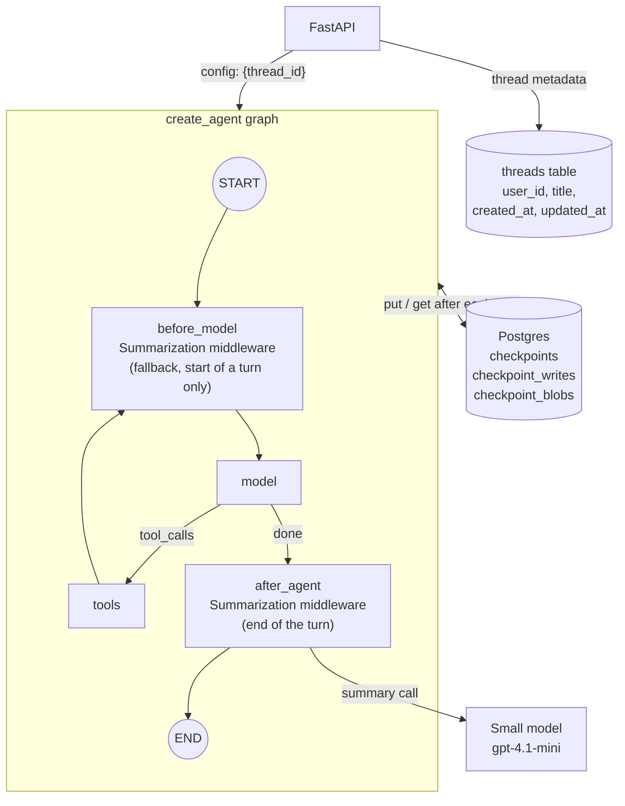
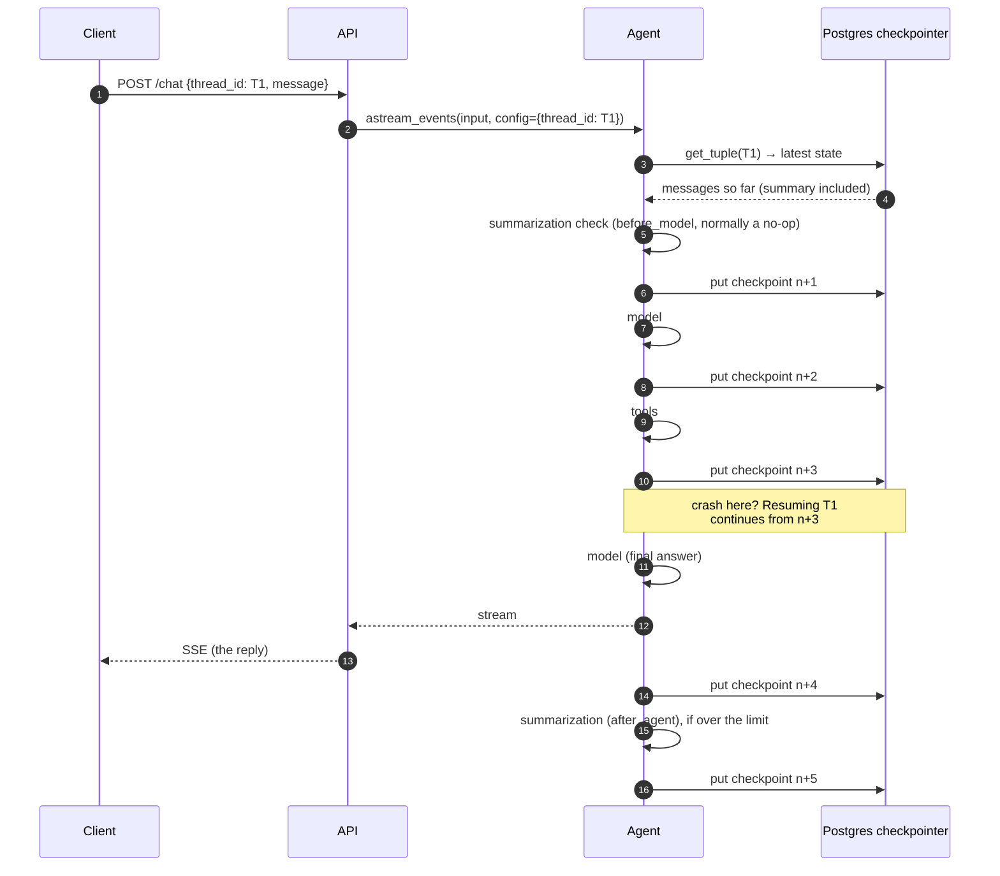
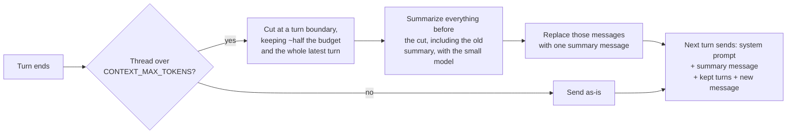

# Phase 3: Short-term memory and checkpointing

**Goal:** Conversations persist. A user can close the tab, come back, and continue the same thread. The graph saves its state after every step, so a crash mid-run can be resumed. Long threads stay within the context window.

[← Phase 2](phase-2-tools-rag-web-search.md) · [Overview](../README.md) · [Next: Phase 4 →](phase-4-human-in-the-loop.md)

**Status: built.** Cross-thread memory is Phase 6; interrupts for a human are Phase 4, which uses this phase's checkpointer.

| Area | What's built | Section |
| --- | --- | --- |
| Checkpointing | `AsyncPostgresSaver`, one per process on the shared pool; a checkpoint after every graph step | [Checkpointing](#checkpointing) |
| Threads | Create, list, read, delete; ownership checks; a `threads` metadata table | [Threads](#threads) |
| Resume and time travel | Finish a run that stopped early; inspect and fork from earlier checkpoints | [Resume and time travel](#resume-and-time-travel) |
| Context window | A rolling summary of older turns (`SummarizationMiddleware`, with five adjustments) | [Context-window management](#context-window-management) |
| Retention | A nightly job that prunes idle threads' history; hard delete on request | [Retention](#retention) |
| Debugging | Logs tagged with request and thread, the history endpoint, pgweb | [Debugging](#debugging) |

Terms used below: a **thread** is one conversation (`thread_id`). A **checkpoint** is a snapshot of graph state saved after each super-step, keyed by `(thread_id, checkpoint_id)`. **Short-term memory** is everything in the thread's state: its messages, including the running summary.



## Checkpointing

`src/chatbot/api/dependencies.py`, with the pool from `storage/db.py`.

```python
pool = await open_pool(settings)            # shared with the RAG tool
checkpointer = AsyncPostgresSaver(pool)    # build_checkpointer(pool), storage/langgraph.py
await checkpointer.setup()                  # creates and migrates the checkpoint tables (since Phase 9: python -m chatbot.migrate)
agent = build_graph(settings, tools=tools, checkpointer=checkpointer)
```



- **One saver per process**, on the connection pool the RAG tool also uses, not one per request. Like the other resources it's built on the first request, so the API still starts when Postgres is down.
- **Two kinds of tables.** `setup()` manages the checkpoint tables. The `threads` table is an Alembic migration (`0002_threads`). Since Phase 9 both come from `python -m chatbot.migrate` (`make migrate`, or the migrate Job), not from the API at startup.
- **More steps than the diagram shows.** Every middleware hook is its own graph step with its own checkpoint, so later phases add several per round trip.
- **State must be serializable.** Don't put clients, DB connections or open files in state.

## Threads

`src/chatbot/api/routes/threads.py`, `routes/chat.py`, and the metadata store in `memory/threads.py`.

| Endpoint | Purpose |
| --- | --- |
| `POST /threads` | Create a thread, return its ID |
| `GET /threads` | List the caller's threads, most recent first (from the `threads` table, not by scanning checkpoints) |
| `GET /threads/{id}/messages` | User messages and replies (with each reply's tools and sources), the summary, and any pending approval |
| `GET /threads/{id}/history` | Checkpoints, for debugging and time travel ([below](#resume-and-time-travel)) |
| `POST /threads/{id}/resume` | Finish a run that stopped early, or fork from an earlier checkpoint ([below](#resume-and-time-travel)) |
| `DELETE /threads/{id}` | `checkpointer.adelete_thread(id)`, then delete the metadata row |

- **`thread_id` is optional** on `POST /chat` and `/chat/stream` (a UUID). Without one a new thread is created. An unknown ID creates a thread with that ID, so clients can generate their own. The `done` SSE event carries the ID either way.
- **Every request checks that the thread belongs to the caller**, or a guessed or leaked ID would expose someone else's conversation. Someone else's thread answers 404, the same as a missing one, so IDs can't be probed. Ownership denials are logged as warnings. The caller comes from the login token (`get_current_user` in `api/security.py`, Phase 8); before that it was an `X-User-Id` header.
- **Dangling tool calls.** If a run dies mid tool call and the user sends a new message instead of resuming, the thread holds a tool call with no result, which the model API rejects. `ModelCallMiddleware` (`agent/middleware.py`) calls `close_dangling_tool_calls` (`memory/short_term.py`), which adds a placeholder result to what the model is sent. The stored state isn't changed. LangChain has no built-in for this.

## Resume and time travel

`POST /threads/{id}/resume` and `GET /threads/{id}/history`, both in `routes/threads.py`.

- **Resume** re-invokes the thread with `None` input, which continues from the last checkpoint: a run killed by a crash, a restart or a client disconnect finishes where it stopped. A thread whose run finished answers 409.
- **History** (`agent.aget_state_history`) lists the checkpoints with their step, source, next node and last message.
- **Fork:** `/resume` with a `checkpoint_id` from the history replays from that checkpoint.
- Phase 4 adds approval decisions to the same endpoint.

## Context-window management

`src/chatbot/memory/short_term.py`, a subclass of LangChain's `SummarizationMiddleware`, with the prompt in `prompts/summarize.md`.



```python
Summarization(                       # subclass of SummarizationMiddleware
    summary_model,
    trigger=("tokens", settings.context_max_tokens),
    keep=("tokens", settings.context_max_tokens // 2),
    summary_prompt=load_prompt("summarize"),
    trim_tokens_to_summarize=None,   # never cut off the previous summary
)
```

- **Threshold:** `CONTEXT_MAX_TOKENS` (10k), measured with LangChain's local estimate (`count_tokens_approximately`). That's far below the model's window on purpose: every turn and every tool round trip resends the history, so cost and latency grow long before the window fills.
- **What's kept:** about the most recent half of the budget, so the next few turns don't trigger another summary straight away.
- **Rolling summary:** the summary is one message in the thread, marked `lc_source: "summarization"` and starting "Here is a summary of the conversation to date". The next summarization folds it in with the newly dropped messages, so it doesn't drift. `GET /threads/{id}/messages` returns it as `summary` and leaves it out of `messages`.
- **What the summarizer is told:** keep names, numbers, dates, order IDs and decisions verbatim, keep answers with their citations, and treat the messages as data.
- **Only the agent's reply is streamed.** `stream_run` (`api/streaming.py`) forwards tokens from the `model` node only, so the summarizer's output never reaches the client.
- **When it runs:** at the end of a turn (`after_agent`), after the reply has streamed, so the user doesn't wait for it before the answer starts (the request still ends once it's done). At the start of the next turn the same check runs again as a fallback, normally finding nothing to do. It catches what the end of the last turn didn't: a new message that pushes the thread over the limit on its own (a long paste), a turn that ended early (the client disconnected, a timeout, a failed summary, a pause for approval), and threads from before this change. Without it, those model calls would go over `CONTEXT_MAX_TOKENS`.

Five adjustments to the built-in, each covered by a test in `tests/unit/test_summarization.py`:

| Built-in behaviour | Problem | Adjustment |
| --- | --- | --- |
| Runs before every model call | Summarized twice in one request, mid-answer, ~7 s each | Never between tool rounds: only at the start of a turn (last message is the user's) |
| Runs before the model answers | The user waited for the summary (~6 s, once 126 s) before the reply began | Runs at the end of the turn, after the reply (`after_agent`); the start-of-turn check is a fallback |
| Cuts anywhere that doesn't split a tool call from its result | Summarized away the question being answered: "What about express shipping?" got an answer about a tent | Cut moves back to the start of a turn and never past the current one |
| Raises if the summary model fails (after its own retries) | The turn fails | The turn goes ahead with the full history; the next turn tries again |
| Summarizes whenever the thread is over the limit | Once the summary alone was near the limit, every turn re-summarized nothing but the previous summary (5–6 s each) | Skips a summary that would fold away only the previous one |

**How fast threads grow**, measured on the sample docs: a turn with a knowledge base search is about 600 tokens (most of it the tool result), and plain chat is 50–150. With the default 10k that's about 16 search turns before the first summary. To watch it happen, set `CONTEXT_MAX_TOKENS=1000`: the third message of a search-heavy thread triggers it.

## Retention

`src/chatbot/memory/retention.py` (`make retention`, or `python -m chatbot.memory.retention [--idle-days N] [--dry-run]`).

- **Pruning:** for threads idle more than `CHECKPOINT_RETENTION_DAYS` (30), keeps only the latest checkpoint plus its pending writes (an interrupted run needs them to resume), and deletes the blobs nothing points to any more. The thread still continues normally; only its time-travel history is gone. Run it nightly (since Phase 9, the `retention` CronJob in `deploy/base/jobs.yaml`, at 03:30).
- **Plain SQL:** the Postgres saver doesn't implement `aprune` (checked up to 3.1.3). It's safe because the graph has no `DeltaChannel` state, which would need the parent chain to reconstruct.
- **Hard delete** of a whole thread is `DELETE /threads/{id}`, not this job.

## Debugging

- **Logs.** One line per request, plus what each turn did, each tagged with the request ID and thread (`ContextFilter` in `observability/logs.py`, `RequestMiddleware` in `api/middleware.py`). `grep thread=<first 8 chars>` follows a conversation:

  ```text
  chatbot.api.routes.chat  [req=daf6ce1f thread=ee996bd2]: continuing thread, message of 28 chars
  chatbot.memory.short_term [req=daf6ce1f thread=ee996bd2]: context: 9 messages, ~1262 tokens
  chatbot.memory.short_term [req=daf6ce1f thread=ee996bd2]: summarized older messages in 7.1s; thread now 6 messages, ~1196 tokens
  chatbot.tools.rag        [req=daf6ce1f thread=ee996bd2]: knowledge base search 'express shipping': 6 hits in 2.3s (top: Shipping Policy › Shipping Options (United States))
  chatbot.agent.middleware [req=daf6ce1f thread=ee996bd2]: model replied in 2.2s (1080 tokens in, 60 out): answer of 236 chars
  chatbot.api              [req=daf6ce1f thread=ee996bd2]: POST /chat -> 200 in 9.01s (user=log-check)
  ```

  Token counts come from the API (`stream_usage=True`; streamed responses don't report usage otherwise). HTTP client, OpenAI SDK, uvicorn access and `/healthz` lines only show with `LOG_LEVEL=DEBUG`.

- **State:** `GET /threads/{id}/history` reads the checkpoints ([Resume and time travel](#resume-and-time-travel)).
- **pgweb** (<http://localhost:8081>; part of `docker compose` and Tilt then, a Deployment in the kind cluster since Phase 9) browses the `threads` and checkpoint tables directly. Checkpoint blobs are msgpack, so use the history endpoint to read state.

## Reference

### Settings

| Setting | Default | |
| --- | --- | --- |
| `CONTEXT_MAX_TOKENS` | `10000` | When a thread is summarized; the most recent half is kept verbatim |
| `SUMMARY_MODEL` | `gpt-4.1-mini` | Writes the summaries, on the same endpoint as `MODEL`. Chosen over `gpt-5-nano`, which took 4–70 s with 8 summaries at once (3 hit the timeout) against 4–11 s |
| `CHECKPOINT_RETENTION_DAYS` | `30` | Idle days before the retention job prunes a thread's history |
| `LOG_LEVEL` | `INFO` | `DEBUG` adds HTTP client, SDK, access and `/healthz` lines |

### Files

| File | What it does |
| --- | --- |
| `src/chatbot/api/dependencies.py`, `storage/langgraph.py` | Creates the saver once per process, on the first request (`build_checkpointer`) |
| `src/chatbot/storage/db.py` | `open_pool`, the shared connection pool |
| `src/chatbot/memory/short_term.py` | `Summarization`, `summarization(settings, model, on_summarize=None)` (`on_summarize` is Phase 6's memory push), `close_dangling_tool_calls` |
| `src/chatbot/prompts/summarize.md` | The summary prompt |
| `src/chatbot/memory/threads.py`, `migrations/versions/0002_threads.py` | The `threads` metadata table and its store |
| `src/chatbot/api/routes/threads.py`, `routes/chat.py` | Thread endpoints, ownership checks, resume and history; optional `thread_id` on `/chat` |
| `src/chatbot/api/streaming.py` | `stream_run`: only the `model` node's tokens |
| `src/chatbot/memory/retention.py` | The retention job |
| `src/chatbot/observability/logs.py`, `api/middleware.py` | `ContextFilter`, `RequestMiddleware`: request and thread IDs on every line |
| `docker-compose.yml` | `pgweb` (since Phase 9, `deploy/local/pgweb.yaml`; the root `docker-compose.yml` is gone) |

### Tests

| Test file | Covers |
| --- | --- |
| `tests/unit/test_summarization.py` | The five adjustments; the dangling-call placeholder; threads remember earlier turns and stay isolated; a crash mid tool call resumes; a long thread stays under budget |
| `tests/unit/test_api.py` | Threads over HTTP: create, list, continue, messages, ownership, delete, history, resume and fork; the summary isn't streamed; request and thread IDs in the logs |
| `tests/integration/test_memory.py` | On Postgres: a thread survives an API restart; a SIGKILLed run resumes; delete removes every checkpoint row; pruning keeps only the latest checkpoint; thread ownership |

### Known issues and notes

- **Summarized messages disappear from the thread view.** Replacing them keeps checkpoints small (each step stores the whole message list), but `GET /threads/{id}/messages` then returns only the recent turns plus the summary. Keeping a full transcript for display would need a separate append-only table.
- **Summaries lose detail.** Exact numbers, names and decisions are often what users ask about later, which is why the summarizer is told to keep them verbatim. Phase 6 long-term memory is the real fix for "remember this forever".
- **Concurrent requests on one thread** both read the same checkpoint and the later write wins. The UI sends one message at a time; a per-thread lock is a Phase 9 concern. **Since Phase 9** a run holds a lease on its thread's row, and a second request meanwhile gets 409 ([Per-thread lock](phase-9-reliability-deployment.md#per-thread-lock)).
- **Checkpoints and logs hold user text.** Checkpoints keep every message, and logs keep search queries as the model wrote them. Since Phase 5 the API redacts PII from the user's message before the agent runs, so both hold the redacted text. Still treat the checkpoint tables as sensitive (encryption at rest, restricted access).

## Exit criteria

- [x] Restart the API mid-conversation. The next message in the same thread has full context (`test_thread_survives_an_api_restart`)
- [x] Kill the process during a tool call. Re-invoking the thread with `None` input resumes from the last checkpoint (`test_run_killed_during_a_tool_call_resumes` SIGKILLs a real process)
- [x] A 200-turn synthetic conversation stays under the token threshold and still answers questions about early turns via the summary (`test_long_thread_is_summarized_and_stays_under_budget`)
- [x] Users cannot read or write threads they don't own (`test_users_cannot_touch_other_users_threads`)
- [x] Deleting a thread removes all its checkpoints (`test_delete_thread_removes_every_checkpoint_row`)
