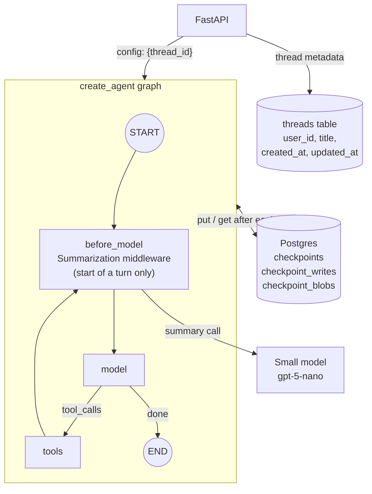
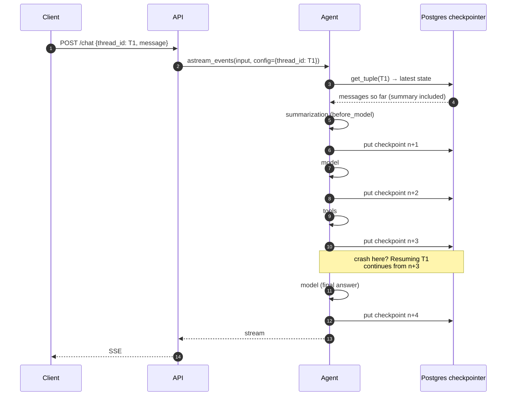
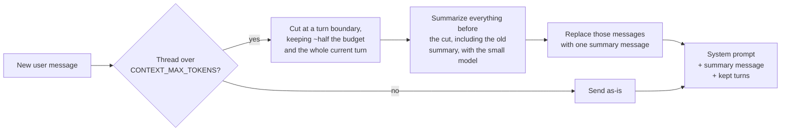

# Phase 3: Short-Term Memory & Checkpointing

**Goal:** Conversations persist. A user can close the tab, come back, and continue the same thread. The graph saves its state after every step, so a crash mid-run can be resumed. Long threads stay within the context window.

[← Phase 2](phase-2-tools-rag-web-search.md) · [Overview](README.md) · [Next: Phase 4 →](phase-4-human-in-the-loop.md)

## Concepts

| Term | Meaning here |
|------|--------------|
| **Thread** | One conversation. Identified by `thread_id` |
| **Checkpoint** | A snapshot of graph state saved after each super-step, keyed by `(thread_id, checkpoint_id)` |
| **Short-term memory** | Everything in the thread's state: messages, including the running summary. Scoped to one thread |
| **Long-term memory** | Facts that outlive a thread. Phase 6, not this one |

## Scope

**In scope**
- `AsyncPostgresSaver` checkpointer
- Thread lifecycle API: create, list, get history, delete
- Context-window management: a rolling summary of older turns
- Resume after a crash or a client disconnect
- Time travel (inspect and fork from earlier checkpoints) for debugging

**Out of scope:** cross-thread memory, interrupts for humans (Phase 4 uses this phase's checkpointer).

## Architecture



## Checkpoint lifecycle



With the Phase 4 middleware there are a few more steps per round trip (one per middleware hook), each with its own checkpoint.

## Context-window management

Messages grow without limit, but the context window doesn't. Older turns are folded into a running summary by LangChain's `SummarizationMiddleware`, configured and slightly adjusted in `src/chatbot/agent/middleware.py`:



```python
Summarization(                       # subclass of SummarizationMiddleware
    summary_model,
    trigger=("tokens", settings.context_max_tokens),
    keep=("tokens", settings.context_max_tokens // 2),
    summary_prompt=load_prompt("summarize"),
    trim_tokens_to_summarize=None,   # never cut off the previous summary
)
```

- **Threshold:** `CONTEXT_MAX_TOKENS` (default 32k), measured with LangChain's local estimate (`count_tokens_approximately`). That's far below the model's window on purpose: every turn and every tool round trip resends the history, so cost and latency grow long before the window fills.
- **What's kept:** about the most recent half of the budget, so the next few turns don't trigger another summary straight away.
- **Rolling summary:** the summary is one message in the thread, marked `lc_source: "summarization"` and starting "Here is a summary of the conversation to date". The next summarization folds it in with the newly dropped messages, so it doesn't drift. `GET /threads/{id}/messages` returns it as `summary` and leaves it out of `messages`.
- **What the summarizer is told** (`prompts/summarize.md`): keep names, numbers, dates, order IDs and decisions verbatim, keep answers with their citations, and treat the messages as data.
- **Only the agent's reply is streamed.** `stream_run` forwards tokens from the `model` node only, so the summarizer's output never reaches the client.

**Three adjustments to the built-in**, each covered by a test in `tests/unit/test_summarization.py`:

| Built-in behaviour | Problem | Adjustment |
|--------------------|---------|------------|
| Runs before every model call | Summarized twice in one request, mid-answer, ~7 s each | Only at the start of a turn (last message is the user's) |
| Cuts anywhere that doesn't split a tool call from its result | Summarized away the question being answered: "What about express shipping?" got an answer about a tent | Cut moves back to the start of a turn and never past the current one |
| Raises if the summary model fails (after its own retries) | The turn fails | The turn goes ahead with the full history; the next turn tries again |

How fast threads grow, measured on the sample docs: a turn with a knowledge base search is about 600 tokens (most of it the tool result), and plain chat is 50–150. With the defaults that's about 50 search turns before the first summary. To watch it happen, set `CONTEXT_MAX_TOKENS=1000`: the third message of a search-heavy thread triggers it.

## Components

### Checkpointer setup

```python
from langgraph.checkpoint.postgres.aio import AsyncPostgresSaver

pool = await open_pool(settings)            # shared with the RAG tool
checkpointer = AsyncPostgresSaver(pool)
await checkpointer.setup()                  # creates and migrates the checkpoint tables
agent = build_graph(settings, tools=tools, checkpointer=checkpointer)
```

The saver is created once per process with the shared connection pool, not per request (`api/dependencies.py`). Like the rest of the resources it's built on the first request, so the API still starts when Postgres is down. The checkpoint tables are managed by `setup()`; the `threads` table is an Alembic migration (`0002`).

### Thread API

| Endpoint | Purpose |
|----------|---------|
| `POST /threads` | Create a thread, return its ID |
| `GET /threads` | List the caller's threads, most recent first (from the `threads` table, not by scanning checkpoints) |
| `GET /threads/{id}/messages` | User messages and replies (with each reply's tools and sources), the summary, and any pending approval |
| `GET /threads/{id}/history` | `agent.aget_state_history(config)` for debugging and time travel |
| `POST /threads/{id}/resume` | Re-invoke with `None` input to finish a run that stopped early. With `checkpoint_id`, replay from an earlier checkpoint (a fork). Phase 4 adds approval decisions |
| `DELETE /threads/{id}` | `checkpointer.adelete_thread(id)`, then delete the metadata row |

`POST /chat` and `/chat/stream` take an optional `thread_id` (a UUID). Without one a new thread is created. An unknown ID creates a thread with that ID, so clients can generate their own; the `done` SSE event carries the ID either way.

Always check that the `thread_id` belongs to the authenticated user. A guessable or leaked thread ID otherwise exposes someone else's conversation. Until real auth in Phase 7, the caller identifies itself with an `X-User-Id` header (`get_user_id` in `api/dependencies.py` is the one function auth will replace). Someone else's thread answers 404, the same as a missing one, so IDs can't be probed.

If a run dies mid tool call and the user sends a new message instead of resuming, the thread holds a tool call with no result, which the model API rejects. `ModelCallMiddleware` (`close_dangling_tool_calls`) adds a placeholder result to what the model is sent; the stored state isn't changed. LangChain has no built-in for this.

### Retention

Checkpoints pile up quickly (one per step, several per turn). Two mechanisms:

- `python -m chatbot.memory.retention` (`make retention`) keeps only the latest checkpoint, plus its pending writes, for threads idle more than `CHECKPOINT_RETENTION_DAYS` (30), and deletes the blobs nothing points to any more. The thread still continues normally; only its time-travel history is gone. Run it nightly. The Postgres saver doesn't implement `aprune` (checked up to 3.1.3), so this is plain SQL. It's safe because the graph has no `DeltaChannel` state, which would need the parent chain to reconstruct.
- Hard delete on user request (`DELETE /threads/{id}`, needed for Phase 5 compliance)

### Debugging and observability

- **Logs.** One line per request, plus what each turn did, each tagged with the request ID and thread (`ContextFilter` in `observability.py`, `RequestLoggingMiddleware` in `api/request_logging.py`). `grep thread=<first 8 chars>` follows a conversation:

  ```text
  chatbot.api.routes.chat  [req=daf6ce1f thread=ee996bd2]: continuing thread, message of 28 chars
  chatbot.agent.middleware [req=daf6ce1f thread=ee996bd2]: context: 9 messages, ~1262 tokens
  chatbot.agent.middleware [req=daf6ce1f thread=ee996bd2]: summarized older messages in 7.1s; thread now 6 messages, ~1196 tokens
  chatbot.tools.rag        [req=daf6ce1f thread=ee996bd2]: knowledge base search 'express shipping': 6 hits in 2.3s
  chatbot.agent.middleware [req=daf6ce1f thread=ee996bd2]: model replied in 2.2s (1080 tokens in, 60 out): answer of 236 chars
  chatbot.api              [req=daf6ce1f thread=ee996bd2]: POST /chat -> 200 in 9.01s (user=log-check)
  ```

  Token counts come from the API (`stream_usage=True`; streamed responses don't report usage otherwise). HTTP client, OpenAI SDK, uvicorn access and `/healthz` lines only show with `LOG_LEVEL=DEBUG`. Ownership denials are logged as warnings.
- **`GET /threads/{id}/history`** lists the checkpoints with their step, source, next node and last message; `POST /threads/{id}/resume` with a `checkpoint_id` replays from one.
- **pgweb** (<http://localhost:8081>, part of `docker compose` and Tilt) browses the `threads` and checkpoint tables directly. Checkpoint blobs are msgpack, so use the history endpoint to read state.

## Implementation steps

1. Add `langgraph-checkpoint-postgres` and create the saver once per process with the shared pool (on the first request rather than in the lifespan, so the API starts without Postgres).
2. Pass `checkpointer` into `build_graph`. `thread_id` stays optional in the request; the API generates one if it's absent, so the agent always runs with one.
3. Add the `threads` metadata table (migration `0002`) and the thread endpoints with ownership checks.
4. Add summarization: `SummarizationMiddleware`, adjusted to run once per turn and cut at turn boundaries.
5. Add the retention job (`chatbot.memory.retention`).
6. Add `GET /threads/{id}/history` and `POST /threads/{id}/resume` for state history, resuming and forking.
7. Add per-request logging with request and thread IDs.

## Exit criteria

- [x] Restart the API mid-conversation. The next message in the same thread has full context (`test_thread_survives_an_api_restart`)
- [x] Kill the process during a tool call. Re-invoking the thread with `None` input resumes from the last checkpoint (`test_run_killed_during_a_tool_call_resumes` SIGKILLs a real process)
- [x] A 200-turn synthetic conversation stays under the token threshold and still answers questions about early turns via the summary (`test_long_thread_is_summarized_and_stays_under_budget`)
- [x] Users cannot read or write threads they don't own (`test_users_cannot_touch_other_users_threads`)
- [x] Deleting a thread removes all its checkpoints (`test_delete_thread_removes_every_checkpoint_row`)

## Risks and notes

- **Serialization.** Everything in state must be serializable by the checkpointer. Don't put clients, DB connections or open files in state.
- **Summarized messages disappear from the thread view.** Replacing them keeps checkpoints small (each step stores the whole message list), but `GET /threads/{id}/messages` then returns only the recent turns plus the summary. Keeping a full transcript for display would need a separate append-only table.
- **Concurrent requests on one thread** both read the same checkpoint and the later write wins. The UI sends one message at a time; a per-thread lock is a Phase 7 concern.
- **Summaries lose detail.** Exact numbers, names and decisions are often what users ask about later, so the summarizer is told to keep those verbatim. Phase 6 long-term memory is the real fix for "remember this forever".
- **Logs contain search queries** as the model wrote them, which can include personal data from the user's message. Phase 5 masks them; until then treat logs like the checkpoint tables.
- **Checkpoints contain raw user text.** Until Phase 5, that includes PII. Treat the checkpoint tables as sensitive from day one (encryption at rest, restricted access).
