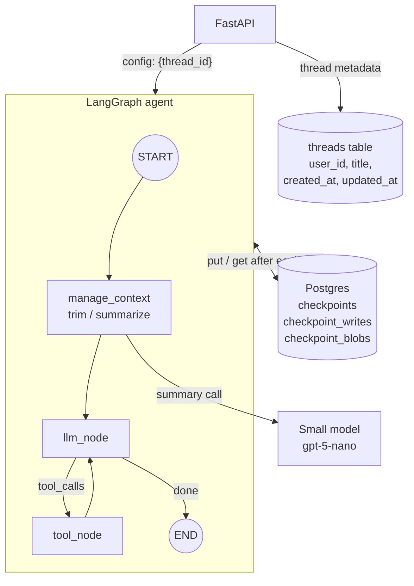
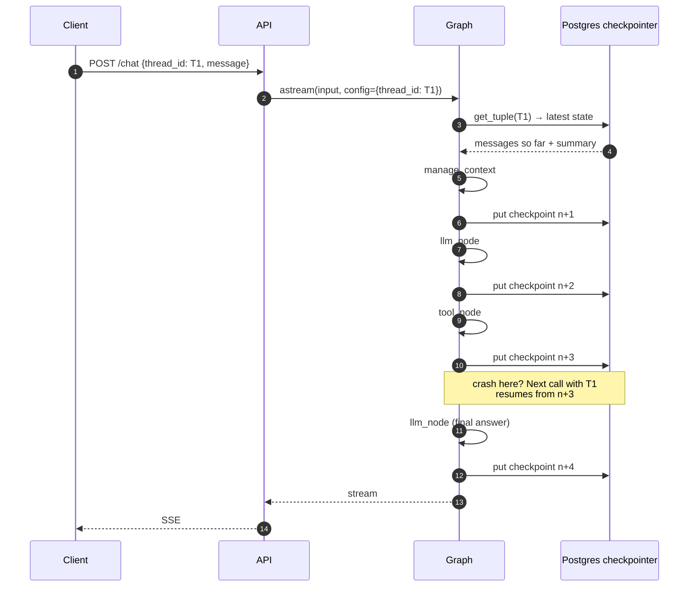
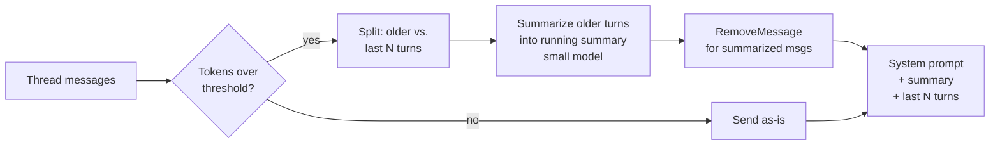

# Phase 3: Short-Term Memory & Checkpointing

**Goal:** Conversations persist. A user can close the tab, come back, and continue the same thread. The graph saves its state after every step, so a crash mid-run can be resumed. Long threads stay within the context window.

[← Phase 2](phase-2-tools-rag-web-search.md) · [Overview](README.md) · [Next: Phase 4 →](phase-4-human-in-the-loop.md)

## Concepts

| Term | Meaning here |
|------|--------------|
| **Thread** | One conversation. Identified by `thread_id` |
| **Checkpoint** | A snapshot of graph state saved after each super-step, keyed by `(thread_id, checkpoint_id)` |
| **Short-term memory** | Everything in the thread's state: messages, running summary, scratch fields. Scoped to one thread |
| **Long-term memory** | Facts that outlive a thread. Phase 6, not this one |

## Scope

**In scope**
- `AsyncPostgresSaver` checkpointer
- Thread lifecycle API: create, list, get history, delete
- Context-window management: trimming plus a rolling summary
- Resume after a crash or a client disconnect
- Time travel (inspect and fork from earlier checkpoints) for debugging

**Out of scope:** cross-thread memory, interrupts for humans (Phase 4 uses this phase's checkpointer).

## Architecture



## Checkpoint lifecycle



## Context-window management

Messages grow without limit, but the context window doesn't. Use a two-part strategy:



- **Threshold:** `CONTEXT_MAX_TOKENS` (default 32k), measured with LangChain's local estimate (`count_tokens_approximately`). That's far below gpt-5-mini's window on purpose: every turn and every tool round trip resends the history, so cost and latency grow long before the window fills.
- **Keep the last N turns verbatim** (`CONTEXT_KEEP_TURNS`, default 6). The kept tail always starts at a user message, so a tool call is never split from its tool result (the API rejects orphaned tool results). If those turns alone take more than half the budget, fewer are kept, so the next turn doesn't trigger another summary straight away. The current turn is always kept whole.
- **Rolling summary** lives in state as `summary: str`. Each summarization folds the previous summary in, so it doesn't drift. It is appended to the system prompt, framed as what the user and the assistant said earlier in this conversation. Without that framing the model treated it as outside information and hedged ("I don't have access to your account") when asked about details from it.
- **Tool outputs are the biggest culprit.** They're truncated to 1,500 characters in what the summarizer sees, and dropped with the rest of the turn once it's summarized. They aren't stubbed while still in the tail, so follow-ups like "what did the second source say?" still work.
- **If summarizing fails**, the turn goes ahead with the full history and the next turn tries again.
- **Checked once per turn**, before the first model call. Tool round trips within a turn aren't rechecked, so one turn with several large searches can go past the threshold until the next turn summarizes it.
- **Only the agent's reply is streamed.** The summarizer's tokens would otherwise show up in the SSE stream, so `stream_run` only forwards tokens from the `llm` node.

How fast threads grow, measured on the sample docs: a turn with a knowledge base search is about 600 tokens (most of it the tool result), and plain chat is 50–150. With the defaults that's about 50 search turns before the first summary; a corpus whose chunks fill the full 600 tokens gets there in about 8. To watch it happen, set `CONTEXT_MAX_TOKENS=1000`: the third message of a search-heavy thread triggers it.

State becomes:

```python
class AgentState(TypedDict):
    messages: Annotated[list[AnyMessage], add_messages]
    summary: NotRequired[str]   # absent until the first summarization
```

## Components

### Checkpointer setup

```python
from langgraph.checkpoint.postgres.aio import AsyncPostgresSaver

pool = await open_pool(settings)            # shared with the RAG tool
checkpointer = AsyncPostgresSaver(pool)
await checkpointer.setup()                  # creates and migrates the checkpoint tables
graph = build_graph(settings, tools=tools, checkpointer=checkpointer)
```

The saver is created once per process with the shared connection pool, not per request (`api/dependencies.py`). Like the rest of the resources it's built on the first request, so the API still starts when Postgres is down. The checkpoint tables are managed by `setup()`; the `threads` table is an Alembic migration.

### Thread API

| Endpoint | Purpose |
|----------|---------|
| `POST /threads` | Create a thread, return its ID |
| `GET /threads` | List the caller's threads, most recent first (from the `threads` table, not by scanning checkpoints) |
| `GET /threads/{id}/messages` | User messages and replies (with each reply's tools and sources) from `graph.aget_state(config)`, plus the summary |
| `GET /threads/{id}/history` | `graph.aget_state_history(config)` for debugging and time travel |
| `POST /threads/{id}/resume` | Re-invoke with `None` input to finish a run that stopped early. With `checkpoint_id`, replay from an earlier checkpoint (a fork) |
| `DELETE /threads/{id}` | `checkpointer.adelete_thread(id)`, then delete the metadata row |

`POST /chat` and `/chat/stream` take an optional `thread_id` (a UUID). Without one a new thread is created. An unknown ID creates a thread with that ID, so clients can generate their own; the `done` SSE event carries the ID either way.

Always check that the `thread_id` belongs to the authenticated user. A guessable or leaked thread ID otherwise exposes someone else's conversation. Until real auth in Phase 7, the caller identifies itself with an `X-User-Id` header (`get_user_id` in `api/dependencies.py` is the one function auth will replace). Someone else's thread answers 404, the same as a missing one, so IDs can't be probed.

If a run dies mid tool call and the user sends a new message instead of resuming, the thread holds a tool call with no result. `llm_node` adds a placeholder result before calling the model; the stored state isn't changed.

### Retention

Checkpoints pile up quickly (one per step, so four or more per turn). Two mechanisms:
- `python -m chatbot.memory.retention` (`make retention`) keeps only the latest checkpoint, plus its pending writes, for threads idle more than `CHECKPOINT_RETENTION_DAYS` (30), and deletes the blobs nothing points to any more. The thread still continues normally; only its time-travel history is gone. Run it nightly. The Postgres saver doesn't implement `aprune`, so this is plain SQL. It's safe because the graph has no `DeltaChannel` state, which would need the parent chain to reconstruct.
- Hard delete on user request (`DELETE /threads/{id}`, needed for Phase 5 compliance)

### Debugging and observability

- **Logs.** One line per request, plus what each turn did, each tagged with the request ID and thread (`ContextFilter` in `observability.py`, `RequestLoggingMiddleware` in `api/middleware.py`). `grep thread=<first 8 chars>` follows a conversation:

  ```
  chatbot.api.routes.chat [req=9f4574e3 thread=46695ac5]: continuing thread, message of 15 chars
  chatbot.graph.builder   [req=9f4574e3 thread=46695ac5]: context: 9 messages, ~1262/1000 tokens
  chatbot.graph.builder   [req=9f4574e3 thread=46695ac5]: over the limit: summarizing the oldest 8 of 9 messages
  chatbot.graph.builder   [req=9f4574e3 thread=46695ac5]: summary updated in 4.0s (2237 chars); thread now ~8 tokens
  chatbot.tools.rag       [req=adbe00b0 thread=6c11b750]: knowledge base search 'refund processing time': 6 hits in 2.5s
  chatbot.graph.builder   [req=adbe00b0 thread=6c11b750]: model replied in 2.2s (1080 tokens in, 60 out): answer of 236 chars
  chatbot.api             [req=9f4574e3 thread=46695ac5]: POST /chat -> 200 in 5.65s (user=log-check)
  ```

  Token counts come from the API (`stream_usage=True`; streamed responses don't report usage otherwise). HTTP client, OpenAI SDK, uvicorn access and `/healthz` lines only show with `LOG_LEVEL=DEBUG`. Ownership denials are logged as warnings.
- **`GET /threads/{id}/history`** lists the checkpoints with their step, source, next node and last message; `POST /threads/{id}/resume` with a `checkpoint_id` replays from one.
- **pgweb** (http://localhost:8081, part of `docker compose` and Tilt) browses the `threads` and checkpoint tables directly. Checkpoint blobs are msgpack, so use the history endpoint to read state.

## Implementation steps

1. Add `langgraph-checkpoint-postgres` and create the saver once per process with the shared pool (on the first request rather than in the lifespan, so the API starts without Postgres).
2. Pass `checkpointer` into `build_graph`. `thread_id` stays optional in the request; the API generates one if it's absent, so the graph always runs with one.
3. Add the `threads` metadata table (migration `0002`) and the thread endpoints with ownership checks.
4. Implement the `manage_context` node with token counting, summarization and `RemoveMessage`.
5. Add the retention job (`chatbot.memory.retention`).
6. Add `GET /threads/{id}/history` and `POST /threads/{id}/resume` for state history, resuming and forking.
7. Add per-request logging with request and thread IDs.

## Exit criteria

- [x] Restart the API mid-conversation. The next message in the same thread has full context (`test_thread_survives_an_api_restart`)
- [x] Kill the process during a tool call. Re-invoking the thread with `None` input resumes from the last checkpoint (`test_run_killed_during_a_tool_call_resumes` SIGKILLs a real process)
- [x] A 200-turn synthetic conversation stays under the token threshold and still answers questions about early turns via the summary (`test_long_thread_is_summarized_and_stays_under_budget`)
- [x] Users cannot read or write threads they don't own (`test_users_cannot_touch_other_users_threads`)
- [x] Deleting a thread removes all its checkpoints (`test_delete_thread_removes_every_checkpoint_row`)

## Risks and notes

- **Serialization.** Everything in state must be serializable by the checkpointer. Don't put clients, DB connections or open files in state.
- **Summarized messages disappear from the thread view.** `RemoveMessage` keeps checkpoints small (each step stores the whole message list), but `GET /threads/{id}/messages` then returns only the recent tail plus the summary. Keeping a full transcript for display would need a separate append-only table.
- **Concurrent requests on one thread** both read the same checkpoint and the later write wins. The UI sends one message at a time; a per-thread lock is a Phase 7 concern.
- **Summaries lose detail.** Exact numbers, names and decisions are often what users ask about later. Tell the summarizer to keep those verbatim. Phase 6 long-term memory is the real fix for "remember this forever".
- **Logs contain search queries** as the model wrote them, which can include personal data from the user's message. Phase 5 masks them; until then treat logs like the checkpoint tables.
- **Checkpoints contain raw user text.** Until Phase 5, that includes PII. Treat the checkpoint tables as sensitive from day one (encryption at rest, restricted access).
