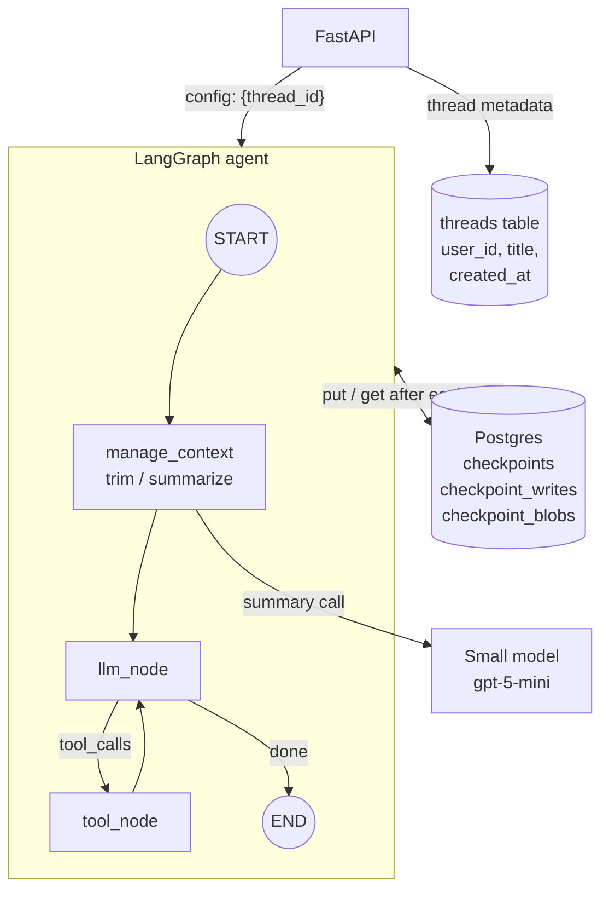
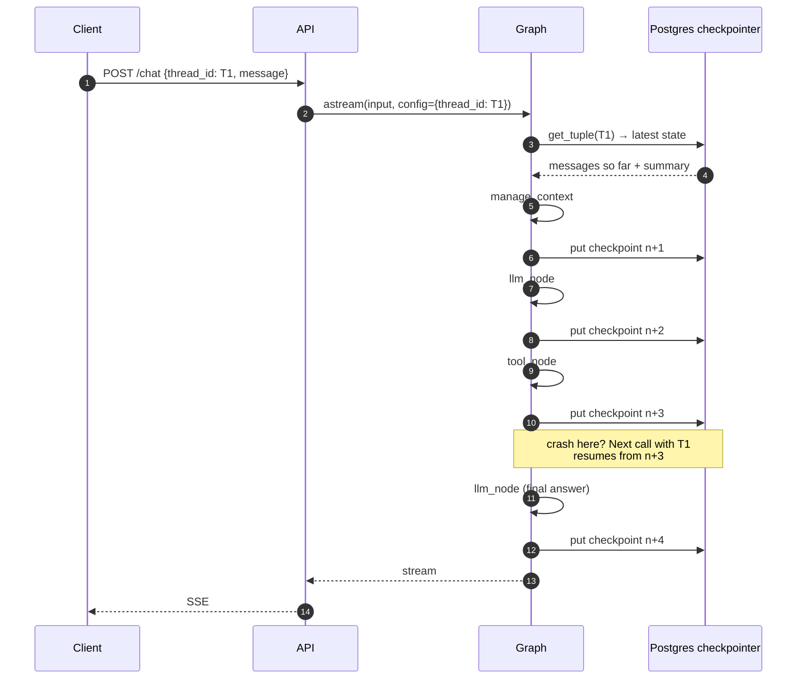
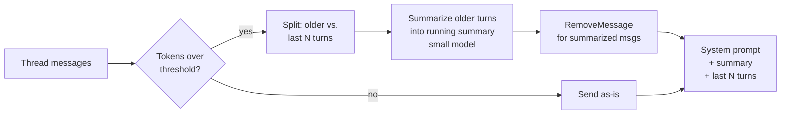

# Phase 3: Short-Term Memory & Checkpointing

**Goal:** Conversations persist. A user can close the tab, come back, and continue the same thread. The graph saves its state after every step, so a crash mid-run can be resumed. Long threads stay within the context window.

[← Phase 2](phase-2-tools-rag-web-search.md) · [Overview](README.md) · [Next: Phase 4 →](phase-4-human-in-the-loop.md)

## Concepts

| Term | Meaning here |
|------|--------------|
| **Thread** | One conversation. Identified by `thread_id` |
| **Checkpoint** | A snapshot of graph state saved after each super-step, keyed by `(thread_id, checkpoint_id)` |
| **Short-term memory** | Everything in the thread's state: messages, running summary, scratch fields. Scoped to one thread |
| **Long-term memory** | Facts that outlive a thread. Phase 6, not this one |

## Scope

**In scope**
- `AsyncPostgresSaver` checkpointer
- Thread lifecycle API: create, list, get history, delete
- Context-window management: trimming plus a rolling summary
- Resume after a crash or a client disconnect
- Time travel (inspect and fork from earlier checkpoints) for debugging

**Out of scope:** cross-thread memory, interrupts for humans (Phase 4 uses this phase's checkpointer).

## Architecture



## Checkpoint lifecycle



## Context-window management

Messages grow without limit, but the context window doesn't. Use a two-part strategy:



- **Threshold:** e.g. 60% of the model's context, measured with the token counting API or a local estimate.
- **Keep the last N turns verbatim** (N ≈ 6–10). Never split a tool call from its tool result. The API rejects orphaned tool results.
- **Rolling summary** lives in state as `summary: str`. Each summarization folds the previous summary in, so it doesn't drift.
- **Tool outputs are the biggest culprit.** Large RAG/web payloads can be replaced with a short stub (`"[web_search: 5 results about X, see citations]"`) once they've been used.

State becomes:

```python
class AgentState(TypedDict):
    messages: Annotated[list[AnyMessage], add_messages]
    summary: str
```

## Components

### Checkpointer setup

```python
from langgraph.checkpoint.postgres.aio import AsyncPostgresSaver

async with AsyncPostgresSaver.from_conn_string(settings.database_url) as checkpointer:
    await checkpointer.setup()          # creates tables on first run
    graph = build_graph(settings, checkpointer=checkpointer)
```

Create the saver once at app startup (FastAPI lifespan) with a connection pool, not per request.

### Thread API

| Endpoint | Purpose |
|----------|---------|
| `POST /threads` | Create a thread, return `thread_id` |
| `GET /threads?user_id=` | List a user's threads (from the `threads` table, not by scanning checkpoints) |
| `GET /threads/{id}/messages` | `graph.aget_state(config).values["messages"]` |
| `GET /threads/{id}/history` | `graph.aget_state_history(config)` for debugging and time travel |
| `DELETE /threads/{id}` | `checkpointer.adelete_thread(id)` + delete metadata row |

Always check that the `thread_id` belongs to the authenticated user. A guessable or leaked thread ID otherwise exposes someone else's conversation.

### Retention

Checkpoints pile up quickly (one per step). Plan for:
- A TTL or nightly job that prunes all but the latest checkpoint for threads idle more than X days
- Hard delete on user request (needed for Phase 5 compliance)

## Implementation steps

1. Add `langgraph-checkpoint-postgres`, init the saver in the FastAPI lifespan.
2. Pass `checkpointer` into `build_graph`; make `thread_id` required (generate one if absent).
3. Add a `threads` metadata table and the thread endpoints with ownership checks.
4. Implement `manage_context` node with token counting, summarization and `RemoveMessage`.
5. Add retention job.
6. Add a debug endpoint or script for state history and forking.

## Exit criteria

- [ ] Restart the API mid-conversation. The next message in the same thread has full context
- [ ] Kill the process during a tool call. Re-invoking the thread with `None` input resumes from the last checkpoint
- [ ] A 200-turn synthetic conversation stays under the token threshold and still answers questions about early turns via the summary
- [ ] Users cannot read or write threads they don't own
- [ ] Deleting a thread removes all its checkpoints

## Risks and notes

- **Serialization.** Everything in state must be serializable by the checkpointer. Don't put clients, DB connections or open files in state.
- **Summaries lose detail.** Exact numbers, names and decisions are often what users ask about later. Tell the summarizer to keep those verbatim. Phase 6 long-term memory is the real fix for "remember this forever".
- **Checkpoints contain raw user text.** Until Phase 5, that includes PII. Treat the checkpoint tables as sensitive from day one (encryption at rest, restricted access).
