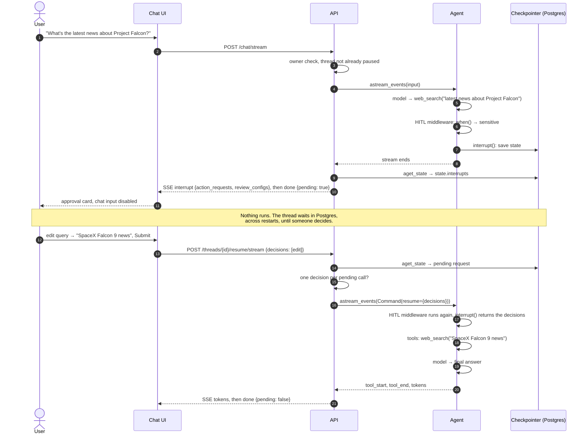
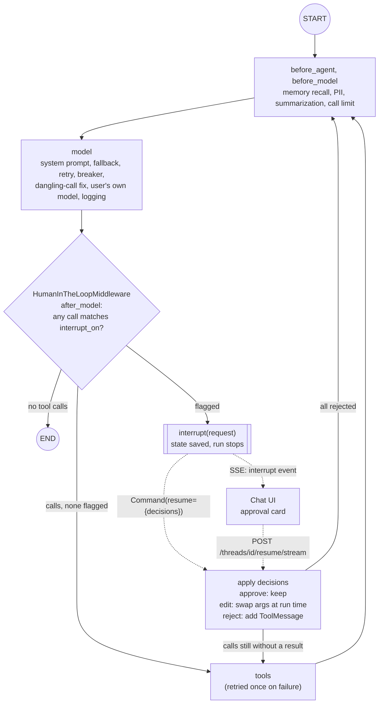
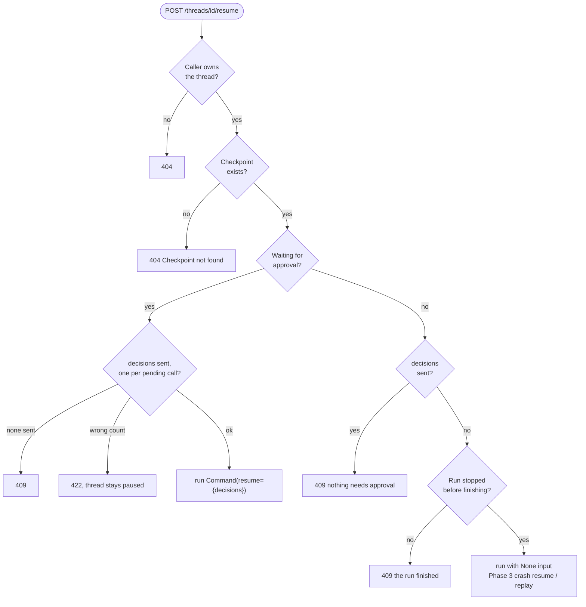
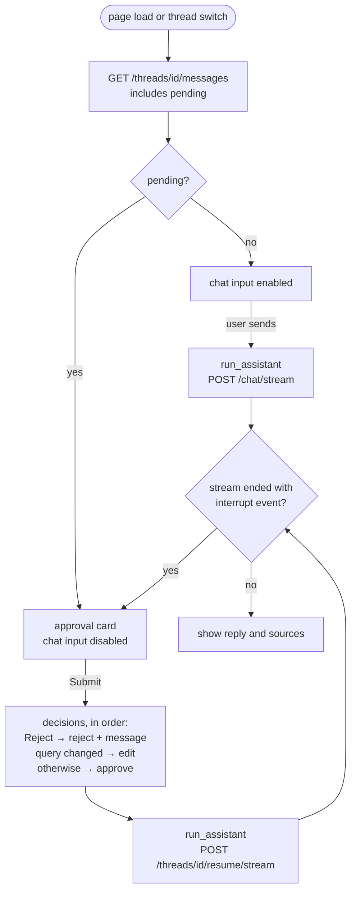

# Phase 4: Human-in-the-loop

**Goal:** The agent can stop and ask a human before it does something risky, expensive or uncertain, then continue exactly where it left off once the human responds, even hours later.

[← Phase 3](phase-3-short-term-memory-checkpointing.md) · [Overview](../README.md) · [Next: Phase 5 →](phase-5-pii-detection-masking.md)

**Status: built** for tool approval. Other pause triggers and the `hitl_events` audit table are [not built](#not-built-other-triggers-and-the-audit-table).

| Area | What's built | Section |
| --- | --- | --- |
| Rules | Which tool calls wait for a human: sensitive web searches, and any tool without a rule | [Approval rules](#approval-rules) |
| Agent | LangChain's `HumanInTheLoopMiddleware`: pause with `interrupt()`, then approve, edit or reject each call | [Pausing and resuming in the agent](#pausing-and-resuming-in-the-agent) |
| API | `pending` in responses, an `interrupt` SSE event, decisions on `/resume` and `/resume/stream` | [API](#api) |
| UI | An approval card that survives a reload | [Chat UI](#chat-ui) |

How it fits together: after each model call, the middleware checks the requested tool calls against our rules. If any match, `interrupt()` saves the thread to the Phase 3 checkpointer and stops the run. The API returns the pending calls, and the UI shows a card. The human's decisions come back through `/resume`, and the agent continues with `Command(resume={"decisions": [...]})`.



## Approval rules

`src/chatbot/agent/approvals.py`; `api/dependencies.py` builds the config from `HITL_ENABLED` and `HITL_SENSITIVE_TERMS`.

`sensitive_reason(query, terms)` returns why a web query could leak information, or `None`. A web query goes to a third-party search engine, so it checks for:

| Check | Example | Reason shown |
| --- | --- | --- |
| A term from `HITL_SENSITIVE_TERMS`, whole word, any case | `Project Falcon launch date` | `The query mentions "Project Falcon", which may be internal information.` |
| An Acme order number (`AC-` + 4 or more digits) | `order AC-55821` | `The query contains an order number.` |

Emails, card numbers and phone numbers used to be checks here too. Since Phase 5 the API redacts them from the user's message before the agent runs (`guardrails/pii.py`), so they can't reach a search, and the checks were removed. Order numbers aren't redacted (the bot needs them to help with an order), so they still pause.

`interrupt_on(tools, terms)` turns that into the middleware's config, one entry per tool:

| Tool | Config | Effect |
| --- | --- | --- |
| `search_knowledge_base` | `False` | Never asks: it only reads Acme's documents |
| `web_search` | `InterruptOnConfig(when=is_sensitive, description=...)` | Asks only when `sensitive_reason` finds something; the reason becomes the card's description |
| anything else | `InterruptOnConfig(...)`, no `when` | Always asks |

- **The last row matters:** the middleware auto-approves tools that aren't listed. Listing every tool ourselves means a future tool with side effects (`send_email`) is gated until someone writes a rule for it.
- **The exception is `remember`** (Phase 6). `build_graph` adds it after the config is built, so it's unlisted and never asks: it only writes the caller's own memories.
- All three decisions (approve, edit, reject) are allowed for every gated tool.

## Pausing and resuming in the agent

`src/chatbot/agent/builder.py` adds `HumanInTheLoopMiddleware(interrupt_on)` last. `create_agent` builds the graph, and each middleware hook becomes a node.



```python
# src/chatbot/agent/builder.py, build_graph (abridged)
middleware = [
    ToolCallMetrics([t.name for t in tools]),            # Phase 8
    *([LongTermMemory(settings.memory_recall_limit)] if memory else []),  # Phase 6
    *(output_middleware() if settings.pii_enabled else []),  # Phase 5: tool results, replies
    summarization(settings, summary_model, on_summarize=...),  # Phase 3
    *([context_editing(settings)] if ... else []),       # Phase 9: clear old tool results
    system_prompt,                                       # today's date, recalled memories
    *([ModelFallbackMiddleware(fallback)] if fallback else []),  # Phase 9
    ModelRetryMiddleware(...),                           # Phase 9: retry outages
    ModelBreaker(breakers),                              # Phase 9: circuit breaker per model
    ModelCallMiddleware(),                               # dangling tool calls, logging
    UserModel(settings),                                 # Phase 8: the user's own endpoint
    ModelCallLimit(run_limit=settings.max_model_calls, exit_behavior="end"),
    *([SpendTokens(usage)] if usage else []),            # Phase 8: daily token budget
]
if retry := tool_retry(tools):                           # ToolRetryMiddleware for the searches
    middleware.append(retry)
if interrupt_on:                                         # HITL_ENABLED
    middleware.append(HumanInTheLoopMiddleware(interrupt_on))
```

What `HumanInTheLoopMiddleware.after_model` does (LangChain's code, summarized):

1. Look at the model's latest tool calls. For each one with a config, run its `when` predicate (if any).
2. If none need approval, do nothing and the tools run.
3. Otherwise call `interrupt()` once with all of them:

   ```json
   {
     "action_requests": [
       {"name": "web_search", "args": {"query": "latest news about Project Falcon"},
        "description": "The query mentions \"Project Falcon\", which may be internal information."}
     ],
     "review_configs": [
       {"action_name": "web_search", "allowed_decisions": ["approve", "edit", "reject"]}
     ]
   }
   ```

4. On resume, `interrupt()` returns `{"decisions": [...]}`, one per action request, matched by position (not tool call ID):

| Decision | What happens |
| --- | --- |
| `{"type": "approve"}` | The tool node runs the call unchanged |
| `{"type": "edit", "edited_action": {"name", "args"}}` | The edited call runs in place of the original; the model's message keeps its own call, and the result starts with a note that a reviewer replaced it |
| `{"type": "reject", "message": "..."}` | A `ToolMessage` with `status="error"` ("User rejected the tool call ... with reason: ...") answers the call; it doesn't run |
| no answer | The thread stays paused; nothing runs |

- **Mixed parallel calls work.** Calls that didn't need approval run as usual, so in one turn some calls can run while others are rejected. Every tool call still ends up with exactly one result, which the model API requires.
- **`interrupt()` doesn't block.** The first time, it stops the run. On resume, LangGraph runs the middleware node again from the top, and `interrupt()` returns the decisions. So our `when` and `description` functions must be pure: they run twice for the same call. It's also why the "paused for approval" log line is written by the API after the run (`chat_response`), not inside the rule.

## API

`src/chatbot/api/routes/threads.py`, `routes/chat.py`, `runs.py`, `streaming.py` and `schemas.py`.

### Reading the pause

`pending_request(state)` (`agent/approvals.py`) returns the first of `state.interrupts` that holds `action_requests`, or `None`. It's used in five places:

- `stream_run` (`api/streaming.py`), after the agent finishes: sends `interrupt` before `done`, and `done` carries `pending: true/false`
- `chat_response` (`api/runs.py`), after `/chat` and `/resume`: sets `pending`, and `reply` is empty while paused
- `open_thread` (`routes/chat.py`), before a new message: a paused thread is a 409, since a new message would leave the pending calls without results
- `GET /threads/{id}/messages`, so a client can rebuild the card after a reload
- `prepare_resume` (`routes/threads.py`), before resuming

### Resuming

| Endpoint | Purpose |
| --- | --- |
| `POST /threads/{id}/resume` | Body: `{"decisions": [...]}`, one per pending call in order. Runs on and returns JSON |
| `POST /threads/{id}/resume/stream` | The same, streamed like `/chat/stream` (what the UI uses) |

`prepare_resume` decides what a request means. The same endpoint also handles Phase 3's crash recovery and replay:



- **The count is checked up front** because the middleware matches decisions to calls by position: a wrong count would only fail inside the middleware, halfway through the run. The decision's shape (a known `type`, and `edited_action` for an edit) is checked by the `Decision` model when the request is parsed.
- **Reject reasons get a suffix.** A bare reason like "no" read to the model as if the tool had failed ("the search tool wasn't available"). So the API appends "It was not run; don't retry it, and answer without it."
- **The reviewer's text is redacted like a message** (Phase 5): string args of an edit, and a reject reason, go through the same PII redaction before they enter the thread.

| Code | When |
| --- | --- |
| 404 | Someone else's thread, or a `checkpoint_id` that doesn't exist |
| 409 | New `/chat` message on a paused thread; `/resume` without decisions on a paused thread; decisions for a thread that isn't paused; nothing to resume; another run on the thread is still going (Phase 9's per-thread lease) |
| 422 | Wrong number of decisions, an unknown decision type, or `edit` without `edited_action` |

## Chat UI

`ui/app.py`.



- `run_assistant(path, body)` streams one assistant turn, for both new messages and resumes.
- `approval_card(pending)` shows each pending call with its description (the rule's reason), an editable query, Approve/Reject, and an optional reason the model sees. Editing the query with Approve selected sends an `edit`.

## Not built: other triggers and the audit table

Tool approval is one of four triggers considered. The others can reuse the same interrupt and resume path:

| Trigger | Example | Human can |
| --- | --- | --- |
| Tool approval (built) | A web search that may leak internal info; any future tool with side effects (send email, create ticket) | Approve, edit args, reject |
| Clarification | The request is ambiguous ("book the usual") | Answer a question |
| Low confidence | RAG returned nothing relevant, and the model is about to guess | Confirm, give a source, or tell it to stop |
| Policy / PII | PII in an outgoing tool call | Allow masked, allow raw, block |

Phase 5 handled PII by redacting it before the agent runs instead of pausing for it.

The plan also had an `hitl_events` table (`thread_id, user_id, tool, original_args, final_args, action, reason, decided_by, decided_at`) and a job that auto-rejects approvals nobody answers. Neither is built. Every pause and decision is in the application log (`paused for approval: web_search({...})`, `decisions: web_search=edit`) with the request and thread IDs, and counted in Prometheus since Phase 8 (`chatbot_approval_pauses_total`, `chatbot_approval_decisions_total{decision}`), and an unanswered thread simply stays paused (nothing runs; a new message gets a 409). Both can be added later without changing the API.

## Reference

### Settings

| Setting | Default | |
| --- | --- | --- |
| `HITL_ENABLED` | `true` | `false` builds the agent without `HumanInTheLoopMiddleware` |
| `HITL_SENSITIVE_TERMS` | `["confidential", "internal", "codename", "Project Falcon", "salary", "payroll", "password"]` | A JSON list in `.env` |

### Files

| File | What it does |
| --- | --- |
| `src/chatbot/agent/approvals.py` | `sensitive_reason`, `interrupt_on(tools, terms)`, `pending_request(state)` |
| `src/chatbot/agent/builder.py` | Adds `HumanInTheLoopMiddleware(interrupt_on)` to the agent |
| `src/chatbot/api/dependencies.py`, `config.py` | Build `interrupt_on` from `HITL_ENABLED` and `HITL_SENSITIVE_TERMS` |
| `src/chatbot/api/streaming.py` | The `interrupt` SSE event, and `pending` on `done` |
| `src/chatbot/api/runs.py` | `chat_response`: `pending` in responses, empty `reply` while paused, the "paused for approval" log line |
| `src/chatbot/api/routes/chat.py` | `open_thread`: 409 on paused threads |
| `src/chatbot/api/routes/threads.py` | `prepare_resume`: decisions on `/resume` and `/resume/stream`; `pending` in `/messages` |
| `src/chatbot/api/schemas.py` | `pending`, `Decision` (an edit must carry `edited_action`), `decisions` on `ResumeRequest` |
| `ui/app.py` | `run_assistant`, `approval_card` |

### Tests

| Test file | Covers |
| --- | --- |
| `tests/unit/test_approvals.py` | `sensitive_reason` cases; the `interrupt_on` config; the agent: safe call runs, sensitive call pauses, approve, edit, reject, mixed parallel decisions. Each run checks that every tool call the model is sent has exactly one result |
| `tests/unit/test_api_hitl.py` | Over HTTP: `pending` in `/chat` and `/messages`, the `interrupt` SSE event, 409s, 422s, approve/edit/reject via `/resume` and `/resume/stream`, mixed decisions, other users get 404 |
| `tests/integration/test_hitl_postgres.py` | A pending approval survives a restart (new pool, saver and agent) and resumes |

**Checked live** with `gpt-5.4`: a "Project Falcon" search paused, an edited query ran instead, a rejection got a sensible reply, a mixed request ran its knowledge-base and REI searches while the rejected one didn't run, and the UI card worked end to end, including after a reload.

### Known issues and notes

- **Approval fatigue.** If everything needs approval, users click "approve" without reading. Start strict, measure the approval rate per rule, and loosen rules that are approved ~100% of the time.
- **Keyword rules are blunt.** "internal" also matches "internal frame backpack", and the model writes its own queries, so a sensitive word in the user's question doesn't always reach the search (in testing, the model sometimes refused an email lookup or sent a salary question to the knowledge base instead). Tune `HITL_SENSITIVE_TERMS`, or replace the rule with a classifier.
- **Edited args aren't validated by the API.** Invalid args fail validation when the tool runs, and the model gets the error as the tool result.

## Exit criteria

- [x] A sensitive web search pauses the run and shows an approval card (`test_sensitive_call_pauses_until_approved`, `test_stream_emits_interrupt_then_done`; the card was driven end to end with Streamlit's `AppTest` against the live model)
- [x] Approve, edit and reject all produce correct, valid follow-up LLM calls (each test checks that every tool call the model is sent has exactly one result)
- [x] Restarting the server while an interrupt is pending, then resuming, works (`test_pending_approval_survives_a_restart`, Postgres)
- [x] Parallel tool calls with mixed decisions (one approved, one rejected) work (`test_parallel_calls_with_mixed_decisions`, `test_mixed_decisions_through_the_api`)
- [ ] Every decision appears in the audit log. Partly: every decision is in the application log, but there's no `hitl_events` table yet
