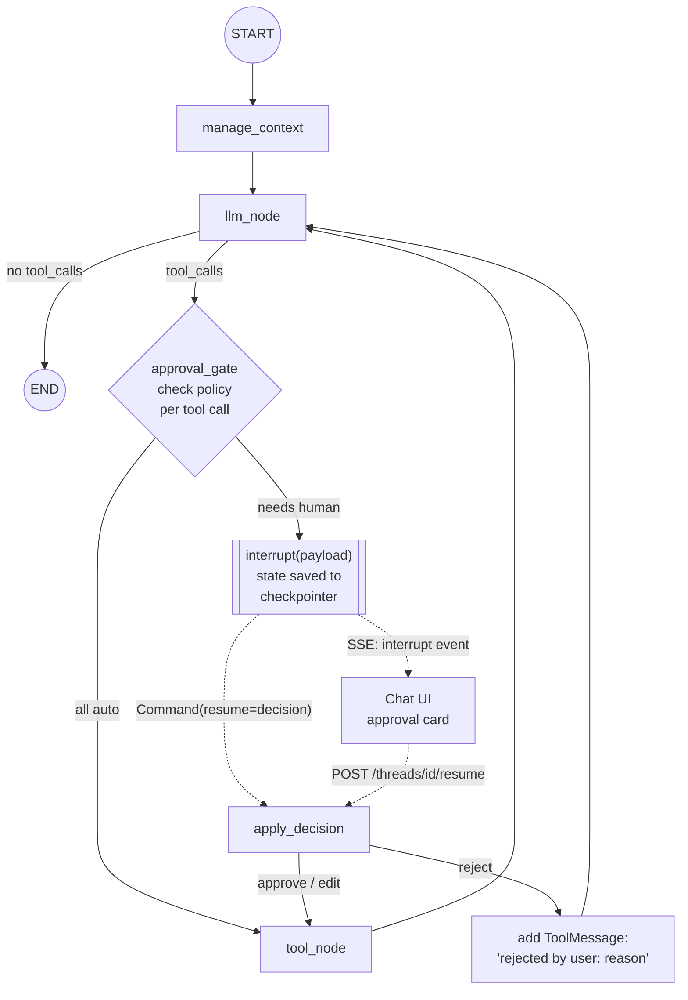
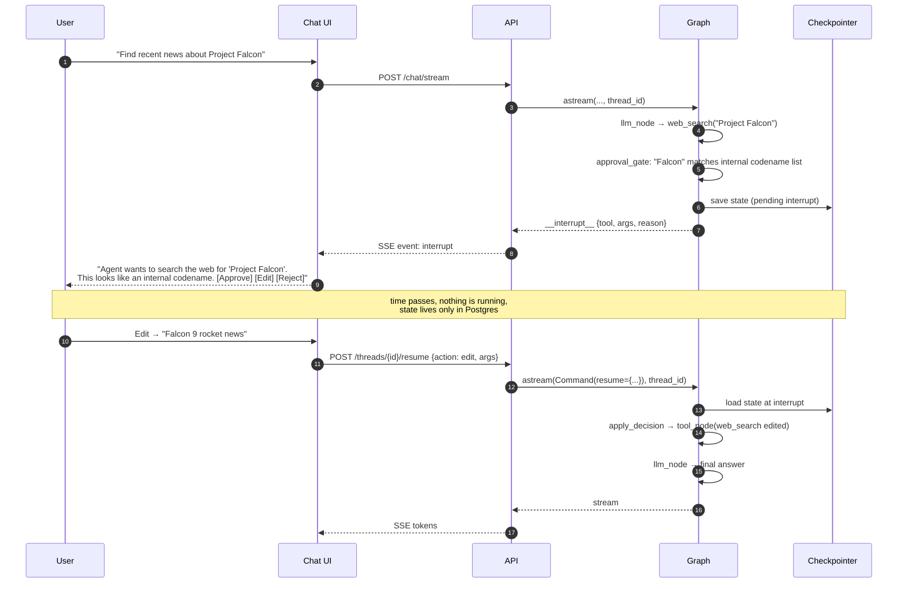

# Phase 4: Human-in-the-Loop (HITL)

**Goal:** The agent can stop and ask a human before it does something risky, expensive or uncertain, then continue exactly where it left off once the human responds, even hours later.

[← Phase 3](phase-3-short-term-memory-checkpointing.md) · [Overview](README.md) · [Next: Phase 5 →](phase-5-pii-detection-masking.md)

## When to interrupt

| Trigger | Example | Human can |
|---------|---------|-----------|
| **Tool approval** | Web search with a query that may leak internal info; any future tool with side effects (send email, create ticket) | Approve, edit args, reject |
| **Clarification** | The request is ambiguous ("book the usual") | Answer a question |
| **Low confidence** | RAG returned nothing relevant, model is about to guess | Confirm, give a source, or tell it to stop |
| **Policy / PII** | Phase 5 detects PII in an outgoing tool call | Allow masked version, allow raw, block |

Approval rules live in a policy table, not hard-coded in nodes:

```python
# hitl/policy.py
POLICIES = {
    "search_knowledge_base": Policy(mode="auto"),
    "web_search":            Policy(mode="conditional", rule=looks_sensitive),
    # future: "send_email": Policy(mode="always"),
}
```

## Architecture



## Interrupt and resume sequence



## Components

### Approval gate node

```python
from langgraph.types import interrupt, Command

async def approval_gate(state: AgentState):
    last = state["messages"][-1]
    pending = [tc for tc in last.tool_calls if POLICIES[tc["name"]].needs_approval(tc, state)]
    if not pending:
        return Command(goto="tools")

    decisions = interrupt({
        "type": "tool_approval",
        "tool_calls": pending,          # name, args, id
        "reasons": [POLICIES[tc["name"]].reason(tc) for tc in pending],
    })
    # decisions: {tool_call_id: {"action": "approve"|"edit"|"reject", "args"?: {...}, "reason"?: str}}
    return apply_decisions(last, decisions)   # → Command(goto="tools"|"llm", update=...)
```

Important behaviour of `interrupt()`: when the graph resumes, **the node re-runs from the top**, and `interrupt()` returns the resume value instead of pausing. So:
- Code before `interrupt()` must be safe to run twice (no side effects, no billing calls).
- Batch all pending approvals into a single interrupt rather than several in a row. It's simpler for the UI and avoids index-matching bugs.

### Decision handling

| Action | What happens |
|--------|--------------|
| `approve` | Tool call runs unchanged |
| `edit` | Replace `args` on the AIMessage's tool call (same `id`), then run |
| `reject` | Insert a `ToolMessage(tool_call_id=..., content="User rejected: <reason>")` and route back to the LLM so it can respond or try something else |
| timeout / abandon | Thread stays paused. A background job can auto-reject after N hours and notify the user |

Every tool call ID in the AIMessage must end up with a matching ToolMessage, or the next LLM call fails. The reject path has to take care of this.

### API additions

| Endpoint | Purpose |
|----------|---------|
| `GET /threads/{id}/pending` | Is the thread waiting on a human? Returns the interrupt payload (`aget_state(config).tasks[*].interrupts`) |
| `POST /threads/{id}/resume` | Body: decisions. Validates them against the pending payload, then streams the continued run |

Reject new `/chat` messages on a thread that has a pending interrupt (HTTP 409), or explicitly auto-reject the pending call first. Don't let both happen silently.

### Audit log

Write every interrupt and decision to an `hitl_events` table: `thread_id, user_id, tool, original_args, final_args, action, reason, decided_by, decided_at`. This is the record you need when someone asks "why did the bot search for that?"

## Implementation steps

1. Add `hitl/policy.py` with per-tool policies and a `looks_sensitive` rule (keyword list to start, classifier later).
2. Add `approval_gate` node between `llm` and `tools`.
3. Implement `apply_decisions` with all three actions, plus validation (edited args must still match the tool's schema).
4. Stream `interrupt` SSE events; add `/pending` and `/resume`.
5. Build the approval card in the UI.
6. Add `hitl_events` audit table.
7. Add the abandoned-interrupt cleanup job.

## Exit criteria

- [ ] A sensitive web search pauses the run and shows an approval card
- [ ] Approve, edit and reject all produce correct, valid follow-up LLM calls
- [ ] Restarting the server while an interrupt is pending, then resuming, works
- [ ] Parallel tool calls with mixed decisions (one approved, one rejected) work
- [ ] Every decision appears in the audit log

## Risks and notes

- **Approval fatigue.** If everything needs approval, users click "approve" without reading. Start strict, measure the approval rate per rule, and loosen rules that are approved ~100% of the time.
- **Non-idempotent pre-interrupt code.** The most common HITL bug. Keep the gate node pure.
- **Edited args bypass validation.** Re-validate edited args against the tool schema and re-run PII checks (Phase 5) on them.
