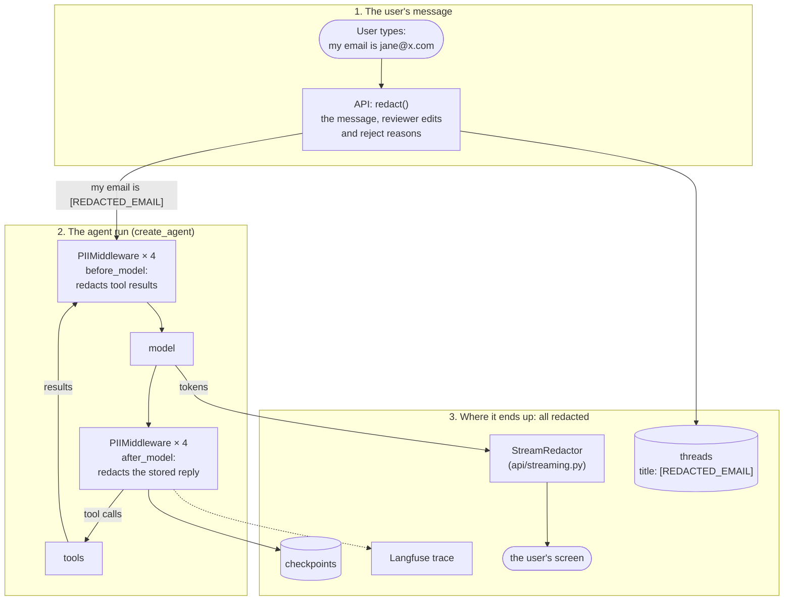

# Phase 5: PII Detection & Masking

**Goal:** Personal data doesn't leak to places it shouldn't go. That covers what the user types and third-party data that comes back from searches. The places to protect: the model provider, third-party APIs (web search), logs and traces, the thread list, checkpoints, replies, and (in Phase 6) long-term memory.

[← Phase 4](phase-4-human-in-the-loop.md) · [Overview](../README.md) · [Next: Phase 6 →](phase-6-long-term-memory.md)

**Status: built, the lean version.** One-way redaction with LangChain's built-in detectors (`RedactionRule`, `PIIMiddleware`): `jane@x.com` becomes `[REDACTED_EMAIL]`. The original plan (Presidio and spaCy, a reversible encrypted vault, a stream buffer for unmasking, a labelled PII eval set) was cut; see [Not built](#not-built). The eval set came later, in Phase 7.

| Area                     | What's built                                                                                     | Section                                                            |
| ------------------------ | ------------------------------------------------------------------------------------------------ | ------------------------------------------------------------------ |
| Rules                    | Email, card number, IP address, phone number. Acme's own email domain and order numbers are kept | [What&#39;s redacted](#whats-redacted)                              |
| The user's message       | `redact()` in the API, before the agent runs, also for a reviewer's edits and reject reasons   | [The user&#39;s message](#the-users-message)                        |
| Tool results and replies | `PIIMiddleware` inside the agent                                                               | [Tool results and stored replies](#tool-results-and-stored-replies) |
| The stream               | `StreamRedactor` on the SSE tokens                                                             | [The streamed reply](#the-streamed-reply)                           |
| Other phases             | A simpler approval rule (Phase 4), a higher step limit                                           | [Effects on other phases](#effects-on-other-phases)                 |

Three places, three mechanisms, one set of rules (`guardrails/pii.py`):



## What's redacted

`src/chatbot/guardrails/pii.py`.

```python
# Card numbers before phones: a card number also looks like a long phone number.
RULES = [
    RedactionRule("email", detector=detect_email).resolve(),    # built-in, minus allowed domains
    RedactionRule("credit_card").resolve(),                       # Luhn-checked
    RedactionRule("ip").resolve(),
    RedactionRule("phone", detector=detect_phone).resolve(),      # our pattern
]

def redact_pii(text) -> tuple[str, list[str]]     # redacted text, types found
def output_middleware() -> list[PIIMiddleware]    # tool results + stored reply
class StreamRedactor                              # feed(token) / flush()
```

- **`detect_email`** is LangChain's detector, minus addresses at `PII_ALLOWED_EMAIL_DOMAINS` (`acme-outfitters.example`), so the bot can still tell customers how to reach support.
- **`detect_phone`** is the only fully custom detector: LangChain has none for phone numbers. It matches 8+ digits with optional spaces, dots, dashes and brackets, and skips dates (in Phase 6, "arrived on 2026-10-16" had come back as `[REDACTED_PHONE]`).
- **Order numbers are kept:** the bot needs them to help with an order. A web query with one still pauses for approval (Phase 4).
- **Logs name types, never values:** `redacted PII from the message: credit_card, email`, `... from a tool result: email`, `... from the reply: phone`. Since Phase 8 each redaction is also counted in the `chatbot_pii_redactions_total` metric, by type and source (`message`, `tool_result`, `reply`).

**What the user sees.** What they typed stays on screen until they reload; after that the thread shows the redacted text. Asked "what email did I give you?", the bot only has the placeholder. Acme's support and returns addresses come through in answers; a third party's email or phone in a document or web page comes through as `[REDACTED_EMAIL]` / `[REDACTED_PHONE]`.

## The user's message

`redact()` in `src/chatbot/api/runs.py`, called by `routes/chat.py` for the message and by `routes/threads.py` for a reviewer's edited query and reject reason, before the agent is invoked.

- This is the only place that keeps the raw value out of every checkpoint and the trace: LangGraph checkpoints the input before any middleware runs.
- The thread title is made from the redacted message.

**Why not `PIIMiddleware` for this.** The first version used it. It redacts in `before_model`, but LangGraph writes the input to the checkpointer **before any node runs**, and middleware hooks are nodes. So every turn left the raw message in one checkpoint: three rows in the database (`checkpoint_writes` for the input, and the `__start__` and `messages` blobs), visible through `GET /threads/{id}/history`. The Langfuse trace recorded the raw input too. A `before_agent` hook made it worse, and `durability="exit"` closed the checkpoint gap but broke Phase 3's crash recovery. For card numbers that's a hard no: a full card number stored in plaintext puts the database in PCI DSS scope.

## Tool results and stored replies

`output_middleware()` in `guardrails/pii.py`, added in `agent/builder.py`.

- One `PIIMiddleware` per type (`LoggedPIIMiddleware`, which adds the log line and metric for each redaction), with `apply_to_input=False` (the API already redacted the message), `apply_to_tool_results=True` and `apply_to_output=True`.
- **Tool results** (knowledge base chunks, web snippets) are redacted before the model reads them, so the model can't repeat a third party's details.
- **The stored reply** is redacted after the model call, so the thread, `/chat` replies and `GET /messages` get the redacted reply.
- In the middleware list it comes after `ToolCallMetrics` (Phase 8) and `LongTermMemory` (Phase 6), which only reads the memory store.

## The streamed reply

`StreamRedactor` in `guardrails/pii.py`, used by `api/streaming.py`. The middleware rewrites the reply only after the model has finished, so the tokens the user watches need redacting on the way out too.

- It holds back the last 128 characters, so a value split across tokens ("jane@ex", "ample.com") is seen whole before anything is released, and it never releases part of a match. Replies shorter than that arrive in one piece at the end of the model call.
- Since Phase 10, a model call that fails partway (and is retried, or goes to the fallback model) gets a fresh `StreamRedactor`, so nothing held back from the failed reply is released.

**Why not `PIIMiddleware`'s own stream transformer.** LangGraph only runs it through `astream_events(version="v3")`, which is marked experimental. We tried it:

- **With v2 streaming** (what the API uses), the stored reply was redacted but the streamed tokens weren't: `write to jane@example.com` reached the UI.
- **With v3**, streamed text was redacted, but with the real model the transformer **dropped tool calls**: the model's message came out empty (`tool_calls: []`) or with empty arguments, so the knowledge-base search failed validation and the model retried until it hit `MAX_MODEL_CALLS`. Without `PIIMiddleware`, v3 kept the arguments. The fake test model sends tool calls in one piece, which is why the tests didn't catch it.

So streaming stays on v2. Worth revisiting when v3 is stable.

## Where PII can leak

| Leak point                            | Risk                                          | Now                                                                                                                                     |
| ------------------------------------- | --------------------------------------------- | --------------------------------------------------------------------------------------------------------------------------------------- |
| LLM provider                          | Data leaves your boundary                     | Covered: the model sees the redacted message and redacted tool results                                                                  |
| Web search API                        | Query sent to a third party, possibly logged  | Covered: queries are written from redacted text, and reviewer edits are redacted. Order numbers in a web query still pause for approval |
| Checkpoints                           | Raw text stored indefinitely                  | The user's text: covered in every checkpoint. Tool results: one checkpoint per call is a [known gap](#known-gaps)                         |
| Thread list                           | Title made from the first message             | Covered                                                                                                                                 |
| Logs                                  | Wide internal access                          | Covered: messages are logged by length, queries come from redacted text, redactions are logged by type only                             |
| Traces                                | Langfuse                                      | Covered for the user's input                                                                                                            |
| Replies                               | Model repeats PII from documents or web pages | Covered: stored and streamed replies are redacted, except Acme's allowed contact emails                                                 |
| Summaries, long-term memory (Phase 6) | Stored permanently                            | Covered: written from the redacted thread                                                                                               |
| Web search cache (Phase 11)           | Raw results in Redis                          | Not covered: the tool caches results before `PIIMiddleware` redacts them, for `WEB_SEARCH_CACHE_SECONDS` (600 s). See [known gaps](#known-gaps) |

## Effects on other phases

- **Approval rule (Phase 4) is simpler.** Emails, card numbers and phone numbers never reach a web query, so `sensitive_reason` in `agent/approvals.py` dropped those checks. It still pauses for the internal-terms list and for order numbers, which aren't redacted.
- **Step limit.** The four `PIIMiddleware` instances add eight graph steps (one per hook) to every model/tool round, so a run with one search went past LangGraph's default limit of 25. Every run's config (`run_config` in `api/runs.py`) now sets `recursion_limit=RECURSION_LIMIT` (200, in `agent/builder.py`); `ModelCallLimitMiddleware` is still the real cap. Setting the limit with `agent.with_config()` didn't take effect, because a run's own config replaces it.

## Reference

### Settings

| Setting                       | Default                         | Effect                                                |
| ----------------------------- | ------------------------------- | ----------------------------------------------------- |
| `PII_ENABLED`               | `true`                        | `false` turns all redaction off                     |
| `PII_ALLOWED_EMAIL_DOMAINS` | `["acme-outfitters.example"]` | JSON list. Emails at these domains are never redacted |

### Files

| File                                                      | What it does                                                                                                                        |
| --------------------------------------------------------- | ----------------------------------------------------------------------------------------------------------------------------------- |
| `src/chatbot/guardrails/pii.py`                         | The rules, `detect_email`, `detect_phone`, `redact_pii`, `LoggedPIIMiddleware` and `output_middleware`, `StreamRedactor` |
| `src/chatbot/api/runs.py`                               | `redact()`: the user's text, before anything stores or sends it; `run_config` sets the recursion limit                          |
| `src/chatbot/api/routes/chat.py`, `routes/threads.py` | Redact the message, and a reviewer's edits and reject reason                                                                        |
| `src/chatbot/api/streaming.py`                          | Runs every streamed token through `StreamRedactor`                                                                                 |
| `src/chatbot/agent/builder.py`                          | Adds `output_middleware()` when `PII_ENABLED`; `RECURSION_LIMIT`                                                               |
| `src/chatbot/agent/approvals.py`                        | `sensitive_reason` without the email, card and phone checks                                                                       |

### Tests

`tests/unit/test_pii.py`:

- each type is redacted, text without PII is untouched, and the phone pattern ignores prices, years and dates
- types are reported for logging, never values
- the model never sees the user's raw PII, and no checkpoint does either, including the input checkpoint (`test_raw_pii_never_reaches_the_model_or_any_checkpoint`)
- the summarizer never sees raw PII
- reviewer edits and reject reasons are redacted
- order numbers and Acme's contact emails are kept
- a third party's email and phone in a reply are redacted, both stored and streamed
- PII in a tool result is redacted before the model reads it
- `StreamRedactor` catches PII split across tokens of any size, and still streams incrementally
- `PII_ENABLED=false` turns it off

`tests/unit/test_api.py` checks the redacted title, the log naming types but not values, long replies streaming in pieces, and that several tool rounds fit in the step limit (`test_several_tool_rounds_fit_in_the_step_limit`).

**Checked live** with `gpt-5.4`:

- **The user's own data:** a message with an email and a card number left 0 rows containing either value across `checkpoint_writes`, `checkpoint_blobs` and the thread title.
- **Acme's contact details:** a question about returns streamed an answer with `returns@acme-outfitters.example` intact.
- **A third party's details:** asked to repeat someone else's email and phone, the bot streamed and stored `[REDACTED_EMAIL]` and `[REDACTED_PHONE]`.

### Known gaps

1. **Raw tool results in one checkpoint.** The tools node writes each result before the next `before_model` hook redacts it, so a third party's PII from a web page or document is stored raw in that step's checkpoint (later checkpoints hold the redacted version). This is third-party data, not what the user typed. Redacting inside the tool call (a `wrap_tool_call` middleware, or in the tools themselves) would close it. Since Phase 11 the same raw results also sit in the Redis web search cache for `WEB_SEARCH_CACHE_SECONDS`; redacting inside the tool would close that too.
2. **Sources.** The `sources` artifact on each tool result (shown as citations) isn't redacted. Knowledge base sources are Acme's own documents; web sources are page titles and URLs.
3. **Detection coverage.** Names, addresses and free-form IDs aren't detected, and are stored as plain text in the checkpoints. LangGraph's `EncryptedSerializer.from_pycryptodome_aes()` would encrypt everything the checkpointer writes; turning it on needs a key from a secrets manager. Not enabled.
4. **No detector is perfect.** Treat redaction as defense in depth, not a guarantee. Keep encryption at rest and access controls on every store.
5. **Over-redaction hurts usefulness.** The phone pattern can catch other long digit runs (some account numbers, tracking numbers). Watch the `redacted PII` log lines for types that look wrong, and add Acme's other contact domains to `PII_ALLOWED_EMAIL_DOMAINS`.
6. **Re-identification.** Several non-PII fields together (job title + city + employer) can still identify a person. Out of scope for pattern matching.

### Not built

From the original plan, plus the fixes for the gaps above:

- **Reversible masking:** `<EMAIL_1>` placeholders mapped back to the real value through an encrypted per-thread vault (`pii_vault` table, AES-GCM, key from a KMS), so replies and internal tools can use the real value.
- **Presidio + spaCy** as a custom detector for names, locations and IDs. `RedactionRule` accepts any detector callable.
- **Redact tool results inside the tool call** (gap 1) and **at-rest encryption** of checkpoints with `EncryptedSerializer` (gap 3).
- **v3 streaming**, to replace `StreamRedactor` with `PIIMiddleware`'s own stream transformer, once v3 is stable and keeps tool calls.
- **A labelled PII eval set** (synthetic data plus tricky cases: names that are words, international phone formats, PII in pasted JSON). Since Phase 7 there is one: `tests/evals/pii_cases.jsonl` (30 cases, scored by `tests/evals/suites/pii.py`), and any drop blocks a PR.

## Exit criteria

- [X] No raw PII in checkpoints, traces or logs, for what the user types (`test_raw_pii_never_reaches_the_model_or_any_checkpoint`; checked live in Postgres). Third-party PII in tool results is redacted everywhere except one checkpoint per tool call (gap 1)
- [X] Web search never receives detected PII without explicit human approval (queries are written from redacted text; reviewer edits are redacted; order numbers pause for approval)
- [ ] The user sees their own details unmasked in replies. Not wanted in the lean version: redaction is one-way
- [ ] Deleting a thread deletes its vault entries. No vault in the lean version
- [ ] Detection metrics meet targets. No target was set; since Phase 7 the labelled set measures 95% recall and 92% of look-alikes left alone (the committed report, run 2026-10-20), and gates every PR ([Phase 7](phase-7-eval-gate.md))
