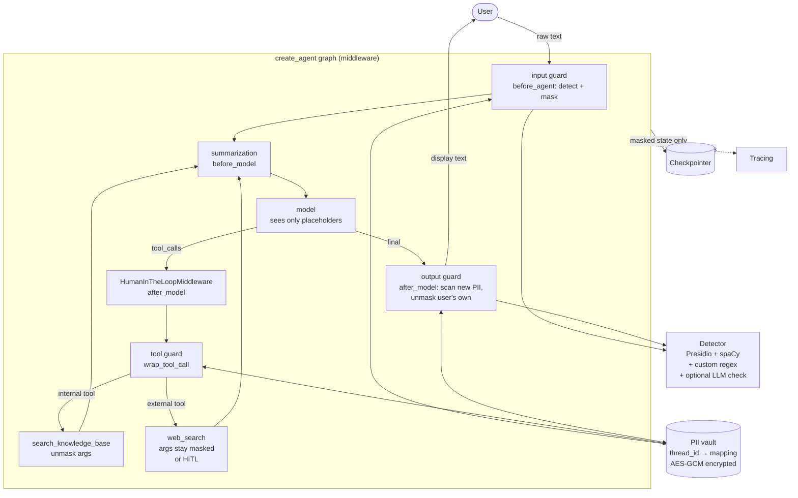
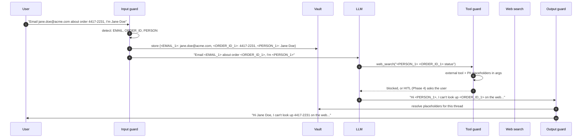

# Phase 5: PII Detection & Masking

**Goal:** Personal data the user types doesn't leak to places it shouldn't go: third-party APIs (web search), logs and traces, checkpoints, and (in Phase 6) long-term memory. The user still sees their own data in replies where it makes sense.

[← Phase 4](phase-4-human-in-the-loop.md) · [Overview](README.md) · [Next: Phase 6 →](phase-6-long-term-memory.md)

## Threat model: where PII can leak

| Leak point | Risk | Control |
|-----------|------|---------|
| LLM provider | Data leaves your boundary | Mask before the LLM call (configurable; see below) |
| Web search API | Query sent to a third party, possibly logged | **Always** mask; HITL if PII is detected in a query |
| Checkpoints | Raw text stored indefinitely | Store masked messages only |
| Traces and logs | Wide internal access | Mask before tracing; never log raw input |
| Long-term memory | Stored permanently, recalled in other threads | Mask, or store only with explicit consent |
| LLM output | Model repeats PII from RAG docs | Output guard scans and masks |

## Scope

**In scope**
- Detection: Presidio analyzer + custom recognizers + optional LLM-based check for free-text PII
- Reversible masking with a per-thread encrypted vault (`<PERSON_1>` ↔ `"Jane Doe"`)
- Input guard, tool-call guard, output guard
- Masked checkpoints and traces
- Admin config: which entity types to mask, per-environment

**Out of scope:** masking inside ingested documents (do it at ingestion time if needed; same library).

## Architecture



## Masking round trip



## Components

### Detector

Layered, cheapest first:

1. **Regex / checksum recognizers:** emails, phone numbers, credit cards (Luhn), IBAN, SSN, plus custom domain IDs (order numbers, employee IDs). Fast and precise.
2. **NER (Presidio + spaCy `en_core_web_lg` or a transformer model):** names, locations, organizations.
3. **Optional LLM check (small model)** for context-dependent PII ("my neighbour who has diabetes"). Run it only when the cheaper layers flag something borderline, or for high-risk tenants.

Configure per entity type: `action: mask | redact | allow` and a confidence threshold. Names need a higher threshold than emails or you'll mask "Jordan" in "flights to Jordan".

### Masking strategies

| Strategy | Example | Use when |
|----------|---------|----------|
| **Reversible placeholder** | `<PERSON_1>` | Default. Model can still reason ("the same person"), output can be unmasked |
| **Irreversible redaction** | `[REDACTED]` | Logs, traces, analytics |
| **Format-preserving fake** | `jane.doe@acme.com` → `user_7f3a@example.com` | When the model needs a realistic value to work with |

Placeholders must be **consistent within a thread**: the same email always maps to `<EMAIL_1>`. The vault handles this.

### Vault

```sql
CREATE TABLE pii_vault (
  thread_id   text NOT NULL,
  placeholder text NOT NULL,
  ciphertext  bytea NOT NULL,       -- AES-GCM, key from KMS
  entity_type text NOT NULL,
  created_at  timestamptz DEFAULT now(),
  PRIMARY KEY (thread_id, placeholder)
);
```

- Key from a KMS (AWS KMS, GCP KMS, Vault). Never store it in the DB or `.env` in production.
- Deleting a thread deletes its vault rows. Without the vault, the masked checkpoints can't be turned back into PII, which makes "delete my data" requests much easier to satisfy.

### The three guards

Since Phase 4 the agent is `create_agent`, so the guards are middleware hooks, not graph nodes:

| Guard | Hook | Behaviour |
|-------|------|-----------|
| Input guard | `before_agent` (runs once per invocation, before anything else) | Mask the new HumanMessage in place, so the checkpoint only ever sees the masked version |
| Tool guard | `wrap_tool_call` (around each tool execution, after the Phase 4 approval) | **Internal tools:** unmask args just before execution if the tool needs real values. **External tools:** keep masked; if the query is meaningless without the PII, it pauses for approval (Phase 4) |
| Output guard | `after_model` on the final message, before streaming to user | Detect *new* PII (e.g. from RAG docs about other people) and mask it; unmask placeholders that the user supplied |

### LangChain built-ins to start from

- **`PIIMiddleware`** (`langchain.agents.middleware`) covers detection and one-way masking: one instance per PII type, with `strategy` `block` / `redact` / `mask` / `hash`, applied to input, output and/or tool results (`apply_to_input`, `apply_to_output`, `apply_to_tool_results`). It has built-in detectors for email, credit card, IP, MAC address and URL, and takes a custom `detector` callable, so Presidio can plug in for names, phone numbers and IDs.
- **What it doesn't do** is the reversible part: the per-thread vault and turning `<PERSON_1>` back into "Jane Doe" for the user. That stays custom, as a small middleware that shares the vault.
- **Already in place:** Phase 4's approval rule uses LangChain's `detect_email` and `detect_credit_card`, plus phone and order-number patterns, so a web search containing those already waits for a human. Phase 5 changes that from "ask" to "mask, then ask only if the query needs the real value".

### Should the LLM see raw PII?

Make it a setting, `PII_MASK_FOR_LLM=true|false`:
- **true** (default): the provider never sees PII. Small quality cost.
- **false**: for deployments with a zero-retention agreement where the model needs real values. Checkpoints, tools, logs and memory remain masked either way.

### Streaming wrinkle

The output guard needs whole placeholders to unmask, but tokens arrive in fragments (`<PER`, `SON_1>`). Buffer the stream until any open `<...` is closed, then flush. Detecting *new* PII in streamed output is harder. Either run the output guard on sentence boundaries or accept a small delay.

## Implementation steps

1. Add `presidio-analyzer`, `presidio-anonymizer`, spaCy model; build `pii/detector.py` with custom recognizers.
2. Build `pii/vault.py` with encryption and the consistent-placeholder logic.
3. Add the three guards as middleware: `PIIMiddleware` instances (with a Presidio `detector`) for detection, plus a small vault middleware for reversible placeholders.
4. Add a tracing callback that redacts before export.
5. Add the stream buffer for placeholder unmasking.
6. Hook PII-in-external-tool-args into the Phase 4 approval rule (`hitl/policy.py`).
7. Add the PII config (entity types, thresholds, `PII_MASK_FOR_LLM`).

## Evaluation

Build a labelled PII test set (synthetic data, e.g. generated with Faker, plus tricky cases):

| Metric | Target (tune) |
|--------|---------------|
| Recall on high-risk entities (SSN, card, email, phone) | ≥ 0.99 |
| Recall on names/locations | ≥ 0.90 |
| False-positive rate on a clean corpus | ≤ 2% |
| Answer quality on the Phase 2 golden set with masking on vs. off | Small drop only |

Tricky cases to include: names that are also words ("Will", "Faith"), international phone formats, PII split across lines, PII in pasted JSON/CSV, and PII in other languages if you support them.

## Exit criteria

- [ ] No raw PII in checkpoints, traces or logs (verified by scanning the DB and trace export with the detector)
- [ ] Web search never receives detected PII without explicit human approval
- [ ] The user sees their own details unmasked in replies
- [ ] Deleting a thread deletes its vault entries
- [ ] Detection metrics meet the targets above

## Risks and notes

- **No detector is perfect.** Treat masking as defense in depth, not a guarantee. Keep encryption at rest and access controls on every store.
- **Over-masking hurts usefulness.** Track false positives as closely as misses.
- **Re-identification.** Several non-PII fields together (job title + city + employer) can still identify a person. Out of scope for regex. Note it in the privacy review.
