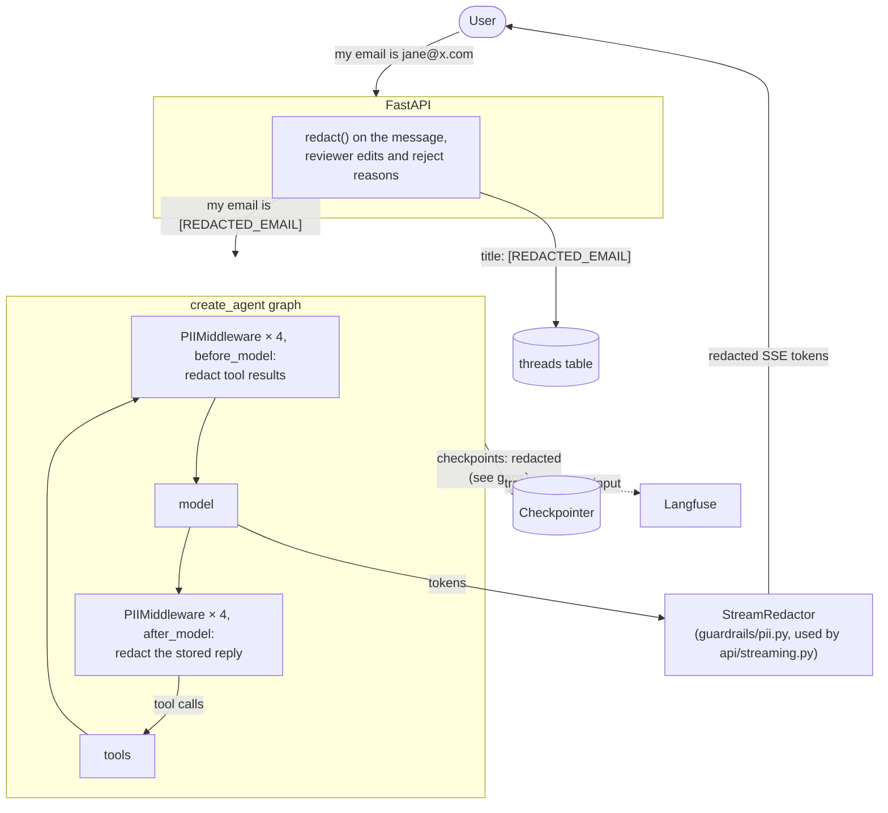

# Phase 5: PII Detection & Masking

**Goal:** Personal data doesn't leak to places it shouldn't go. That covers what the user types and third-party data that comes back from searches. The places to protect: the model provider, third-party APIs (web search), logs and traces, the thread list, checkpoints, replies, and (in Phase 6) long-term memory.

[← Phase 4](phase-4-human-in-the-loop.md) · [Overview](../README.md) · [Next: Phase 6 →](phase-6-long-term-memory.md)

## What was built: the lean version

The original plan (Presidio and spaCy, a reversible encrypted vault, a stream buffer for unmasking, a labelled PII eval set) was cut down to one-way redaction with LangChain's built-in detectors. The decisions:

| Question | Decision |
|----------|----------|
| How much to build | Lean: LangChain's detectors, `RedactionRule` and `PIIMiddleware`, one-way. No vault, no Presidio |
| What happens to PII | Redacted: `jane@x.com` → `[REDACTED_EMAIL]` |
| Which types | Email, card number, IP address (built-in detectors), phone number (our pattern). Order numbers are kept: the bot needs them to help with an order |
| Allowed | Emails at Acme's own domain (`PII_ALLOWED_EMAIL_DOMAINS`), so the bot can still tell customers how to reach support |
| Where | User messages and what a reviewer types on an approval (redacted by the API, before the agent runs); tool results and the model's replies (redacted by `PIIMiddleware` inside the agent, and in the stream) |

## Three places, three mechanisms



| What | Redacted by | Why there |
|------|-------------|-----------|
| The user's message, a reviewer's edited query and reject reason | `redact()` in `api/runs.py`, before the agent is invoked | LangGraph checkpoints the input before any middleware runs, so this is the only place that keeps the raw value out of every checkpoint and the trace |
| Tool results (knowledge base chunks, web snippets) | `PIIMiddleware(apply_to_tool_results=True)` | Redacted before the model reads them, so the model can't repeat a third party's details |
| The model's reply, as stored | `PIIMiddleware(apply_to_output=True)` | The thread, `/chat` replies and `GET /messages` get the redacted reply |
| The reply as it streams to the UI | `StreamRedactor` (`guardrails/pii.py`), used by `api/streaming.py` | The middleware rewrites the reply only after the model has finished, so the tokens the user watches need redacting on the way out too |

All three share the same rules (`chatbot/guardrails/pii.py`), built from LangChain's `RedactionRule`.

### Why the stream has its own redactor

`PIIMiddleware` has a built-in stream transformer that redacts tokens in flight, but LangGraph only runs it through `astream_events(version="v3")`, which is marked experimental. We tried it:

- **With v2 streaming** (what the API uses), the stored reply was redacted but the streamed tokens weren't: `write to jane@example.com` reached the UI.
- **With v3**, streamed text was redacted, but with the real model the transformer **dropped tool calls**: the model's message came out empty (`tool_calls: []`) or with empty arguments, so the knowledge-base search failed validation and the model retried until it hit `MAX_MODEL_CALLS`. Without `PIIMiddleware`, v3 kept the arguments. The fake test model sends tool calls in one piece, which is why the tests didn't catch it.

So streaming stays on v2. `StreamRedactor` holds back the last 128 characters, so a value split across tokens ("jane@ex", "ample.com") is seen whole before anything is released, and it never releases part of a match. Replies shorter than that arrive in one piece at the end of the model call. Worth revisiting when v3 is stable.

### Why the user's message isn't redacted with `PIIMiddleware`

The first version did that. It redacts in `before_model`, but LangGraph writes the input to the checkpointer **before any node runs**, and middleware hooks are nodes. So every turn left the raw message in one checkpoint: three rows in the database (`checkpoint_writes` for the input, and the `__start__` and `messages` blobs), visible through `GET /threads/{id}/history`. The Langfuse trace recorded the raw input too. A `before_agent` hook made it worse, and `durability="exit"` closed the checkpoint gap but broke Phase 3's crash recovery. For card numbers that's a hard no: a full card number stored in plaintext puts the database in PCI DSS scope.

## Threat model: where PII can leak

| Leak point | Risk | Now |
|-----------|------|-----|
| LLM provider | Data leaves your boundary | Covered: the model sees the redacted message and redacted tool results |
| Web search API | Query sent to a third party, possibly logged | Covered: queries are written from redacted text, and reviewer edits are redacted. Order numbers in a web query still pause for approval (Phase 4) |
| Checkpoints | Raw text stored indefinitely | User's text: covered in every checkpoint. Tool results: **gap**, see below |
| Thread list | Title made from the first message | Covered |
| Logs | Wide internal access | Covered: messages are logged by length, queries come from redacted text, and every redaction is logged by type only: `redacted PII from the message: credit_card, email`, `... from a tool result: email`, `... from the reply: phone` |
| Traces | Langfuse | Covered for the user's input |
| Replies | Model repeats PII from documents or web pages | Covered: stored and streamed replies are redacted, except Acme's allowed contact emails |
| Summaries, long-term memory (Phase 6) | Stored permanently | Covered: written from the redacted thread |

## Components

### `chatbot/guardrails/pii.py`

```python
RULES = [
    RedactionRule("email", detector=detect_email).resolve(),    # built-in, minus allowed domains
    RedactionRule("credit_card").resolve(),                       # Luhn-checked
    RedactionRule("ip").resolve(),
    RedactionRule("phone", detector=detect_phone).resolve(),      # our pattern
]

def redact_pii(text) -> tuple[str, list[str]]     # redacted text, types found
def output_middleware() -> list[PIIMiddleware]    # tool results + stored reply
class StreamRedactor                              # feed(token) / flush()
```

- **`detect_email`** is LangChain's detector, minus addresses at `PII_ALLOWED_EMAIL_DOMAINS`.
- **`detect_phone`** is the only fully custom detector: LangChain has none for phone numbers. It matches 8+ digits with optional spaces, dots, dashes and brackets.
- **`output_middleware()`** is one `PIIMiddleware` per type (`LoggedPIIMiddleware`, which adds a log line for each redaction), with `apply_to_input=False` (the API already redacted the message), `apply_to_tool_results=True` and `apply_to_output=True`. It's the first middleware in the list after `LongTermMemory` (Phase 6), which only reads the memory store.

### Approval rule (Phase 4) is simpler

Emails, card numbers and phone numbers never reach a web query, so `sensitive_reason` in `agent/approvals.py` dropped those checks. It still pauses for the internal-terms list and for order numbers, which aren't redacted.

### Step limit

The four `PIIMiddleware` instances add eight graph steps (one per hook) to every model/tool round, so a run with one search went past LangGraph's default limit of 25. Every run's config now sets `recursion_limit=RECURSION_LIMIT` (200) explicitly; `ModelCallLimitMiddleware` is still the real cap. Setting the limit with `agent.with_config()` didn't take effect, because a run's own config replaces it. `test_several_tool_rounds_fit_in_the_step_limit` covers this.

### Config

| Setting | Default | Effect |
|---------|---------|--------|
| `PII_ENABLED` | `true` | `false` turns all redaction off |
| `PII_ALLOWED_EMAIL_DOMAINS` | `["acme-outfitters.example"]` | JSON list. Emails at these domains are never redacted |

### What the user sees

What they typed stays on screen until they reload; after that the thread shows the redacted text. Asked "what email did I give you?", the bot only has the placeholder. Acme's support and returns addresses come through in answers; a third party's email or phone in a document or web page comes through as `[REDACTED_EMAIL]` / `[REDACTED_PHONE]`.

### At-rest encryption (optional, not enabled)

Redaction covers the detected types. Everything else in a conversation (names, addresses, anything the patterns miss) is still stored as plain text in the checkpoints. LangGraph's `EncryptedSerializer.from_pycryptodome_aes()` encrypts everything the checkpointer writes; turning it on needs a key from a secrets manager.

## Known gaps

1. **Raw tool results in one checkpoint.** The tools node writes each result before the next `before_model` hook redacts it, so a third party's PII from a web page or document is stored raw in that step's checkpoint (later checkpoints hold the redacted version). This is third-party data, not what the user typed. Redacting inside the tool call (a `wrap_tool_call` middleware, or in the tools themselves) would close it.
2. **Sources.** The `sources` artifact on each tool result (shown as citations) isn't redacted. Knowledge base sources are Acme's own documents; web sources are page titles and URLs.
3. **Detection coverage.** Names, addresses and free-form IDs aren't detected.

## Tests

`tests/unit/test_pii.py`:
- each type is redacted, text without PII is untouched, and the phone pattern ignores prices and years
- types are reported for logging, never values
- the model never sees the user's raw PII, and no checkpoint does either, including the input checkpoint
- the summarizer never sees raw PII
- reviewer edits and reject reasons are redacted
- order numbers and Acme's contact emails are kept
- a third party's email and phone in a reply are redacted, both stored and streamed
- PII in a tool result is redacted before the model reads it
- `StreamRedactor` catches PII split across tokens of any size, and still streams incrementally
- `PII_ENABLED=false` turns it off

`tests/unit/test_api.py` checks the redacted title, the log naming types but not values, long replies streaming in pieces, and that several tool rounds fit in the step limit.

Checked live with `gpt-5.4`:
- **The user's own data:** a message with an email and a card number left 0 rows containing either value across `checkpoint_writes`, `checkpoint_blobs` and the thread title.
- **Acme's contact details:** a question about returns streamed an answer with `returns@acme-outfitters.example` intact.
- **A third party's details:** asked to repeat someone else's email and phone, the bot streamed and stored `[REDACTED_EMAIL]` and `[REDACTED_PHONE]`.

## Exit criteria

- [x] No raw PII in checkpoints, traces or logs, for what the user types (`test_raw_pii_never_reaches_the_model_or_any_checkpoint`; checked live in Postgres). Third-party PII in tool results is redacted everywhere except one checkpoint per tool call (gap 1)
- [x] Web search never receives detected PII without explicit human approval (queries are written from redacted text; reviewer edits are redacted; order numbers pause for approval)
- [ ] The user sees their own details unmasked in replies. Not wanted in the lean version: redaction is one-way
- [ ] Deleting a thread deletes its vault entries. No vault in the lean version
- [ ] Detection metrics meet targets. No labelled PII eval set yet

## Later (from the original plan)

- **Reversible masking:** `<EMAIL_1>` placeholders mapped back to the real value through an encrypted per-thread vault (`pii_vault` table, AES-GCM, key from a KMS), so replies and internal tools can use the real value.
- **Presidio + spaCy** as a custom detector for names, locations and IDs. `RedactionRule` accepts any detector callable.
- **Redact tool results inside the tool call**, to close gap 1.
- **At-rest encryption** of checkpoints with `EncryptedSerializer`.
- **v3 streaming**, to replace `StreamRedactor` with `PIIMiddleware`'s own stream transformer, once v3 is stable and keeps tool calls.
- **A labelled PII eval set** (synthetic data plus tricky cases: names that are words, international phone formats, PII in pasted JSON).

## Risks and notes

- **No detector is perfect.** Treat redaction as defense in depth, not a guarantee. Keep encryption at rest and access controls on every store.
- **Over-redaction hurts usefulness.** The phone pattern can catch other long digit runs (some account numbers, tracking numbers). Watch the `redacted PII` log lines for types that look wrong, and add Acme's other contact domains to `PII_ALLOWED_EMAIL_DOMAINS`.
- **Re-identification.** Several non-PII fields together (job title + city + employer) can still identify a person. Out of scope for pattern matching.
