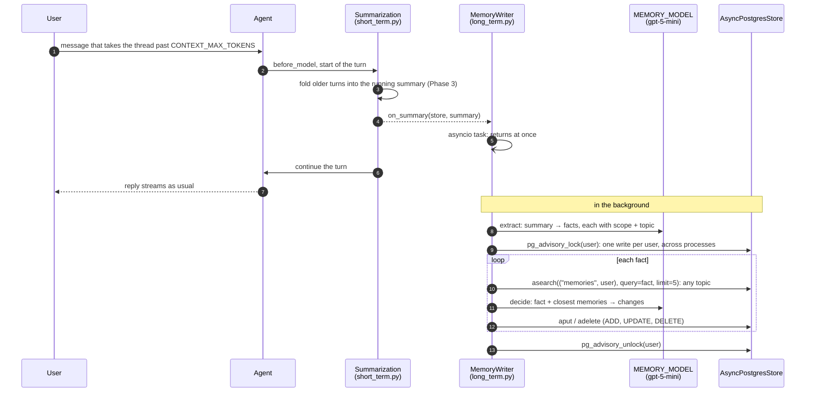
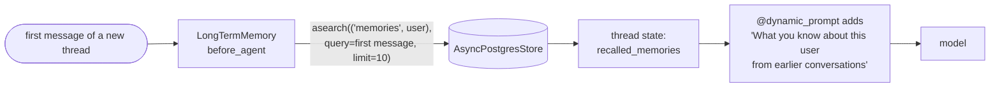

# Phase 6: Long-Term Memory

**Goal:** The bot remembers useful things about a user across conversations: preferences, facts they've shared, ongoing issues. A new conversation starts with what it learned in earlier ones, and the user can see and delete what it remembers.

[← Phase 5](phase-5-pii-detection-masking.md) · [Overview](README.md) · [Next: Phase 7 →](phase-7-production-hardening.md)

## Short-term vs. long-term

| | Short-term (Phase 3) | Long-term (this phase) |
|--|---------------------|-------------------------|
| Scope | One thread: the immediate conversation | One user, across all their threads |
| Code | `memory/short_term.py` | `memory/long_term.py` |
| Storage | Checkpointer (`AsyncPostgresSaver`) | LangGraph store (`AsyncPostgresStore`) with a vector index: one record per fact |
| Contents | The thread's messages and running summary | Small memories ("User lives in Bangalore"), each with a scope and a topic |
| Written | Every graph step | When a thread passes `CONTEXT_MAX_TOKENS` (10k), in the background |
| Read | Always (it is the thread) | Once, when a new thread starts: the memories closest to its first message |

## How it works

### Write: at the token breach, in the background



The summarization step from Phase 3 already decides when a thread is too long and writes a summary of what's being dropped. Long-term memory reuses that moment: `Summarization` calls its `on_summary` hook with the new summary, and `MemoryWriter.schedule` starts an asyncio task and returns, so the reply never waits.

The task makes two kinds of model call, both with structured output:

1. **Extract** (`prompts/memory_extract.md`): the summary becomes a list of facts. Each is one sentence stating the current state, with a `scope` (`user`: about the user; `other`: an order, trip or issue they're dealing with), a `topic` (`personal`, `preferences`, `communication`, `orders`, `plans`, `issues`) and a `forget` flag for "forget my jacket size".
2. **Decide** (`prompts/memory_decide.md`), once per fact: the fact plus the 5 closest memories the user already has, **on any topic**, become a list of changes: `UPDATE` a memory it corrects (merged content), `DELETE` the ones it makes obsolete, or `ADD` it. One fact can change several memories.

The topic is stored for display, not used to narrow the search. The same subject often gets a different topic from one thread to the next ("trek in March" under `plans`, "trek moved to April" under `personal`), and a topic-filtered search then misses the memory it should update.

### Read: once, when a new thread starts



`LongTermMemory.abefore_agent` runs at the start of each invocation, but only does anything on a thread's first message. It searches the user's memories with that message and saves the closest `MEMORY_RECALL_LIMIT` in the thread's state (`recalled_memories`), dated and oldest first, so the thread keeps them for its whole life and the checkpointer saves them with everything else. The system prompt adds them under a heading that tells the model to use them only when relevant, that the newer one holds if two disagree, and to believe the user if they contradict them.

### Updating facts: examples

```text
Thread A:  "my favourite colour is pink, I live in Pune, my dog Bruno camps with me"
           ADD  User's favourite colour is pink.
           ADD  User lives in Pune.
           ADD  User has a golden retriever named Bruno who camps with them.

Thread B:  "it's red now, I moved to Bangalore, Bruno passed away so no pet gear"
           UPDATE  → User's favourite colour is red.            (history: ["…pink."])
           DELETE  User lives in Pune.  ADD  User moved to Bangalore last month.
           UPDATE  → User no longer needs pet gear because Bruno has passed away.

Thread C:  "suggest a daypack colour; do I need a pet-friendly tent?"
           → "I'd suggest red… No, you don't need a pet-friendly tent."
```

This is from a live run with `gpt-5.4` and `gpt-5-mini`. When the model deletes the memories a fact replaces but forgets to add the fact itself (it happened once in the spike: "Bruno passed away" deleted every Bruno memory), `apply_changes` adds it anyway, so the fact isn't lost.

## Components

| File | What it does |
|------|--------------|
| `memory/short_term.py` | `Summarization` (LangChain's `SummarizationMiddleware`, adjusted in Phase 3) with an `on_summary` hook; `close_dangling_tool_calls` |
| `memory/long_term.py` | `MemoryWriter` (extract, decide, per-user lock, background task), `apply_changes`, `LongTermMemory` (recall at thread start), `recall`, `list_memories`, `namespace` |
| `prompts/memory_extract.md` | Summary → facts: only what the user said about themselves that will matter weeks from now; no one-off questions, assistant advice, other people's details or sensitive data |
| `prompts/memory_decide.md` | Fact + closest memories → add, update, delete; one fact can make several memories obsolete |
| `agent/middleware.py` | `system_prompt` adds the recalled memories |
| `agent/builder.py` | Wires it up when a `store` is passed and `MEMORY_ENABLED` is on; `create_agent(store=...)` |
| `api/dependencies.py` | Creates `AsyncPostgresStore` on the shared pool with a vector index on `content` (the same embeddings as the knowledge base) and runs its `setup()` |
| `api/runs.py` | Puts `user_id` in every run's config, which is how memory knows whose memories to use |
| `api/routes/memory.py` | `GET /me/memory`, `DELETE /me/memory/{id}`, `DELETE /me/memory` |
| `ui/app.py` | The "What I remember about you" sidebar panel |

### What's built-in and what's ours

| Need | Built-in |
|------|----------|
| Storage, per-user namespaces, vector search, timestamps | LangGraph `AsyncPostgresStore` with `index=` |
| Deciding when a thread is long, summarizing it | LangChain `SummarizationMiddleware` (Phase 3) |
| Running before a thread starts, adding to the prompt | `create_agent` middleware hooks (`before_agent`, `@dynamic_prompt`) |
| Structured model output | `with_structured_output` |
| Extract and decide | ours: two prompts and `apply_changes` |
| Running in the background, one write per user | ours: an asyncio task, an asyncio lock plus a Postgres advisory lock |

### Why not a library: the spike

Before building this, we ran the same 8 scripted multi-thread scenarios (pink→red, Pune→Bangalore, "forget my jacket size", a trip moved March→April, repeated statements, one-off questions only, a brother's address and a health condition, a dog that died) through each approach, 3 runs each, on the real Postgres. "Contents correct" checks what's stored after all threads; "answers correct" asks 15 questions, answers each from the top 5 recalled memories with `gpt-5-mini`, and has a judge compare it with the right answer.

| Approach | Contents correct | Outdated facts gone | Records | Answers correct | 2 writes at once |
|--|--|--|--|--|--|
| **This design** (`gpt-5-mini`) | **24/24** | **36/36** | **34** | 93% | **1 record** (with the lock) |
| Same, `gpt-5-nano` extracting | 19/24 | 32/36 | 44 | 91% | 1 record |
| First draft: search limited to the fact's topic, one change per fact, `gpt-5-nano` | 9/24 | 16/36 | | | 2 records |
| mem0 2.2 (`gpt-5-mini`) | 7/24 | 10/36 | 83 | 98% | 2 records |
| mem0 2.2 (`gpt-5-nano`) | 0/24 | 4/36 | 105 | 89% | 2 records |

- **mem0** 2.x only ever adds: a change becomes a new memory ("User changed their favourite colour from pink to red") next to the old one. Answers are good because the answering model sees both and their dates, but the store grows with every change and old versions crowd the top results as history builds. It also needs spaCy, a SQLite history file and its own tables, and has no per-user locking.
- **langmem** (0.0.30, last released a year earlier): its background extractor re-saved existing memories as strings of their own records and couldn't read memories its own tool had written (`KeyError: 'kind'`). Its profile mode worked, but two writes at once created two profiles.
- A single profile per user rewritten by the model on every merge (this phase's first version) could silently drop or invent facts, with no earlier version to go back to.

### The store record

```python
# namespace ("memories", user_id), key: a random hex id
{"content": "User's favourite colour is red.",
 "scope": "user", "topic": "preferences",
 "history": ["User's favourite colour is pink."]}   # earlier versions, last 5
```

The store keeps `created_at` and `updated_at`, and indexes `content` for vector search (`store_vectors`, created by `setup()`).

### API

| Endpoint | Purpose |
|----------|---------|
| `GET /me/memory` | The memories (`id`, `content`, `scope`, `topic`, `updated_at`), newest first |
| `DELETE /me/memory/{id}` | Forget one memory; 404 if it isn't yours |
| `DELETE /me/memory` | Forget everything. New threads start without memories; threads already open keep what they recalled when they started |

All are scoped to the caller's `X-User-Id`, like the thread endpoints.

### UI

The chat UI's sidebar has a "What I remember about you (n)" panel: each memory with its topic and a button to forget it, and a "Forget everything" button.

### PII and safety

- Memories are extracted from thread summaries, which come from a thread the API has already redacted (Phase 5), so raw emails, cards and phone numbers never reach the store. The extract prompt also says not to record `[REDACTED_…]` placeholders.
- The extract prompt keeps only facts about the user themselves, never other people's details, and leaves out sensitive categories (health, finances, religion, relationships) unless the user clearly asked for them to be remembered. With `gpt-5-mini` this held in every spike run; with `gpt-5-nano` it didn't, which is one reason `MEMORY_MODEL` defaults to mini.
- **Memory poisoning:** memories come from the conversation summary, which is written from the user's messages and the assistant's replies. Both prompts treat their input as data.
- Logs record counts and actions, never the memories themselves.

### Config

| Setting | Default | Effect |
|---------|---------|--------|
| `MEMORY_ENABLED` | `true` | `false` turns off both recall and writing |
| `MEMORY_MODEL` | `gpt-5-mini` | Extracts facts and decides changes |
| `MEMORY_RECALL_LIMIT` | `10` | Memories recalled into a new thread |
| `CONTEXT_MAX_TOKENS` | `10000` | The token breach that triggers a summary, and with it a memory write (Phase 3) |

The local `.env` uses `CONTEXT_MAX_TOKENS=1000` to see memory working after a few messages.

### Logging

```text
chatbot.memory.long_term  [req=… thread=def8932c]: no long-term memories yet
chatbot.memory.short_term [req=… thread=def8932c]: summarized older messages in 9.8s; thread now 2 messages, ~1591 tokens
chatbot.memory.long_term  [req=… thread=def8932c]: updated long-term memory from 6 facts: 6 add
chatbot.memory.long_term  [req=… thread=bd7954e3]: recalled 6 long-term memories
chatbot.memory.long_term  [req=… thread=bd7954e3]: updated long-term memory from 3 facts: 1 add, 2 delete, 2 update
chatbot.memory.long_term  [req=… thread=…]:       nothing to remember from this thread's summary
chatbot.api.routes.memory [req=…]: user mem-v2 deleted all 7 long-term memories
```

A failed write is logged with its traceback (`updating long-term memory failed`) and leaves the memories as they were; the next token breach tries again. `ignored` in the counts means the model named a memory that wasn't among the candidates, or tried to add a forget request.

## Tests

`tests/unit/test_long_term_memory.py`, over the API with an in-memory store and a fake memory model (`FactMemoryModel`: "fact: key=value" lines, a later value for the same key updates its memory):
- memories are written at the token breach and recalled in a new thread
- a newer fact updates its memory, keeps the old version in `history`, and leaves other memories alone
- a forget request deletes the memory
- short threads (no token breach) aren't remembered
- memories are recalled only when a thread starts, not mid-way through an older thread
- recall is capped at `MEMORY_RECALL_LIMIT`
- memories are per user
- `GET /me/memory`, `DELETE /me/memory/{id}` (404 for someone else's) and `DELETE /me/memory`
- `MEMORY_ENABLED=false` turns it all off
- a failed write keeps the memories and doesn't affect the reply
- `apply_changes`: one fact updating one memory and deleting another; a fact kept when the model only deletes what it replaces; unknown ids ignored; forget requests never added

`tests/integration/test_long_term_memory_postgres.py`, on a real `AsyncPostgresStore` with a vector index:
- a newer fact updates its memory, other memories are kept, and both survive a restart (new pool, new store)
- two writers (standing in for two API processes) writing the same new fact at once store it once. With the advisory lock removed, this test fails: both add it.

## Exit criteria

- [x] Cross-thread recall: a fact told in thread A is used correctly in thread B (unit test; live: "I'd suggest red")
- [x] Contradiction handling: "I moved / it's red now" updates the old memory instead of adding a second one (unit and integration tests; spike: outdated facts gone in 36/36 checks; live: pink → red, Pune → Bangalore)
- [x] Irrelevance: only the memories closest to the thread's first message are recalled, and the prompt says to use them only when relevant (no automated check of the model's behaviour)
- [x] Forgetting: one memory or all of them; new threads don't see them
- [x] PII: no raw PII reaches the store (it's built from the redacted thread); other people's details and sensitive facts are left out (spike, `gpt-5-mini`)
- [x] Extraction runs off the request path: the write is a background task; the reply doesn't wait
- [ ] Users can view, edit and delete their memories. View and delete yes (API and the sidebar panel); edit no (tell the bot, and the next write corrects it)
- [x] Memory off fully disables recall and writing

## Trade-offs of this design

- **Only threads that pass `CONTEXT_MAX_TOKENS` are remembered.** 10k tokens is a long support chat; most short conversations never reach it. Writing when a thread goes idle (or ends) would cover them.
- **Facts said after a thread's last summary wait** for that thread's next token breach. If the thread ends first, they aren't remembered.
- **Writes aren't durable.** The background task lives in the API process: a deploy or crash during a write loses it, and the next token breach redoes it. A job queue (arq, Celery, a Postgres-backed queue) would make it durable and retryable. The advisory lock already makes writes safe across processes.
- **Writes are slow and cost a model call per fact.** One `gpt-5-mini` decision per fact, one after another (they must see each other's changes): about 10–20 s per fact, so a summary with 7 facts takes a couple of minutes in the background, holding one pooled connection for the lock.
- **The extractor sometimes keeps the assistant's advice.** The summary mixes what the user said with what the assistant answered, and in live runs a few memories like "User prefers a 20–25L daypack" came from the bot's recommendation. Extracting from the raw messages being summarized (where the roles are clear) instead of the summary would help.
- **No cap on the number of memories.** Updates and deletes keep it small (34 records across 24 spike runs, against mem0's 83), but nothing bounds it.
- **Deleting a thread doesn't remove the memories it produced.** They aren't linked to threads; `DELETE /me/memory` clears them.

## Not built (from the original plan)

- Episodic memories (summaries of individual past conversations), procedural "instructions" memories
- The explicit `save_memory` / `forget_memory` tools ("remember that I…")
- A consent flow before storing the user's own PII
- Editing a memory through the API; confidence decay for memories not recalled in 180 days
