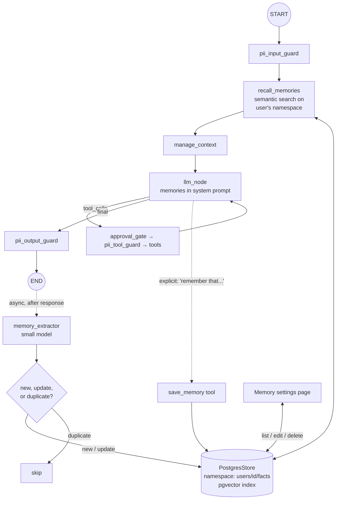
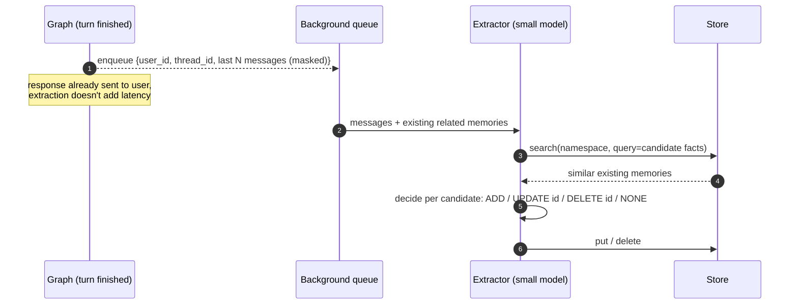

# Phase 6: Long-Term Memory

**Goal:** The bot remembers useful things about a user across conversations: preferences, facts they've shared, past decisions. It recalls them when relevant, and the user can see and delete what it remembers.

[← Phase 5](phase-5-pii-detection-masking.md) · [Overview](README.md) · [Next: Phase 7 →](phase-7-production-hardening.md)

## Short-term vs. long-term

| | Short-term (Phase 3) | Long-term (this phase) |
|--|---------------------|-------------------------|
| Scope | One thread | One user, across all threads |
| Storage | Checkpointer | LangGraph `Store` (Postgres + pgvector) |
| Contents | Full messages, summary | Distilled facts, preferences, episodes |
| Written | Automatically, every step | Selectively, by an extraction step |
| Read | Always loaded | Retrieved by relevance |
| Lifetime | Pruned by retention policy | Until the user or a policy deletes it |

## Memory types

| Type | Example | Namespace |
|------|---------|-----------|
| **Semantic** (facts, preferences) | "Prefers answers in bullet points", "Works on the payments team" | `("users", user_id, "facts")` |
| **Episodic** (past interactions) | "On 2026-09-02 we debugged a refund webhook. Fix was retry config." | `("users", user_id, "episodes")` |
| **Procedural** (how this user wants the bot to behave) | "Always cite the policy doc version" | `("users", user_id, "instructions")` |

Start with semantic memory only. Add episodic once retrieval quality is proven.

## Architecture



## Write path: extracting memories



The "existing related memories" input is what keeps the store from filling with near-duplicates and contradictions ("lives in Pune" plus "moved to Bangalore"). The extractor should **update** rather than append.

## Components

### Store setup

```python
from langgraph.store.postgres.aio import AsyncPostgresStore

store = AsyncPostgresStore.from_conn_string(
    settings.database_url,
    index={"dims": 1024, "embed": embed_fn, "fields": ["text"]},
)
await store.setup()
graph = build_graph(settings, checkpointer=checkpointer, store=store)
```

Nodes access it through the injected `store` parameter. `user_id` comes from the run config (`config["configurable"]["user_id"]`), set by the API from the authenticated session and never from the request body.

### Memory record

```python
{
  "text": "Prefers concise answers with code examples in Python",
  "type": "preference",
  "confidence": 0.9,
  "source_thread_id": "t_123",
  "created_at": "...",
  "updated_at": "...",
}
```

### Recall node

- Query: the latest user message, optionally rewritten by the small model into a search query.
- `store.asearch(("users", user_id, "facts"), query=q, limit=5)`, then drop results below a similarity threshold.
- Always include `instructions` memories (they're few and always relevant).
- Inject into the system prompt under a clear heading, e.g. `## What you know about this user`, and tell the model not to mention memories unless relevant.

### Explicit memory tool

```python
@tool
async def save_memory(text: str, *, config, store) -> str:
    """Save something the user explicitly asked you to remember."""
```

Also offer `forget_memory(query)` so "forget that I said X" works in chat.

### PII and consent

Memories are written from **masked** messages (Phase 5). Two options for what gets stored:
1. **Store placeholders only.** Safe by default, but `<PERSON_1>` means nothing outside its thread. So the extractor must drop facts that only make sense with the raw value.
2. **Store selected PII with consent.** For things like the user's own name or preferred contact email, ask once ("Want me to remember your name?") using a Phase 4 interrupt, then store it encrypted.

Never store third-party PII (people the user mentions) in long-term memory.

### User control

| Endpoint | Purpose |
|----------|---------|
| `GET /me/memories` | List everything stored |
| `PATCH /me/memories/{id}` | Correct a memory |
| `DELETE /me/memories/{id}` | Forget one |
| `DELETE /me/memories` | Forget everything |
| Setting: memory on/off | Off means skip both recall and extraction |

## Implementation steps

1. Init `AsyncPostgresStore` with a vector index in the app lifespan; pass it to the graph.
2. Implement `recall_memories` node and system-prompt injection.
3. Implement `save_memory` / `forget_memory` tools.
4. Build the extractor prompt with ADD/UPDATE/DELETE/NONE output (structured output), and run it in a background worker (e.g. `arq`, Celery, or a simple asyncio task queue to start).
5. Add the consent flow for storing user-owned PII.
6. Add memory management endpoints and UI.
7. Add retention rules (e.g. decay confidence for memories not recalled in 180 days).

## Evaluation

| Test | Pass condition |
|------|----------------|
| Cross-thread recall | Fact told in thread A is used correctly in thread B |
| Contradiction handling | "I moved to Bangalore" updates the old city instead of adding a second one |
| Irrelevance | Memories aren't dragged into unrelated answers |
| Forgetting | After delete, the fact is not recalled and not in the store |
| PII | No third-party PII and no unconsented user PII in the store (scan with the Phase 5 detector) |

## Exit criteria

- [ ] All evaluation tests above pass on a scripted multi-thread scenario
- [ ] Extraction runs off the request path (p95 latency unchanged from Phase 5)
- [ ] Users can view, edit and delete their memories
- [ ] Memory off fully disables recall and extraction

## Risks and notes

- **Memory poisoning.** A malicious document or web page could get the model to call `save_memory` with injected instructions. Only let the extractor see user messages and the assistant's replies, not raw tool output. Consider requiring that `instructions`-type memories come from the user directly.
- **Creepiness.** Unprompted "As you mentioned last month, your divorce..." breaks trust. Weight preference and work-context memories over personal ones, and keep sensitive categories out entirely.
- **Stale memories.** Facts change. Timestamps plus the UPDATE path plus decay handle most of this.
