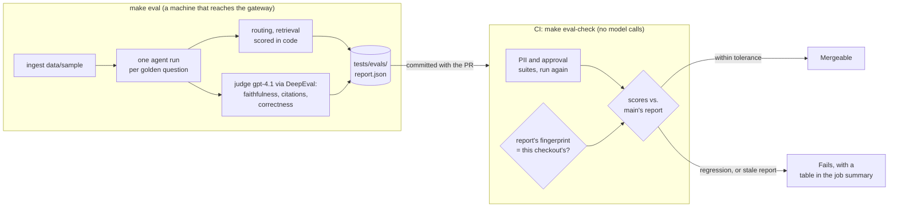
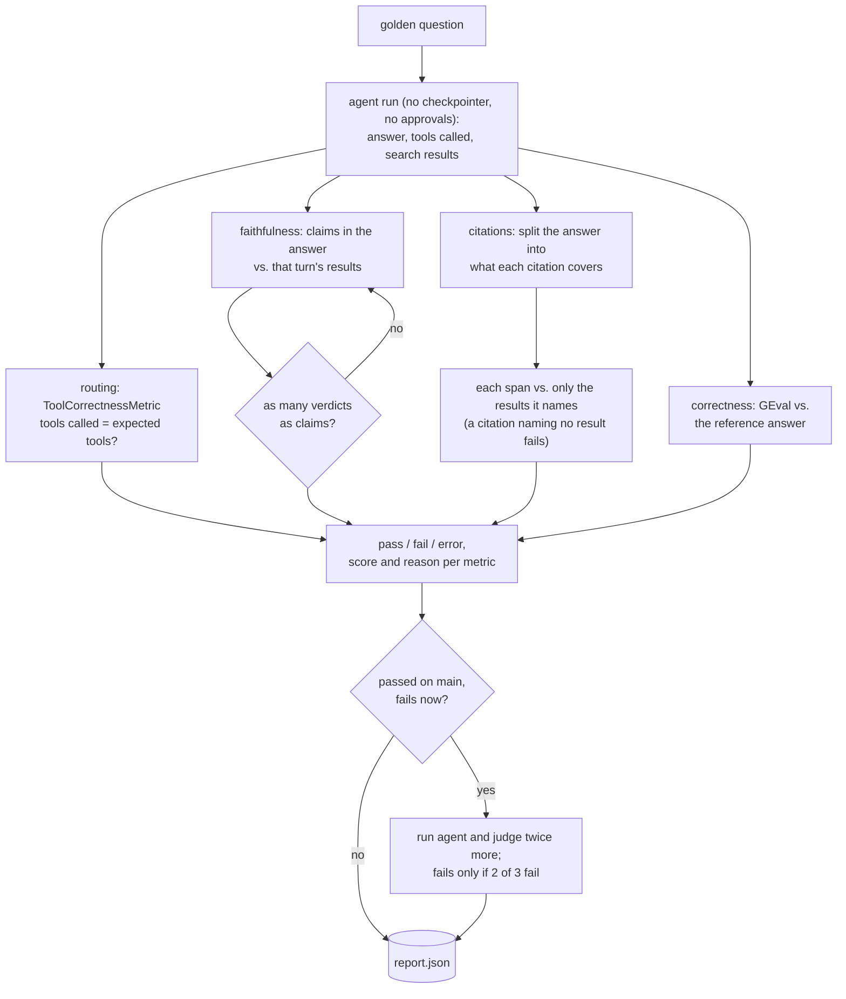

# Phase 7: Eval Gate

**Goal:** Every PR shows, and is blocked on, whether it made the bot worse: retrieval, tool routing, faithful and correctly cited answers, correct answers, PII redaction and the approval policy.

[← Phase 6](phase-6-long-term-memory.md) · [Overview](../README.md) · [Next: Phase 8 →](phase-8-security-observability.md)

**Status: built.** Phases 7 to 9 make the chatbot a production-ready demo: built the way production would be, run locally or on one host, with no real users or on-call. This phase measures quality; [Phase 8](phase-8-security-observability.md) adds login, limits and observability; [Phase 9](phase-9-reliability-deployment.md) reliability, cost and deployment.

| Area | What's built | Section |
| --- | --- | --- |
| Suites | Seven suites over one agent run per golden question: retrieval, routing, faithfulness, citations, correctness (scored by code or by a judge), plus PII and approval policy (code only) | [What's measured](#whats-measured) |
| Ground truth | Reference answers and labels written by Claude, reviewable in a PR | [Ground truth](#ground-truth) |
| Judge | `gpt-4.1` through DeepEval; a judged metric gates only at 90% or more agreement with a labelled calibration set | [The judge and calibration](#the-judge-and-calibration) |
| Gate | `make eval` on a machine that reaches the gateway writes `report.json`; CI's `make eval-check` checks it against the checkout and against `main` | [The report and the CI check](#the-report-and-the-ci-check) |
| Noise | A tolerance per metric and 2-of-3 re-runs of each case that flipped | [Noise](#noise) |

The gate is split: the model endpoint is an internal gateway that GitHub's runners can't reach, and the repo is public, so CI gets no model credentials. The model suites run on a developer machine and the report is committed with the PR; CI runs the code-only suites itself and checks the report.

## What's measured

`tests/evals/suites/` (`retrieval.py`, `routing.py`, `judged.py`, `pii.py`, `approvals.py`), over the cases in `tests/evals/*.jsonl`.

| Suite | Cases | Scored by |
| --- | --- | --- |
| Retrieval | 28 knowledge base questions with the doc and heading that answer them | code: is that section in the top `RETRIEVAL_TOP_K`? |
| Routing | 44 questions | DeepEval `ToolCorrectnessMetric`, exact match (code, no judge) |
| Faithfulness | every answer that used search results (40) | DeepEval `FaithfulnessMetric(penalize_ambiguous_claims=True)`, against that turn's results |
| Citations | the same answers | `FaithfulnessMetric` on what each citation covers, against only the results it names. A citation naming no result fails, and so does an answer that cites nothing |
| Correctness | 30 knowledge base questions | DeepEval `GEval` against a reference answer, with fixed evaluation steps |
| PII | 21 labelled values, 12 look-alikes (`pii_cases.jsonl`) | code: `redact_pii` catches the values and leaves dates, prices, order numbers and Acme's own address alone |
| Approval policy | 30 web queries (`approval_cases.jsonl`) | code: `sensitive_reason` flags exactly the internal terms and order numbers |

One question, from agent run to report:

- **One agent run per golden question** (`agent_runs.py`), scored by routing, faithfulness, citations and correctness. Web answers change over time, so they get faithfulness and citations but no reference answer.
- **DeepEval 4.3.1**, used programmatically (each metric's `a_measure`), never logged in to its hosted service, telemetry off. Retrieval keeps our own exact-label scoring: it beats DeepEval's judged `ContextualRecallMetric` when the right section is known.
- **What a citation covers** (`citations.py`). The system prompt asks for `[cite_as]` after each claim from a knowledge base result, and the `cite_as` markdown link for a web result. A citation covers the text since the previous citation on the same line: "Yes. Orders can be canceled within 30 minutes. [Order Changes]" vouches for both sentences, as a reader would take it. Splitting into sentences instead broke on "1 p.m.", "Donald J. Trump" and titles like "REI Return Policy [Latest 2026 Guide]", and let a wrong first sentence go unchecked.
- **Two DeepEval defaults changed:**
  - `FaithfulnessMetric` only penalizes contradictions by default. An answer adding "Shipping is always free", which no result says, scored 1.0. `penalize_ambiguous_claims=True` counts it.
  - The judge sometimes returns fewer verdicts than claims (one run in three in the spike), and DeepEval scores the verdicts it got. Such a result is measured again, up to 3 times, then counted as an error.
- **Not here:** approval *flows* (pause, approve, reject, edit) are covered by `tests/unit/test_api_hitl.py` and `test_approvals.py`, which CI runs. The memory test (Phase 6, about 40 minutes) and red teaming come later.

## Ground truth

Reference answers, calibration labels, and the PII and approval labels were **written by Claude, not a person**. Every report says so (`ground_truth_by`), and anyone can review them in a PR.

- **Reference answers have to match the question.** At first, "What discount do employees get on other brands?" answered correctly with "20%" failed correctness, because the reference also listed the 40% Acme discount. References now put context in parentheses, and the judge is told not to penalize leaving out what the question didn't ask about.
- Confirmed judge mistakes go into the calibration set.

## The judge and calibration

`tests/evals/judge.py` and `calibrate.py`.

- **The judge is `gpt-4.1`** (`JUDGE_MODEL`), a different model from the `gpt-5.4` under test, so it doesn't grade its own answers. It's the same vendor, though; calibration measures how much that matters. Claude on the gateway would be a different vendor, but our OpenAI client can't call it there.
- **`JudgeModel`** is a `DeepEvalBaseLLM` around our own `build_llm(settings, JUDGE_MODEL)`: at most 3 calls at once, each tried up to 3 times, since the gateway times out now and then.
- **Calibration** (`make eval-calibrate`): 58 answers in `calibration.jsonl`, 29 of them the agent's own and 29 copies with one planted flaw each (a wrong number, an unsupported claim, a citation to the wrong section, a missing fact, no citations). The answers are fixed, so only the judge varies. Run it only when the judge changes.
- **A judged metric gates PRs only at 90% or more agreement** with the labels; below that it's reported as advisory. The result goes in `calibration.json` with a fingerprint of the judge (model, our evaluation steps, DeepEval version, the set), and goes stale when any of them change.

| Metric | Agreement | Gates |
| --- | --- | --- |
| Citations | 98% (57/58) | yes |
| Faithfulness | 91% (53/58) | yes |
| Correctness | 90% (45/50) | yes |

The correctness disagreements are between "partly" and "wrong", which doesn't change pass or fail. The faithfulness disagreements all go one way: see [Known issues](#known-issues).

## Noise

`tests/evals/scoring.py` and `report.py`. Answers vary between runs, and so does the judge ([measured](#measurements)).

- **Tolerance:** a metric blocks when it drops below `main` by more than max(2 points, one case); with 30 cases one case is 3.3 points. The judged metrics (faithfulness, citations, correctness) get three cases: one claim the results don't state word for word fails a whole faithfulness case, and four runs of the same answers scored 65%, 72.5%, 72.5% and 77.5% on its 40 cases (Phases 8 and 9). The code-only suites (PII, approval policy) don't vary, so any drop there blocks.
- **Re-runs:** a case that passed on `main` and fails now is run twice more, agent and judge; it fails only if 2 of 3 runs fail. A whole-metric drop within normal variation isn't a regression by itself; the re-runs of each case that flipped are what tell noise from a real change.
- **Errors:** a question whose agent run or judging still fails after 3 tries is an error, listed but counted as neither a pass nor a fail.
- Every failing case is listed with the judge's reason, so a reviewer can check it.

## The report and the CI check

`make eval` (`tests/evals/run.py`) ingests `data/sample` (so the knowledge base matches the repo), runs every suite and writes `tests/evals/report.json`: the score, case count and whether it gates for each metric, an outcome and reason for each case, the models, the DeepEval version, and who wrote the ground truth. Since Phase 8, with the Langfuse keys set, each run is also traced and gets a score per metric on its trace ([Phase 8](phase-8-security-observability.md#eval-scores-on-traces)).

- **Settings at their defaults** (`tests/evals/settings.py`). Only the credentials, URLs and database (and settings the evals never use, since they call the agent directly) come from the environment; every setting that affects answers is the default in `config.py`. A value that differs (an exported `CONTEXT_MAX_TOKENS=1000`) stops the run, so scores are comparable between machines and with `main`.
- **The fingerprint** is a sha256 of `src/chatbot/`, `data/sample/`, `tests/evals/` (minus the report), `pyproject.toml`, `uv.lock` and the DeepEval version. A PR that changes any of them needs a new report; one that touches only the UI or docs doesn't.

`make eval-check` (`tests/evals/check.py`) is a CI step with no model calls:

1. Runs the PII and approval suites again, so they never rely on the report.
2. Fails if the report's fingerprint isn't this checkout's: "run `make eval` and commit the new report.json".
3. Compares each metric with `main`'s report (`git show origin/main:tests/evals/report.json`; CI checks out with `fetch-depth: 0`). With no baseline yet it passes, and says so.
4. Writes the comparison table, and the failing code-only cases, to the job summary.

- **What it can't guarantee:** CI can't prove the report came from a real run; someone could edit it by hand. For a single-maintainer demo that's accepted, and the report's diff shows in the PR. A self-hosted runner that reaches the gateway would turn `make eval` into a CI step without changing anything else.
- **DeepEval isn't in the lockfile:** it caps `click<8.4`, and in one lockfile that pulls the app's `huggingface-hub` (used by the reranker) from 1.33 back to 1.16. The eval commands add it for the run only: `uv run --with deepeval==4.3.1`.

## Reference

### Settings

| Setting | Default | |
| --- | --- | --- |
| `JUDGE_MODEL` | `gpt-4.1` | The judge for faithfulness, citations and correctness |

Every other setting that affects answers must be at its default during `make eval` ([above](#the-report-and-the-ci-check)). The Makefile adds `eval`, `eval-calibrate` and `eval-check`; CI runs `make eval-check`; Tilt's `evals` button runs `make eval`.

### Files

| File | What it does |
| --- | --- |
| `tests/evals/run.py` | `make eval`: every suite, re-runs, writes the report |
| `tests/evals/check.py` | `make eval-check`: what CI runs |
| `tests/evals/calibrate.py` | `make eval-calibrate`: judge agreement, writes `calibration.json` |
| `tests/evals/agent_runs.py` | One agent run per question: answer, tools called, search results |
| `tests/evals/judge.py` | `JudgeModel`: DeepEval's judge, through our model client |
| `tests/evals/citations.py` | What each citation covers, and which results it names |
| `tests/evals/suites/` | `retrieval.py`, `routing.py`, `judged.py`, `pii.py`, `approvals.py` |
| `tests/evals/golden.py` | Loads the golden questions |
| `tests/evals/report.py` | Fingerprint, metrics, comparison with `main` |
| `tests/evals/scoring.py` | `Outcome`, the 2-of-3 majority, the verdict check |
| `tests/evals/settings.py` | Settings at their defaults |
| `tests/evals/*.jsonl` | `golden.jsonl` (questions with reference answers), `calibration.jsonl`, `pii_cases.jsonl`, `approval_cases.jsonl` |
| `tests/evals/report.json`, `calibration.json` | The committed results |

### Tests

`tests/unit/test_evals.py`: the gate's own logic (fingerprint, tolerance, majority, citation spans, settings, the CI check).

### Measurements

- **Latest scores** (the committed `report.json`, Phase 9): retrieval 100%, routing 100%, faithfulness 77.5%, citations 90%, correctness 100%, PII 95% recall and 92% of look-alikes left alone, approval policy 100%.
- **Run-to-run variance:** two runs of the same code an hour apart scored faithfulness 65% and 72%, citations 85% and 72% (correctness 100% both times).
- **Errors:** without retries, 9 of 44 questions errored on the first run.
- **Time and cost:** one `make eval` is 44 agent runs and about 130 judge measurements, at most 3 model calls at once: about 15 minutes with retries, a few dollars. Calibration adds 58 answers.

### Known issues

- **The judge is too strict on faithfulness.** All 5 of its faithfulness disagreements fail an answer labelled faithful: "Opened fuel canisters are non-returnable" next to a chunk listing exactly that, 5 plus 3–7 days added up to 8–12, an offer to help counted as a claim. It failed 5 of 34 good answers and passed none of the 24 bad ones. So the faithfulness score understates how faithful the answers are. `main` and the PR are scored by the same judge, so a drop still means something. A custom DeepEval template (paraphrase and arithmetic from the context are supported; offers aren't claims) is the next step.
- **Faithfulness and citations are noisy** run to run ([measured](#measurements)), so a whole-metric drop of a few points can block a PR on its own: Phase 8's first re-run blocked on faithfulness 69% against `main`'s 72% ([Phase 8](phase-8-security-observability.md#effect-on-the-evals)).
- **PII:** IPv6 addresses aren't redacted (`2001:db8::1` passes through), and a version number like "1.2.3.4" is redacted as an IP. Both are in the baseline, so they don't block; a new miss would.
- **Unsourced advice:** for a missing package the bot adds "check with neighbours or building staff", which no document says.

## Exit criteria

- [x] Eval gate runs on every PR (CI checks the committed report; the model suites run on a machine that reaches the gateway)
- [x] The judge agrees with the labels on at least 90% of the calibration set (labels written by Claude, not a person)
- [x] PII and approval policy scored on labelled sets, with no tolerance for a drop
- [x] Eval scores stored in Langfuse against each run's trace (Phase 8)
- [ ] Faithfulness judge tightened (a custom template), then re-calibrated
- [ ] Memory and red-team suites; nightly runs
