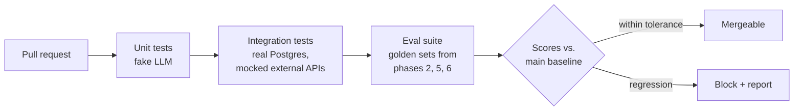

# Phase 7: Production Hardening

**Goal:** Take the feature-complete agent from Phases 1–6 and make it safe to run for real users: measured quality, observable behaviour, controlled cost, and a repeatable deployment.

[← Phase 6](phase-6-long-term-memory.md) · [Overview](README.md)

## Scope

- Evaluation suite that runs in CI and blocks regressions
- Observability: traces, metrics, alerts
- Auth, multi-tenancy, rate limiting
- Cost and latency controls
- Containerized deployment with migrations and scaling

## Deployment architecture

API pods are stateless. All conversation state lives in Postgres through the checkpointer, so any pod can serve any thread, and a pending HITL interrupt can be resumed on a different pod from the one that created it.

## CI evaluation pipeline

| Suite | Source | Gate |
|-------|--------|------|
| RAG retrieval and faithfulness | Phase 2 golden set | recall@k, faithfulness ≥ baseline − 2% |
| Tool routing | Phase 2 | accuracy ≥ baseline |
| HITL flows | Phase 4 scripted scenarios | 100% pass |
| PII detection | Phase 5 labelled set | recall thresholds met |
| Memory | Phase 6 multi-thread scenarios | 100% pass |
| Red team | Prompt injection, jailbreak, PII exfiltration attempts | No new failures |

Add real (masked, consented) production conversations that went wrong to the golden sets over time.

## Checklist

### Security and access
- [ ] Authentication (OIDC/JWT); `user_id` taken only from the token
- [ ] Ownership checks on threads, memories, interrupts (threads and interrupts done since Phase 3/4, keyed on `X-User-Id` until real auth)
- [ ] Rate limits per user and per IP; token budget per user per day
- [ ] Secrets in a secret manager; vault keys in KMS
- [ ] Prompt-injection defenses reviewed (tool output delimiters, no side-effect tools without HITL)

### Observability
- [ ] Every run traced with `thread_id`, `user_id` (hashed), model, tokens, cost, tool calls, interrupts
- [ ] Metrics: p50/p95 latency, time to first token, tool error rate, interrupt rate and approval rate, PII detections per entity type, memory recall hit rate
- [ ] Alerts: error rate, LLM/API latency spikes, cost anomalies, PII guard failures

### Cost and latency
- [ ] Prompt caching on system prompt + tool definitions
- [x] Small model for summarization (`gpt-5-nano`, Phase 3); use it for extraction and query rewriting too
- [x] Cap on model/tool round trips (`ModelCallLimitMiddleware`, `MAX_MODEL_CALLS`; `ToolCallLimitMiddleware` if a single tool needs its own cap)
- [ ] Cap on retrieved context size
- [ ] Cache frequent web search queries (short TTL)

### Reliability
- [ ] Retries with backoff and circuit breakers on the LLM, web search and embedding calls (searches: `ToolRetryMiddleware`, done; LLM: `ModelRetryMiddleware` or the client's `max_retries`; circuit breakers still to add)
- [ ] Fallback model on provider outage (`ModelFallbackMiddleware`)
- [x] Graceful degradation: web search down → answer from RAG and say so (`ToolRetryMiddleware` returns an error result the model relays)
- [ ] DB migrations (Alembic) run as a separate deploy step
- [ ] Backups and restore tested for Postgres

### Compliance
- [ ] Data retention policy implemented (checkpoints, vault, memories, audit logs)
- [ ] "Delete my data" removes threads, checkpoints, vault entries and memories
- [ ] Data processing records for third parties (OpenAI or the gateway, the web search provider, embedding provider)

## Exit criteria

- [ ] Eval gate runs on every PR
- [ ] Load test: target concurrent users at p95 latency target with no errors
- [ ] Dashboards and alerts live
- [ ] Runbook for common incidents (provider outage, stuck interrupts, PII leak report)

Most of the reliability and cost items above have LangChain middleware equivalents (`ModelRetryMiddleware`, `ModelFallbackMiddleware`, `ToolCallLimitMiddleware`, `PIIMiddleware`). Check `langchain.agents.middleware` before building one.
