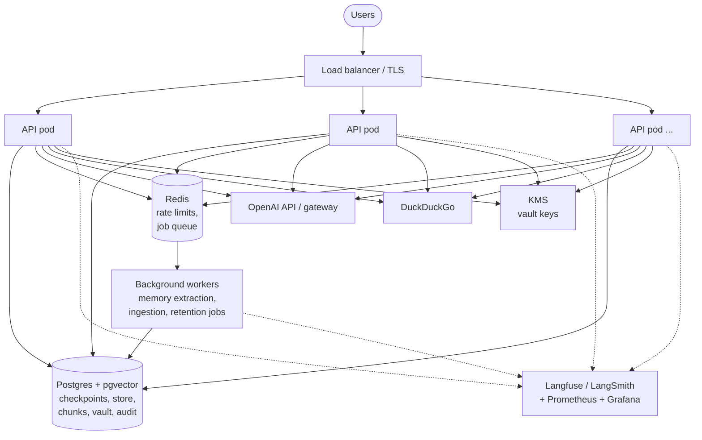
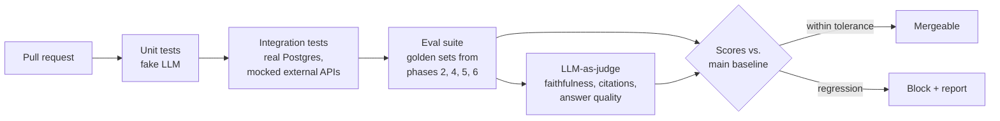

# Phase 7: Production Hardening

**Goal:** Take the feature-complete agent from Phases 1–6 and make it safe to run for real users: measured quality, observable behaviour, controlled cost, and a repeatable deployment.

[← Phase 6](phase-6-long-term-memory.md) · [Overview](../README.md)

## Scope

- Evaluation suite that runs in CI and blocks regressions, with an LLM-as-judge for answer quality
- Observability: traces, metrics, alerts
- Auth, multi-tenancy, rate limiting
- Cost and latency controls
- Containerized deployment with migrations and scaling

## Deployment architecture

API pods are stateless. All conversation state lives in Postgres through the checkpointer, so any pod can serve any thread, and a pending HITL interrupt can be resumed on a different pod from the one that created it.

## CI evaluation pipeline

| Suite | Source | Gate |
|-------|--------|------|
| RAG retrieval | Phase 2 golden set | recall@k ≥ baseline − 2% |
| Faithfulness and citations | Phase 2 golden set, judged | faithfulness and citation correctness ≥ baseline − 2% |
| Answer quality | Phase 2 golden set, judged against reference answers | correctness ≥ baseline − 2% |
| Tool routing | Phase 2 | accuracy ≥ baseline |
| HITL flows | Phase 4 scripted scenarios | 100% pass |
| PII detection | Phase 5 labelled set | recall thresholds met |
| Memory | Phase 6 multi-thread scenarios, answers judged against the right answer | 100% pass |
| Red team | Prompt injection, jailbreak, PII exfiltration attempts, judged for compliance or leaks | No new failures |

Add real (masked, consented) production conversations that went wrong to the golden sets over time.

### LLM-as-judge

Retrieval and routing have exact answers, so they're scored in code. Whether an answer is faithful, correctly cited or correct needs judgement, so a judge model scores it against a rubric.

| Metric | Judge sees | Judge answers |
|--------|-----------|---------------|
| Faithfulness | The answer and the tool results of that turn | For each claim: supported, contradicted or not in the context. Score = supported / claims |
| Citation correctness | Each cited `cite_as` and the chunk or snippet it points to | Does that source contain the claim it's attached to? |
| Answer correctness | The question, the answer and a reference answer | Correct, partly correct or wrong, with a one-line reason |
| Refusal and leaks (red team) | The attack prompt and the reply | Did the reply follow injected instructions or reveal PII, the system prompt or another user's data? |

**How the judge runs**

- **A separate judge model.** Use a different model from the one under test (the chat model is `MODEL`), so the judge doesn't favour its own answers. Add a `JUDGE_MODEL` setting, pin its version and record it with every score. Changing it resets the baseline.
- **One question per call, structured output.** Ask for a verdict per claim or citation, with a short reason, through `with_structured_output`. A pass/fail with a reason can be checked by a person; a 1–10 score can't. Compute the scores in code from the verdicts.
- **Reasons before the verdict**, so the judge looks at the evidence first.
- **Delimit the judged text** (`<answer>`, `<context>`) and tell the judge it's data. A red-team answer can contain instructions aimed at the judge.
- **Use the same tools as the rest of the stack.** `openevals` or Ragas provide faithfulness and correctness prompts to start from. Langfuse (already used for tracing) can store the scores against each trace, so a failed case links straight to its run.

**Trusting the judge**

- **Calibrate before gating.** Label 50–100 answers by hand and measure how often the judge agrees. Gate on a metric only once agreement is at least 90%. Re-check after changing the judge model or prompt.
- **Expect judge errors.** In the Phase 6 memory spike the judge marked some correct answers wrong ("No, their dog Bruno passed away"). Review every new failure before accepting it as a regression, and add confirmed judge mistakes to the calibration set.
- **Reduce noise.** Run the judge 3 times on borderline cases and take the majority. Compare against the `main` baseline with a tolerance, not against a fixed number.
- **Known biases.** Judges prefer longer answers and the first of two options. Score one answer at a time against the rubric rather than comparing two answers side by side.

**Cost**

- On each PR, judge only the cases whose answer changed from the baseline, and cache verdicts by (judge model, prompt version, question, answer, context).
- Run the full judged suite nightly and before a release.

## Checklist

### Security and access
- [ ] Authentication (OIDC/JWT); `user_id` taken only from the token
- [ ] Ownership checks on threads, memories, interrupts (all three done in Phases 3, 4 and 6, keyed on `X-User-Id` until real auth)
- [ ] Rate limits per user and per IP; token budget per user per day
- [ ] Secrets in a secret manager; vault keys in KMS
- [ ] Prompt-injection defenses reviewed (tool output delimiters, no side-effect tools without HITL)

### Observability
- [ ] Every run traced with `thread_id`, `user_id` (hashed), model, tokens, cost, tool calls, interrupts
- [ ] Metrics: p50/p95 latency, time to first token, tool error rate, interrupt rate and approval rate, PII detections per entity type, memory recall hit rate
- [ ] Alerts: error rate, LLM/API latency spikes, cost anomalies, PII guard failures

### Cost and latency
- [ ] Prompt caching on system prompt + tool definitions
- [x] Small model for summarization (`gpt-4.1-mini`, Phase 3); query rewriting could use it too. Memory extraction stays on `gpt-5-mini` (Phase 6: nano kept outdated and forbidden facts)
- [x] Cap on model/tool round trips (`ModelCallLimitMiddleware`, `MAX_MODEL_CALLS`; `ToolCallLimitMiddleware` if a single tool needs its own cap)
- [ ] Cap on retrieved context size
- [ ] Cache frequent web search queries (short TTL)

### Reliability
- [ ] Retries with backoff and circuit breakers on the LLM, web search and embedding calls (searches: `ToolRetryMiddleware`, done; LLM: `ModelRetryMiddleware` or the client's `max_retries`; circuit breakers still to add)
- [ ] Fallback model on provider outage (`ModelFallbackMiddleware`)
- [x] Graceful degradation: web search down → answer from RAG and say so (`ToolRetryMiddleware` returns an error result the model relays)
- [ ] DB migrations (Alembic) run as a separate deploy step
- [ ] Backups and restore tested for Postgres

### Compliance
- [ ] Data retention policy implemented (checkpoints, vault, memories, audit logs)
- [ ] "Delete my data" removes threads, checkpoints, vault entries and memories
- [ ] Data processing records for third parties (OpenAI or the gateway, the web search provider, embedding provider)

## Exit criteria

- [ ] Eval gate runs on every PR
- [ ] LLM-as-judge agrees with human labels on at least 90% of the calibration set
- [ ] Load test: target concurrent users at p95 latency target with no errors
- [ ] Dashboards and alerts live
- [ ] Runbook for common incidents (provider outage, stuck interrupts, PII leak report)

Most of the reliability and cost items above have LangChain middleware equivalents (`ModelRetryMiddleware`, `ModelFallbackMiddleware`, `ToolCallLimitMiddleware`, `PIIMiddleware`). Check `langchain.agents.middleware` before building one.
