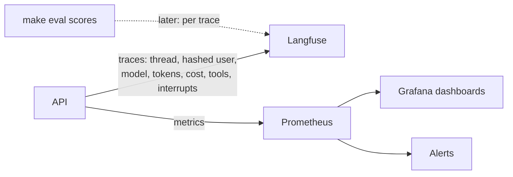

# Phase 8: Security and Observability

**Goal:** Know who is calling and keep them within limits, and see what every run did: who asked, what it cost, how long it took, and when something is going wrong.

[← Phase 7](phase-7-eval-gate.md) · [Overview](../README.md) · [Next: Phase 9 →](phase-9-reliability-deployment.md)

Status: planned. Like Phase 7, this is for a production-ready demo (one host, no real users or on-call), so it's built the way production would be without a secret manager or paging.

## Scope

- Login (OIDC/JWT) instead of the `X-User-Id` header
- Rate limits per user and per IP, and a daily token budget per user
- Traces with the metadata needed to debug a run, metrics, dashboards and alerts
- Deleting a user's data, and a retention policy for all of it

## Security and access

- [ ] Authentication (OIDC/JWT); `user_id` taken only from the token. Today the API trusts `X-User-Id` (`get_user_id` in `api/dependencies.py`)
- [ ] Ownership checks on threads, memories and interrupts move to the token's user (all three exist since Phases 3, 4 and 6, keyed on `X-User-Id`)
- [ ] Rate limits per user and per IP; token budget per user per day
- [ ] Secrets from the environment or a mounted file, never in the image or the repo
- [ ] Prompt-injection defenses reviewed: tool output delimited (`<kb_results>`, `<web_results>`), no side-effect tools without approval, memories never grant permissions (Phase 6)

## Observability

- [ ] Every run traced with `thread_id`, `user_id` (hashed), model, tokens, cost, tool calls, interrupts (Langfuse tracing exists since Phase 1, without this metadata)
- [ ] Metrics: p50/p95 latency, time to first token, tool error rate, interrupt and approval rate, PII detections per type, memory recall hit rate
- [ ] Alerts: error rate, model and API latency spikes, cost anomalies, PII guard failures
- [ ] Eval scores stored against each trace in Langfuse, so a failed eval case links to its run (Phase 7 writes them to `report.json` only)

## Data and compliance

- [ ] "Delete my data" removes a user's threads, checkpoints, memories and memory cursors in one call (today: per thread, and `DELETE /me/memory`)
- [ ] Retention policy for checkpoints (the Phase 3 job), memories and logs
- [ ] Data processing records for third parties: the model gateway, the web search provider, the embedding provider

## Exit criteria

- [ ] No request is served without a valid token; the user comes only from it
- [ ] Limits enforced and visible (429 with a retry time)
- [ ] Dashboards and alerts live
