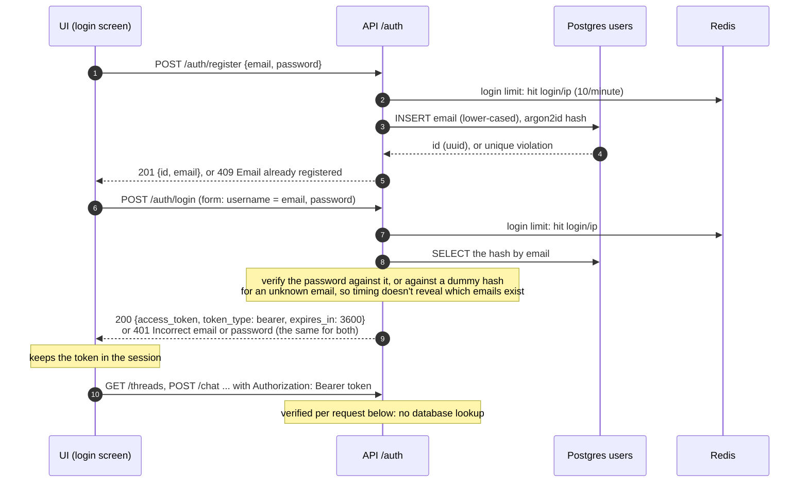
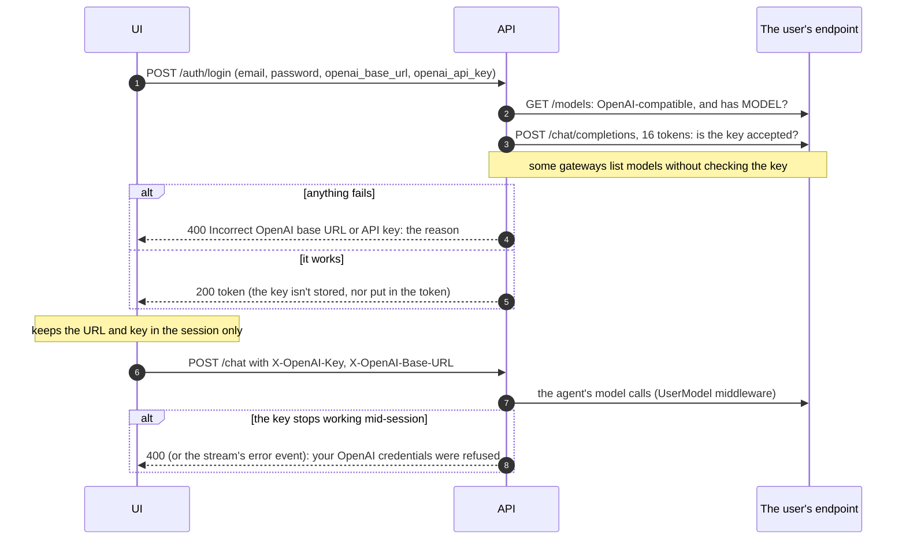
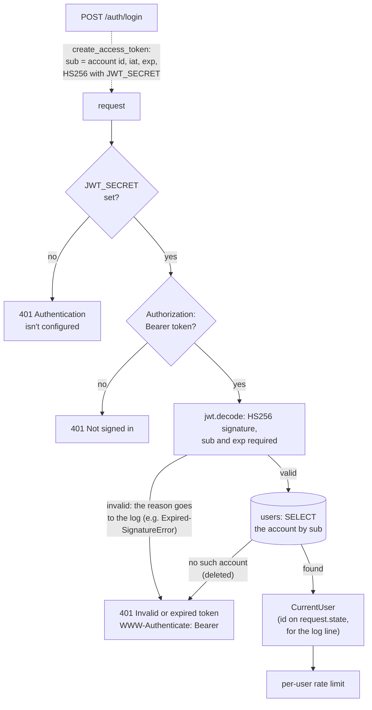
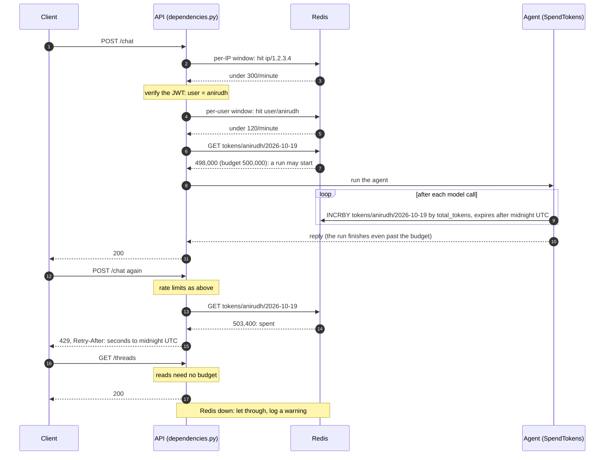
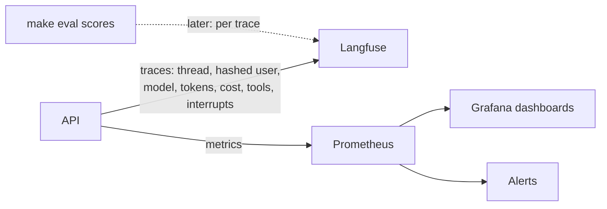

# Phase 8: Security and Observability

**Goal:** Know who is calling and keep them within limits, and see what every run did: who asked, what it cost, how long it took, and when something is going wrong.

[← Phase 7](phase-7-eval-gate.md) · [Overview](../README.md) · [Next: Phase 9 →](phase-9-reliability-deployment.md)

Status: accounts and login (email and password, JWT), and limits (Redis) are built; observability and data deletion are planned. Like Phase 7, this is for a production-ready demo (one host, no real users or on-call), so it's built the way production would be without a secret manager or paging.

## Scope

- Accounts and login (email and password, JWT) instead of the `X-User-Id` header
- Rate limits per user and per IP, and a daily token budget per user
- Traces with the metadata needed to debug a run, metrics, dashboards and alerts
- Deleting a user's data, and a retention policy for all of it

## Authentication and limits (as built)

**Accounts and login** (`src/chatbot/api/auth.py`, `src/chatbot/users.py`, migration `0003_users`), following the login API of [async-agentic-workflows](https://github.com/Anirudh1905/async-agentic-workflows/blob/main/src/agentic_workflows/api/routes/auth.py):

| Endpoint | Body | Answers |
| --- | --- | --- |
| `POST /auth/register` | JSON `{email, password}` (a valid email, 8–128 characters) | 201 `{id, email}`; 409 if the email is taken; 422 for bad input |
| `POST /auth/login` | Form `username` (the email), `password`: the OAuth2 password flow, so the OpenAPI docs' "Authorize" button works. Optionally `openai_api_key` and `openai_base_url` | 200 `{access_token, token_type, expires_in}`; 401 for a wrong password or an unknown email alike; 400 if the OpenAI credentials don't work |
| `GET /auth/me` | (a bearer token) | `{id, email}` of the signed-in account |

- **Passwords** are hashed with argon2id (`pwdlib`'s recommended hasher) and never logged; a failed login logs the client address, not the email (failed logins are often typos of real addresses).
- **The token's `sub` is the account's id** (a uuid), not the email, so threads and memories stay with the account if the email changes. Tokens last `JWT_TTL_MINUTES` (60); then the UI asks to log in again.
- **Both endpoints are limited per IP** (`RATE_LIMIT_LOGIN`, 10 a minute), against password guessing, on top of the general per-IP limit.
- **The UI** shows a "Log in" / "Create account" screen until there's a token, keeps it in the Streamlit session, shows "Signed in as …" with a log-out button, and goes back to the login screen on a 401 or when the token expires.

**Your own OpenAI credentials** (optional). The login screen can take an OpenAI-compatible base URL and API key; the user's chats then run on them instead of the server's `OPENAI_*` settings.

- **Checked at login** (`check_credentials` in `agent/builder.py`): `/models` must list `MODEL`, and a chat completion of at most 16 tokens must succeed. The second call is needed because the gateway lists models even for a wrong key. Logging in takes about 3 s longer.
- **The key is sent both ways**, as `Authorization: Bearer` (OpenAI) and as an `api-key` header (Azure OpenAI and our gateway, which refuses some keys as Bearer with "Unreadable token" but accepts them as `api-key`). Each endpoint reads the one it uses; the key only goes to the endpoint it was given for.
- **Session only:** the UI keeps the URL and key in the Streamlit session and sends them in two headers with every request. The server never stores them, they aren't in the token, and they aren't logged. Logging out or a new login drops them. A key alone uses OpenAI's base URL.
- **Used for the agent's model calls** of that user's runs: the `UserModel` middleware swaps in a model on their endpoint (`request.override(model=...)`, LangChain's built-in), same model name and settings, one cached client per endpoint and key. **Summaries and memory pushes stay on the server's key**: they're the service's cost, and a memory push runs in the background, when no session key is around.
- **A key that stops working mid-session** (revoked, out of credit) gets a 400 or the stream's error event saying so, instead of a 500. Errors from the server's own key are unchanged.
- Only send keys over HTTPS outside local development: they travel with every request.

**Authentication** (`src/chatbot/api/auth.py`), the same logic as the reference repo. Every route gets the user from one dependency, `get_current_user`; the same file holds the account routes and the `UserId` / `BudgetedUserId` dependencies built on it.

- The token comes from FastAPI's `OAuth2PasswordBearer` (pointing the OpenAPI docs' "Authorize" button at `/auth/login`), and is decoded with PyJWT: an HS256 signature with `JWT_SECRET`, with `sub` and `exp` required. Unsigned (`alg: none`) tokens are refused. The user is `sub`; nothing else in the request can say who it is.
- **Every request looks the account up** (one primary-key query, ~1 ms next to model calls of seconds). A deleted account's token stops working at once, and so does a token signed for a user this database doesn't have.
- **One answer for every bad token**, "Invalid or expired token", so a caller can't probe why; the reason (`ExpiredSignatureError`, `InvalidSignatureError`, an unknown user) is only in the log.
- Beyond the reference: without `JWT_SECRET`, requests get a clear 401 instead of a server error.
- The request log line names the authenticated user, not a header the caller sent.

**Limits** (`src/chatbot/usage.py`), counted in Redis through the `limits` library, so every API process shares the counts.

| Limit | Default | Key | Over it |
| --- | --- | --- | --- |
| Requests per IP | `300/minute` (moving window) | client address | 429, `Retry-After` |
| Requests per user | `120/minute` | the token's `sub` | 429, `Retry-After` |
| Model tokens per user per UTC day | `500000` | `sub` and the date | 429 on new runs until midnight UTC |

- The IP limit runs **before** authentication, so a flood of bad tokens is limited too; `/healthz` isn't limited. Behind a proxy, run uvicorn with `--proxy-headers` so the address is the client's.
- **The token budget** counts the input and output tokens of every model call in the user's agent runs (`SpendTokens` middleware, after each call). It's checked when a run would start (`/chat`, `/chat/stream`, the two resumes), not in the middle of one, so a run that starts under the budget finishes. Summaries and memory pushes aren't counted: they're the service's cost, not the user's request. Reads and deletes don't need budget.
- **If Redis is down, requests go through**, with a warning in the log. The limits protect cost; an outage of the counter store shouldn't take the chatbot down.
- Redis is its own Compose service (`redis`, port 6380), separate from Langfuse's, with no volume: counters don't need to survive a restart.

**Tests** (`tests/unit/test_auth_limits.py`, `tests/integration/test_users_postgres.py`): register, log in (any case of the email) and use the token; a wrong password and an unknown email get the same 401; an email registers once; bad input is 422; passwords are stored as argon2id hashes; logging in is limited per IP; the credential check (both `/models` shapes, a missing model, a refused key even when models are listed, a non-API URL, an unreachable host); login refused for bad credentials; a user's runs use their model and others the server's; a key that stops working gets a clear 400 and stream error; the subject is the user; expired, missing-claim, wrong-key and unsigned tokens get the same 401, with the reason logged; a token for an account that doesn't exist, or was deleted after login, gets 401; no token or no secret gets 401; per-user and per-IP limits (the IP one before authentication); the budget stops the third run, not reads or other users; Redis down lets requests through. The rest of the suite runs as an authenticated user with a test secret.

Checked live against Redis: a chat counted 2,727 tokens for the user; with the per-user limit then at 30 a minute, the 31st request got `429` with `Retry-After: 60`. That limit turned out too low for the UI, which reads three times per page run (thread list, messages, memories), and the panel crashed on the 429; the defaults are now 120 per user and 300 per IP, and the UI shows a notice instead.

### What changed for clients

| Before (Phases 1–7) | Now |
| --- | --- |
| `X-User-Id: anirudh`, trusted as sent | An account (`/auth/register`), a token from `/auth/login`, and `Authorization: Bearer <JWT>`; the user is the verified token's `sub`. `X-User-Id` is ignored |
| Missing header: 401 | Missing or invalid token: 401 with `WWW-Authenticate: Bearer` and the reason ("Signature has expired", "Audience doesn't match") |
| No limits | 429 with `Retry-After` over the per-IP or per-user rate, or (for runs) once the day's token budget is spent |

For `curl`, log in for a token: `curl -s localhost:8000/auth/login -d 'username=me@example.com&password=...'`. The UI shows a 429 or 401 from a run as an error in the chat instead of "Can't reach the API".

### Settings

| Setting | Default | |
| --- | --- | --- |
| `JWT_SECRET` | unset | What `/auth/login` signs tokens with, and the API verifies them with. Put a random one in `.env` |
| `JWT_TTL_MINUTES` | `60` | How long a login lasts |
| `RATE_LIMITS_ENABLED` | `true` | Both limits and the budget |
| `REDIS_URL` | `redis://localhost:6380/0` | The Compose `redis` service |
| `RATE_LIMIT_PER_USER` / `RATE_LIMIT_PER_IP` | `120/minute` / `300/minute` | `limits` notation |
| `RATE_LIMIT_LOGIN` | `10/minute` | Register and log-in attempts per IP |
| `DAILY_TOKEN_BUDGET` | `500000` | Per user per UTC day; 0 turns it off |

### Files

| File | Change |
| --- | --- |
| `src/chatbot/api/auth.py` (new) | Everything about who's calling: the `/auth` routes, `create_access_token`, `get_current_user` (decode, then look the account up), and the `UserId` / `BudgetedUserId` dependencies |
| `src/chatbot/agent/builder.py`, `agent/middleware.py` | `check_credentials`; `build_llm(credentials=...)`; the `UserModel` middleware and `UserModelError` |
| `src/chatbot/config.py` (`RunContext`) | `ModelCredentials`, carried in the run context |
| `src/chatbot/users.py` (new) | `UserStore`: create, authenticate (argon2id, dummy hash for unknown emails), get (every request) |
| `migrations/versions/0003_users.py` (new) | The `users` table |
| `src/chatbot/usage.py` (new) | `UsageLimits` (rate limits and the budget on `limits`' Redis storage), `SpendTokens` middleware |
| `src/chatbot/api/dependencies.py` | `get_limits`, `limit_ip`, `limit_login`, `get_users` |
| `src/chatbot/api/main.py` | The per-IP limit on every router except health |
| `src/chatbot/api/routes/chat.py`, `threads.py` | The four run routes take `BudgetedUserId` |
| `src/chatbot/api/request_logging.py` | Logs the authenticated user, not a header |
| `src/chatbot/agent/builder.py` | `build_graph(usage=...)` adds `SpendTokens` |
| `src/chatbot/config.py` | The settings above |
| `ui/app.py` | Login and create-account screen, with optional OpenAI credentials sent as headers; the token in the session; "Signed in as" and log out; back to login on 401 or expiry; shows a refused run's reason |
| `docker-compose.yml`, `Tiltfile` | A `redis` service; the API waits for it under Tilt |
| `pyproject.toml` | `pyjwt`, `limits[async-redis]`, `pwdlib[argon2]`, `email-validator`, `python-multipart`. `limits` caps `packaging` below 26, so it went from 26.3 to 25.0 |
| `tests/apiclient.py` | Tests run as authenticated users (`auth("alice")`), with limits off unless a test passes them |
| `tests/unit/test_auth_limits.py` (new) | The tests above |
| `tests/integration/test_users_postgres.py` (new) | The user store against Postgres |
| `tests/evals/settings.py` | Evals call the agent directly, so the auth and limit settings may come from `.env` |

### Effect on the evals

The evals call the agent directly, not through the API, and the agent behaves the same: `SpendTokens` is only added when the API builds the graph. Still, the re-run on this branch scored faithfulness 69% against `main`'s 72%, a 3-point drop where the tolerance is 2.6 (one case of 39), and the gate blocked. That's the run-to-run noise Phase 7 measured (65% and 72% on the same code), wider than one case. Citations moved the other way (72% to 82%).

## Security and access

- [x] Authentication (JWT); the user taken only from the token's `sub`, which must be an existing account
- [x] A login page: accounts with email and password (`/auth/register`, `/auth/login`), and a login screen in the UI
- [x] Ownership checks on threads, memories and interrupts use the token's user (they exist since Phases 3, 4 and 6; only where the user comes from changed)
- [x] Rate limits per user and per IP; token budget per user per day (Redis)
- [ ] Secrets from the environment or a mounted file, never in the image or the repo
- [ ] Prompt-injection defenses reviewed: tool output delimited (`<kb_results>`, `<web_results>`), no side-effect tools without approval, memories never grant permissions (Phase 6)

## Observability

- [ ] Every run traced with `thread_id`, `user_id` (hashed), model, tokens, cost, tool calls, interrupts (Langfuse tracing exists since Phase 1, without this metadata)
- [ ] Metrics: p50/p95 latency, time to first token, tool error rate, interrupt and approval rate, PII detections per type, memory recall hit rate
- [ ] Alerts: error rate, model and API latency spikes, cost anomalies, PII guard failures
- [ ] Eval scores stored against each trace in Langfuse, so a failed eval case links to its run (Phase 7 writes them to `report.json` only)

## Data and compliance

- [ ] "Delete my data" removes a user's threads, checkpoints, memories and memory cursors in one call (today: per thread, and `DELETE /me/memory`)
- [ ] Retention policy for checkpoints (the Phase 3 job), memories and logs
- [ ] Data processing records for third parties: the model gateway, the web search provider, the embedding provider

## Exit criteria

- [x] No request is served without a valid token; the user comes only from it
- [x] Limits enforced and visible (429 with a retry time)
- [ ] Dashboards and alerts live
