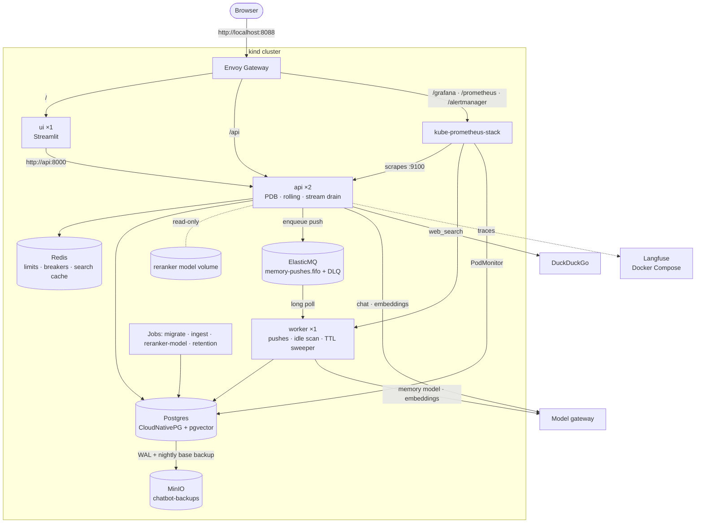
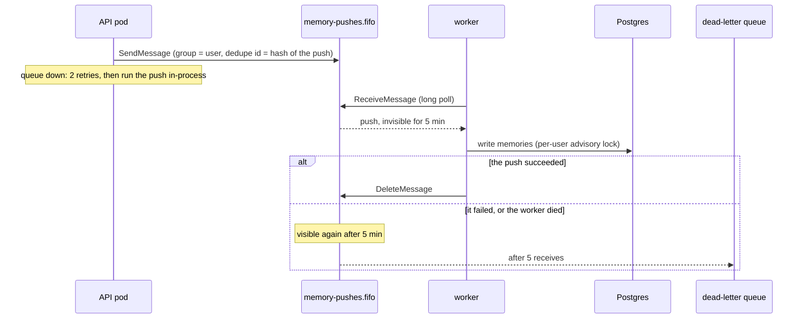
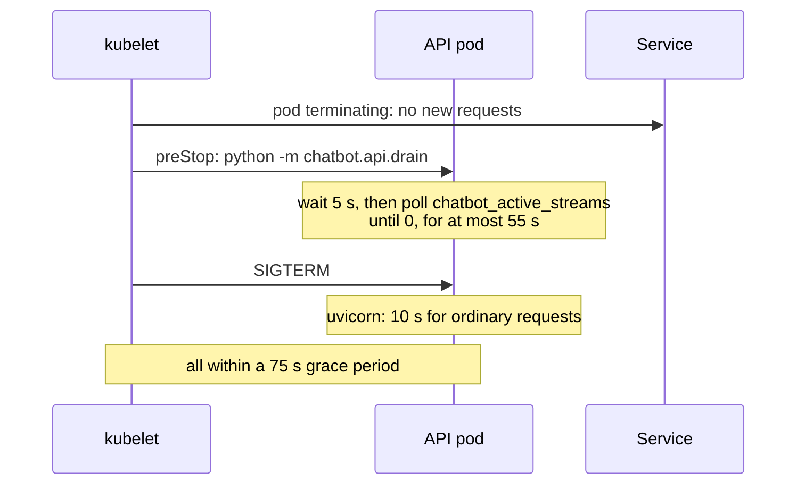

# Phase 9: Deployment

**Goal:** deploy the whole stack repeatably: the app on Kubernetes (a local kind cluster) with Tilt, memory pushes on a queue run by a worker, and a smoke test in CI.

[← Phase 8](phase-8-security-observability.md) · [Overview](../README.md) · [Next: Phase 10 →](phase-10-reliability.md)

**Status: built** (2026-10-19, merged in [PR #10](https://github.com/Anirudh1905/agentic-ai-chatbot/pull/10) with Phases 10 to 12). Like Phases 7 and 8, Phases 9 to 12 are a production-ready demo: a local Kubernetes cluster, no real users or on-call. Deployment came first because the rest is measured on it: the load and outage tests need the deployed stack, and the per-thread lock (Phase 10) depends on where processes run. API pods are stateless: conversation state is in Postgres through the checkpointer, so any pod serves any thread, and an approval can be resumed on another pod.

## Decisions

| Decision | Chosen | Why, and what it rules out |
| --- | --- | --- |
| Target | Kubernetes, on a local **kind** cluster | Replicas, a migration that gates the rollout and scheduled jobs are what Kubernetes is for; Compose would only approximate them. |
| Manifests | **Kustomize**: `deploy/base`, a `deploy/local` overlay, `deploy/ci` on top of it | Plain YAML, applies with or without Tilt (`kubectl apply -k deploy/local`, given an image named `chatbot` loaded into kind, as CI does with `chatbot:ci`; under Tilt, don't: it would swap Tilt's built images for that name) |
| Third-party services | **Helm** charts, installed by `make cluster` | Envoy Gateway, CloudNativePG, kube-prometheus-stack, and later cert-manager and the Barman Cloud plugin |
| Langfuse | **Stays in Compose** | About five services, and a real deployment often rents Langfuse Cloud |
| Postgres | **CloudNativePG**, one instance, its image with pgvector | Failover and backups to object storage are configuration, not code |
| Redis | A plain Deployment, no volume | Rate-limit windows, token counts and breaker state may be lost on restart |
| Monitoring | **kube-prometheus-stack** | ServiceMonitors scrape every API pod and the worker at any replica count, a PodMonitor Postgres; alerts are a `PrometheusRule`; Alertmanager is ready to route |
| Background work | Every memory push goes through a **queue**, run by a **worker** | A push used to run in the API pod that triggered it, so a pod dying mid-push lost it, and the summarized turns had already left the thread. With 2 replicas and rolling deploys that's routine, not rare |
| Queue | **Amazon SQS**, with **ElasticMQ** standing in locally and in CI | The same API on AWS. ElasticMQ is one small container with FIFO, visibility timeouts and dead-letter queues; LocalStack emulates far more. A Redis Streams queue would have made Redis durable |
| Schema | A **migrate Job** | Alembic and the LangGraph tables once, before the API rolls out; a failed migration stops the rollout |
| Reranker model (570 MB) | A **shared volume**, filled once by a Job, mounted read-only | A small image, one download |
| Traffic | **Envoy Gateway** (Gateway API) on host port **8088** | One front door for the UI, `/api`, `/grafana`, `/prometheus`, `/alertmanager`, and the load test |
| Settings, secrets | Kustomize **configMapGenerator** and **secretGenerator** | The Secret comes from a gitignored `deploy/local/secrets.env`, mounted at `/run/secrets`; a changed value rolls the pods |
| API replicas | **2, fixed**, a PodDisruptionBudget (`minAvailable: 1`), `maxUnavailable: 0` | The API mostly waits on the model, so CPU is the wrong signal to autoscale on |
| Dev workflow | **`tilt up` deploys to kind** | One environment everywhere |
| CI | **Build, validate, and a kind smoke test** | Probe, Secret, Service-name and migration-order mistakes only show when pods start |

## What runs where


The picture's source is `.archify/architecture-chatbot-k8s-20261021-150000/candidate.json`. The Mermaid version adds the per-route detail:



- **One image** (`Dockerfile`: multi-stage uv build, non-root, `.env` excluded) runs as the API, the worker, the UI and every Job, each with its own command. It includes `data/sample`, so the ingest Job needs nothing mounted.
- **API:** 2 pods behind an `HTTPRoute` at `/api` that strips the prefix; uvicorn runs with `--root-path /api` so the OpenAPI docs work. The route's timeout is 300 s, for long streamed replies.
  - **Metrics on their own port** (`METRICS_PORT=9100`), which no route reaches; `/metrics` on the app port answers 404.
  - **Probes:** `/healthz` for liveness; `/readyz` (the app's resources are up, the reranker loaded, and the pool answers `SELECT 1`) for readiness, so a pod that loses Postgres leaves the Service instead of restarting in a loop.
  - **Resources:** a 2 Gi memory request and a 3 Gi limit, measured under load (about 1.7 GB with the reranker loaded, in the [load tests](phase-12-load-outage-tests.md#load-test) on 6 CPUs and 16 GB, 2026-10-20); the CI overlay, without the reranker, asks for 512 Mi.
  - `BACKGROUND_JOBS=false`: the API pods run neither the idle scan nor the sweeper.
- **Worker:** `python -m chatbot.worker` runs the pushes, the idle-thread scan (which only enqueues) and the store's TTL sweeper, with metrics on 9100.
- **UI:** one Streamlit pod at the gateway root.
- **Jobs:** `migrate` (Alembic, then the checkpointer's and store's setup; `make migrate` runs the same module), `reranker-model` (fills the volume; the API reads it at `RERANKER_CACHE_DIR=/models`), `ingest` (`data/sample` with `--prune`), and `retention`, a CronJob at 03:30 (a manual resource in Tilt with `auto_init=False`, so it isn't applied until triggered once).
- **Langfuse** runs from `ops/langfuse/docker-compose.yml` (`make langfuse`). `deploy/local/langfuse-link.sh` attaches it to kind's network, and a `langfuse-web` Service with a manual EndpointSlice points at it.
- **Layout:** `deploy/kind.yaml` (the cluster), `cluster.sh` (`make cluster`), `helm/` (chart values), `base/` (our manifests; `config/` holds the ElasticMQ config and the dashboard), `local/` (the kind overlay), `ci/`, `smoke.sh`, `restore.sh`, `restore-test.sh`, `outage-test.sh` and `outage/` (the [outage test](phase-12-load-outage-tests.md#outage-test)).

## Memory pushes on a queue




- **One job per push**, a small JSON message (`chatbot/jobs/push.py`): a *summary* push carries the transcript itself (PII-redacted, tool results blanked), since those turns have left the thread; an *idle* push carries the thread id, and the worker pushes what's past its cursor; a *remember* push carries the question and the reply.
- **Ordering and duplicates:** `MessageGroupId` is the user, so one user's pushes run one at a time and in order (the advisory lock stays as a second guard). `MessageDeduplicationId` makes the same push enqueued twice within 5 minutes run once.
- **Code:** a `JobQueue` protocol (`enqueue`, `receive`, `ack`, `depth`) in `chatbot/jobs/queue.py`, on SQS with `aioboto3`, and in memory for tests. With `SQS_QUEUE_URL` unset (`make dev`), pushes run in-process as before.
- **ElasticMQ** declares both queues at start (`deploy/base/config/elasticmq.conf`) and persists messages on a volume, so queued pushes survive a restart.
- **Metrics and alerts:** the queue's depth by state (`chatbot_queue_messages`), each job's age when it runs, pushes by outcome, and in-process fallbacks (`chatbot_queue_fallbacks_total`). Alerts: **ChatbotWorkerDown** (no worker scraped for 5 minutes), **ChatbotMemoryPushesDeadLettered** (anything dead-lettered) and **ChatbotMemoryQueueStuck** (pushes waiting 15 minutes with none run).

## Shutdown

uvicorn ends every open SSE stream at SIGTERM (sse-starlette closes them), so its own graceful shutdown can't let a reply finish. A `preStop` hook drains first:



A stream cut off anyway finishes with `POST /threads/{id}/resume`, from its checkpoint.

## Dev workflow

```bash
make cluster   # once: the kind cluster and the charts (safe to re-run)
make secrets   # deploy/local/secrets.env, backup-store.env and ca-bundle.pem
make tilt      # tilt up: Langfuse, the image, everything in deploy/local
```

- `make cluster` never changes your kubectl context, and the Tiltfile refuses any context but `kind-chatbot`.
- **After the Docker VM restarts, run `make cluster` again.** It raises the VM kernel's inotify limits, which a restart resets; with the defaults, kube-proxy fails with "too many open files", no pod can reach the API server, and Postgres, the operators and the gateway crash-loop. Delete the crash-looping pods after, or wait for their back-off.
- **Tilt** runs the data services, then migrate, reranker-model and ingest, then the app. A code change rebuilds the image and rolls the pods in about 20 s (2026-10-19, on the kind cluster; the image installs the app non-editable, so it never drifts from what CI builds). Retention, checks and evals are manual resources.
- **From the host**, for tests, evals and database tools: Postgres on `localhost:5433` as a local-only `dev` role (a NodePort and a socat container, `deploy/local/postgres-host.sh`, since kubectl's port-forward drops when the tests reset connections on purpose), Redis on `6380` and ElasticMQ on `9324` (Tilt port-forwards), pgweb on `8081`; everything else is behind `http://localhost:8088`.
- **Never `tilt trigger` config or a resource that holds a volume** (postgres, minio, elasticmq, reranker-volume): a trigger is a force update, which deletes every object in the resource before applying it again. config holds the namespace, so triggering it deletes everything; the others take the database, the backups, the queue or the model with them. It happened once, on 2026-10-21, and wiped the local database and its backups. To re-apply without deleting, stop Tilt and run `tilt up` again (`tilt down` deletes it all).
- **Every object belongs to a named Tilt resource.** Moving one between resources while Tilt runs deletes it, and rerunning a failed Job recreates its whole resource, so the reranker's volume is a resource of its own.
- **`make secrets`** writes `secrets.env` from `.env` (model key and URL, `JWT_SECRET`, the Langfuse keys) and `ca-bundle.pem`, this Mac's keychains, so a corporate TLS-inspecting proxy is trusted inside the containers too. `DATABASE_URL` comes from CloudNativePG's `postgres-app` Secret.
- `make dev` still runs without Kubernetes, with Postgres and Redis started by hand.

## CI

A `deploy` job beside `check` in `.github/workflows/ci.yml`: placeholder secrets → `kubectl kustomize deploy/ci` validated by kubeconform (strict, with the CRD catalog) → build the image, `deploy/cluster.sh`, load the image into kind → apply `deploy/ci` (no ingest or reranker-model Job; `RERANKER_MODEL` empty, so reranking is off and the API pods ask for 512 Mi) and wait for Postgres, migrate and the rollouts → `deploy/smoke.sh` through the gateway. The smoke test checks `/readyz`, that `/api/metrics` is 404, register, log in and an authenticated call, Grafana and Alertmanager behind the gateway, Prometheus scraping at least three targets in the namespace (the API pods, the worker and Postgres; it doesn't check which), at least 10 alert rules loaded (there are 13), and the worker reading the queue. There's no chat call: CI has no model access. The `check` job runs Postgres, ElasticMQ and Redis services, with `REQUIRE_DB`, `REQUIRE_SQS` and `REQUIRE_REDIS` so their tests can't silently skip.

## Failures

| What fails | What happens |
| --- | --- |
| The migrate Job | Tilt doesn't roll out the API or the worker, so nothing serves against the wrong schema; CI's deploy fails waiting for the Job |
| Postgres | `/readyz` fails and the pod leaves the Service; `/healthz` keeps it from a restart loop |
| Redis | Limits let requests through (Phase 8); breakers keep state in memory; searches run uncached |
| The queue | Enqueueing retries twice, then runs the push in-process and counts it, so nothing is dropped |
| The worker | Pushes wait in the queue; ChatbotWorkerDown fires after 5 minutes |
| A push keeps failing | Retried after each visibility timeout; after 5 receives it's dead-lettered, which alerts, and the message holds everything needed to replay it |
| The model volume is empty | The API pods don't become ready: `/readyz` loads the reranker first. With `RERANKER_MODEL` empty (as in `deploy/ci`), search uses the fused results without reranking |
| A pod replaced mid-stream | The drain lets the stream finish; if it's cut anyway, resume finishes the run |
| The model, the embeddings, web search | See [Reliability](phase-10-reliability.md) |

## Tests and checks

| Part | Unit | Integration | Live, on kind |
| --- | --- | --- | --- |
| Deployment | `/readyz` both ways; `/metrics` off the app port; `BACKGROUND_JOBS`; each push kind's group and dedupe ids; the worker acking success only; the enqueue fallback; the drain (`test_drain.py`) | SQS against ElasticMQ, including the dead-letter redrive; migrate run twice; only a background process runs the loops | `tilt up` from nothing; chats spread over both pods; a rolling restart mid-stream finished with every token, twice; a force-deleted worker's push came back after 5 minutes and was written once; every dashboard panel has data |

- **Not done live:** a push dead-lettered after 5 failures (25 minutes of visibility timeouts; covered by the integration test).

## Changes from the design

| Designed | Built | Why |
| --- | --- | --- |
| ingress-nginx on port 80 | **Envoy Gateway** on **8088** | ingress-nginx is retired; 80 and 8080 are often taken |
| Tilt creates the cluster with `ctlptl` | **`make cluster`** | ctlptl's Homebrew build needs a newer Xcode; a script also keeps chart upgrades out of every `tilt up` |
| `/api/metrics` refused at the Ingress | **A separate metrics port** | Simpler, and holds on any gateway |
| uvicorn's graceful shutdown finishes streams | **A `preStop` drain** | sse-starlette closes every stream at SIGTERM; found by the rolling-restart check |
| Live update syncs `src/` | **A rebuild** (about 20 s) | Fast enough, and never drifts from CI's image |
| Pods reach Langfuse by container name | **A Service with a manual EndpointSlice** | Cluster DNS doesn't resolve Docker names |
| An alert on the oldest message's age | **Alerts on worker absence and stuck pushes** | That age is a CloudWatch metric ElasticMQ doesn't expose |
| — | **A CA bundle** in the pods, and `HF_HUB_DISABLE_XET=1` | A TLS-inspecting proxy re-signs HTTPS |
| — | **Postgres on `localhost:5433`** through a NodePort and socat, as a `dev` role | The port-forward dropped under the tests, and the app user can't create databases or the vector extension |
| pgweb dropped with Compose | **pgweb as a local-only Deployment** | Still useful |
| Prometheus and Grafana config in `ops/` | **`deploy/base/monitoring.yaml` and `config/`** | Compose no longer runs them; the root `docker-compose.yml` is gone too |

## Production gaps

To document, not build: the real SQS queues and their IAM permissions (Terraform); autoscaling on in-flight requests; Sealed Secrets or External Secrets; storage several nodes can read, for the model volume; Alertmanager routing; TLS on the gateway.

## Exit criteria

- [x] `tilt up` brings up the whole stack on kind; a chat works through the gateway, spread over 2 API pods
- [x] A rolling restart of the API breaks no streaming reply
- [x] The worker alone runs the background loops; Prometheus scrapes every API pod
- [x] CI builds the image, validates the manifests and passes the kind smoke test (on [PR #10](https://github.com/Anirudh1905/agentic-ai-chatbot/pull/10))
