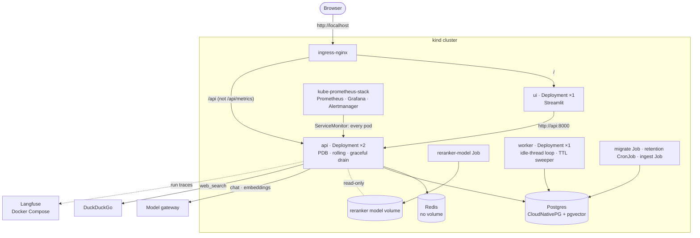

# Phase 9: Reliability, Cost and Deployment

**Goal:** Keep answering when a provider fails, keep cost and latency in check, and deploy the whole stack repeatably.

[← Phase 8](phase-8-security-observability.md) · [Overview](../README.md)

**Status: in progress.** Deployment is designed (below) and built first; reliability, cost and latency, and proof follow, in that order, each designed when it starts. Like Phases 7 and 8, this is for a production-ready demo: a local Kubernetes cluster, no real users or on-call. Items already done in earlier phases are ticked.

| Area | Planned | Section |
| --- | --- | --- |
| Reliability | Retries and circuit breakers on every external call, a fallback model, a per-thread lock, Postgres backups | [Reliability](#reliability) |
| Cost and latency | Prompt caching, a cap on retrieved context, a web search cache | [Cost and latency](#cost-and-latency) |
| Deployment | The app on Kubernetes (kind): an image, 2 API replicas behind an Ingress, a worker, a migrations Job, CloudNativePG, kube-prometheus-stack | [Deployment (design)](#deployment-design) |
| Proof | A load test, a provider-outage test, a runbook | [Exit criteria](#exit-criteria) |

The target shape is in [What runs where](#what-runs-where).

API pods are stateless. All conversation state lives in Postgres through the checkpointer, so any pod can serve any thread, and a pending approval can be resumed on a different pod from the one that created it.

Most items below have LangChain middleware equivalents (`ModelRetryMiddleware`, `ModelFallbackMiddleware`, `ToolCallLimitMiddleware`). Check `langchain.agents.middleware` before building one.

## Deployment (design)

**Status: designed, not built.** Agreed on 2026-10-19. The first piece of Phase 9 to build, because the other three are measured on it: the load test and the outage test need the deployed stack, and the per-thread lock and the background loops depend on where processes run.

### Decisions

| Decision | Chosen | Why, and what it rules out |
| --- | --- | --- |
| Target | Kubernetes in Phase 9, on a local **kind** cluster | Replicas, a migration step that gates the rollout and scheduled jobs are what Kubernetes is for; Compose would only approximate them. There is no separate Phase 10 |
| Our manifests | **Kustomize**: `deploy/base` and a `deploy/local` overlay | Plain YAML, applies with or without Tilt (`kubectl apply -k deploy/local`) |
| Third-party services | **Helm** charts, installed once by Tilt | Only where hand-written manifests would be painful: ingress-nginx, CloudNativePG, kube-prometheus-stack |
| In the cluster | The app, Postgres, Redis, Prometheus and Grafana | **Langfuse stays in Compose**: it's heavy (about five services) and a real deployment often rents it as Langfuse Cloud |
| Postgres | **CloudNativePG**, one instance with pgvector | The production-grade choice (failover, backups to object storage); the later backup work becomes configuration |
| Redis | A plain Deployment, no volume | It holds only rate-limit windows and token counts, which may be lost on restart (Phase 8) |
| Monitoring | **kube-prometheus-stack** | A `ServiceMonitor` scrapes every API pod whatever the replica count; the 7 alerts become a `PrometheusRule`; Alertmanager is ready to route (Phase 8 had nothing to page with) |
| Background work | A **worker** Deployment (1 replica) runs the idle-thread memory loop and the store's TTL sweeper | API pods stop running both, so N replicas don't do the same scans N times. Request-triggered pushes (summary, Remember this, the `remember` tool) stay as background tasks in the API pod; the per-user advisory lock (Phase 6) keeps them safe across pods. No job queue: the Phase 9 plan only needs one if pushes outgrow a worker |
| Schema | A **migrations Job** runs Alembic, `checkpointer.setup()` and `store.setup()` | Once, before the API rolls out; a failed migration stops the rollout instead of breaking pods. API and worker no longer create tables at start |
| Reranker model (about 570 MB) | A **shared volume**, filled once by a Job, mounted read-only | The image stays small and the model is downloaded once, not per pod |
| Traffic | **ingress-nginx**, kind mapping host port 80 | `http://localhost/` is the UI, `/api` the API across both replicas; the load test goes through the same front door as users |
| Settings and secrets | Kustomize **configMapGenerator** and **secretGenerator** | The Secret is built from a gitignored `deploy/local/secrets.env` and mounted at `/run/secrets` (read since Phase 8); a changed value rolls the pods, through the generated name's hash |
| API replicas | **2, fixed**, with a PodDisruptionBudget (`minAvailable: 1`) and rolling updates at `maxUnavailable: 0` | Autoscaling waits for the load test: the API mostly waits on the model gateway, so CPU is the wrong signal; scaling on in-flight requests needs the Prometheus adapter |
| Shutdown | **Graceful drain** | Readiness fails, `preStop` waits a few seconds, uvicorn finishes open streams (`--timeout-graceful-shutdown` 45 s in a 60 s grace period), background pushes get up to 30 s. A stream cut off anyway resumes from its checkpoint (`POST /threads/{id}/resume`) |
| Dev workflow | **`tilt up` deploys to kind** | One environment everywhere; Tilt's live update syncs `src/` into the pods instead of rebuilding the image |
| CI | **Build and validate, plus a kind smoke test** | Most Kubernetes mistakes (probes, Secrets, Service names, migration order) only show when the pods start |

### What runs where

- **One app image** (`Dockerfile`, a multi-stage uv build, `.env` excluded by `.dockerignore`) runs as the API, the worker, the UI and every Job, each with its own command.
- **API:** a Deployment of 2, a Service, and the Ingress at `/api`. The Ingress strips the prefix (the routes stay at `/chat`, `/threads`, …) and uvicorn runs with `--root-path /api` so the OpenAPI docs work behind it. **`/api/metrics` is refused at the Ingress**: Prometheus scrapes the pods directly, and the endpoint isn't authenticated or limited (Phase 8). `/healthz` stays the liveness probe; a new **`/readyz`** (the database pool answers) is the readiness probe, so a pod that loses Postgres leaves the Service instead of being restarted.
- **Worker:** a new `python -m chatbot.worker` runs `MemoryWriter.start` and the store's TTL sweeper. A new setting, **`BACKGROUND_JOBS`** (`true` by default so `make dev` keeps working alone; `false` in the API pods), decides whether a process starts them.
- **UI:** one Streamlit pod at the Ingress root, calling the API in-cluster.
- **Jobs:**
  - `migrate`: a new `python -m chatbot.migrate` that runs `alembic upgrade head`, then the checkpointer's and the store's setup. Tilt runs it before the API and worker roll out; `make migrate` calls the same module.
  - `reranker-model`: downloads the model into the shared volume once; the API mounts it read-only (`RERANKER_CACHE_DIR`).
  - `retention`: a CronJob, nightly, running today's `python -m chatbot.memory.retention`.
  - `ingest`: a Job you trigger from Tilt, for `data/sample` or your own documents.
- **Langfuse** stays in `ops/langfuse/docker-compose.yml` (`make langfuse`). Its containers are attached to kind's Docker network, so pods reach `http://langfuse-web:3000`. To verify first when building: if pods can't resolve it, a Service with manual Endpoints pointing at the container's address does the same.
- **Layout:** `deploy/base/` (our manifests), `deploy/local/` (the kind overlay: generators, `secrets.env`, image tag), `deploy/kind.yaml` (the cluster, with port 80 mapped), `deploy/helm/` (values for the three charts).

### Dev workflow and settings

- `tilt up` creates the kind cluster if it's missing (Tilt's `ctlptl` integration), installs the three Helm charts once, builds the image and applies `deploy/local`. Live update syncs `src/` and restarts the process in the api, worker and ui pods; a change to `pyproject.toml` or `uv.lock` rebuilds the image. The migrate, ingest, retention, checks and evals resources stay in the Tilt UI.
- Tilt port-forwards Postgres to `localhost:5433` and Redis to `6380`, so `make test`, `make eval` and the integration tests keep working with today's `.env`. The UI, API, Grafana and Prometheus are reached through the Ingress on `http://localhost`.
- `docker-compose.yml` keeps only Langfuse (through its include). Postgres, Redis, pgweb, Prometheus and Grafana move into the cluster; pgweb becomes an optional Deployment.
- `make secrets` writes `deploy/local/secrets.env` from `.env` (`OPENAI_API_KEY`, `OPENAI_BASE_URL`, `JWT_SECRET`, the Langfuse keys). The overlay's ConfigMap holds the rest, including the in-cluster `DATABASE_URL` and `REDIS_URL`. No app code changes for settings: Phase 8 already reads `/run/secrets` and requires the URLs.
- Running without Kubernetes stays possible with `make dev`, with Postgres and Redis started by hand.

### CI

A second job beside today's `check`:

1. Build the image.
2. `kustomize build deploy/local` and validate it with kubeconform.
3. Start kind, install the three charts, deploy with a placeholder model key, and wait for the migrations Job.
4. Through the Ingress: `/readyz` answers, register and log in work, and Prometheus has both API pods as targets.

There is no chat call: CI has no model access. About 6 to 8 minutes.

### Failures

| What fails | What happens |
| --- | --- |
| The migrations Job | It shows as failed in Tilt and the API doesn't roll out, so nothing serves against the wrong schema |
| Postgres | `/readyz` fails and the pod leaves the Service; `/healthz` keeps answering, so it isn't restarted in a loop |
| Redis | Limits let requests through, as in Phase 8 |
| The worker | Idle threads aren't pushed until it's back (their cursors keep the place); request-triggered pushes keep working in the API pods |
| The model volume is empty | Search uses the fused results without reranking, as the code already does when the model can't load, and logs it |
| A pod replaced mid-stream | The drain lets the stream finish; if it's cut anyway, resume finishes the run from its checkpoint |

### Tests and checks

- Unit tests:
  - `/readyz` ready and not ready
  - `BACKGROUND_JOBS=false` starts neither the memory loop nor the sweeper, and the worker starts both
  - the worker and migrate entry points, on today's in-memory fakes and against Postgres in the integration tests
- The CI smoke test above.
- Checked live before it's done:
  - chats through the Ingress spread over both API pods (the per-pod request metrics)
  - a rolling restart during a streaming reply breaks no stream
  - deleting the worker pod, then idle pushes resume when it's back

### Not in this piece

- **Reliability, then cost and latency, then proof**, in that order, each with its own design ([below](#reliability)).
- **Production gaps, to document, not build:** autoscaling on in-flight requests; Sealed Secrets or External Secrets instead of a generated Secret; storage several nodes can read, for the model volume on a multi-node cluster; Alertmanager routing; TLS on the Ingress.

## Reliability

- [ ] Retries with backoff and circuit breakers on the model, web search and embedding calls. Searches already retry (`ToolRetryMiddleware`, `tools/registry.py`); the model needs `ModelRetryMiddleware` or the client's `max_retries`; circuit breakers are still to add
- [ ] Fallback model on provider outage (`ModelFallbackMiddleware`). The gateway stalls gpt-5 calls under load (Phase 6 and 7 measurements), so this matters here
- [x] Graceful degradation: web search down → answer from the knowledge base and say so (`ToolRetryMiddleware` returns an error result the model relays)
- [ ] A per-thread lock: two requests on one thread both read the same checkpoint and the later write wins (Phase 3). The UI sends one message at a time
- [ ] Backups and a tested restore for Postgres

## Cost and latency

- [ ] Prompt caching on the system prompt and tool definitions (Phase 6 keeps the recalled memories stable between turns for this)
- [ ] Cap on retrieved context size
- [ ] Cache frequent web search queries (short TTL)
- [x] Small model for summarization (`gpt-4.1-mini`, Phase 3); query rewriting could use it too. Memory extraction stays on `gpt-5-mini` (Phase 6: nano kept outdated and forbidden facts)
- [x] Cap on model and tool round trips (`ModelCallLimitMiddleware`, `MAX_MODEL_CALLS`; `ToolCallLimitMiddleware` if one tool needs its own cap)
- [x] Summaries made after the reply, not before it (Phase 3)
- [x] Per-user rate limits and a daily token budget (Phase 8)

## Exit criteria

- [ ] `tilt up` brings up the whole stack on kind; a chat works through the Ingress, spread over 2 API pods
- [ ] A rolling restart of the API breaks no streaming reply
- [ ] The worker alone runs the background loops; Prometheus scrapes every API pod
- [ ] CI builds the image, validates the manifests and passes the kind smoke test
- [ ] Load test: target concurrent users at the p95 latency target with no errors
- [ ] A provider outage degrades to the fallback model, not errors
- [ ] Runbook for common incidents: provider outage, stuck interrupts, a PII leak report
