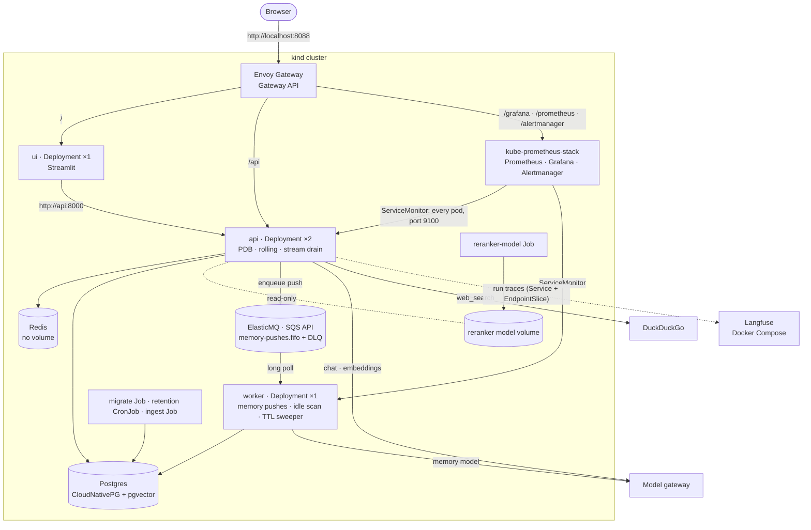

# Phase 9: Reliability, Cost and Deployment

**Goal:** Keep answering when a provider fails, keep cost and latency in check, and deploy the whole stack repeatably.

[← Phase 8](phase-8-security-observability.md) · [Overview](../README.md)

**Status: in progress.** Deployment is built (below); reliability, cost and latency, and proof follow, in that order, each designed when it starts. Like Phases 7 and 8, this is for a production-ready demo: a local Kubernetes cluster, no real users or on-call. Items already done in earlier phases are ticked.

| Area | Planned | Section |
| --- | --- | --- |
| Reliability | Retries and circuit breakers on every external call, a fallback model, a per-thread lock, Postgres backups | [Reliability](#reliability) |
| Cost and latency | Prompt caching, a cap on retrieved context, a web search cache | [Cost and latency](#cost-and-latency) |
| Deployment | Built: the app on Kubernetes (kind): an image, 2 API replicas behind Envoy Gateway, a worker on an SQS queue, a migrate Job, CloudNativePG, kube-prometheus-stack | [Deployment](#deployment) |
| Proof | A load test, a provider-outage test, a runbook | [Exit criteria](#exit-criteria) |

The target shape is in [What runs where](#what-runs-where).

API pods are stateless. All conversation state lives in Postgres through the checkpointer, so any pod can serve any thread, and a pending approval can be resumed on a different pod from the one that created it.

Most items below have LangChain middleware equivalents (`ModelRetryMiddleware`, `ModelFallbackMiddleware`, `ToolCallLimitMiddleware`). Check `langchain.agents.middleware` before building one.

## Deployment

**Status: built.** Designed on 2026-10-19 and built the same day, in 10 steps (the plan is in this doc's history). It came first because the rest of Phase 9 is measured on it: the load test and the outage test need the deployed stack, and the per-thread lock depends on where processes run. [Changes from the design](#changes-from-the-design) lists what turned out different.

### Decisions

| Decision | Chosen | Why, and what it rules out |
| --- | --- | --- |
| Target | Kubernetes in Phase 9, on a local **kind** cluster | Replicas, a migration step that gates the rollout and scheduled jobs are what Kubernetes is for; Compose would only approximate them. There is no separate Phase 10 |
| Our manifests | **Kustomize**: `deploy/base` and a `deploy/local` overlay (`deploy/ci` on top of it for CI) | Plain YAML, applies with or without Tilt (`kubectl apply -k deploy/local`) |
| Third-party services | **Helm** charts, installed by `make cluster` | Only where hand-written manifests would be painful: Envoy Gateway, CloudNativePG, kube-prometheus-stack |
| In the cluster | The app, Postgres, Redis, ElasticMQ, Prometheus, Grafana and Alertmanager | **Langfuse stays in Compose**: it's heavy (about five services) and a real deployment often rents it as Langfuse Cloud |
| Postgres | **CloudNativePG**, one instance, on its image with pgvector | The production-grade choice (failover, backups to object storage); the later backup work becomes configuration |
| Redis | A plain Deployment, no volume | It holds only rate-limit windows and token counts, which may be lost on restart (Phase 8) |
| Monitoring | **kube-prometheus-stack** | A `ServiceMonitor` scrapes every API pod whatever the replica count; the alerts are a `PrometheusRule`; Alertmanager is ready to route (Phase 8 had nothing to page with) |
| Background work | Every memory push goes through a **queue**; a **worker** Deployment (1 replica) runs them, the idle-thread scan and the store's TTL sweeper | Before, a push ran as a task in the API pod that triggered it. If that pod died mid-push, a summary push was lost for good: the summarized turns have already left the thread. "Remember this" answers 202 and could lose its push the same way. With 2 replicas and rolling deploys, that goes from rare to routine. The queue also takes the memory model's calls, and the pooled connection each push holds, out of the API pods |
| Queue | **Amazon SQS**, with **ElasticMQ** standing in for it in the cluster, CI and dev | The same API locally and on AWS. ElasticMQ is one small container with FIFO queues, visibility timeouts, dead-letter queues and on-disk persistence. LocalStack emulates far more than we need. A Redis Streams queue would have made Redis durable; it stays the disposable limits store |
| Schema | A **migrate Job** runs Alembic, `checkpointer.setup()` and `store.setup()` | Once, before the API rolls out; a failed migration stops the rollout instead of breaking pods. API and worker no longer create tables at start |
| Reranker model (about 570 MB) | A **shared volume**, filled once by a Job, mounted read-only | The image stays small and the model is downloaded once, not per pod |
| Traffic | **Envoy Gateway** (Gateway API), kind mapping host port **8088** | `http://localhost:8088/` is the UI, `/api` the API across both replicas, plus `/grafana`, `/prometheus` and `/alertmanager`; the load test goes through the same front door as users |
| Settings and secrets | Kustomize **configMapGenerator** and **secretGenerator** | The Secret is built from a gitignored `deploy/local/secrets.env` and mounted at `/run/secrets` (read since Phase 8); a changed value rolls the pods, through the generated name's hash |
| API replicas | **2, fixed**, with a PodDisruptionBudget (`minAvailable: 1`) and rolling updates at `maxUnavailable: 0` | Autoscaling waits for the load test: the API mostly waits on the model gateway, so CPU is the wrong signal; scaling on in-flight requests needs the Prometheus adapter |
| Shutdown | **Drain open streams before SIGTERM** | See [Shutdown](#shutdown) |
| Dev workflow | **`tilt up` deploys to kind** | One environment everywhere |
| CI | **Build and validate, plus a kind smoke test** | Most Kubernetes mistakes (probes, Secrets, Service names, migration order) only show when the pods start |

### What runs where


The diagram's source is `.archify/architecture-chatbot-k8s-20261019-231500/candidate.json` (archify); the same picture heads the README. The Mermaid version below adds the reranker volume and the per-route detail.



- **One app image** (`Dockerfile`, a multi-stage uv build, non-root, `.env` excluded by `.dockerignore`) runs as the API, the worker, the UI and every Job, each with its own command. It includes `data/sample`, so the ingest Job loads the sample knowledge base with nothing mounted.
- **API:** a Deployment of 2, a Service, and an `HTTPRoute` at `/api`. The route strips the prefix (the routes stay at `/chat`, `/threads`, …), and uvicorn runs with `--root-path /api` so the OpenAPI docs work behind it. The request timeout is 300 s, for long streamed replies.
  - **Metrics are on their own port** (`METRICS_PORT=9100`), which no route reaches, and `/metrics` on the app port answers 404 when it's set. Prometheus scrapes the pods directly, and the endpoint isn't authenticated or limited (Phase 8).
  - `/healthz` stays the liveness probe; **`/readyz`** (the database pool answers `SELECT 1`) is the readiness probe, so a pod that loses Postgres leaves the Service instead of being restarted.
  - `BACKGROUND_JOBS=false`: the API pods run neither the idle scan nor the sweeper.
- **The queue:** one FIFO queue, `memory-pushes.fifo`, and its dead-letter queue, `memory-pushes-dlq.fifo`, after 5 failed receives. ElasticMQ declares both in its config at start (`deploy/base/config/elasticmq.conf`) and runs as a StatefulSet with message persistence on a volume, so queued pushes survive a restart, as on SQS.
  - **One job per push**, as a small JSON message (`chatbot/jobs/push.py`):
    - a *summary* push carries the transcript itself (already PII-redacted; tool results blanked), because the turns have left the thread
    - an *idle* push carries the thread id; the worker reads the thread and pushes what's after its cursor
    - a *remember* push carries the question and the reply
  - **`MessageGroupId` is the user**, so one user's pushes run in order, one at a time. The per-user advisory lock stays as a second guard.
  - **`MessageDeduplicationId`** is a hash of the push, so the same push enqueued twice within SQS's 5-minute window runs once. Idle pushes are idempotent anyway, through the cursor.
  - **Code:** a `JobQueue` protocol (`enqueue`, `receive`, `ack`, `depth`) in `chatbot/jobs/queue.py`, implemented on SQS with `aioboto3` (`SQS_QUEUE_URL`, `SQS_DEAD_LETTER_QUEUE_URL`, and `SQS_ENDPOINT_URL` for ElasticMQ, unset on AWS) and in memory for tests. `MemoryWriter` enqueues when a queue is configured; with `SQS_QUEUE_URL` unset (`make dev`), pushes run in-process as before.
- **Worker:** `python -m chatbot.worker` long-polls the queue and runs each push with the existing writing code. It deletes a message only after the push succeeds; a failure leaves it to come back after its visibility timeout (5 minutes, longer than a push's worst case of retried model calls). It also runs the idle-thread scan, which only enqueues, and the store's TTL sweeper. Its metrics are on port 9100.
- **Queue metrics and alerts:** the worker exports the queue's depth by state (`chatbot_queue_messages`: visible, in flight, dead), each job's age when it runs, and pushes by outcome; the API counts fallbacks. Three alerts join Phase 8's seven: **ChatbotWorkerDown** (no worker scraped for 5 minutes), **ChatbotMemoryPushesDeadLettered** (anything in the dead-letter queue) and **ChatbotMemoryQueueStuck** (pushes waiting for 15 minutes with none run).
- **UI:** one Streamlit pod at the gateway root, calling the API in-cluster.
- **Jobs:**
  - `migrate`: `python -m chatbot.migrate` runs `alembic upgrade head`, then the checkpointer's and the store's setup. Tilt runs it before the API and worker; `make migrate` calls the same module.
  - `reranker-model`: downloads the model into the shared volume once; the API mounts it read-only (`RERANKER_CACHE_DIR=/models`).
  - `ingest`: loads `data/sample` (with `--prune`); re-run from Tilt.
  - `retention`: a CronJob, nightly at 03:30, running `python -m chatbot.memory.retention`.
- **Langfuse** stays in `ops/langfuse/docker-compose.yml` (`make langfuse`). `deploy/local/langfuse-link.sh` attaches `langfuse-web` to kind's Docker network and points a `langfuse-web` Service at it through a manual EndpointSlice, so pods reach `http://langfuse-web:3000`.
- **Layout:**
  - `deploy/kind.yaml`: the cluster
  - `deploy/cluster.sh`: `make cluster`
  - `deploy/helm/`: values for the three charts
  - `deploy/base/`: our manifests, with the ElasticMQ config and the Grafana dashboard in `config/`
  - `deploy/local/`: the kind overlay (generators, `secrets.env`, `ca-bundle.pem`, the NodePort `EnvoyProxy`)
  - `deploy/ci/`: the CI overlay
  - `deploy/smoke.sh`: the smoke test

### Shutdown

uvicorn ends every open SSE stream as soon as it gets SIGTERM (sse-starlette closes them on shutdown), so its own graceful shutdown can't let a stream finish. Instead:

1. The pod is marked terminating, leaves the Service, and gets no new requests.
2. **`preStop` runs `python -m chatbot.api.drain`:** it waits 5 s, then polls `chatbot_active_streams` on the metrics port until it's 0, for up to 55 s.
3. uvicorn gets SIGTERM and has 10 s (`--timeout-graceful-shutdown`) for ordinary requests, within a 75 s grace period.

A stream still cut off can be finished with `POST /threads/{id}/resume`, from its checkpoint.

### Dev workflow and settings

```bash
make cluster   # once: the kind cluster and the three charts (safe to re-run)
make secrets   # deploy/local/secrets.env and ca-bundle.pem from .env and this machine
make tilt      # tilt up: Langfuse, the image, everything in deploy/local
```

- `make cluster` never changes your current kubectl context, and the Tiltfile refuses any context but `kind-chatbot`.
- Tilt builds the image and applies `deploy/local`. It runs the data services first, then migrate, reranker-model and ingest, then the app. A code change rebuilds the image and rolls the pods in about 20 s. Retention, checks and evals are manual resources. A `monitoring` resource holds our side of monitoring (ServiceMonitors, rules, dashboard, routes) and links Grafana, Prometheus's alerts and Alertmanager; those three are the chart's, so Tilt doesn't track their pods.
- From the host, for `make test`, `make eval`, the integration tests and database tools:
  - **Postgres on `localhost:5433`**, as a local-only `dev` role (`dev`/`dev`): it may create databases (the tests make a throwaway one each) and is a member of the tables' owner. CloudNativePG manages it (`spec.managed.roles`, in the kind overlay). It isn't a Tilt port-forward: kubectl's forward drops whenever the server resets a connection, which the tests do on purpose, so a NodePort and a small socat container on kind's network (`deploy/local/postgres-host.sh`) publish it instead.
  - **Redis on `6380` and ElasticMQ on `9324`**, through Tilt port-forwards.
  - **pgweb on `http://localhost:8081`**, a database browser (a local-only Deployment).
  - Everything else is behind the gateway on `http://localhost:8088`.
- Every object belongs to a named Tilt resource: `config` holds the namespace, the generated settings, trust store and Secret; the others sit with what uses them. Moving an object between Tilt resources while Tilt runs deletes it, so change those groupings with Tilt stopped.
- `docker-compose.yml` keeps only Langfuse (through its include).
- `make secrets` writes `deploy/local/secrets.env` from `.env` (`OPENAI_API_KEY`, `OPENAI_BASE_URL`, `JWT_SECRET`, the Langfuse keys) and `deploy/local/ca-bundle.pem`, the trust store the pods use: this Mac's keychains, so a corporate TLS-inspecting proxy's root is trusted inside the containers too (the system bundle on Linux). The overlay's ConfigMap holds the rest; `DATABASE_URL` comes from CloudNativePG's `postgres-app` Secret.
- Running without Kubernetes stays possible with `make dev`, with Postgres and Redis started by hand.

### CI

A `deploy` job beside `check`, in `.github/workflows/ci.yml`:

1. Placeholder secrets (a random `JWT_SECRET`, a dummy model key) and `make-secrets.sh`.
2. `kubectl kustomize deploy/ci`, validated with kubeconform (strict, with the CRD catalog for the Gateway API, CloudNativePG and Prometheus Operator kinds).
3. Build the image, run `deploy/cluster.sh`, and load the image into kind.
4. Apply `deploy/ci` (the kind overlay with the `chatbot:ci` image, without the ingest and reranker-model Jobs), then wait for Postgres, the migrate Job and the rollouts.
5. `deploy/smoke.sh` through the gateway: `/readyz` answers, `/api/metrics` is 404, register, log in and an authenticated call work, Prometheus scrapes both API pods and the worker, the 10 alert rules are loaded, and the worker reports the queue's depth.

There is no chat call: CI has no model access. On failure it prints the pods, events and logs. `deploy/smoke.sh` also runs against the local cluster (it passed there in under 3 s).

### Failures

| What fails | What happens |
| --- | --- |
| The migrate Job | It shows as failed in Tilt and the API doesn't roll out, so nothing serves against the wrong schema |
| Postgres | `/readyz` fails and the pod leaves the Service; `/healthz` keeps answering, so it isn't restarted in a loop |
| Redis | Limits let requests through, as in Phase 8 |
| The queue (ElasticMQ, or SQS) | Enqueueing fails: the API retries twice, then runs that push in-process, logs it and counts it (`chatbot_queue_fallbacks_total`), so a push is never dropped. The worker waits and reconnects |
| The worker | Pushes wait in the queue until it's back; nothing is lost. ChatbotWorkerDown fires after 5 minutes |
| A push keeps failing | It's retried after each visibility timeout; after 5 receives it moves to the dead-letter queue, which alerts. The message holds everything needed to replay it |
| The model volume is empty | Search uses the fused results without reranking, as the code already does when the model can't load, and logs it |
| A pod replaced mid-stream | The drain lets the stream finish; if it's cut anyway, resume finishes the run from its checkpoint |

### Tests and checks

- Unit tests: `/readyz` both ways; `/metrics` off the app port; `BACKGROUND_JOBS`; each push kind enqueued with the right group and dedupe ids; the worker acking success and not failure; the enqueue fallback; the drain's wait (`test_drain.py`).
- Integration tests: the SQS backend against ElasticMQ, including the dead-letter redrive (CI runs ElasticMQ as a service); migrate against Postgres, run twice; only a background process runs the loops.
- The CI smoke test above.
- **Live checks on kind, 2026-10-19:**
  - [x] `tilt up` from nothing brings up the whole stack; register, log in and a chat work through `http://localhost:8088`, and the trace shows up in Langfuse.
  - [x] Chats spread over both API pods (the per-pod request counts in Prometheus).
  - [x] A rolling restart of the API during a streaming reply: the stream finished with `done` and every token, twice. The first try, before the drain, cut the stream at SIGTERM.
  - [x] "Remember this" through the queue: the worker wrote the memory.
  - [x] The worker pod force-deleted (`--grace-period=0`) right after a remember push was received: the message stayed in flight, came back to the new pod after the 5-minute visibility timeout, and the memory was written once ("1 add"); the queue drained to 0.
  - [x] Prometheus scrapes both API pods and the worker; the 10 rules load; the Grafana dashboard is provisioned.
  - [x] Every panel of the Chatbot dashboard has data after traffic that touches it (knowledge base and web search chats, PII, a stream, an approval, login 429s), except "Firing alerts", empty because none fired. This found that counters whose label sets are fixed (decisions, limits, recall results, push outcomes, PII types, tool outcomes) now start at 0: a series that first appeared already at 1 had no earlier sample, so `increase()` missed that count and ratios were blank.
  - [x] `make check` against the cluster: 244 passed, none skipped.
  - [ ] A push failing 5 times reaching the dead-letter queue *live*: covered by the integration test against ElasticMQ, not repeated on the cluster (it takes 25 minutes of visibility timeouts).

### Changes from the design

| Designed | Built | Why |
| --- | --- | --- |
| ingress-nginx on host port 80 | **Envoy Gateway** (Gateway API) on host port **8088** | ingress-nginx is retired; Gateway API is its successor. Ports 80 and 8080 are often taken (by Rancher Desktop here) |
| Tilt creates the cluster with `ctlptl` and installs the charts | **`make cluster`** (`deploy/cluster.sh`) | ctlptl's Homebrew build needs a newer Xcode than this Mac has; a script also keeps chart upgrades out of every `tilt up` |
| `/api/metrics` refused at the Ingress | **A separate metrics port** no route reaches | Simpler than a deny rule, and it holds on any gateway |
| uvicorn's graceful shutdown (45 s) finishes streams | **A `preStop` drain** on `chatbot_active_streams`, then 10 s for uvicorn | sse-starlette closes every stream on SIGTERM; found by the rolling-restart check |
| Live update syncs `src/` into the pods | **A rebuild** (about 20 s) | The image installs the app non-editable; a rebuild is fast enough and never drifts from what CI builds |
| Pods reach Langfuse by its container name on kind's network | **A Service with a manual EndpointSlice**, and Langfuse listening on all interfaces (`HOSTNAME=0.0.0.0`) | Cluster DNS doesn't resolve Docker names, and Langfuse bound only to its first network |
| An alert on the oldest message's age | **Alerts on worker absence and on waiting pushes with none run** | SQS's oldest-message age is a CloudWatch metric, not a queue attribute ElasticMQ exposes |
| — | **A CA bundle** mounted into the pods (`SSL_CERT_FILE`, `REQUESTS_CA_BUNDLE`), and `HF_HUB_DISABLE_XET=1` for the model download | A TLS-inspecting corporate proxy re-signs HTTPS; the containers' trust store doesn't have its root, and Hugging Face's xet transfer failed through it |
| — | Postgres on `localhost:5433` through a NodePort and socat, as a `dev` role; pgvector in `template1` | The Tilt port-forward dropped under the integration tests, and CloudNativePG's app user can't create databases or the (untrusted) vector extension, which the Compose superuser could |
| pgweb dropped with Compose | pgweb as a local-only Deployment | Still useful for looking at threads, checkpoints and memories |
| — | `automountServiceAccountToken: false` on the app pods | The token mount sits under `/run/secrets`, which the secrets volume is mounted read-only over |
| `ops/prometheus/alerts.yml`, `ops/grafana/dashboards/chatbot.json` | The `PrometheusRule` in `deploy/base/monitoring.yaml`; the dashboard in `deploy/base/config/` | Compose no longer runs Prometheus or Grafana |

### Not in this piece

- **Reliability, then cost and latency, then proof**, in that order, each with its own design ([below](#reliability)).
- **Production gaps, to document, not build:** the real SQS queues and their IAM permissions (Terraform), in place of ElasticMQ; autoscaling on in-flight requests; Sealed Secrets or External Secrets instead of a generated Secret; storage several nodes can read, for the model volume on a multi-node cluster; Alertmanager routing; TLS on the gateway.

## Reliability

- [ ] Retries with backoff and circuit breakers on the model, web search and embedding calls. Searches already retry (`ToolRetryMiddleware`, `tools/registry.py`); the model needs `ModelRetryMiddleware` or the client's `max_retries`; circuit breakers are still to add
- [ ] Fallback model on provider outage (`ModelFallbackMiddleware`). The gateway stalls gpt-5 calls under load (Phase 6 and 7 measurements), so this matters here
- [x] Graceful degradation: web search down → answer from the knowledge base and say so (`ToolRetryMiddleware` returns an error result the model relays)
- [ ] A per-thread lock: two requests on one thread both read the same checkpoint and the later write wins (Phase 3). The UI sends one message at a time
- [ ] Backups and a tested restore for Postgres

## Cost and latency

- [ ] Prompt caching on the system prompt and tool definitions (Phase 6 keeps the recalled memories stable between turns for this)
- [ ] Cap on retrieved context size
- [ ] Cache frequent web search queries (short TTL)
- [x] Small model for summarization (`gpt-4.1-mini`, Phase 3); query rewriting could use it too. Memory extraction stays on `gpt-5-mini` (Phase 6: nano kept outdated and forbidden facts)
- [x] Cap on model and tool round trips (`ModelCallLimitMiddleware`, `MAX_MODEL_CALLS`; `ToolCallLimitMiddleware` if one tool needs its own cap)
- [x] Summaries made after the reply, not before it (Phase 3)
- [x] Per-user rate limits and a daily token budget (Phase 8)

## Exit criteria

- [x] `tilt up` brings up the whole stack on kind; a chat works through the gateway, spread over 2 API pods
- [x] A rolling restart of the API breaks no streaming reply
- [x] The worker alone runs the background loops; Prometheus scrapes every API pod
- [ ] CI builds the image, validates the manifests and passes the kind smoke test
- [ ] Load test: target concurrent users at the p95 latency target with no errors
- [ ] A provider outage degrades to the fallback model, not errors
- [ ] Runbook for common incidents: provider outage, stuck interrupts, a PII leak report
