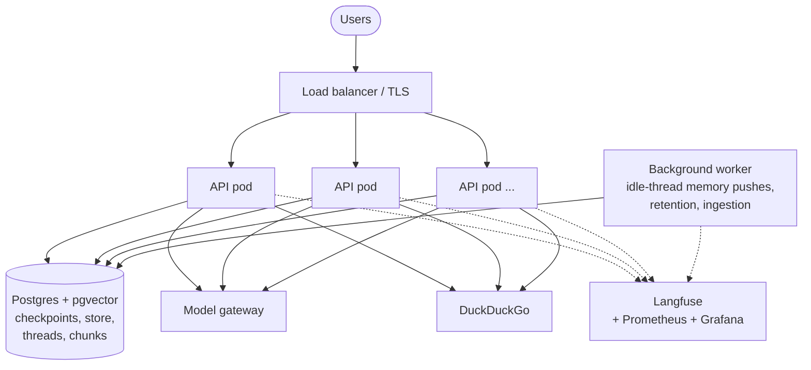

# Phase 9: Reliability, Cost and Deployment

**Goal:** Keep answering when a provider fails, keep cost and latency in check, and deploy the whole stack repeatably.

[← Phase 8](phase-8-security-observability.md) · [Overview](../README.md)

Status: planned. Like Phases 7 and 8, this is for a production-ready demo: one host or a small cluster, no real users or on-call.

## Scope

- Retries, fallbacks and circuit breakers on every external call
- Cost and latency controls
- A container image, migrations as a deploy step, scaling, backups
- A load test and a runbook

## Deployment architecture

API pods are stateless. All conversation state lives in Postgres through the checkpointer, so any pod can serve any thread, and a pending approval can be resumed on a different pod from the one that created it. Today every API process runs the idle-thread memory loop (Phase 6); the Postgres advisory lock keeps that safe across replicas, but one worker is cleaner. A job queue (Redis) is only needed if pushes outgrow one worker.

## Reliability

- [ ] Retries with backoff and circuit breakers on the model, web search and embedding calls (searches: `ToolRetryMiddleware`, done; model: `ModelRetryMiddleware` or the client's `max_retries`; circuit breakers still to add)
- [ ] Fallback model on provider outage (`ModelFallbackMiddleware`). The gateway stalls gpt-5 calls under load (Phase 6 and 7 measurements), so this matters here
- [x] Graceful degradation: web search down → answer from the knowledge base and say so (`ToolRetryMiddleware` returns an error result the model relays)
- [ ] A per-thread lock: two requests on one thread both read the same checkpoint and the later write wins (Phase 3). The UI sends one message at a time
- [ ] DB migrations (Alembic) run as a separate deploy step
- [ ] Backups and a tested restore for Postgres

## Cost and latency

- [ ] Prompt caching on the system prompt and tool definitions (Phase 6 keeps the recalled memories stable between turns for this)
- [x] Small model for summarization (`gpt-4.1-mini`, Phase 3); query rewriting could use it too. Memory extraction stays on `gpt-5-mini` (Phase 6: nano kept outdated and forbidden facts)
- [x] Cap on model and tool round trips (`ModelCallLimitMiddleware`, `MAX_MODEL_CALLS`; `ToolCallLimitMiddleware` if one tool needs its own cap)
- [x] Summaries made after the reply, not before it (Phase 3)
- [ ] Cap on retrieved context size
- [ ] Cache frequent web search queries (short TTL)

Most of these have LangChain middleware equivalents (`ModelRetryMiddleware`, `ModelFallbackMiddleware`, `ToolCallLimitMiddleware`). Check `langchain.agents.middleware` before building one.

## Deployment

- [ ] An app image, and Compose for the whole stack: API, UI, Postgres, Langfuse
- [ ] Migrations as their own step before the new version starts
- [ ] The idle-thread memory loop, retention and ingestion in one worker instead of every API process

## Exit criteria

- [ ] Load test: target concurrent users at the p95 latency target with no errors
- [ ] A provider outage degrades to the fallback model, not errors
- [ ] Runbook for common incidents: provider outage, stuck interrupts, a PII leak report
