# Phase 9: Reliability, Cost and Deployment

**Goal:** Keep answering when a provider fails, keep cost and latency in check, and deploy the whole stack repeatably.

[← Phase 8](phase-8-security-observability.md) · [Overview](../README.md)

**Status: in progress.** Like Phases 7 and 8, this is a production-ready demo: a local Kubernetes cluster, no real users or on-call. Each part was designed when it started and built the same day; [Changes from the design](#changes-from-the-design) lists what turned out different.

| Part | Status | What |
| --- | --- | --- |
| [Deployment](#deployment) | Built 2026-10-19 | The app on kind: one image, 2 API replicas behind Envoy Gateway, a worker on an SQS queue, a migrate Job, CloudNativePG, kube-prometheus-stack, a kind smoke test in CI |
| [Reliability](#reliability) | Built 2026-10-20 | Retries, circuit breakers and a fallback model on the model calls; breakers on the embeddings and web search; a per-thread lock; Postgres backups with a tested point-in-time restore |
| [Cost and latency](#cost-and-latency) | Built 2026-10-20 | Prompt caching measured (automatic at the gateway), caps on retrieved context and on old tool results, a web search cache in Redis |
| [Load test](#load-test) | Run 2026-10-20 | 5 users with no errors; p95 time to first token 13.7 to 18.5 s, over the 10 s target |
| Outage test, runbook | Planned | See [Exit criteria](#exit-criteria) |

Two rules ran through all of it. **API pods are stateless:** conversation state is in Postgres through the checkpointer, so any pod serves any thread, and an approval can be resumed on another pod. **LangChain built-ins first:** retries, fallback and context editing are its middleware; only the circuit breaker, the thread lock and the web search cache are ours, since it has none.

## Decisions

| Area | Decision | Chosen | Why, and what it rules out |
| --- | --- | --- | --- |
| Deployment | Target | Kubernetes, on a local **kind** cluster | Replicas, a migration that gates the rollout and scheduled jobs are what Kubernetes is for; Compose would only approximate them. There is no Phase 10 |
| | Manifests | **Kustomize**: `deploy/base`, a `deploy/local` overlay, `deploy/ci` on top of it | Plain YAML, applies with or without Tilt (`kubectl apply -k deploy/local`) |
| | Third-party services | **Helm** charts, installed by `make cluster` | Envoy Gateway, CloudNativePG, kube-prometheus-stack, and later cert-manager and the Barman Cloud plugin |
| | Langfuse | **Stays in Compose** | About five services, and a real deployment often rents Langfuse Cloud |
| | Postgres | **CloudNativePG**, one instance, its image with pgvector | Failover and backups to object storage are configuration, not code |
| | Redis | A plain Deployment, no volume | Rate-limit windows, token counts and breaker state may be lost on restart |
| | Monitoring | **kube-prometheus-stack** | A `ServiceMonitor` scrapes every pod at any replica count; alerts are a `PrometheusRule`; Alertmanager is ready to route |
| | Background work | Every memory push goes through a **queue**, run by a **worker** | A push used to run in the API pod that triggered it, so a pod dying mid-push lost it, and the summarized turns had already left the thread. With 2 replicas and rolling deploys that's routine, not rare |
| | Queue | **Amazon SQS**, with **ElasticMQ** standing in locally and in CI | The same API on AWS. ElasticMQ is one small container with FIFO, visibility timeouts and dead-letter queues; LocalStack emulates far more. A Redis Streams queue would have made Redis durable |
| | Schema | A **migrate Job** | Alembic and the LangGraph tables once, before the API rolls out; a failed migration stops the rollout |
| | Reranker model (570 MB) | A **shared volume**, filled once by a Job, mounted read-only | A small image, one download |
| | Traffic | **Envoy Gateway** (Gateway API) on host port **8088** | One front door for the UI, `/api`, `/grafana`, `/prometheus`, `/alertmanager`, and the load test |
| | Settings, secrets | Kustomize **configMapGenerator** and **secretGenerator** | The Secret comes from a gitignored `deploy/local/secrets.env`, mounted at `/run/secrets`; a changed value rolls the pods |
| | API replicas | **2, fixed**, a PodDisruptionBudget (`minAvailable: 1`), `maxUnavailable: 0` | The API mostly waits on the model, so CPU is the wrong signal to autoscale on |
| | Dev workflow | **`tilt up` deploys to kind** | One environment everywhere |
| | CI | **Build, validate, and a kind smoke test** | Probe, Secret, Service-name and migration-order mistakes only show when pods start |
| Reliability | Fallback model | **`gpt-4.1` on the same gateway** (`FALLBACK_MODEL`; empty turns it off) | A stalled gpt-5 call is the failure we've measured (Phases 6, 7). A second provider would need a second key and client |
| | Fallback, retries | LangChain's **`ModelFallbackMiddleware`** and **`ModelRetryMiddleware`** | Built-ins. The cost: the fallback catches every error, so a refused request (a 400) goes to the fallback too, though it isn't retried or counted as an outage |
| | Circuit breakers | **Our own** (`reliability/breaker.py`), **shared in Redis** | LangChain has none. Shared, so one pod's timeouts spare the others theirs; in memory without Redis |
| | Busy thread | **409**, `Retry-After: 5` | Queueing would hold a connection open for a whole reply. LangGraph's multitask strategies are a LangGraph Server feature, not in the library |
| | Lock store | **A lease on the `threads` row** | Postgres holds the thread; a Redis lock would be a second source of truth, lost on restart |
| | Backups | **CloudNativePG's Barman Cloud plugin to MinIO**, point-in-time recovery | Continuous WAL plus nightly base backups restore to any moment. In production only the ObjectStore's endpoint and keys change |
| Cost and latency | Prompt caching | **The gateway's own**, no request parameter | Automatic for prefixes of 1,024 tokens or more. The gateway answers `prompt_cache_key` with a 503, which would count as an outage and send calls to the fallback |
| | Old tool results | LangChain's **`ContextEditingMiddleware`** (`ClearToolUsesEdit`) | Built-in, and it edits only what the model is sent: the thread, its sources and the UI keep every result |
| | Per-search cap | Our `within_tokens`, at 4 characters a token | Nothing built in caps a tool's output; LangChain's own estimate, no tokenizer download |
| | Web search cache | **Redis**, already used by every pod | Shared by the API pods; no in-memory fallback, since a per-pod cache would rarely hit |

## Deployment

### What runs where


The picture's source is `.archify/architecture-chatbot-k8s-20261019-231500/candidate.json`. The Mermaid version adds what came later (the backups) and the per-route detail:

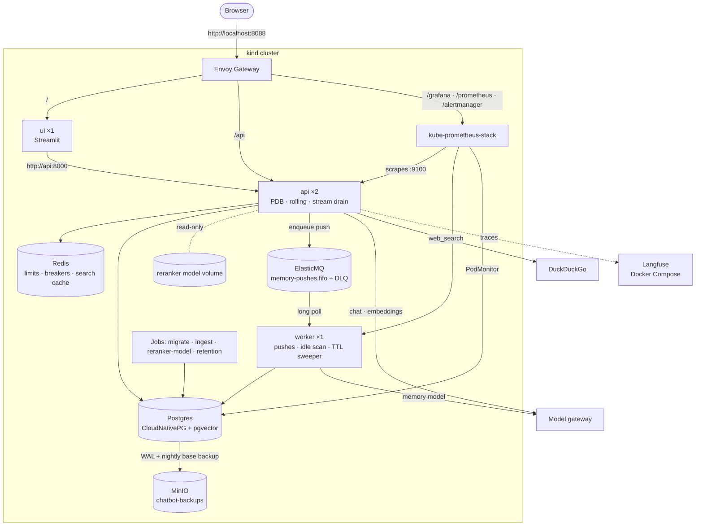

- **One image** (`Dockerfile`: multi-stage uv build, non-root, `.env` excluded) runs as the API, the worker, the UI and every Job, each with its own command. It includes `data/sample`, so the ingest Job needs nothing mounted.
- **API:** 2 pods behind an `HTTPRoute` at `/api` that strips the prefix; uvicorn runs with `--root-path /api` so the OpenAPI docs work. The route's timeout is 300 s, for long streamed replies.
  - **Metrics on their own port** (`METRICS_PORT=9100`), which no route reaches; `/metrics` on the app port answers 404.
  - **Probes:** `/healthz` for liveness; `/readyz` (the pool answers `SELECT 1`) for readiness, so a pod that loses Postgres leaves the Service instead of restarting in a loop.
  - **Resources:** a 2 Gi memory request and a 3 Gi limit, measured under load (about 1.7 GB with the reranker loaded); the CI overlay, without the reranker, asks for 512 Mi.
  - `BACKGROUND_JOBS=false`: the API pods run neither the idle scan nor the sweeper.
- **Worker:** `python -m chatbot.worker` runs the pushes, the idle-thread scan (which only enqueues) and the store's TTL sweeper, with metrics on 9100.
- **UI:** one Streamlit pod at the gateway root.
- **Jobs:** `migrate` (Alembic, then the checkpointer's and store's setup; `make migrate` runs the same module), `reranker-model` (fills the volume; the API reads it at `RERANKER_CACHE_DIR=/models`), `ingest` (`data/sample` with `--prune`), and `retention`, a CronJob at 03:30.
- **Langfuse** runs from `ops/langfuse/docker-compose.yml` (`make langfuse`). `deploy/local/langfuse-link.sh` attaches it to kind's network, and a `langfuse-web` Service with a manual EndpointSlice points at it.
- **Layout:** `deploy/kind.yaml` (the cluster), `cluster.sh` (`make cluster`), `helm/` (chart values), `base/` (our manifests; `config/` holds the ElasticMQ config and the dashboard), `local/` (the kind overlay), `ci/`, `smoke.sh`, `restore.sh`, `restore-test.sh`.

### Memory pushes on a queue

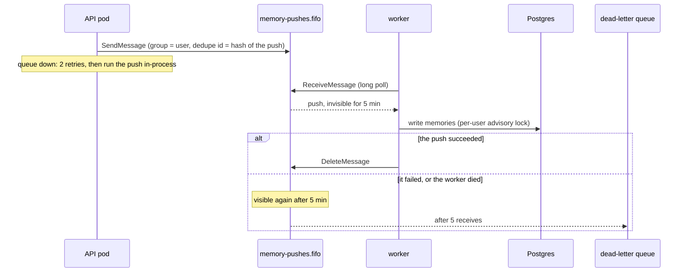

- **One job per push**, a small JSON message (`chatbot/jobs/push.py`): a *summary* push carries the transcript itself (PII-redacted, tool results blanked), since those turns have left the thread; an *idle* push carries the thread id, and the worker pushes what's past its cursor; a *remember* push carries the question and the reply.
- **Ordering and duplicates:** `MessageGroupId` is the user, so one user's pushes run one at a time and in order (the advisory lock stays as a second guard). `MessageDeduplicationId` makes the same push enqueued twice within 5 minutes run once.
- **Code:** a `JobQueue` protocol (`enqueue`, `receive`, `ack`, `depth`) in `chatbot/jobs/queue.py`, on SQS with `aioboto3`, and in memory for tests. With `SQS_QUEUE_URL` unset (`make dev`), pushes run in-process as before.
- **ElasticMQ** declares both queues at start (`deploy/base/config/elasticmq.conf`) and persists messages on a volume, so queued pushes survive a restart.
- **Metrics and alerts:** the queue's depth by state (`chatbot_queue_messages`), each job's age when it runs, pushes by outcome, and in-process fallbacks (`chatbot_queue_fallbacks_total`). Alerts: **ChatbotWorkerDown** (no worker scraped for 5 minutes), **ChatbotMemoryPushesDeadLettered** (anything dead-lettered) and **ChatbotMemoryQueueStuck** (pushes waiting 15 minutes with none run).

### Shutdown

uvicorn ends every open SSE stream at SIGTERM (sse-starlette closes them), so its own graceful shutdown can't let a reply finish. A `preStop` hook drains first:

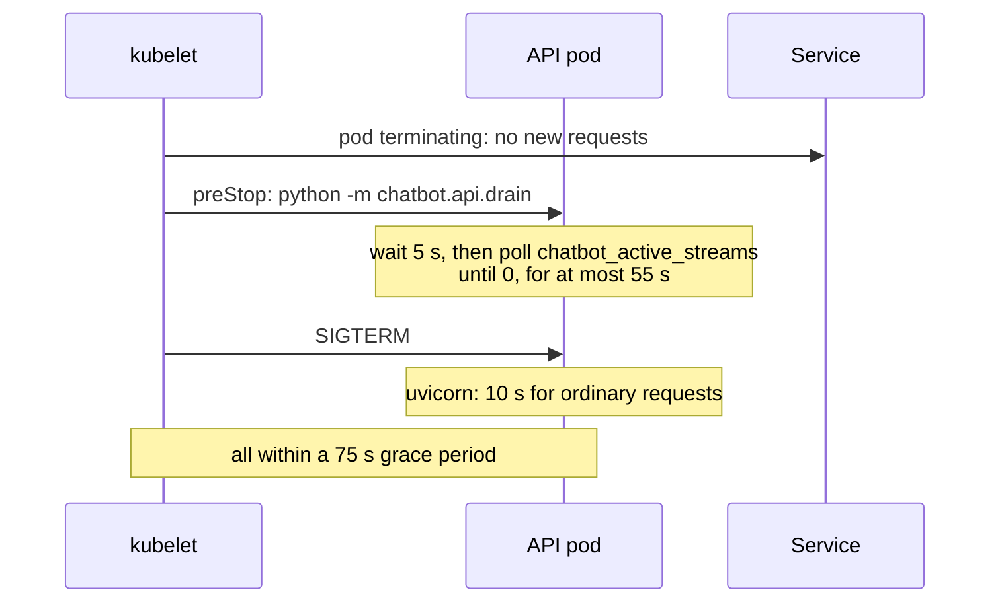

A stream cut off anyway finishes with `POST /threads/{id}/resume`, from its checkpoint.

### Dev workflow

```bash
make cluster   # once: the kind cluster and the charts (safe to re-run)
make secrets   # deploy/local/secrets.env, backup-store.env and ca-bundle.pem
make tilt      # tilt up: Langfuse, the image, everything in deploy/local
```

- `make cluster` never changes your kubectl context, and the Tiltfile refuses any context but `kind-chatbot`.
- **After the Docker VM restarts, run `make cluster` again.** It raises the VM kernel's inotify limits, which a restart resets; with the defaults, kube-proxy fails with "too many open files", no pod can reach the API server, and Postgres, the operators and the gateway crash-loop. Delete the crash-looping pods after, or wait for their back-off.
- **Tilt** runs the data services, then migrate, reranker-model and ingest, then the app. A code change rebuilds the image and rolls the pods in about 20 s (the image installs the app non-editable, so it never drifts from what CI builds). Retention, checks and evals are manual resources.
- **From the host**, for tests, evals and database tools: Postgres on `localhost:5433` as a local-only `dev` role (a NodePort and a socat container, `deploy/local/postgres-host.sh`, since kubectl's port-forward drops when the tests reset connections on purpose), Redis on `6380` and ElasticMQ on `9324` (Tilt port-forwards), pgweb on `8081`; everything else is behind `http://localhost:8088`.
- **Every object belongs to a named Tilt resource.** Moving one between resources while Tilt runs deletes it, and rerunning a failed Job recreates its whole resource, so the reranker's volume is a resource of its own.
- **`make secrets`** writes `secrets.env` from `.env` (model key and URL, `JWT_SECRET`, the Langfuse keys) and `ca-bundle.pem`, this Mac's keychains, so a corporate TLS-inspecting proxy is trusted inside the containers too. `DATABASE_URL` comes from CloudNativePG's `postgres-app` Secret.
- `make dev` still runs without Kubernetes, with Postgres and Redis started by hand.

### CI

A `deploy` job beside `check` in `.github/workflows/ci.yml`: placeholder secrets → `kubectl kustomize deploy/ci` validated by kubeconform (strict, with the CRD catalog) → build the image, `deploy/cluster.sh`, load the image into kind → apply `deploy/ci` (no ingest or reranker-model Job) and wait for Postgres, migrate and the rollouts → `deploy/smoke.sh` through the gateway. The smoke test checks `/readyz`, that `/api/metrics` is 404, register, log in and an authenticated call, Grafana and Alertmanager behind the gateway, Prometheus scraping both API pods and the worker, the alert rules (13) loaded, and the worker reading the queue. There's no chat call: CI has no model access. The `check` job runs Postgres, ElasticMQ and Redis services, with `REQUIRE_DB`, `REQUIRE_SQS` and `REQUIRE_REDIS` so their tests can't silently skip.

### Failures

| What fails | What happens |
| --- | --- |
| The migrate Job | The API doesn't roll out, so nothing serves against the wrong schema |
| Postgres | `/readyz` fails and the pod leaves the Service; `/healthz` keeps it from a restart loop |
| Redis | Limits let requests through (Phase 8); breakers keep state in memory; searches run uncached |
| The queue | Enqueueing retries twice, then runs the push in-process and counts it, so nothing is dropped |
| The worker | Pushes wait in the queue; ChatbotWorkerDown fires after 5 minutes |
| A push keeps failing | Retried after each visibility timeout; after 5 receives it's dead-lettered, which alerts, and the message holds everything needed to replay it |
| The model volume is empty | Search uses the fused results without reranking, and logs it |
| A pod replaced mid-stream | The drain lets the stream finish; if it's cut anyway, resume finishes the run |
| The model, the embeddings, web search | See [Reliability](#reliability) |

## Reliability

- [x] Retries with backoff, circuit breakers and a fallback model on the model calls; breakers on the embeddings and web search ([Model calls](#model-calls))
- [x] Graceful degradation: web search down → answer from the knowledge base and say so; embeddings down → keyword search only, and say so
- [x] A per-thread lock: two requests on one thread both read the same checkpoint, and the later write won (Phase 3) ([Per-thread lock](#per-thread-lock))
- [x] Backups and a tested restore for Postgres ([Backups](#backups))

### Model calls

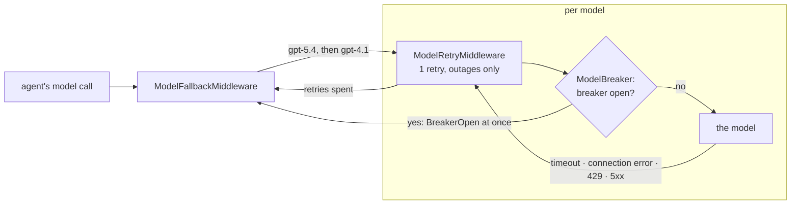

- **The chain** (`agent/builder.py`), outermost first: `ModelFallbackMiddleware(gpt-4.1)`, `ModelRetryMiddleware`, `ModelBreaker`, then `ModelCallMiddleware` (logs and metrics), so every attempt is measured under its own model's name, and the fallback's calls go through the same retry and breaker.
- **Retries:** `ModelRetryMiddleware(max_retries=MODEL_MAX_RETRIES, retry_on=is_outage, on_failure="error")`, about 1 s of backoff. `is_outage` is a timeout, a connection error, a 429 or a 5xx. The client's own retries are off, so it's one retry, not two: a stalled call costs `REQUEST_TIMEOUT` (30 s) each time, and the fallback answers sooner. `on_failure="error"` matters, since the default turns the last failure into an AI message the fallback never sees.
- **A user on their own key never reaches our fallback:** `UserModel` swaps their client into every call, the fallback's included, and `ModelBreaker` skips their calls, since their endpoint's outages aren't ours to count.
- **A reply that fails partway starts over.** When a model call starts while the previous one never ended and had already streamed tokens, the stream (`api/streaming.py`) sends a **`reset`** event first, and the UI redraws the reply (`write_reply` in `ui/app.py`, since `st.write_stream` can't take text back). It works the same for a retry and the fallback. Tokens the PII redactor still held (the last 128 characters) were never shown, so a short failed reply needs no reset.
- **Memory pushes** fall back with `with_fallbacks`: `model.with_structured_output(schema).with_fallbacks([fallback.with_structured_output(schema)])`. One that fails anyway is retried from the queue.
- **Summaries have no fallback:** `SummarizationMiddleware` needs a chat model, and `with_fallbacks` returns a runnable. A failed summary already lets the turn go on with the full history (Phase 3).
- **Embeddings** (`GuardedEmbeddings`) have a breaker and no fallback, since another model's vectors wouldn't match the stored ones. In an outage, knowledge base search runs on full text only and starts its result with a note the model relays (`KEYWORD_ONLY`); recall goes on with the memories the thread already has; ingest fails at once.
- **Web search** keeps its one retry (Phase 2) and gets a breaker that counts every failure, since by then each backend has failed. While it's open the tool answers "Web search is unavailable right now" at once.

### Circuit breakers

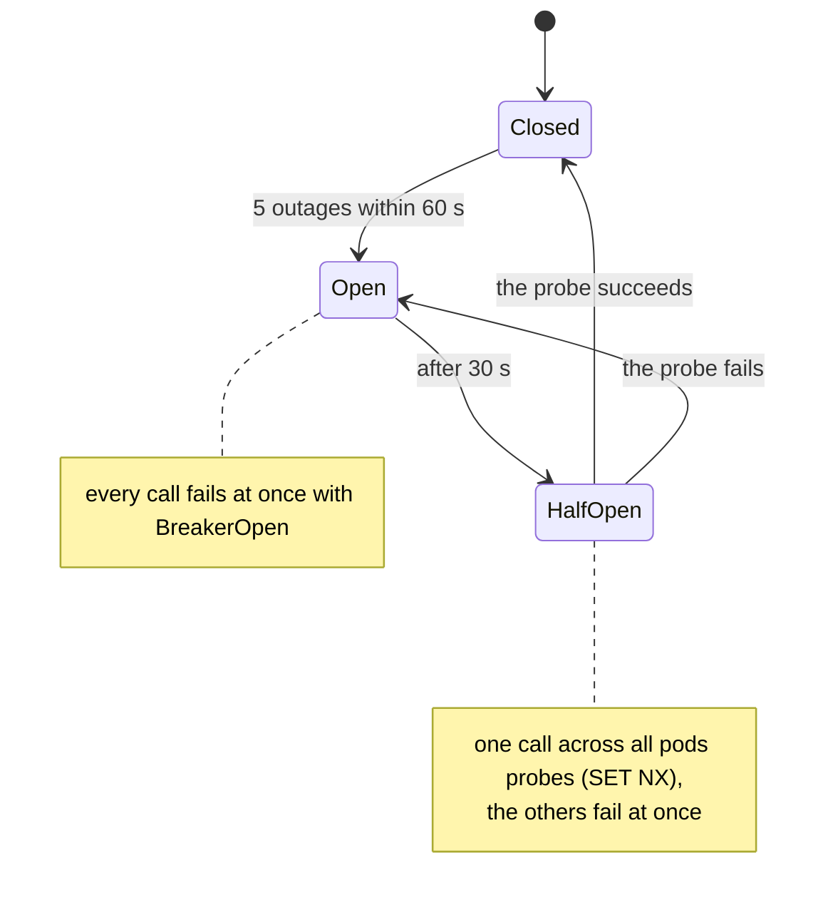

- **Settings:** `BREAKER_FAILURES` (5) outages within `BREAKER_WINDOW_SECONDS` (60) open it for `BREAKER_COOLDOWN_SECONDS` (30). A request the dependency refused (a 400) counts as it answering.
- **In Redis:** four keys per breaker (`breaker/<name>/failures`, `open`, `tripped`, `probe`), each with an expiry, so a pod that dies mid-probe can't leave one stuck (a probe expires after 120 s). The count is `INCR` plus `EXPIRE` in one Lua script. A closed breaker costs one `EXISTS` per call.
- **Without Redis:** `SharedBreakerStore` keeps state in memory, retries Redis every 30 s, and logs once each way.
- **Watching them:** `chatbot_breaker_open{dependency}` (each process reports what it last saw; the dashboard takes the max), the `ChatbotBreakerOpen` alert after 1 minute, and a dashboard panel. Calls to the fallback model show under `gpt-4.1` in the model metrics.

### Per-thread lock

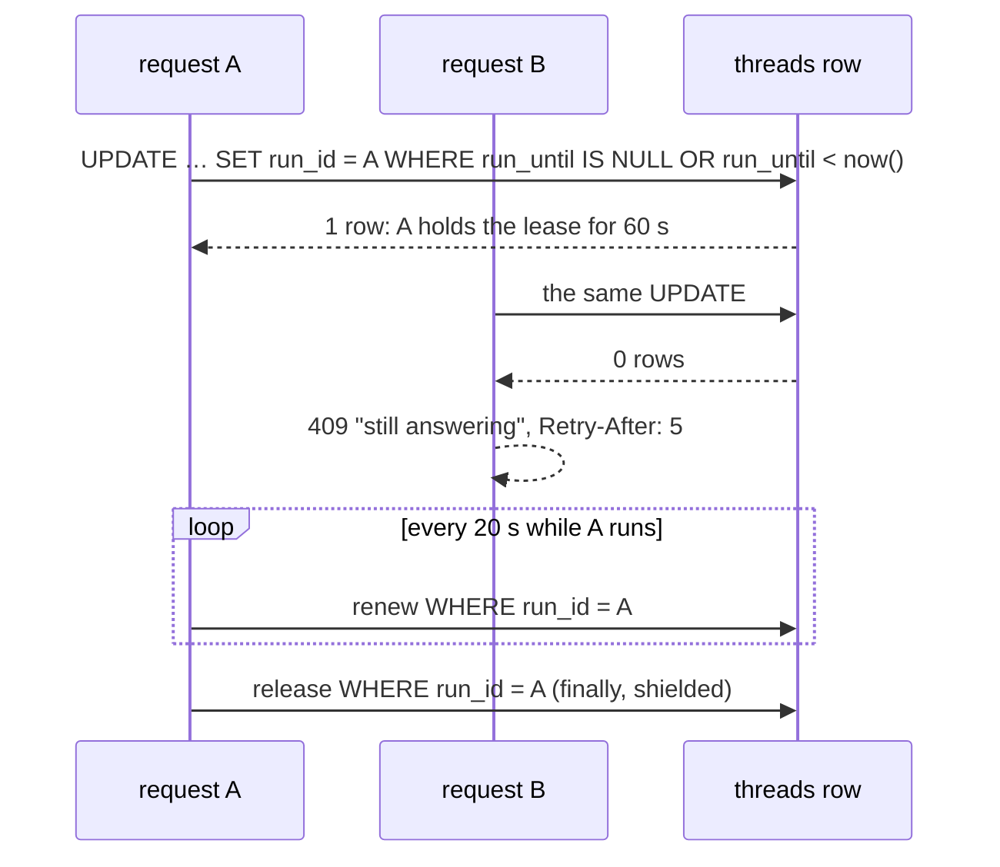

- **The lease:** migration `0004` adds `threads.run_id` and `threads.run_until`; one conditional `UPDATE`, matching the user and an expired or empty lease, means exactly one of two racing runs gets the row. The helpers are `take_lease` and `ThreadLease` in `api/leases.py`.
- **Who takes it:** the run routes (`/chat`, `/chat/stream`, `/threads/{id}/resume` and its stream) and `DELETE /threads/{id}`, since a run would write checkpoints back after a delete. Reads don't, and neither does the worker's idle scan. It's taken after auth, the rate limit and the ownership check (someone else's thread stays 404), before any tokens are spent.
- **Busy:** 409 with `Retry-After: 5`, counted as `chatbot_limited_total{limit="thread_busy"}`. The UI takes a refused message back out of the chat and shows its text under the error.
- **Renewal** every `THREAD_LEASE_SECONDS / 3`, matched on its own `run_id`. A failed renewal is counted (`chatbot_thread_lease_renewal_failures_total`) and the run carries on: stopping a reply halfway is worse than a small chance of a second run once the lease expires.
- **Release** in a `finally`. A client that disconnects cancels the stream's anyio scope, which would cancel the release too, so it runs shielded (`anyio.CancelScope(shield=True)`).
- **A pod that dies** renews nothing, so its threads free themselves within 60 s. **A run paused for approval holds no lease;** its resume takes a new one.

### Backups

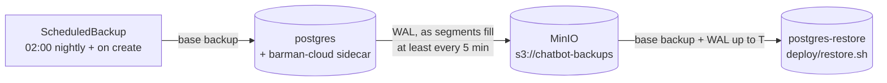

- **Charts:** `make cluster` adds **cert-manager** (v1.21.2, for the plugin's TLS) and the **Barman Cloud plugin** (0.8.1, in `cnpg-system`).
- **`deploy/base/backup.yaml`:** MinIO (a 5 Gi volume, console on 9001 linked from Tilt; Chainguard's image from Docker Hub, pinned, since MinIO stopped publishing images), a `backup-bucket` Job (Barman won't create the bucket), the `backups` ObjectStore (gzip, 7-day retention) and the `postgres-nightly` ScheduledBackup.
- **The cluster** names the plugin as its WAL archiver with `archive_timeout: 5min`, so a restore loses at most the last 5 minutes. The store's keys are made once by `make secrets` (gitignored `backup-store.env`) and kept, since backups are only readable with the keys they were written with.
- **Restore:** `make restore TARGET="2026-10-20 09:30:00+00"` (no `TARGET`: the latest) bootstraps a second Cluster, `postgres-restore`, from the store while the live one keeps running, compares the two (users, threads, threads with checkpoints, the Alembic revision, pgvector's version), and prints how to switch the app over. Switching stays a person's decision: it's an outage either way.
- **`make restore-test`** proves point-in-time recovery, not just that a backup exists:

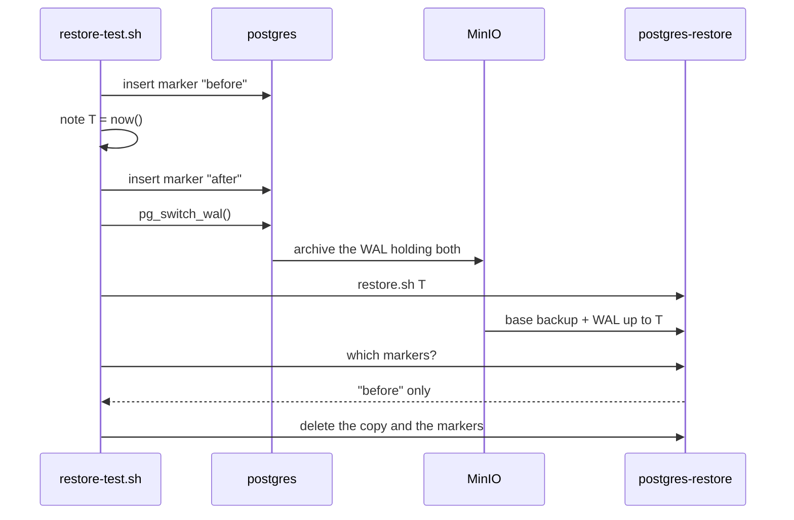

- **Monitoring:** a `PodMonitor` scrapes Postgres. **PostgresBackupMissing** fires with no base backup in 26 h; **PostgresWALArchiveFailing** when the latest archiving attempt failed for 10 minutes. A dashboard panel shows the time since each.
- **CI** keeps MinIO and the backups, so archiving runs during the smoke test; the restore test doesn't run there.

## Cost and latency

- [x] Prompt caching on the system prompt and tool definitions: automatic at the gateway; the prefix kept stable and the hits measured ([Prompt caching](#prompt-caching))
- [x] A cap on retrieved context: per search, and old tool results across a thread ([A cap on context](#a-cap-on-context))
- [x] Frequent web searches cached, briefly ([Web search cache](#web-search-cache))
- [x] From earlier phases: a small summary model (`gpt-4.1-mini`, Phase 3), summaries after the reply (Phase 3), a cap on model calls (`MAX_MODEL_CALLS`), rate limits and a daily token budget (Phase 8). Memory extraction stays on `gpt-5-mini` (Phase 6: nano kept outdated and forbidden facts)

### Prompt caching

OpenAI-style caching reuses the longest prompt prefix the endpoint has seen, past 1,024 tokens, in 128-token steps. What the agent sends, in order, from the most stable to the least:

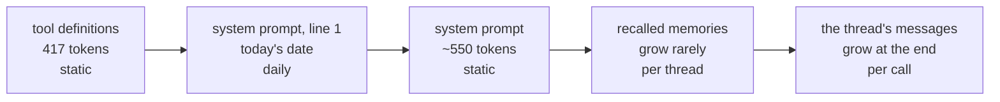

- **Too short alone:** the tools and the system prompt come to 971 tokens (`o200k_base`), just under the minimum, so a thread's first call can't hit. Every later call can: a turn's second call (after a search) repeats the first call's prompt, and the next turn repeats the whole previous one.
- **Memories stay put:** a thread's recalled set only grows when a message brings up one it hasn't seen (Phase 6).
- **On the gateway:** three identical calls of 1,887 tokens read 0, 0, then 1,664 `cached_tokens`. Hits depend on which backend serves a call, which `prompt_cache_key` would steer, but the gateway refuses it.
- **Measured:** `chatbot_model_cached_tokens_total{model}`, from `usage_metadata.input_token_details.cache_read`; its own counter, so `chatbot_model_tokens_total`'s sums and the token alert stay input plus output. Each model call's log line has it ("2104 tokens in, 1664 cached, 85 out"), and a "Prompt cache hit rate" panel charts it. Under the load test, 21% of input tokens were cached.
- **Guarded:** a unit test checks that every call of a thread gets the same system prompt, and memories come after the static part. A per-request value in the prompt (a timestamp, a thread ID) would quietly make every call a miss.

### A cap on context

- **Per search:** `RETRIEVAL_MAX_TOKENS` (2,500). After reranking, the knowledge base keeps its best chunks in rank order until the next would pass the cap, and always the first; six chunks of up to 600 tokens could reach 3,600. Web snippets were already capped at 800 characters (Phase 2).
- **Across a thread:** every call resends the thread, earlier search results included, and those are its biggest messages. Past `CONTEXT_CLEAR_TOOL_RESULTS_TOKENS` (6,000), `ContextEditingMiddleware(ClearToolUsesEdit(...))` sends all but the latest `CONTEXT_KEEP_TOOL_RESULTS` (3) results as a placeholder that says to search again if needed.
  - **Only the request changes:** the thread, the UI's sources and the summaries keep every result.
  - **Summarization** still folds old turns away at `CONTEXT_MAX_TOKENS` (10,000), counted on the thread itself, so clearing doesn't delay it.
  - **Its cost to caching:** a cleared result changes the prompt from that message on, so the next call misses past that point.

### Web search cache

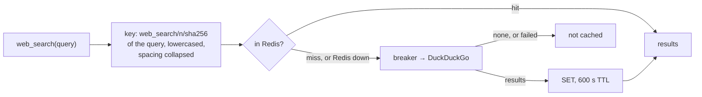

- **Shared** by every API pod, for `WEB_SEARCH_CACHE_SECONDS` (600); `n` is `WEB_SEARCH_MAX_RESULTS`, so a different count is a different search.
- **Only searches with results** are cached: keyless search returns nothing when rate-limited, and a failure goes to the retry and the breaker as before. An approval still applies to a cached query, since it runs before the tool.
- **Without Redis** (no `REDIS_URL`, or a TTL of 0) there's no cache; while Redis is down, searches run uncached with one warning per outage, and 0.5 s client timeouts keep a slow Redis from slowing a search.
- **Measured:** `chatbot_web_search_cache_total{result}`, a "Web search cache hit rate" panel, and `(cached)` in each search's log line. Under the load test it answered 6 of 26 searches.

## Load test

`make load` (`tests/load/run.py`) runs virtual users against the deployed stack, through the gateway, with the reranker on as normally deployed.

- **Each user** has its own account, and they start 13 s apart: registering and logging in are two of the 10 attempts a minute allowed per IP, and they all come from one. Each repeats a conversation for `DURATION` seconds: a knowledge base question from the golden set on a new thread, a follow-up on the same thread, 2 to 5 s of thought. Every fourth conversation asks one of three web questions instead, so the search cache sees repeats.
- **It passes** with no failed turn (a status other than 200, an `error` event, or no `done`) and a p95 time to first token within `P95_TTFT_SECONDS` (10 s). It writes `tests/load/report.json` (gitignored), and each user deletes its account at the end.

| Run, 2026-10-20 | Turns | Failed | First token p50 / p95 | Whole turn p50 / p95 | What it showed |
| --- | --- | --- | --- | --- | --- |
| 10 users | 41 | 3 | 10.1 s / 142 s | 10.9 s / 209 s | The kind VM ran out of memory: the kernel killed an API pod at 2 GB, and Postgres, Redis and every probe stalled |
| 10 users, after the fixes | 152 | 0 | 11.2 s / 37.4 s | 11.9 s / 41.2 s | No errors, but searches took 8.2 s at p50 and 25 s at p95, at a load of 33 on 6 cores; Grafana itself timed out |
| **5 users** | **125** | **0** | **8.3 s / 18.5 s** | **8.7 s / 18.8 s** | No errors, probe failures or restarts. Follow-ups (no search) 4.0 s at p50, first questions 9.7 s |
| 5 users, 4 minutes, after a VM restart | 113 | 0 | 8.0 s / 13.7 s | 8.2 s / 14.2 s | The same picture; the dashboard below is from this run |

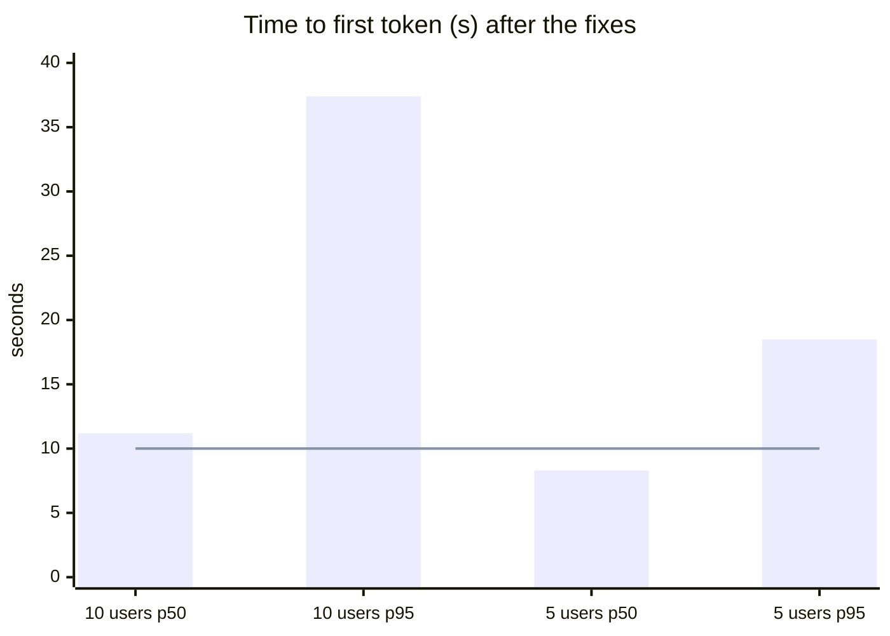

The line is the 10 s target. The dashboard during the last 5-user run:

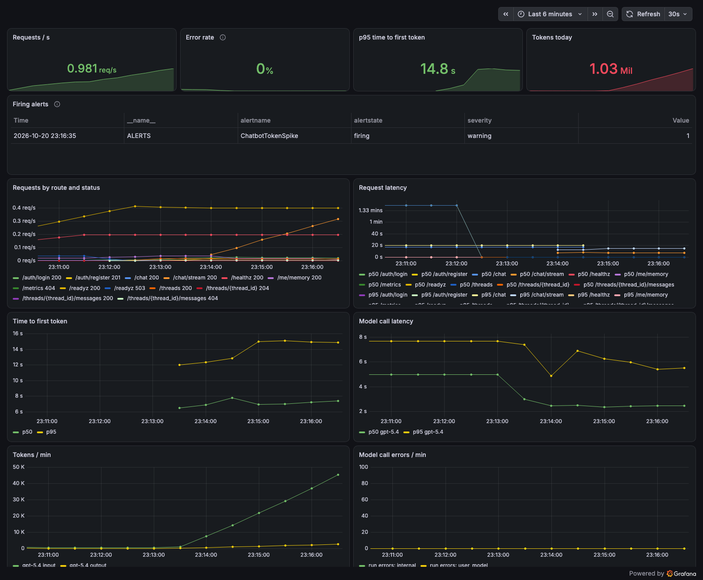

- **The bottleneck is the CPU reranker, not the model or the app.** Under 10 users model calls stayed at 2.6 s p50 and 7.3 s p95, while knowledge base searches took 8.2 s at p50 (reranking adds about 0.5 s on an idle machine, Phase 2). The kind node is a 6-core Docker VM shared with other projects' containers, with about 2 GB of memory free.
- **Fixed along the way:** one rerank at a time per pod (`tools/rerank.py`: concurrent ONNX runs each used every core and allocated their own working memory; with the lock the 10-user run had no out-of-memory kill), API memory requests and limits that match use (above), and the load test retrying a dropped login.
- **Capacity on this laptop: 5 users with no errors, p95 time to first token 13.7 to 18.5 s.** The 10 s target holds at p50, not p95. Meeting it needs a reranker that doesn't compete for the CPU (skipped when busy, fewer candidates, a GPU, or a hosted API); it's kept as is for now, since it raised top-1 retrieval from 96% to 100%.

## Tests and checks

| Part | Unit | Integration | Live, on kind |
| --- | --- | --- | --- |
| Deployment | `/readyz` both ways; `/metrics` off the app port; `BACKGROUND_JOBS`; each push kind's group and dedupe ids; the worker acking success only; the enqueue fallback; the drain (`test_drain.py`) | SQS against ElasticMQ, including the dead-letter redrive; migrate run twice; only a background process runs the loops | `tilt up` from nothing; chats spread over both pods; a rolling restart mid-stream finished with every token, twice; a force-deleted worker's push came back after 5 minutes and was written once; every dashboard panel has data |
| Model calls, breakers (`test_reliability.py`) | An outage is retried, then falls back; a refused request isn't retried or counted; an open breaker skips the model; one `reset` for a reply that failed partway, none when nothing was shown; an own-key user never reaches our fallback; the breaker's open, window, probe and expiry rules; memory pushes fall back; web search and embeddings degrade | One pod's failures open the breaker for another; only one pod probes; every key expires (`test_breaker_redis.py`) | Breaker gauges at 0 for every dependency |
| Thread lock (`test_thread_lease.py`) | 409 with `Retry-After` on every run route and delete; someone else's thread still 404; released after success, an error and a disconnect (fails without the shield); expiry, renewal, a failed renewal; two concurrent `/chat` give one 200 and one 409 | Ten concurrent takers get exactly one lease; renew, release and expiry; keyword-only search with the note | Two concurrent requests: a 200 and a 409 |
| Backups | | | WAL archived and the nightly backup ran on its own; `make restore-test` restored to T in about 3 minutes with only the first marker |
| Cost and latency (`test_cost.py`) | One system prompt per thread; memories after the static part; cached tokens counted; the per-search cap; old tool results cleared while the thread keeps them; the search cache's hits, what isn't cached, and Redis down | One pod's cached results are another's hit; a different count misses; every entry has its TTL (`test_search_cache_redis.py`) | Cache hits and cached tokens under the load test |

- **Totals:** `make check` passes 289 tests with nothing skipped against the cluster; kubeconform validates both overlays; CI runs the smoke test.
- **Evals,** after the context caps, against the committed baseline: nothing dropped. Retrieval, routing, correctness and approval policy at 100%, faithfulness 78%, PII 95% recall and 92% without false positives; citations went from 78% to 90%, within the judge's run-to-run noise. The questions are single turns, so they exercise the per-search cap, not the clearing of old results.
- **Not done live:** a push dead-lettered after 5 failures (25 minutes of visibility timeouts; covered by the integration test).

## Changes from the design

| Part | Designed | Built | Why |
| --- | --- | --- | --- |
| Deployment | ingress-nginx on port 80 | **Envoy Gateway** on **8088** | ingress-nginx is retired; 80 and 8080 are often taken |
| | Tilt creates the cluster with `ctlptl` | **`make cluster`** | ctlptl's Homebrew build needs a newer Xcode; a script also keeps chart upgrades out of every `tilt up` |
| | `/api/metrics` refused at the Ingress | **A separate metrics port** | Simpler, and holds on any gateway |
| | uvicorn's graceful shutdown finishes streams | **A `preStop` drain** | sse-starlette closes every stream at SIGTERM; found by the rolling-restart check |
| | Live update syncs `src/` | **A rebuild** (about 20 s) | Fast enough, and never drifts from CI's image |
| | Pods reach Langfuse by container name | **A Service with a manual EndpointSlice** | Cluster DNS doesn't resolve Docker names |
| | An alert on the oldest message's age | **Alerts on worker absence and stuck pushes** | That age is a CloudWatch metric ElasticMQ doesn't expose |
| | — | **A CA bundle** in the pods, and `HF_HUB_DISABLE_XET=1` | A TLS-inspecting proxy re-signs HTTPS |
| | — | **Postgres on `localhost:5433`** through a NodePort and socat, as a `dev` role | The port-forward dropped under the tests, and the app user can't create databases or the vector extension |
| | pgweb dropped with Compose | **pgweb as a local-only Deployment** | Still useful |
| | Prometheus and Grafana config in `ops/` | **`deploy/base/monitoring.yaml` and `config/`** | Compose no longer runs them; the root `docker-compose.yml` is gone too |
| Reliability | Our own fallback middleware and a `model_fallback` event | **`ModelFallbackMiddleware`, `ModelRetryMiddleware`, `with_fallbacks`** | Built-ins first. Costs: a 400 goes to the fallback, and replies don't say a backup model answered |
| | A `reset` event when the fallback starts | **Sent when a call starts while the previous one never ended** | Needs no marker from the built-ins, and covers retries too |
| | Summaries fall back to gpt-4.1 | **No fallback** | The summarizer needs a chat model, not a runnable |
| | A fallbacks-by-reason counter | **None** | The built-in doesn't report why; fallback calls show under their model |
| | The client's `max_retries=1` | **`ModelRetryMiddleware`, client retries off** | Built-in, with backoff and an outage filter |
| | Barman creates the bucket; MinIO's own image | **A `backup-bucket` Job; Chainguard's image, pinned** | Barman doesn't; MinIO stopped publishing, and `cgr.dev` failed through the proxy |
| Cost and latency | A `kind="cached"` on the token counter | **`chatbot_model_cached_tokens_total`** | Sums over `kind`, and the token alert, would have counted cached tokens twice |
| Load test | — | **One rerank at a time per pod; 2 Gi requests, 3 Gi limits** | The first run took the node out of memory |

## Production gaps

To document, not build: the real SQS queues and their IAM permissions (Terraform); autoscaling on in-flight requests; Sealed Secrets or External Secrets; storage several nodes can read, for the model volume; a reranker off the API pods' CPU; Alertmanager routing; TLS on the gateway.

## Exit criteria

- [x] `tilt up` brings up the whole stack on kind; a chat works through the gateway, spread over 2 API pods
- [x] A rolling restart of the API breaks no streaming reply
- [x] The worker alone runs the background loops; Prometheus scrapes every API pod
- [ ] CI builds the image, validates the manifests and passes the kind smoke test (runs on the first PR)
- [ ] Load test: target concurrent users at the p95 latency target with no errors. Run: 5 users with no errors, but p95 time to first token is 13.7 to 18.5 s against 10 s ([Load test](#load-test))
- [ ] A provider outage degrades to the fallback model, not errors
- [ ] Runbook for common incidents: provider outage, stuck interrupts, a PII leak report
