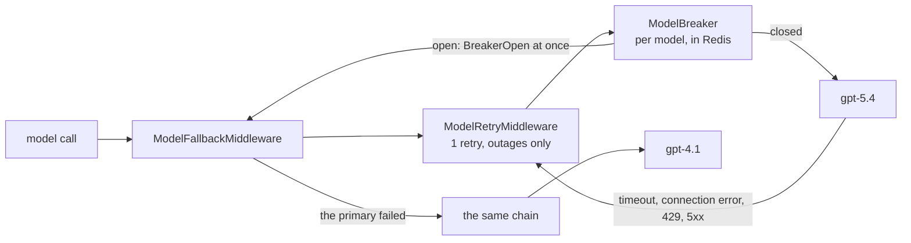
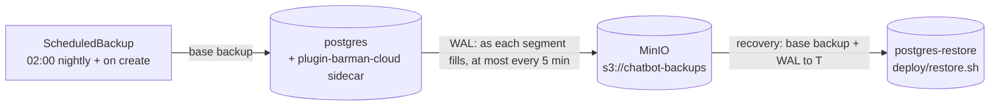

# Phase 9: Reliability, Cost and Deployment

**Goal:** Keep answering when a provider fails, keep cost and latency in check, and deploy the whole stack repeatably.

[← Phase 8](phase-8-security-observability.md) · [Overview](../README.md)

**Status: in progress.** Deployment and reliability are built (below); cost and latency, and proof follow, in that order, each designed when it starts. Like Phases 7 and 8, this is for a production-ready demo: a local Kubernetes cluster, no real users or on-call. Items already done in earlier phases are ticked.

| Area | Planned | Section |
| --- | --- | --- |
| Reliability | Built: retries, circuit breakers and a fallback model on the model calls, breakers on the embeddings and web search, a per-thread lock, Postgres backups with a tested point-in-time restore | [Reliability](#reliability) |
| Cost and latency | Prompt caching, a cap on retrieved context, a web search cache | [Cost and latency](#cost-and-latency) |
| Deployment | Built: the app on Kubernetes (kind): an image, 2 API replicas behind Envoy Gateway, a worker on an SQS queue, a migrate Job, CloudNativePG, kube-prometheus-stack | [Deployment](#deployment) |
| Proof | A load test, a provider-outage test, a runbook | [Exit criteria](#exit-criteria) |

The target shape is in [What runs where](#what-runs-where).

API pods are stateless. All conversation state lives in Postgres through the checkpointer, so any pod can serve any thread, and a pending approval can be resumed on a different pod from the one that created it.

Most items below have LangChain middleware equivalents (`ModelRetryMiddleware`, `ModelFallbackMiddleware`, `ToolCallLimitMiddleware`). Check `langchain.agents.middleware` before building one.

## Deployment

**Status: built.** Designed on 2026-10-19 and built the same day, in 10 steps (the plan is in this doc's history). It came first because the rest of Phase 9 is measured on it: the load test and the outage test need the deployed stack, and the per-thread lock depends on where processes run. [Changes from the design](#changes-from-the-design) lists what turned out different.

### Decisions

| Decision | Chosen | Why, and what it rules out |
| --- | --- | --- |
| Target | Kubernetes in Phase 9, on a local **kind** cluster | Replicas, a migration step that gates the rollout and scheduled jobs are what Kubernetes is for; Compose would only approximate them. There is no separate Phase 10 |
| Our manifests | **Kustomize**: `deploy/base` and a `deploy/local` overlay (`deploy/ci` on top of it for CI) | Plain YAML, applies with or without Tilt (`kubectl apply -k deploy/local`) |
| Third-party services | **Helm** charts, installed by `make cluster` | Only where hand-written manifests would be painful: Envoy Gateway, CloudNativePG, kube-prometheus-stack |
| In the cluster | The app, Postgres, Redis, ElasticMQ, Prometheus, Grafana and Alertmanager | **Langfuse stays in Compose**: it's heavy (about five services) and a real deployment often rents it as Langfuse Cloud |
| Postgres | **CloudNativePG**, one instance, on its image with pgvector | The production-grade choice (failover, backups to object storage); the later backup work becomes configuration |
| Redis | A plain Deployment, no volume | It holds only rate-limit windows and token counts, which may be lost on restart (Phase 8) |
| Monitoring | **kube-prometheus-stack** | A `ServiceMonitor` scrapes every API pod whatever the replica count; the alerts are a `PrometheusRule`; Alertmanager is ready to route (Phase 8 had nothing to page with) |
| Background work | Every memory push goes through a **queue**; a **worker** Deployment (1 replica) runs them, the idle-thread scan and the store's TTL sweeper | Before, a push ran as a task in the API pod that triggered it. If that pod died mid-push, a summary push was lost for good: the summarized turns have already left the thread. "Remember this" answers 202 and could lose its push the same way. With 2 replicas and rolling deploys, that goes from rare to routine. The queue also takes the memory model's calls, and the pooled connection each push holds, out of the API pods |
| Queue | **Amazon SQS**, with **ElasticMQ** standing in for it in the cluster, CI and dev | The same API locally and on AWS. ElasticMQ is one small container with FIFO queues, visibility timeouts, dead-letter queues and on-disk persistence. LocalStack emulates far more than we need. A Redis Streams queue would have made Redis durable; it stays the disposable limits store |
| Schema | A **migrate Job** runs Alembic, `checkpointer.setup()` and `store.setup()` | Once, before the API rolls out; a failed migration stops the rollout instead of breaking pods. API and worker no longer create tables at start |
| Reranker model (about 570 MB) | A **shared volume**, filled once by a Job, mounted read-only | The image stays small and the model is downloaded once, not per pod |
| Traffic | **Envoy Gateway** (Gateway API), kind mapping host port **8088** | `http://localhost:8088/` is the UI, `/api` the API across both replicas, plus `/grafana`, `/prometheus` and `/alertmanager`; the load test goes through the same front door as users |
| Settings and secrets | Kustomize **configMapGenerator** and **secretGenerator** | The Secret is built from a gitignored `deploy/local/secrets.env` and mounted at `/run/secrets` (read since Phase 8); a changed value rolls the pods, through the generated name's hash |
| API replicas | **2, fixed**, with a PodDisruptionBudget (`minAvailable: 1`) and rolling updates at `maxUnavailable: 0` | Autoscaling waits for the load test: the API mostly waits on the model gateway, so CPU is the wrong signal; scaling on in-flight requests needs the Prometheus adapter |
| Shutdown | **Drain open streams before SIGTERM** | See [Shutdown](#shutdown) |
| Dev workflow | **`tilt up` deploys to kind** | One environment everywhere |
| CI | **Build and validate, plus a kind smoke test** | Most Kubernetes mistakes (probes, Secrets, Service names, migration order) only show when the pods start |

### What runs where


The diagram's source is `.archify/architecture-chatbot-k8s-20261019-231500/candidate.json` (archify); the same picture heads the README. The Mermaid version below adds the reranker volume and the per-route detail.


- **One app image** (`Dockerfile`, a multi-stage uv build, non-root, `.env` excluded by `.dockerignore`) runs as the API, the worker, the UI and every Job, each with its own command. It includes `data/sample`, so the ingest Job loads the sample knowledge base with nothing mounted.
- **API:** a Deployment of 2, a Service, and an `HTTPRoute` at `/api`. The route strips the prefix (the routes stay at `/chat`, `/threads`, …), and uvicorn runs with `--root-path /api` so the OpenAPI docs work behind it. The request timeout is 300 s, for long streamed replies.
  - **Metrics are on their own port** (`METRICS_PORT=9100`), which no route reaches, and `/metrics` on the app port answers 404 when it's set. Prometheus scrapes the pods directly, and the endpoint isn't authenticated or limited (Phase 8).
  - `/healthz` stays the liveness probe; **`/readyz`** (the database pool answers `SELECT 1`) is the readiness probe, so a pod that loses Postgres leaves the Service instead of being restarted.
  - `BACKGROUND_JOBS=false`: the API pods run neither the idle scan nor the sweeper.
- **The queue:** one FIFO queue, `memory-pushes.fifo`, and its dead-letter queue, `memory-pushes-dlq.fifo`, after 5 failed receives. ElasticMQ declares both in its config at start (`deploy/base/config/elasticmq.conf`) and runs as a StatefulSet with message persistence on a volume, so queued pushes survive a restart, as on SQS.
  - **One job per push**, as a small JSON message (`chatbot/jobs/push.py`):
    - a *summary* push carries the transcript itself (already PII-redacted; tool results blanked), because the turns have left the thread
    - an *idle* push carries the thread id; the worker reads the thread and pushes what's after its cursor
    - a *remember* push carries the question and the reply
  - **`MessageGroupId` is the user**, so one user's pushes run in order, one at a time. The per-user advisory lock stays as a second guard.
  - **`MessageDeduplicationId`** is a hash of the push, so the same push enqueued twice within SQS's 5-minute window runs once. Idle pushes are idempotent anyway, through the cursor.
  - **Code:** a `JobQueue` protocol (`enqueue`, `receive`, `ack`, `depth`) in `chatbot/jobs/queue.py`, implemented on SQS with `aioboto3` (`SQS_QUEUE_URL`, `SQS_DEAD_LETTER_QUEUE_URL`, and `SQS_ENDPOINT_URL` for ElasticMQ, unset on AWS) and in memory for tests. `MemoryWriter` enqueues when a queue is configured; with `SQS_QUEUE_URL` unset (`make dev`), pushes run in-process as before.
- **Worker:** `python -m chatbot.worker` long-polls the queue and runs each push with the existing writing code. It deletes a message only after the push succeeds; a failure leaves it to come back after its visibility timeout (5 minutes, longer than a push's worst case of retried model calls). It also runs the idle-thread scan, which only enqueues, and the store's TTL sweeper. Its metrics are on port 9100.
- **Queue metrics and alerts:** the worker exports the queue's depth by state (`chatbot_queue_messages`: visible, in flight, dead), each job's age when it runs, and pushes by outcome; the API counts fallbacks. Three alerts join Phase 8's seven: **ChatbotWorkerDown** (no worker scraped for 5 minutes), **ChatbotMemoryPushesDeadLettered** (anything in the dead-letter queue) and **ChatbotMemoryQueueStuck** (pushes waiting for 15 minutes with none run).
- **UI:** one Streamlit pod at the gateway root, calling the API in-cluster.
- **Jobs:**
  - `migrate`: `python -m chatbot.migrate` runs `alembic upgrade head`, then the checkpointer's and the store's setup. Tilt runs it before the API and worker; `make migrate` calls the same module.
  - `reranker-model`: downloads the model into the shared volume once; the API mounts it read-only (`RERANKER_CACHE_DIR=/models`).
  - `ingest`: loads `data/sample` (with `--prune`); re-run from Tilt.
  - `retention`: a CronJob, nightly at 03:30, running `python -m chatbot.memory.retention`.
- **Langfuse** stays in `ops/langfuse/docker-compose.yml` (`make langfuse`). `deploy/local/langfuse-link.sh` attaches `langfuse-web` to kind's Docker network and points a `langfuse-web` Service at it through a manual EndpointSlice, so pods reach `http://langfuse-web:3000`.
- **Layout:**
  - `deploy/kind.yaml`: the cluster
  - `deploy/cluster.sh`: `make cluster`
  - `deploy/helm/`: values for the three charts
  - `deploy/base/`: our manifests, with the ElasticMQ config and the Grafana dashboard in `config/`
  - `deploy/local/`: the kind overlay (generators, `secrets.env`, `ca-bundle.pem`, the NodePort `EnvoyProxy`)
  - `deploy/ci/`: the CI overlay
  - `deploy/smoke.sh`: the smoke test

### Shutdown

uvicorn ends every open SSE stream as soon as it gets SIGTERM (sse-starlette closes them on shutdown), so its own graceful shutdown can't let a stream finish. Instead:

1. The pod is marked terminating, leaves the Service, and gets no new requests.
2. **`preStop` runs `python -m chatbot.api.drain`:** it waits 5 s, then polls `chatbot_active_streams` on the metrics port until it's 0, for up to 55 s.
3. uvicorn gets SIGTERM and has 10 s (`--timeout-graceful-shutdown`) for ordinary requests, within a 75 s grace period.

A stream still cut off can be finished with `POST /threads/{id}/resume`, from its checkpoint.

### Dev workflow and settings

```bash
make cluster   # once: the kind cluster and the three charts (safe to re-run)
make secrets   # deploy/local/secrets.env and ca-bundle.pem from .env and this machine
make tilt      # tilt up: Langfuse, the image, everything in deploy/local
```

- `make cluster` never changes your current kubectl context, and the Tiltfile refuses any context but `kind-chatbot`.
- Tilt builds the image and applies `deploy/local`. It runs the data services first, then migrate, reranker-model and ingest, then the app. A code change rebuilds the image and rolls the pods in about 20 s. Retention, checks and evals are manual resources. A `monitoring` resource holds our side of monitoring (ServiceMonitors, rules, dashboard, routes) and links Grafana, Prometheus's alerts and Alertmanager; those three are the chart's, so Tilt doesn't track their pods.
- From the host, for `make test`, `make eval`, the integration tests and database tools:
  - **Postgres on `localhost:5433`**, as a local-only `dev` role (`dev`/`dev`): it may create databases (the tests make a throwaway one each) and is a member of the tables' owner. CloudNativePG manages it (`spec.managed.roles`, in the kind overlay). It isn't a Tilt port-forward: kubectl's forward drops whenever the server resets a connection, which the tests do on purpose, so a NodePort and a small socat container on kind's network (`deploy/local/postgres-host.sh`) publish it instead.
  - **Redis on `6380` and ElasticMQ on `9324`**, through Tilt port-forwards.
  - **pgweb on `http://localhost:8081`**, a database browser (a local-only Deployment).
  - Everything else is behind the gateway on `http://localhost:8088`.
- Every object belongs to a named Tilt resource: `config` holds the namespace, the generated settings, trust store and Secret; the others sit with what uses them. Moving an object between Tilt resources while Tilt runs deletes it, so change those groupings with Tilt stopped.
- The root `docker-compose.yml` is gone; Langfuse runs from `ops/langfuse/docker-compose.yml`, which keeps the old project name so its containers and volumes carry over.
- `make secrets` writes `deploy/local/secrets.env` from `.env` (`OPENAI_API_KEY`, `OPENAI_BASE_URL`, `JWT_SECRET`, the Langfuse keys) and `deploy/local/ca-bundle.pem`, the trust store the pods use: this Mac's keychains, so a corporate TLS-inspecting proxy's root is trusted inside the containers too (the system bundle on Linux). The overlay's ConfigMap holds the rest; `DATABASE_URL` comes from CloudNativePG's `postgres-app` Secret.
- Running without Kubernetes stays possible with `make dev`, with Postgres and Redis started by hand.

### CI

A `deploy` job beside `check`, in `.github/workflows/ci.yml`:

1. Placeholder secrets (a random `JWT_SECRET`, a dummy model key) and `make-secrets.sh`.
2. `kubectl kustomize deploy/ci`, validated with kubeconform (strict, with the CRD catalog for the Gateway API, CloudNativePG and Prometheus Operator kinds).
3. Build the image, run `deploy/cluster.sh`, and load the image into kind.
4. Apply `deploy/ci` (the kind overlay with the `chatbot:ci` image, without the ingest and reranker-model Jobs), then wait for Postgres, the migrate Job and the rollouts.
5. `deploy/smoke.sh` through the gateway: `/readyz` answers, `/api/metrics` is 404, register, log in and an authenticated call work, Prometheus scrapes both API pods and the worker, the 10 alert rules are loaded, and the worker reports the queue's depth.

There is no chat call: CI has no model access. On failure it prints the pods, events and logs. `deploy/smoke.sh` also runs against the local cluster (it passed there in under 3 s).

### Failures

| What fails | What happens |
| --- | --- |
| The migrate Job | It shows as failed in Tilt and the API doesn't roll out, so nothing serves against the wrong schema |
| Postgres | `/readyz` fails and the pod leaves the Service; `/healthz` keeps answering, so it isn't restarted in a loop |
| Redis | Limits let requests through, as in Phase 8 |
| The queue (ElasticMQ, or SQS) | Enqueueing fails: the API retries twice, then runs that push in-process, logs it and counts it (`chatbot_queue_fallbacks_total`), so a push is never dropped. The worker waits and reconnects |
| The worker | Pushes wait in the queue until it's back; nothing is lost. ChatbotWorkerDown fires after 5 minutes |
| A push keeps failing | It's retried after each visibility timeout; after 5 receives it moves to the dead-letter queue, which alerts. The message holds everything needed to replay it |
| The model volume is empty | Search uses the fused results without reranking, as the code already does when the model can't load, and logs it |
| A pod replaced mid-stream | The drain lets the stream finish; if it's cut anyway, resume finishes the run from its checkpoint |

### Tests and checks

- Unit tests: `/readyz` both ways; `/metrics` off the app port; `BACKGROUND_JOBS`; each push kind enqueued with the right group and dedupe ids; the worker acking success and not failure; the enqueue fallback; the drain's wait (`test_drain.py`).
- Integration tests: the SQS backend against ElasticMQ, including the dead-letter redrive (CI runs ElasticMQ as a service); migrate against Postgres, run twice; only a background process runs the loops.
- The CI smoke test above.
- **Live checks on kind, 2026-10-19:**
  - [x] `tilt up` from nothing brings up the whole stack; register, log in and a chat work through `http://localhost:8088`, and the trace shows up in Langfuse.
  - [x] Chats spread over both API pods (the per-pod request counts in Prometheus).
  - [x] A rolling restart of the API during a streaming reply: the stream finished with `done` and every token, twice. The first try, before the drain, cut the stream at SIGTERM.
  - [x] "Remember this" through the queue: the worker wrote the memory.
  - [x] The worker pod force-deleted (`--grace-period=0`) right after a remember push was received: the message stayed in flight, came back to the new pod after the 5-minute visibility timeout, and the memory was written once ("1 add"); the queue drained to 0.
  - [x] Prometheus scrapes both API pods and the worker; the 10 rules load; the Grafana dashboard is provisioned.
  - [x] Every panel of the Chatbot dashboard has data after traffic that touches it (knowledge base and web search chats, PII, a stream, an approval, login 429s), except "Firing alerts", empty because none fired. This found that counters whose label sets are fixed (decisions, limits, recall results, push outcomes, PII types, tool outcomes) now start at 0: a series that first appeared already at 1 had no earlier sample, so `increase()` missed that count and ratios were blank.
  - [x] `make check` against the cluster: 244 passed, none skipped.
  - [ ] A push failing 5 times reaching the dead-letter queue *live*: covered by the integration test against ElasticMQ, not repeated on the cluster (it takes 25 minutes of visibility timeouts).

### Changes from the design

| Designed | Built | Why |
| --- | --- | --- |
| ingress-nginx on host port 80 | **Envoy Gateway** (Gateway API) on host port **8088** | ingress-nginx is retired; Gateway API is its successor. Ports 80 and 8080 are often taken (by Rancher Desktop here) |
| Tilt creates the cluster with `ctlptl` and installs the charts | **`make cluster`** (`deploy/cluster.sh`) | ctlptl's Homebrew build needs a newer Xcode than this Mac has; a script also keeps chart upgrades out of every `tilt up` |
| `/api/metrics` refused at the Ingress | **A separate metrics port** no route reaches | Simpler than a deny rule, and it holds on any gateway |
| uvicorn's graceful shutdown (45 s) finishes streams | **A `preStop` drain** on `chatbot_active_streams`, then 10 s for uvicorn | sse-starlette closes every stream on SIGTERM; found by the rolling-restart check |
| Live update syncs `src/` into the pods | **A rebuild** (about 20 s) | The image installs the app non-editable; a rebuild is fast enough and never drifts from what CI builds |
| Pods reach Langfuse by its container name on kind's network | **A Service with a manual EndpointSlice**, and Langfuse listening on all interfaces (`HOSTNAME=0.0.0.0`) | Cluster DNS doesn't resolve Docker names, and Langfuse bound only to its first network |
| An alert on the oldest message's age | **Alerts on worker absence and on waiting pushes with none run** | SQS's oldest-message age is a CloudWatch metric, not a queue attribute ElasticMQ exposes |
| — | **A CA bundle** mounted into the pods (`SSL_CERT_FILE`, `REQUESTS_CA_BUNDLE`), and `HF_HUB_DISABLE_XET=1` for the model download | A TLS-inspecting corporate proxy re-signs HTTPS; the containers' trust store doesn't have its root, and Hugging Face's xet transfer failed through it |
| — | Postgres on `localhost:5433` through a NodePort and socat, as a `dev` role; pgvector in `template1` | The Tilt port-forward dropped under the integration tests, and CloudNativePG's app user can't create databases or the (untrusted) vector extension, which the Compose superuser could |
| pgweb dropped with Compose | pgweb as a local-only Deployment | Still useful for looking at threads, checkpoints and memories |
| — | `automountServiceAccountToken: false` on the app pods | The token mount sits under `/run/secrets`, which the secrets volume is mounted read-only over |
| `ops/prometheus/alerts.yml`, `ops/grafana/dashboards/chatbot.json` | The `PrometheusRule` in `deploy/base/monitoring.yaml`; the dashboard in `deploy/base/config/` | Compose no longer runs Prometheus or Grafana |

### Not in this piece

- **Reliability** ([below](#reliability)), **then cost and latency, then proof**, in that order, each with its own design.
- **Production gaps, to document, not build:** the real SQS queues and their IAM permissions (Terraform), in place of ElasticMQ; autoscaling on in-flight requests; Sealed Secrets or External Secrets instead of a generated Secret; storage several nodes can read, for the model volume on a multi-node cluster; Alertmanager routing; TLS on the gateway.

## Reliability

**Status: built.** Designed on 2026-10-20 and built the same day, in three parts: model calls, a per-thread lock, Postgres backups. Where LangChain has a built-in it's used as is; only the circuit breaker and the lock are our code, since neither has one. [What changed from the design](#reliability-changes-from-the-design) lists what turned out different.

- [x] Retries with backoff, circuit breakers and a fallback model on the model calls; breakers on the embeddings and web search too ([Model calls](#model-calls))
- [x] Graceful degradation: web search down → answer from the knowledge base and say so (Phase 2); embeddings down → keyword search only, and say so
- [x] A per-thread lock: two requests on one thread both read the same checkpoint and the later write won (Phase 3) ([Per-thread lock](#per-thread-lock))
- [x] Backups and a tested restore for Postgres ([Backups](#backups))

### Decisions

| Decision | Chosen | Why, and what it rules out |
| --- | --- | --- |
| Fallback model | **`gpt-4.1` on the same gateway** (`FALLBACK_MODEL`; empty turns it off) | A stalled gateway call to gpt-5 is the failure we've measured (Phases 6 and 7); another model on the same endpoint answers it. A second provider would need a second key and client: Claude can't be called through the OpenAI client (Phase 7) |
| Fallback, retries | LangChain's **`ModelFallbackMiddleware`** and **`ModelRetryMiddleware`** | Built-ins over our own. The cost: the fallback catches every error, not only outages, so a request the model refused (a 400) goes to the fallback too. It isn't retried or counted as an outage |
| Circuit breakers | **Our own** (`reliability/breaker.py`), per model, the embeddings and web search, **shared in Redis** | LangChain and LangGraph have none. Shared, so one pod's timeouts spare the other pod and the worker theirs. Without Redis, each process keeps its own, in memory |
| Busy thread | **409**, `Retry-After: 5` | Queueing the second message would hold a connection open for a whole reply, and the UI already sends one at a time. LangGraph's multitask strategies (reject, enqueue, …) are a LangGraph Server feature; the library has none |
| Lock store | **A lease on the `threads` row** | Postgres already holds the thread and is what must stay consistent; a Redis lock would be a second source of truth that can be lost on restart |
| Backups | **CloudNativePG's Barman Cloud plugin to MinIO**, with point-in-time recovery | Continuous WAL archiving plus nightly base backups restore to any moment. MinIO stands in for S3; in production only the ObjectStore's endpoint and keys change |

### Model calls



- **The chain** (`agent/builder.py`), outermost first: `ModelFallbackMiddleware(gpt-4.1)`, `ModelRetryMiddleware`, `ModelBreaker`, then the existing `ModelCallMiddleware` (logs and metrics), so every attempt is measured under its own model's name.
  - **Retries:** `ModelRetryMiddleware(max_retries=MODEL_MAX_RETRIES, retry_on=is_outage, on_failure="error")`, with its default backoff of about 1 s. `is_outage` (`reliability/breaker.py`) is a timeout, a connection error, a 429 or a 5xx. The client's own retries are off (`max_retries=0`), so it's one retry instead of the client's two: a stalled call costs `REQUEST_TIMEOUT` (30 s) each time, and the fallback answers sooner than a third try. `on_failure="error"` matters: the default turns the last failure into an AI message, which the fallback would never see.
  - **Breaker:** `ModelBreaker` runs each call through its model's breaker. While a breaker is open the call raises `BreakerOpen` at once, and the fallback middleware moves on to gpt-4.1, which has its own breaker.
  - **Fallback:** the built-in, unchanged. The fallback's call goes through the same retry and breaker.
- **The breaker** (`Breaker`): `BREAKER_FAILURES` (5) outages within `BREAKER_WINDOW_SECONDS` (60) open it for `BREAKER_COOLDOWN_SECONDS` (30). After that it's half-open: one call probes (a `SET NX` key, so one across all pods) and the others go to the fallback; success closes it, failure opens it again. A request the dependency refused (a 400) counts as the dependency answering.
  - **In Redis:** four keys per breaker (`breaker/<name>/failures`, `open`, `tripped`, `probe`), each with an expiry, so a pod that dies mid-probe can't leave one stuck (the probe expires after 120 s). The failure count is `INCR` and `EXPIRE` in one Lua script, for the same reason. A closed breaker costs one `EXISTS` per call.
  - **Without Redis:** `SharedBreakerStore` falls back to memory for 30 s at a time, and logs once when it loses Redis and once when it's back.
- **A user on their own key never falls back to ours.** `UserModel` sits inside the chain and replaces whatever model the call carries with the user's own client, so the fallback's call goes to their endpoint too. `ModelBreaker` skips their calls: their endpoint's outages aren't ours to count.
- **A reply that fails partway** starts over. The stream (`api/streaming.py`) watches the agent's model calls: when one starts while the previous one never ended and had already sent tokens, it sends a new SSE event, **`reset`**, before the new call's tokens. The UI drops the text shown so far and draws the reply again (`write_reply` in `ui/app.py`; `st.write_stream` can't take text back). This works the same for a retry and for the fallback, with no marker from either. Tokens the PII redactor still held back (`StreamRedactor`, the last 128 characters) were never shown, so a short failed reply needs no reset.
- **Memory pushes** fall back with LangChain's `with_fallbacks`: `MemoryWriter(..., fallback=gpt-4.1)` builds `model.with_structured_output(schema).with_fallbacks([fallback.with_structured_output(schema)])`. A push that fails anyway stays on the queue and is retried (the worker).
- **Summaries have no fallback.** `SummarizationMiddleware` needs a chat model (it calls `with_retry`, `_get_ls_params` and `profile` on it), and `with_fallbacks` returns a runnable. A failed summary already lets the turn go ahead with the full history (Phase 3).
- **Embeddings** (`GuardedEmbeddings`, `storage/embeddings.py`) have a breaker and no fallback: another model's vectors wouldn't match the stored ones.
  - **Knowledge base search:** in an outage, or with the breaker open, it searches full text only and starts its result with a note the model relays: semantic search is down, and the results may miss documents that use other words (`KEYWORD_ONLY`, `tools/rag.py`).
  - **Memory recall:** the turn goes ahead with the memories the thread already has.
  - **Ingest** uses the shared breaker, so it fails at once while the API has found the embeddings down.
- **Web search** keeps its `ToolRetryMiddleware` (one retry, Phase 2) and gets a breaker. Every failure counts, since by then each backend has failed. While it's open the tool answers "Web search is unavailable right now" at once.
- **Metrics and alerts:**
  - **Metric:** `chatbot_breaker_open{dependency}` is 1 while a breaker is open. Each process reports what it last saw, so the dashboard takes the max.
  - **Alert:** `ChatbotBreakerOpen`, after 1 minute open.
  - **Dashboard:** a "Circuit breakers open" panel.
  - **Fallback calls:** calls to the fallback model show in the model call metrics, under `gpt-4.1`.

### Per-thread lock

- **The lease:** migration `0004` adds `threads.run_id` (uuid) and `threads.run_until` (timestamptz). A run takes the lease with one conditional `UPDATE … WHERE id = … AND user_id = … AND (run_until IS NULL OR run_until < now())`, so of two runs racing for a thread exactly one gets the row back. The helper is `api/leases.py`: `take_lease`, and `ThreadLease`, an async context manager.
- **Who takes it:**
  - **Run routes:** `/chat`, `/chat/stream`, `/threads/{id}/resume`, `…/resume/stream`.
  - **Delete:** `DELETE /threads/{id}` takes it too, since a run would write checkpoints back after the delete.
  - **Others:** reads don't take it, and neither does the worker's idle scan, which only reads threads idle for 30 minutes.
  - **Order:** the lease is taken after auth, the rate limit and the ownership check (someone else's thread is still 404), and before the run spends any tokens.
- **Busy:** **409** `{"detail": "This chat is still answering your last message. Try again when it has finished."}`, with `Retry-After: 5`, counted as `chatbot_limited_total{limit="thread_busy"}`. The dashboard's refusals panel covers both the 429s and these.
- **Renewal:** a background task moves `run_until` on every `THREAD_LEASE_SECONDS / 3` (20 s of 60), matched on its own `run_id`, so a run can't extend a newer one's lease.
  - **A renewal that fails** (the database briefly gone, or the lease lost) is logged and counted (`chatbot_thread_lease_renewal_failures_total`), and the run carries on. Stopping a reply halfway would be worse than the small chance of a second run once the lease expires.
- **Release:** in a `finally`, on success, an error or the drain, and for a stream when it ends. A client that disconnects cancels the stream's scope (sse-starlette), and every await in a cancelled anyio scope is cancelled too, so the release runs shielded (`anyio.CancelScope(shield=True)`).
- **A pod that dies** mid-run renews nothing, so its threads free themselves within 60 s. The user can then resend, or resume from the checkpoint (Phase 3).
- **A run paused for approval holds no lease:** it has ended, and its resume takes a new one.
- **The UI:** a refused message (a 409 or a 429) comes back out of the chat, and its text is shown under the error so it isn't lost.

### Backups



- **`make cluster`** installs two more charts: **cert-manager** (`jetstack/cert-manager` v1.21.2, which the plugin needs for its TLS) and the **Barman Cloud plugin** (`cnpg/plugin-barman-cloud` 0.8.1, beside the operator in `cnpg-system`).
- **`deploy/base/backup.yaml`:**
  - **MinIO:** a Deployment with a 5 Gi volume and the console on 9001, linked from Tilt's `minio` resource. The image is Chainguard's (the one Langfuse's compose file uses: MinIO no longer publishes images), from its Docker Hub mirror and pinned by digest. `cgr.dev` only serves `:latest`, and a TLS-inspecting proxy broke pulls from it on the kind node.
  - **`backup-bucket` Job:** creates the bucket with boto3 from the app image, because Barman doesn't create it.
  - **`ObjectStore` `backups`:** `s3://chatbot-backups/`, gzip, 7-day retention.
  - **`ScheduledBackup` `postgres-nightly`:** 02:00 every day, plus one at once when created.
- **The cluster** (`data.yaml`) names the plugin as its WAL archiver and sets `archive_timeout: 5min`, so a restore loses at most the last 5 minutes.
- **The store's keys:** `make secrets` makes them up once, into gitignored `deploy/local/backup-store.env`, as the `backup-store` Secret. They're kept on later runs, since the backups are only readable with the keys they were written with.
- **Restore:** `make restore TARGET="2026-10-20 09:30:00+00"` (or no `TARGET` for the latest) runs `deploy/restore.sh`.
  - **The copy:** a second Cluster, `postgres-restore`, bootstrapped by `recovery` from the ObjectStore. The live cluster keeps running.
  - **The check:** it compares the two (users, threads, threads with checkpoints, the Alembic revision, the pgvector version).
  - **Switching over:** it prints how to point the app at the copy. That stays a person's decision: it's an outage either way.
- **`make restore-test`** (`deploy/restore-test.sh`) proves point-in-time recovery, not just that a backup exists:
  1. Write a marker and note the time T.
  2. Write a second marker.
  3. Switch the WAL and wait until it's archived.
  4. Restore to T.
  5. Check that the copy has the first marker and not the second.
  6. Remove the copy and the markers.
- **Monitoring:** a `PodMonitor` scrapes the Postgres instance (CloudNativePG's port 9187).
  - **`PostgresBackupMissing`:** no base backup in 26 h (`barman_cloud_cloudnative_pg_io_last_available_backup_timestamp`).
  - **`PostgresWALArchiveFailing`:** for 10 minutes, the latest archiving attempt failed, meaning its failure is newer than its last success (`cnpg_pg_stat_archiver_*`).
  - **Dashboard:** a "Postgres backups" panel shows the time since each.
- **CI** runs it all too: `make cluster` installs both charts, and the CI overlay keeps MinIO and the backups, so WAL archiving runs during the smoke test. The restore test doesn't run in CI.

### Tests and checks

- **Unit:**
  - **Lease** (`tests/unit/test_thread_lease.py`):
    - Every run route, and delete, answers 409 with `Retry-After` on a busy thread; someone else's busy thread is still 404.
    - The lease is released after success, after an error, and after a client disconnect. That test fails without the shield.
    - An expired lease is taken over; a long run keeps its lease by renewing it; a failed renewal is counted and the run carries on.
    - Two concurrent `/chat` requests on one thread give one 200 and one 409, with one model call.
  - **Reliability** (`tests/unit/test_reliability.py`):
    - **The breaker:** opens after the failures, then fails fast; failures spread past the window don't open it; a 400 isn't an outage; one probe after the cooldown, whose success closes it and whose failure opens it again; a dead probe expires; without Redis it keeps state in memory and logs once.
    - **Model calls:** an outage is retried, then falls back; a refused request isn't retried or counted; an open breaker skips the model; a reply that failed partway gets one `reset`, and no reset when nothing was shown yet; an own-key user never reaches our fallback.
    - **The rest:** memory pushes fall back; an open embeddings breaker fails fast; web search answers unavailable at once; a turn goes on without recall when the embeddings are down.
- **Integration:**
  - **Postgres:** ten concurrent lease takers get exactly one lease, and the renew, release and expiry rules hold. Knowledge base search with the embeddings down returns keyword results with the note.
  - **Redis** (`tests/integration/test_breaker_redis.py`; CI now runs a Redis service, `REQUIRE_REDIS=1`): one pod's failures open the breaker for another; only one pod probes, and its success closes it for all; every key has an expiry.
- **Live, on kind:**
  - **Archiving:** WAL archives to MinIO, and the first base backup completed. The nightly one then ran on its own the next morning.
  - **Restore test:** `make restore-test` restored to T in about 3 minutes, with only the first marker.
  - **Postgres metrics:** they're scraped, and `barman_cloud_cloudnative_pg_io_last_available_backup_timestamp` is current.

### Reliability: changes from the design

| Designed | Built | Why |
| --- | --- | --- |
| Our own fallback middleware, with a custom `model_fallback` event marking a fallback reply | `ModelFallbackMiddleware`, `ModelRetryMiddleware` and `with_fallbacks`; `ModelBreaker` is the only middleware of ours | Built-ins first. Costs: a 400 goes to the fallback too, and replies no longer say a backup model answered them |
| A `reset` event sent when the fallback starts | Sent when a model call starts while the previous one never ended | It needs no marker from the built-ins, and covers retries as well as the fallback |
| Summaries fall back to gpt-4.1 | No fallback | The summarizer needs a chat model, not a runnable; a failed summary already degrades |
| A fallbacks-by-reason counter | None; the fallback model's calls show under its own name | The built-in doesn't report why it fell back |
| The client's `max_retries=1` | `ModelRetryMiddleware`, client retries off | Built-in, with backoff and an outage filter |
| A new thread inserted with the lease already set | Created first, then leased | The lease is one atomic `UPDATE` either way, so there's no window |
| Barman creates the bucket | A `backup-bucket` Job | It doesn't |
| MinIO's own image | Chainguard's, from Docker Hub, pinned | MinIO stopped publishing images; `cgr.dev` was unreachable through the proxy |
| CI deletes the backup objects | CI keeps them | It runs `make cluster` anyway, and archiving gets exercised |

## Cost and latency

- [ ] Prompt caching on the system prompt and tool definitions (Phase 6 keeps the recalled memories stable between turns for this)
- [ ] Cap on retrieved context size
- [ ] Cache frequent web search queries (short TTL)
- [x] Small model for summarization (`gpt-4.1-mini`, Phase 3); query rewriting could use it too. Memory extraction stays on `gpt-5-mini` (Phase 6: nano kept outdated and forbidden facts)
- [x] Cap on model and tool round trips (`ModelCallLimitMiddleware`, `MAX_MODEL_CALLS`; `ToolCallLimitMiddleware` if one tool needs its own cap)
- [x] Summaries made after the reply, not before it (Phase 3)
- [x] Per-user rate limits and a daily token budget (Phase 8)

## Exit criteria

- [x] `tilt up` brings up the whole stack on kind; a chat works through the gateway, spread over 2 API pods
- [x] A rolling restart of the API breaks no streaming reply
- [x] The worker alone runs the background loops; Prometheus scrapes every API pod
- [ ] CI builds the image, validates the manifests and passes the kind smoke test
- [ ] Load test: target concurrent users at the p95 latency target with no errors
- [ ] A provider outage degrades to the fallback model, not errors
- [ ] Runbook for common incidents: provider outage, stuck interrupts, a PII leak report
